## Advanced OSPF

1. Link-State Advertisements

2. OSPF Stubby Areas

3. OSPF Path Selection

4. Summarization of Routes

5. Discontiguous Network

6. Virtual Links

- Solid understanding of the route advertisements within a multi-area OSPF domain, path selection and techniques to optimize the OSPF environment

### Link-State Advertisements

- An OSPF link-state advertisement (LSA) contains the link state and link metric to a neighboring router

- Received LSAs are stored in a local dababase called the link-state database (LSDB); the LSDB advertises the link-state information to neighboring routers exactly as the original advertising router advertises it

- This process floods the LSA through the OSPF routing domain, just as the advertising router advertised it

- All OSPF routers in the same area maintain a synchronized identical copy of the LSDB for that area

- The LSDB provides the topology of the network, in essence providing the router the complete map of the network

- All OSPF routers run Dijkstra's shortest path first (SPF) algorithm to construct a loop-free topology of shortest paths

- OSPF dynamically detects topology changes within the routing domain and calculates loop-free paths in a short amount of time with minimal routing protocol traffic

- When OSPF routers become adjacent, the LSDBs synchronize between the OSPF routers

- As an OSPF router adds or removes a directly connected network link to or from it's database, the router floods the LSA out all active OSPF interfaces

- The OSPF LSA contains a complete list of networks advertised from that router

- OSPF uses six LSA types for IPv4 routing:

    - **Type 1, router**: LSAs that advertise prefixes within an area

    - **Type 2, network**: LSAs that indicate the routers attached to a broadcast segment within an area

    - **Type 3, summary**: LSAs that advertise prefixes that originate from a different area

    - **Type 4, ASBR summary**: LSA used to locate the ASBR from a different area

    - **Type 5, AS external**: LSA that advertises prefixes that were redistributed in to OSPF

    - **Type 7, NSSA external**: LSA for external prefixes that were redistributed in a local NSSA area

- LSA types 1, 2 and 3 are used for building the SPF tree for inter-area and intra-area route routes

- LSA types 4, 5 and 7 are related to external OSPF routes (that is, routes that were redistributed into the OSPF routing domain)

- Below we can see a packet capture of an OSPF update LSA and shows the important components of the LSA: The LSA type, the LSA age, the sequence, and the advertising router

- Because this is a Type 1 LSA, the link IDs add relevance as they list the attached networks and the associated OSPF cost for each interface

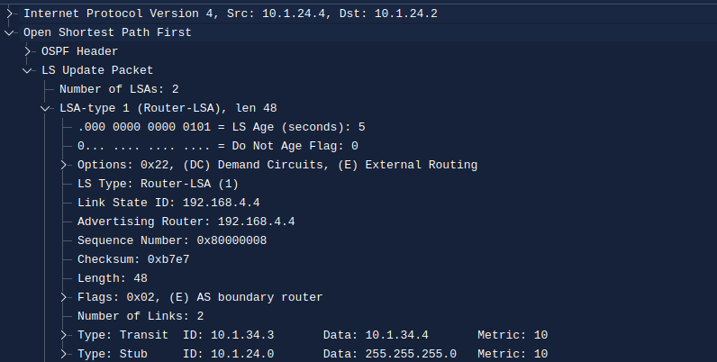

- Below is shown a sample topology to demonstrate the different LSA types

- In this topology:

    - R1, R2 and R3 are nembers (internal) routers

    - R4 and R5 are area border routers (ABRs)

    - R6 is the ASBR which is redistributing the 172.16.6.0/24 network into OSPF

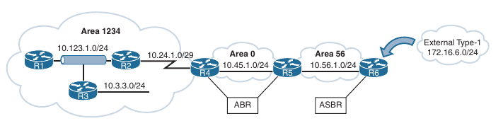

#### LSA Sequences

- OSPF uses the sequence number to overcome problems caused by delays in LSA propagation in a network

- The LSA sequence number is a 32-bit number used to control versioning

- When the originating router sends out LSAs, the LSA sequence number is incremented

- If a router receives an LSA sequence, that is greater than the one in the LSDB, it processes the LSA

- If the LSA sequence number is lower than the one in the LSDB, the router deems the LSA old and discards it

#### LSA Age and Flooding

- Every OSPF LSA includes an age that is entered into the local LSDB that increments by 1 every second

- When a router's OSPF LSA exceeds 1800 seconds (that is, 30 minutes), for it's prefixes, the originating router advertises a new LSA with the LSA age set to 0

- As each router forwards the LSA, the LSA age is incremented with a calculated delay that reflects the link (which is minimal)

- If the LSA age reaches 3600, the LSA is deemed invalid and is purged from the LSDB

- The repetitive flooding of LSAs is a secondary safety mechanism to ensure that all routers maintain a consistent LSDB within an area

#### LSA Types

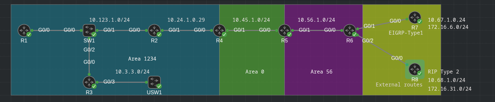

- All routers within an OSPF area have an identical set of LSAs for that area

- The ABRs maintain a separate set of LSAs for each OSPF area

- Most LSAs in one area are different from the LSAs in another area

- You can see generic router LSA output by using the command `show ip ospf database`

```
R1#show ip ospf database 

            OSPF Router with ID (192.168.1.1) (Process ID 1)

                Router Link States (Area 1234)

Link ID         ADV Router      Age         Seq#       Checksum Link count
192.168.1.1     192.168.1.1     1142        0x80000006 0x007456 2
192.168.2.2     192.168.2.2     856         0x80000007 0x0082EB 3
192.168.3.3     192.168.3.3     1142        0x80000005 0x00514B 3
192.168.4.4     192.168.4.4     856         0x80000002 0x00A9E3 2

                Net Link States (Area 1234)

Link ID         ADV Router      Age         Seq#       Checksum
10.123.1.2      192.168.2.2     1151        0x80000002 0x004FA7

                Summary Net Link States (Area 1234)

Link ID         ADV Router      Age         Seq#       Checksum
10.45.1.0       192.168.4.4     859         0x80000001 0x00A7EA
10.56.1.0       192.168.4.4     805         0x80000001 0x002D59
10.67.1.0       192.168.4.4     799         0x80000001 0x00B2C7
10.68.1.0       192.168.4.4     799         0x80000001 0x00A6D2
192.168.5.5     192.168.4.4     805         0x80000001 0x004214
192.168.6.6     192.168.4.4     799         0x80000001 0x00371C

                Summary ASB Link States (Area 1234)

Link ID         ADV Router      Age         Seq#       Checksum
192.168.6.6     192.168.4.4     799         0x80000001 0x001F34

                Type-5 AS External Link States

Link ID         ADV Router      Age         Seq#       Checksum Tag
172.16.6.0      192.168.6.6     795         0x80000001 0x006AD8 0
172.16.31.0     192.168.6.6     796         0x80000001 0x00D53B 0
```

##### LSA Type 1: Router Link

- Every OSPF router advertises a Type 1 LSA (Router LSA)

- Type 1 LSAs are the essential building blocks in the LSDB

- A Type 1 OSPF LSA entry exists for each OSPF-enabled link (that is an interface and it's attached networks)

- Below is shown that the Type 1 LSAs are not advertised outside Area 1234, thus making the underlying topology in an area invisible to other areas

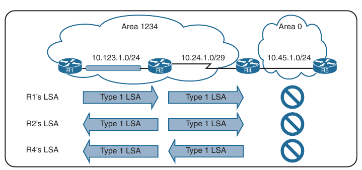

- For a summary view of Type 1 LSAs for an area, look under Router Link States column within the LSDB (output from above)

```
R1#show ip ospf database        

            OSPF Router with ID (192.168.1.1) (Process ID 1)

                Router Link States (Area 1234)

Link ID         ADV Router      Age         Seq#       Checksum Link count
192.168.1.1     192.168.1.1     835         0x80000007 0x007257 2
192.168.2.2     192.168.2.2     603         0x80000008 0x0080EC 3
192.168.3.3     192.168.3.3     830         0x80000006 0x004F4C 3
192.168.4.4     192.168.4.4     478         0x80000003 0x00A7E4 2
```

- Below is an overview of the fields in the LSDB output

```
Field                           Description

Link ID                         Identifies the object that the link connects to. It can refer to the neighboring router's RID, the IP address
                                of the DRs interface, or the IP network address

ADV Router                      The OSPF Router ID for this LSA

Age                             The age of the LSA on the router on which the command is being run. Values over 1800 are expected to refresh soon

Seq #                           The sequence number for the LSA to protect out-of-order LSAs

Checksum                        The checksum of the LSA to verify integrity during flooding

Link count                      The number of links on this router in the Type 1 LSA
```

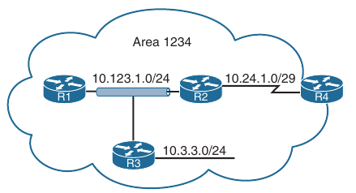

- You can examine the Type 1 OSPF LSAs by using the command `show ip ospf database router` as shown below

- Notice in the output that entries exist for all four routers in an area

```
R1#show ip ospf database router 

            OSPF Router with ID (192.168.1.1) (Process ID 1)

                Router Link States (Area 1234)

  LS age: 332
  Options: (No TOS-capability, DC)
  LS Type: Router Links
  Link State ID: 192.168.1.1
  Advertising Router: 192.168.1.1
  LS Seq Number: 80000008
  Checksum: 0x7058
  Length: 48
  Number of Links: 2

    Link connected to: a Stub Network
     (Link ID) Network/subnet number: 192.168.1.1
     (Link Data) Network Mask: 255.255.255.255
      Number of MTID metrics: 0
       TOS 0 Metrics: 1

    Link connected to: a Transit Network
     (Link ID) Designated Router address: 10.123.1.2
     (Link Data) Router Interface address: 10.123.1.1
      Number of MTID metrics: 0
       TOS 0 Metrics: 1


  LS age: 71
  Options: (No TOS-capability, DC)
  LS Type: Router Links
  Link State ID: 192.168.2.2
  Advertising Router: 192.168.2.2
  LS Seq Number: 80000009
  Checksum: 0x7EED
  Length: 60
  Number of Links: 3

    Link connected to: a Transit Network
     (Link ID) Designated Router address: 10.123.1.2
     (Link Data) Router Interface address: 10.123.1.2
      Number of MTID metrics: 0
       TOS 0 Metrics: 1

    Link connected to: another Router (point-to-point)
     (Link ID) Neighboring Router ID: 192.168.4.4
     (Link Data) Router Interface address: 10.24.1.2
      Number of MTID metrics: 0
       TOS 0 Metrics: 1

    Link connected to: a Stub Network
     (Link ID) Network/subnet number: 10.24.1.0
     (Link Data) Network Mask: 255.255.255.248
      Number of MTID metrics: 0
       TOS 0 Metrics: 1


  LS age: 315
  Options: (No TOS-capability, DC)
  LS Type: Router Links
  Link State ID: 192.168.3.3
  Advertising Router: 192.168.3.3
  LS Seq Number: 80000007
  Checksum: 0x4D4D
  Length: 60
  Number of Links: 3

    Link connected to: a Stub Network
     (Link ID) Network/subnet number: 192.168.3.3
     (Link Data) Network Mask: 255.255.255.255
      Number of MTID metrics: 0
       TOS 0 Metrics: 1

    Link connected to: a Stub Network
     (Link ID) Network/subnet number: 10.3.3.0
     (Link Data) Network Mask: 255.255.255.0
      Number of MTID metrics: 0
       TOS 0 Metrics: 1

    Link connected to: a Transit Network
     (Link ID) Designated Router address: 10.123.1.2
     (Link Data) Router Interface address: 10.123.1.3
      Number of MTID metrics: 0
       TOS 0 Metrics: 1


  LS age: 1977
  Options: (No TOS-capability, DC)
  LS Type: Router Links
  Link State ID: 192.168.4.4
  Advertising Router: 192.168.4.4
  LS Seq Number: 80000003
  Checksum: 0xA7E4
  Length: 48
  Area Border Router
  Number of Links: 2

    Link connected to: another Router (point-to-point)
     (Link ID) Neighboring Router ID: 192.168.2.2
     (Link Data) Router Interface address: 10.24.1.4
      Number of MTID metrics: 0
       TOS 0 Metrics: 1

    Link connected to: a Stub Network
     (Link ID) Network/subnet number: 10.24.1.0
     (Link Data) Network Mask: 255.255.255.248
      Number of MTID metrics: 0
       TOS 0 Metrics: 1
```

- The initial fields of each Type 1 LSA are the same as explained above

- If a router is functioning as an ABR, an ASBR or a virtual-link endpoint, the function is listed between the Length field and the Number of Links field

- In the output from above we can see that R4 (192.168.4.4) is an ABR

- Each OSPF-enabled interface is listed under the number of links for each router

- Each network link on a router contains the following information, in this order:

    - Link type that appears after "Link connected to:". The fields can be corelated with the table from below

    - Link ID, using the values based on the link type listed in the table below

    - Link Data, when applicable

    - Metric for the interface

- OSPF Neighbor states for Type 1 LSA

```
Description                 Link Type                   Link ID Value                       Link Data

Point-to-point (IP          1                           Neighbor RID                        Interface IP address
address assigned)

Point-to-point (IP          1                           Neighbor RID                        MIB II IfIndex value
unnumbered)

Link to transit network     2                           Interface address of DR             Interface IP address

Link to stub network        3                           Network address                     Subnet mask

Virtual link                4                           Neighbor RID                        Interface IP address
```

- During the SPF tree calculation, the network link type is one of the following:

    - **Transit**: A transit network indicates that an adjacency was formed and that a DR was elected on that link

    - **Point-to-point**: A point-to-point link indicates that an adjacency was formed on a network type that does not use a DR

    - Interfaces using point-to-point network type advertise two links: One link is the point-to-point link type that identifies the 
    OSPF neighbor RID for that segment, and the other link is a stub network link that provides the subnet mask for that network

    - **Stub**: A stub network indicates that no neighbor adjacencies were established on that link

    - Point-to-point and transit link types that did not become adjacent with another OSPF router are classified as a stub network link type

    - When an OSPF neighbor adjacency forms, the link type changes to the appropriate type: point-to-point or transit

- Secondary connected networks are always advertised as stub link types because OSPF adjacencies can never form on them

- If you correlate just the Type 1 LSAs from our reference topology, then we can see the topology built by all routers in Area 1234, using the LSA attributes for Area 1234 from all four routers

- Using only Type 1 LSAs, a connection is made between R2 and R4 because they point to each other's RID in the point-to-point LSA

- Notice that the three router links on R1, R2 and R3 (10.123.1.0) have not been directly connected yet

- Type 1 LSA view:

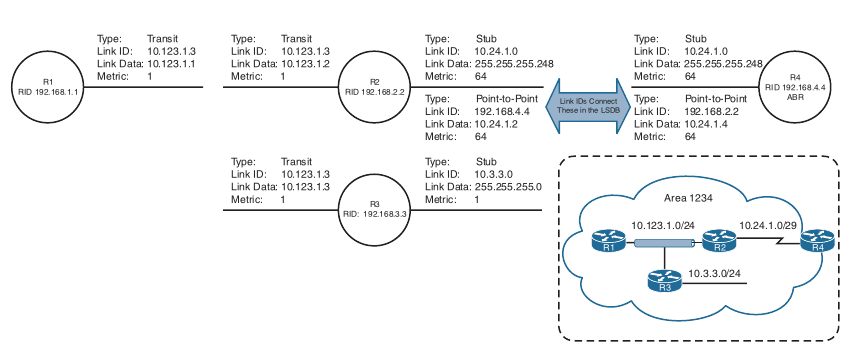

##### LSA Type 2: Network Link

- A Type 2 LSA (Network LSA) represents a multi-access network segment that uses a DR

- The DR always advertises the Type 2 LSA and identifies all the routers attached to that network segment

- If a DR has not been elected, a type 2 LSA is not present in the LSDB because the corresponding Type 1 transit link type LSA is a stub

- Type 2 LSAs are not flooded outside of the originating OSPF area in an identical fashion to Type 1 LSAs

- A brief summary view of the Type 2 LSAs is shown in the LSDB under Net Link States

- Below we can see the output for Type 2 LSAs in Area 1234 from our reference topology

```
R2#show ip ospf database        

            OSPF Router with ID (192.168.2.2) (Process ID 1)
(...)

                Net Link States (Area 1234)

Link ID         ADV Router      Age         Seq#       Checksum
10.123.1.3      192.168.3.3     88          0x80000002 0x0028CB

(...)
```

- Area 1234 has only one DR segment that connects R1, R2 and R3, because R3 has not formed an OSPF adjacency on the 10.3.3.0/24 network segment

- To see detailed Type 2 LSA information, you use the command `show ip ospf database network` 

- Below is shown the Type 2 LSA that is advertised by R3 and shows that the link state ID 10.123.1.3 attaches to R1, R2 and R3 (by listing their RIDs at the bottom)

- The network mask for the subnet is included in the Type 2 LSA

```
R1#show ip ospf database network 

            OSPF Router with ID (192.168.1.1) (Process ID 1)

                Net Link States (Area 1234)

  LS age: 346
  Options: (No TOS-capability, DC)
  LS Type: Network Links
  Link State ID: 10.123.1.3 (address of Designated Router)
  Advertising Router: 192.168.3.3
  LS Seq Number: 80000002
  Checksum: 0x28CB
  Length: 36
  Network Mask: /24
        Attached Router: 192.168.3.3
        Attached Router: 192.168.1.1
        Attached Router: 192.168.2.2

```

- Now that you have the Type 2 LSA for Area 1234, all the network links are connected

- Below we can see a visualization of the Type 1 and Type 2 LSAs; it corresponds with Area 1234 perfectly

- When the DR changes for the network segment, a new Type 2 LSA is created, causing SPF to run again within the OSPF area

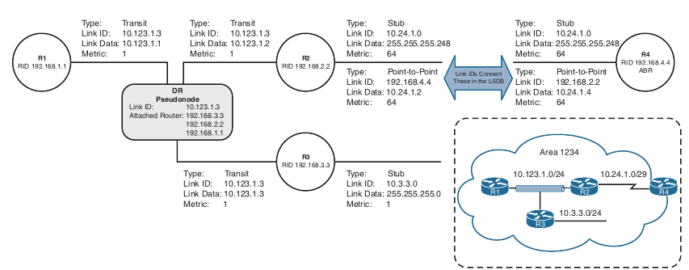

##### LSA Type 3: Summary Link

- Type 3 LSAs, (summary LSAs) represent networks from other areas

- The role of the ABRs is to participate in multiple OSPF areas and ensures that the networks associated with Type 1 LSAs are reachable in the nonoriginating OSPF areas

- As explained earlier, ABRs do not forward Type 1 or Type 2 LSAs into other areas

- When an ABR receives a Type 1 LSA, it creates a Type 3 LSA referencing the network in the original Type 1 LSA

- (The Type 2 LSA is used to determine the network mask of the multi-access network)

- The ABR then advertises the Type 3 LSA into other areas

- If an ABR receives a Type 3 LSA from Area 0 (backbone area), it regenerates a Type 3 LSA for the non-backbone area and lists itself as the advertising router with the additional cost metric

- Below we can see the Type 3 LSA interaction with Type 1 LSAs

- Notice that the Type 1 LSAs exist only in the area of origination and convert to Type 3 when they cross the ABRs (R4 and R5)

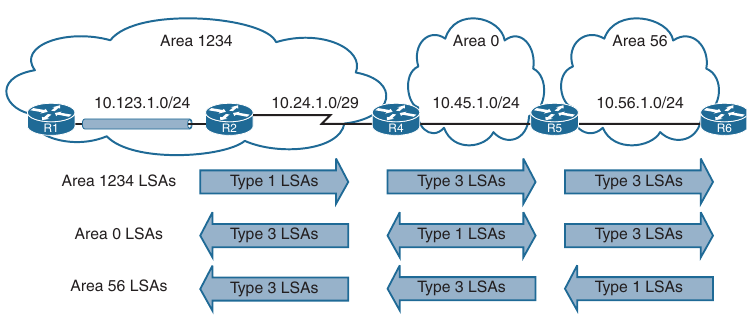

- For a summary view of the Type 3 LSAs, look under Summary Net Link States

- The Type 3 LSAs show up under the appropriate area where they exist in the OSPF domain

```
R2#show ip ospf database 

            OSPF Router with ID (192.168.2.2) (Process ID 1)

(...)

                Summary Net Link States (Area 1234)

Link ID         ADV Router      Age         Seq#       Checksum
10.45.1.0       192.168.4.4     1461        0x80000002 0x00A5EB
10.56.1.0       192.168.4.4     1461        0x80000002 0x002B5A
10.67.1.0       192.168.4.4     1461        0x80000002 0x00B0C8
10.68.1.0       192.168.4.4     1461        0x80000002 0x00A4D3
192.168.5.5     192.168.4.4     1461        0x80000002 0x004015
192.168.6.6     192.168.4.4     1461        0x80000002 0x00351D

(...)
```

- R4 - the ABR:

```
R4#show ip ospf database 

            OSPF Router with ID (192.168.4.4) (Process ID 1)

(...)
                Summary Net Link States (Area 0)

Link ID         ADV Router      Age         Seq#       Checksum
10.3.3.0        192.168.4.4     1443        0x80000002 0x009D1A
10.24.1.0       192.168.4.4     1443        0x80000002 0x007835
10.56.1.0       192.168.5.5     1494        0x80000002 0x001470
10.67.1.0       192.168.5.5     1494        0x80000002 0x0099DE
10.68.1.0       192.168.5.5     1494        0x80000002 0x008DE9
10.123.1.0      192.168.4.4     1443        0x80000002 0x00043E
192.168.1.1     192.168.4.4     1443        0x80000002 0x009EBD
192.168.3.3     192.168.4.4     1443        0x80000002 0x0074E3
192.168.5.5     192.168.5.5     1494        0x80000002 0x00292B
192.168.6.6     192.168.5.5     1494        0x80000002 0x001E33

(...)
                Summary Net Link States (Area 1234)

Link ID         ADV Router      Age         Seq#       Checksum
10.45.1.0       192.168.4.4     1443        0x80000002 0x00A5EB
10.56.1.0       192.168.4.4     1443        0x80000002 0x002B5A
10.67.1.0       192.168.4.4     1443        0x80000002 0x00B0C8
10.68.1.0       192.168.4.4     1443        0x80000002 0x00A4D3
192.168.5.5     192.168.4.4     1443        0x80000002 0x004015
192.168.6.6     192.168.4.4     1443        0x80000002 0x00351D

```

- For example, the 10.56.1.0 Type 3 LSA exists only in Area 0 and Area 1234 on R4

- R5 contains the 10.56.1.0 Type 3 LSA only for Area 0, but not for Area 56 because Area 56 has a Type 1 LSA

```
R5#show ip ospf database 

            OSPF Router with ID (192.168.5.5) (Process ID 1)

(...)
                Summary Net Link States (Area 0)

Link ID         ADV Router      Age         Seq#       Checksum
10.3.3.0        192.168.4.4     1873        0x80000002 0x009D1A
10.24.1.0       192.168.4.4     1873        0x80000002 0x007835
10.56.1.0       192.168.5.5     1922        0x80000002 0x001470
10.67.1.0       192.168.5.5     1922        0x80000002 0x0099DE
10.68.1.0       192.168.5.5     1922        0x80000002 0x008DE9
10.123.1.0      192.168.4.4     1873        0x80000002 0x00043E
192.168.1.1     192.168.4.4     1873        0x80000002 0x009EBD
192.168.3.3     192.168.4.4     1873        0x80000002 0x0074E3
192.168.5.5     192.168.5.5     1922        0x80000002 0x00292B
192.168.6.6     192.168.5.5     1922        0x80000002 0x001E33

(...)

                Router Link States (Area 56)

Link ID         ADV Router      Age         Seq#       Checksum Link count
192.168.5.5     192.168.5.5     1922        0x80000006 0x006CC3 2
192.168.6.6     192.168.6.6     1864        0x80000006 0x00B5B2 4

                Net Link States (Area 56)

Link ID         ADV Router      Age         Seq#       Checksum
10.56.1.6       192.168.6.6     1864        0x80000002 0x008B06

                Summary Net Link States (Area 56)

Link ID         ADV Router      Age         Seq#       Checksum
10.3.3.0        192.168.5.5     1922        0x80000002 0x009A1A
10.24.1.0       192.168.5.5     1922        0x80000002 0x007535
10.45.1.0       192.168.5.5     1922        0x80000002 0x0098F6
10.123.1.0      192.168.5.5     1922        0x80000002 0x00013E
192.168.1.1     192.168.5.5     1922        0x80000002 0x009BBD
192.168.3.3     192.168.5.5     1922        0x80000002 0x0071E3

(...)
```

- To see detailed Type 3 LSA information, you use the command `show ip ospf database summary`

- You can restrict the output to a specific LSA by adding the prefix at the end of the command

- The advertising router for Type 3 LSAs is the last ABR that advertises the prefix

- The metric in the Type 3 LSA uses the following logic:

    - If the Type 3 LSA is created from a Type 1 LSA, is the total path metric to reach the originating router in the Type 1 LSA

    - If the Type 3 LSA is created from a Type 3 LSA from Area 0, it is the total path metric to the ABR plus the metric in the original Type 3 LSA

- Below is shown the Type 3 LSA for Area 56 prefix 10.56.1.0 (10.56.1.0/24) from R4's LSDB

- R4 is an ABR, and the information is shown for both Area 1234 and Area 0

- Notice that the metric increases in Area 1234's LSA compared to in Area 0's LSA

```
R4#show ip ospf database summary 10.56.1.0 

            OSPF Router with ID (192.168.4.4) (Process ID 1)

                Summary Net Link States (Area 0)

  LS age: 608
  Options: (No TOS-capability, DC, Upward)
  LS Type: Summary Links(Network)
  Link State ID: 10.56.1.0 (summary Network Number)
  Advertising Router: 192.168.5.5
  LS Seq Number: 80000003
  Checksum: 0x1271
  Length: 28
  Network Mask: /24
        MTID: 0         Metric: 1 


                Summary Net Link States (Area 1234)

  LS age: 599
  Options: (No TOS-capability, DC, Upward)
  LS Type: Summary Links(Network)
  Link State ID: 10.56.1.0 (summary Network Number)
  Advertising Router: 192.168.4.4
  LS Seq Number: 80000003
  Checksum: 0x295B
  Length: 28
  Network Mask: /24
        MTID: 0         Metric: 2 

```

- Below is an explanation of the fields in a Type 3 LSA

```
Field                                   Description

Link ID                                 Network number

Advertising Router                      RID of the router advertising the route (ABR)

Network Mask                            Prefix length of the advertising network

Metric                                  Metric for the LSA
```

- Understanding the metric in Type 3 LSAs is an important concept

- Below we can see R4's perspective of the Type 3 LSA creared by ABR (R5) for the 10.56.1.0/24 network

- R4 does not know if the 10.56.1.0/24 network is directly attached to the ABR (R5) or if it is multiple hops away

- R4 knows that it's metric to reach the ABR (R5) is 1 and the Type 3 LSA already has a metric of 1, so it's total path metric to reach the 10.56.1.0/24 network is 2

```
R3(config)#do sh ip ospf dat summ 10.56.1.0

            OSPF Router with ID (192.168.3.3) (Process ID 1)

                Summary Net Link States (Area 1234)

  LS age: 56
  Options: (No TOS-capability, DC, Upward)
  LS Type: Summary Links(Network)
  Link State ID: 10.56.1.0 (summary Network Number)
  Advertising Router: 192.168.4.4
  LS Seq Number: 80000004
  Checksum: 0x275C
  Length: 28
  Network Mask: /24
        MTID: 0         Metric: 2 

R3(config)#do sh ip ro 10.56.1.0
Routing entry for 10.56.1.0/24
  Known via "ospf 1", distance 110, metric 67, type inter area
  Last update from 10.123.1.2 on GigabitEthernet0/0, 00:00:34 ago
  Routing Descriptor Blocks:
  * 10.123.1.2, from 192.168.4.4, 00:00:34 ago, via GigabitEthernet0/0
      Route metric is 67, traffic share count is 1
```

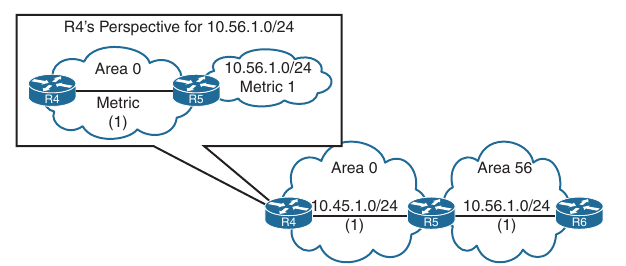

- Below we can see R3's perspective of the Type 3 LSA created by the ABR (R4) for the 10.56.1.0/24 network

- R3 does not know if the 10.56.1.0/24 is directly attached to the ABR (R4) or if it is multiple hops away

- R3 knows that it's metric to the ABR (R4) is 65 and that the Type 3 LSA already has a metric of 2, so the total path metric is 67 to reach the 10.56.1.0/24 network

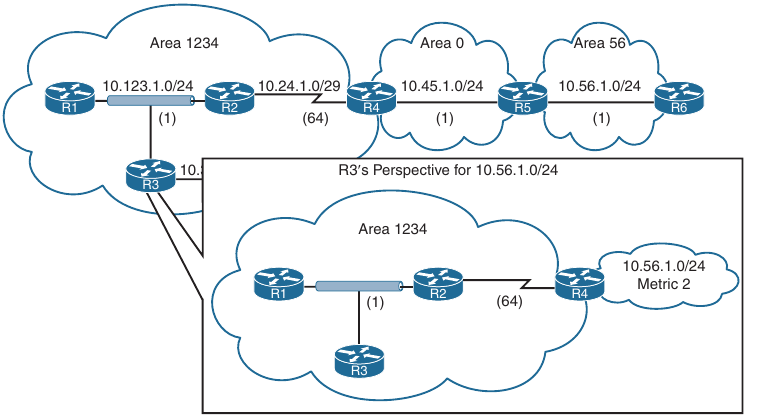

- **IMPORTANT**: The ABR advertises only **ONE** Type 3 LSA for a prefix, even if it's aware of multiple paths from within it's area (Type 1 LSAs) or from outside it's area (Type 3 LSAs). The metric for the best path is used when the LSA is advertised into a different area

##### LSA Type 5: External Routes

- When a route is redistributed into OSPF, the router is known as an *autonomous system boundary router* (ASBR)

- The external route is flooded throughout the entire OSPF domain as a Type 5 LSA (external LSAs)

- Type 5 LSAs are not associated with a specific area and are flooded throughout the OSPF domain

- Only the LSA age is modified during flooding for Type 2 external OSPF routes

- Below we can see R6 redistributing the 172.16.6.0/24 route within the OSPF domain

- Notice that Type 5 LSA exists in all OSPF areas of the routing domain

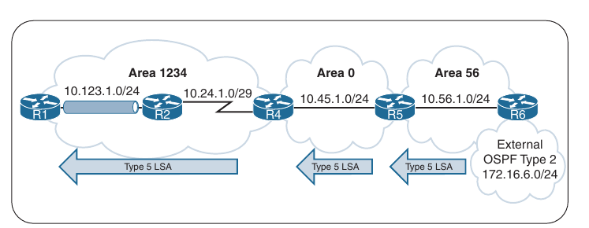

- Below is provided a brief summary view of the Type 5 LSAs under Type-5 AS External

- The link ID is the external network number, and the advertising router is the RID for the router originating the Type 5 LSA

- Notice that Type 5 LSA is not associated with a specific OSPF area

- This is because Type 5 LSAs are flooded throughout the OSPF routing domain by default

```
R4#show ip ospf database
(...)
                Type-5 AS External Link States

Link ID         ADV Router      Age         Seq#       Checksum Tag
172.16.6.0      192.168.6.6     594         0x80000001 0x006AD8 0
```

- You can see Type 5 LSAs in detail by using the `show ip ospf database external` command

- ABRs only modify the LSA age as the Type 5 LSA propagates through the OSPF domain

- Below you can see the detailed output for the OSPF external LSAs in the routing domain

- Notice that only the LS age is modified between the routers

```
R6#show ip ospf database external 

            OSPF Router with ID (192.168.6.6) (Process ID 1)

                Type-5 AS External Link States

  LS age: 16
  Options: (No TOS-capability, DC, Upward)
  LS Type: AS External Link
  Link State ID: 172.16.6.0 (External Network Number )
  Advertising Router: 192.168.6.6
  LS Seq Number: 80000001
  Checksum: 0xCA48
  Length: 36
  Network Mask: /24
        Metric Type: 2 (Larger than any link state path)
        MTID: 0 
        Metric: 20 
        Forward Address: 10.67.1.7
        External Route Tag: 0

```

```
R1#show ip ospf database external 

            OSPF Router with ID (192.168.1.1) (Process ID 1)

                Type-5 AS External Link States

  LS age: 225
  Options: (No TOS-capability, DC, Upward)
  LS Type: AS External Link
  Link State ID: 172.16.6.0 (External Network Number )
  Advertising Router: 192.168.6.6
  LS Seq Number: 80000001
  Checksum: 0xCA48
  Length: 36
  Network Mask: /24
        Metric Type: 2 (Larger than any link state path)
        MTID: 0 
        Metric: 20 
        Forward Address: 10.67.1.7
        External Route Tag: 0

```

- Below we can see an explanation of the fields in a Type 5 LSA 

```
Field                                               Description

Link ID                                             External network number

Network Mask                                        Subnet mask for the external network

Advertising Router                                  RID of the router advertising the route (ASBR)

Metric Type                                         OSPF external metric type (Type 1 O E1 or Type 2 O E2)

Metric                                              Metric upon redistribution

External Route Tag                                  32-bit field included with an external route, which is not used by OSPF under
                                                    normal operation but can be used to communicate AS boundaries or other relevant information
                                                    to prevent routing loops
```

##### LSA Type 4: ASBR Summary

- A Type 4 LSA (ASBR summary LSA) locates the ASBR for a Type 5 LSA

- A Type 5 LSA is flooded through the OSPF domain, and the only mechanism to identify the ASBR is the RID

- Routers examine the Type 5 LSA, check whether the RID is in the local area, and if the ASBR is not local, they require a mechanism to locate the ASBR

- Remember that the RID does not have to match an IP address on any OSPF router (including ASBRs)

- Only Type 1 or Type 2 LSAs provide a method to locate the RID within an area

- Type 4 LSAs provide a way for routers to locate the ASBR when the router is in a different area from the ASBR

- A Type 4 LSA is created by the first ABR, and it provides a summary route strictly for the ASBR of a Type 5 LSA

- The metric for the Type 4 LSA uses the following logic:

    - When the Type 5 LSA crosses the first ABR, the ABR creates a Type 4 LSA with a metric set to the total path metric to the ASBR

    - When an ABR receives a Type 4 LSA from Area 0, the ABR creates a new Type 4 LSA with a metric set to the total path metric of the first ABR plus the metric of the original Type 4 LSA

- Below is shown how the ABRs (R4 and R5) create Type 4 LSAs for the ASBR (R6)

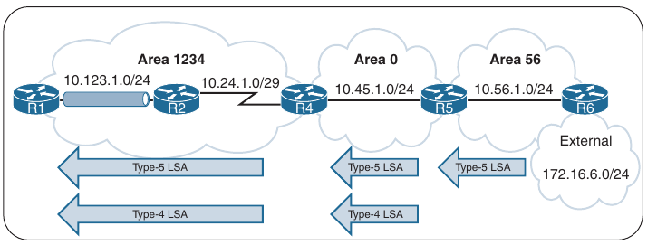

- Below is a brief summary view of the Type 4 LSAs for R4 under "Summary ASB Link States"

- Notice how the advertising router changes as the LSA crosses from ABR to ABR

```
R4#show ip ospf database 

(...)
                Summary ASB Link States (Area 0)

Link ID         ADV Router      Age         Seq#       Checksum
192.168.6.6     192.168.5.5     861         0x80000002 0x00064B

(...)
                Summary ASB Link States (Area 1234)

Link ID         ADV Router      Age         Seq#       Checksum
192.168.6.6     192.168.4.4     919         0x80000002 0x001D35
```

- To view the details of the Type 4 LSAs, you use the command `show ip ospf database asbr-summary`

- Below is provided the detailed output of the Type 4 LSA on R4

```
R4#show ip ospf database asbr-summary 

            OSPF Router with ID (192.168.4.4) (Process ID 1)

                Summary ASB Link States (Area 0)

  LS age: 1065
  Options: (No TOS-capability, DC, Upward)
  LS Type: Summary Links(AS Boundary Router)
  Link State ID: 192.168.6.6 (AS Boundary Router address)
  Advertising Router: 192.168.5.5
  LS Seq Number: 80000002
  Checksum: 0x64B
  Length: 28
  Network Mask: /0
        MTID: 0         Metric: 1 


                Summary ASB Link States (Area 1234)

  LS age: 1123
  Options: (No TOS-capability, DC, Upward)
  LS Type: Summary Links(AS Boundary Router)
  Link State ID: 192.168.6.6 (AS Boundary Router address)
  Advertising Router: 192.168.4.4
  LS Seq Number: 80000002
  Checksum: 0x1D35
  Length: 28
  Network Mask: /0
        MTID: 0         Metric: 2 

```

- Notice that the metric and advertising router change between the OSPF areas

- An ABR advertises only one Type 4 LSA for every ASBR, even if the ASBR advertises thousands of Type 5 LSAs

##### LSA Type 7: NSSA External Summary

- Later we will be using not-so-stubby areas (NSSAs) to reduce the LSDB in an area

- A Type 7 LSA (NSSA external LSA) exists only in NSSAs where route redistribution is occuring

- An ASBR injects external routes as Type 7 LSAs in an NSSA

- The ABR does not advertise the Type 7 LSAs outside the originating NSSA, but it converts the Type 7 LSA into a Type 5 LSA for the other OSPF areas

- If the Type 5 LSA crosses Area 0, the second ABR creates a Type 4 LSA for the Type 5 LSA

- Below is shown Area 56 as a NSSA and R6 redistributing the 172.16.6.0/24 prefix

- The Type 7 LSA exists only for Area 56

- R5 injects the Type 5 LSA in Area 0, which propagates to Area 1234, and R4 creates the Type 4 LSA for Area 1234

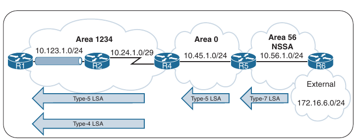

- Below is provided a brief view of the Type 7 LSAs, under Type 7 AS External Link States

- Type 7 LSAs are present only in the OSPF NSSA area where redistribution is occuring

- Notice that the Type 7 LSA is not present on R4; R4 contains a Type 5 LSA that was created by R5 and the Type 4 LSA (created by R4 for Area 1234)

- R5:

```
R5#show ip ospf database 

            OSPF Router with ID (192.168.5.5) (Process ID 1)
(...)
                Type-7 AS External Link States (Area 56)

Link ID         ADV Router      Age         Seq#       Checksum Tag
172.16.6.0      192.168.6.6     431         0x80000001 0x0036D2 0

                Type-5 AS External Link States

Link ID         ADV Router      Age         Seq#       Checksum Tag
172.16.6.0      192.168.5.5     423         0x80000001 0x00D73D 0
```

- R4:

```
R4#show ip ospf database 

            OSPF Router with ID (192.168.4.4) (Process ID 1)
(...)
                Summary ASB Link States (Area 1234)

Link ID         ADV Router      Age         Seq#       Checksum
192.168.5.5     192.168.4.4     518         0x80000001 0x002A2C

                Type-5 AS External Link States

Link ID         ADV Router      Age         Seq#       Checksum Tag
172.16.6.0      192.168.5.5     494         0x80000001 0x00D73D 0
```

- To see the specific Type 7 LSA details, you use the command `show ip ospf database nssa-external`

- Below we can see this command on R5:

```
R5#show ip ospf database nssa-external 

            OSPF Router with ID (192.168.5.5) (Process ID 1)

                Type-7 AS External Link States (Area 56)

  LS age: 652
  Options: (No TOS-capability, Type 7/5 translation, DC, Upward)
  LS Type: AS External Link
  Link State ID: 172.16.6.0 (External Network Number )
  Advertising Router: 192.168.6.6
  LS Seq Number: 80000001
  Checksum: 0x36D2
  Length: 36
  Network Mask: /24
        Metric Type: 2 (Larger than any link state path)
        MTID: 0 
        Metric: 20 
        Forward Address: 10.67.1.7
        External Route Tag: 0

```

- Below is provided a explanation of the fields in the Type 7 LSA

```
Field                                           Description

Link ID                                         External network number

Network Mask                                    Subnet mask for the external network

Advertising Router                              RID of the router advertising the the route (ASBR)

Metric Type                                     Type 1 (O N1 or Type 2 O N2)

Metric                                          Metric upon redistribution

External Route Tag                              32-bit field that is included with an external route, which is not used by OSPF itself and
                                                can be used to communicate AS boundaries or other relevant information to prevent routing loops
```

##### LSA Type Summary

- OSPF LSA types are important when troubleshooting a router's behavior for a specific prefix

- Below is a summary of the OSPF LSA types covered:

```
LSA Type                                        Description

1                                               Router Link

2                                               Network Link

3                                               Summary Link

4                                               ASBR Summary

5                                               AS external

7                                               NSSA External
```

- Below are shown the network prefixes from our sample topology and the relevant LSAs that are present

- Notice that Type 2 LSAs are present only on the broadcast network segments that have established adjacencies with other routers (10.123.1.0/24, 10.45.1.0/24 and 10.56.1.0/24); they are not advertised outside their local area

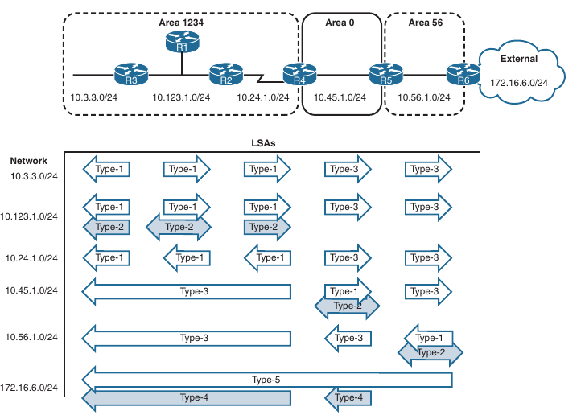

### OSPF Stubby Areas

- OSPF Stubby Areas provide a method to filter out external routes and the option to block inter-area routes

- OSPF stubby areas are identified by the Area flag in the OSPF hello packet

- Every router within an OSPF stubby area needs to be configured as a stub so that the routers can establish/maintain OSPF adjacencies

- There are the following types of OSPF stubby areas:

    - Stub Areas

    - Totally stubby areas

    - Not-so-stubby Areas (NSSAs)
    
    - Totally NSSAs

- Totally stubby areas and totally NSSAs are not defined in RFC 2328 but are compliant and commonly implemented by Cisco and other network vendors

#### Stub Areas

- OSPF stub areas prohibit Type 5 LSAs (external routes) and Type 4 LSAs (ASBR summary LSAs) from entering the area at the ABR

- RFC 2328 states that when a Type 5 LSA reaches the ABR of a stub area, the ABR generates a default route for the stub via a Type 3 LSA

- A Cisco ABR generates a default route when the area is configured as a stub and has an OSPF-enabled interface configured for Area 0

- Below we can see the concept

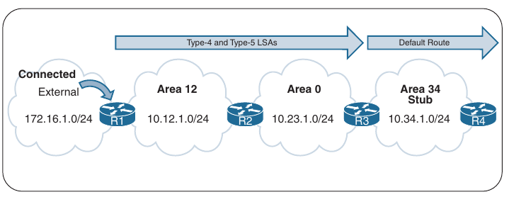

- Below are shown the routing table for R3 and R4 before Area 34 is configured as a stub area

- Notice that the external 172.16.1.0/24 route that R1 has redistributed into the routing table and that is visible on R3 and R4

- R3:

```
R3#show ip route ospf | b Gate
Gateway of last resort is not set

      10.0.0.0/8 is variably subnetted, 5 subnets, 2 masks
O IA     10.1.12.0/24 [110/2] via 10.1.23.2, 00:02:15, GigabitEthernet1
      172.16.0.0/24 is subnetted, 1 subnets
O E2     172.16.1.0 [110/20] via 10.1.23.2, 00:02:15, GigabitEthernet1
      192.168.1.0/32 is subnetted, 1 subnets
O IA     192.168.1.1 [110/3] via 10.1.23.2, 00:02:15, GigabitEthernet1
      192.168.2.0/32 is subnetted, 1 subnets
O IA     192.168.2.2 [110/2] via 10.1.23.2, 00:02:15, GigabitEthernet1
      192.168.4.0/32 is subnetted, 1 subnets
O        192.168.4.4 [110/2] via 10.1.34.4, 00:01:49, GigabitEthernet2
```

- R4:

```
R4#show ip route ospf | b Gate
Gateway of last resort is not set

      10.0.0.0/8 is variably subnetted, 4 subnets, 2 masks
O IA     10.1.12.0/24 [110/3] via 10.1.34.3, 00:02:19, GigabitEthernet1
O IA     10.1.23.0/24 [110/2] via 10.1.34.3, 00:02:19, GigabitEthernet1
      172.16.0.0/24 is subnetted, 1 subnets
O E2     172.16.1.0 [110/20] via 10.1.34.3, 00:02:19, GigabitEthernet1
      192.168.1.0/32 is subnetted, 1 subnets
O IA     192.168.1.1 [110/4] via 10.1.34.3, 00:02:19, GigabitEthernet1
      192.168.2.0/32 is subnetted, 1 subnets
O IA     192.168.2.2 [110/3] via 10.1.34.3, 00:02:19, GigabitEthernet1
      192.168.3.0/32 is subnetted, 1 subnets
O IA     192.168.3.3 [110/2] via 10.1.34.3, 00:02:19, GigabitEthernet1
```

- All routers in the stub area must be configured as stubs, or an adjacency cannot form because the area type flags in the OSPF hello packets do not match

- An area is configured as a stub with the OSPF process command `area <area-id> stub`

- Configuring area 34 as stub on R3 and R4:

- R3:

```
conf t
 router ospf 1
  area 34 stub
```

- R4:

```
conf t
 router ospf 1
  area 34 stub
```

- Below is shown the routing table for R3 and R4 after Area 34 is made an OSPF stub area

- The routing table from R3's perspective is not modified as it receives the Type 4 and Type 5 LSAs from Area 0

- When the Type 5 LSA (172.16.1.0/24) reaches the ABR (R3), the ABR generates a default route a default route by using a Type 3 LSA

- While R4 does not see the route to the 172.16.1.0/24 in it's routing table, it has connectivity to that network through the default route

- Notice that inter-area routes are allowed in Area 34

```
R3#sh ip ro ospf | b Gate
Gateway of last resort is not set

      10.0.0.0/8 is variably subnetted, 5 subnets, 2 masks
O IA     10.1.12.0/24 [110/2] via 10.1.23.2, 00:07:40, GigabitEthernet1
      172.16.0.0/24 is subnetted, 1 subnets
O E2     172.16.1.0 [110/20] via 10.1.23.2, 00:07:40, GigabitEthernet1
      192.168.1.0/32 is subnetted, 1 subnets
O IA     192.168.1.1 [110/3] via 10.1.23.2, 00:07:40, GigabitEthernet1
      192.168.2.0/32 is subnetted, 1 subnets
O IA     192.168.2.2 [110/2] via 10.1.23.2, 00:07:40, GigabitEthernet1
      192.168.4.0/32 is subnetted, 1 subnets
O        192.168.4.4 [110/2] via 10.1.34.4, 00:07:16, GigabitEthernet2
```

```
R4#show ip route ospf | b Gate
Gateway of last resort is 10.1.34.3 to network 0.0.0.0

O*IA  0.0.0.0/0 [110/2] via 10.1.34.3, 00:07:46, GigabitEthernet1
      10.0.0.0/8 is variably subnetted, 4 subnets, 2 masks
O IA     10.1.12.0/24 [110/3] via 10.1.34.3, 00:07:46, GigabitEthernet1
O IA     10.1.23.0/24 [110/2] via 10.1.34.3, 00:07:46, GigabitEthernet1
      192.168.1.0/32 is subnetted, 1 subnets
O IA     192.168.1.1 [110/4] via 10.1.34.3, 00:07:46, GigabitEthernet1
      192.168.2.0/32 is subnetted, 1 subnets
O IA     192.168.2.2 [110/3] via 10.1.34.3, 00:07:46, GigabitEthernet1
      192.168.3.0/32 is subnetted, 1 subnets
O IA     192.168.3.3 [110/2] via 10.1.34.3, 00:07:46, GigabitEthernet1
```

- Default routes are Type 3 LSAs (inter-area summaries) because stub areas do not allow Type 5 LSAs within them

- A benefit of using a Type 3 LSA is that it cannot be advertised from a nonbackbone area into a backbone area

- The concept is explained later

#### Totally Stubby Areas

- An OSPF totally stubby area prohibits Type 3 LSAs (inter-area), Type 4 LSAs (ASBR external LSAs), and Type 5 LSAs (external routes) from entering the area at the ABR

- When an ABR of a totally stubby area receives a Type 3 or Type 5 LSA, the ABR generates a default route for the totally stubby area

- In fact, the ABR for a totally stubby area advertises the default route into the totally stubby area the instant an interface is assigned to Area 0

- Assigning the interface acts as the trigger for the Type 3 LSA that leads to the generation of the default route

- Only intra-area and default routes should exist within a totally stubby area

- Below we can see the totally stubby area concept

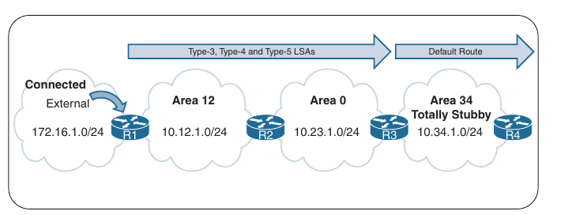

- Below we can see the routing table of R3 and R4 before area 34 is converted to a totally stubby area

- R3:

```
R3(config-router)#do sh ip ro ospf | b Gate
Gateway of last resort is not set

      10.0.0.0/8 is variably subnetted, 5 subnets, 2 masks
O IA     10.1.12.0/24 [110/2] via 10.1.23.2, 00:00:39, GigabitEthernet1
      172.16.0.0/24 is subnetted, 1 subnets
O E2     172.16.1.0 [110/20] via 10.1.23.2, 00:00:39, GigabitEthernet1
      192.168.1.0/32 is subnetted, 1 subnets
O IA     192.168.1.1 [110/3] via 10.1.23.2, 00:00:39, GigabitEthernet1
      192.168.2.0/32 is subnetted, 1 subnets
O IA     192.168.2.2 [110/2] via 10.1.23.2, 00:00:39, GigabitEthernet1
      192.168.4.0/32 is subnetted, 1 subnets
O        192.168.4.4 [110/2] via 10.1.34.4, 00:00:27, GigabitEthernet2
```

- R4:

```
R4(config-router)#do sh ip ro ospf | b Gatew 
Gateway of last resort is not set

      10.0.0.0/8 is variably subnetted, 4 subnets, 2 masks
O IA     10.1.12.0/24 [110/3] via 10.1.34.3, 00:01:00, GigabitEthernet1
O IA     10.1.23.0/24 [110/2] via 10.1.34.3, 00:01:00, GigabitEthernet1
      172.16.0.0/24 is subnetted, 1 subnets
O E2     172.16.1.0 [110/20] via 10.1.34.3, 00:01:00, GigabitEthernet1
      192.168.1.0/32 is subnetted, 1 subnets
O IA     192.168.1.1 [110/4] via 10.1.34.3, 00:01:00, GigabitEthernet1
      192.168.2.0/32 is subnetted, 1 subnets
O IA     192.168.2.2 [110/3] via 10.1.34.3, 00:01:00, GigabitEthernet1
      192.168.3.0/32 is subnetted, 1 subnets
O IA     192.168.3.3 [110/2] via 10.1.34.3, 00:01:00, GigabitEthernet1
```

- Member routers, (no ABRs) of a totally stubby area are configured the same as those in a stub area

- ABRs of a totally stubby area have `no-summary` appended to the configuration

- The command `area <area-id> stub no-summary` is configured under the OSPF process

- The keyword `no-summary` does exactly what it states: It blocks all Type 3 (summary) LSAs going into the stub area, making it a totally stubby area

- Below is shown the configuration for R3 and R4 to make area 34 a totally stubby area for both routers

- R3:

```
conf t
 router ospf 1
  area 34 stub no-summary
```

- R4:

```
conf t
 router ospf 1
  area 34 stub
```

- Below is shown the routing tables for R3 and R4 after Area 34 is converted to a totally stubby area

- Notice that only the default route exists on R4

- R3's loopback is a member of Area 0, but if it were a member of Area 34, it would appear as an intra-area route

- The routing table on R3 has not been impacted at all

- R3:

```
R3(config-router)#do sh ip ro ospf | b Gate
Gateway of last resort is not set

      10.0.0.0/8 is variably subnetted, 5 subnets, 2 masks
O IA     10.1.12.0/24 [110/2] via 10.1.23.2, 00:04:14, GigabitEthernet1
      172.16.0.0/24 is subnetted, 1 subnets
O E2     172.16.1.0 [110/20] via 10.1.23.2, 00:04:14, GigabitEthernet1
      192.168.1.0/32 is subnetted, 1 subnets
O IA     192.168.1.1 [110/3] via 10.1.23.2, 00:04:14, GigabitEthernet1
      192.168.2.0/32 is subnetted, 1 subnets
O IA     192.168.2.2 [110/2] via 10.1.23.2, 00:04:14, GigabitEthernet1
      192.168.4.0/32 is subnetted, 1 subnets
O        192.168.4.4 [110/2] via 10.1.34.4, 00:04:01, GigabitEthernet2
```

- R4:

```
R4(config-router)#do sh ip ro ospf | b Gate
Gateway of last resort is 10.1.34.3 to network 0.0.0.0

O*IA  0.0.0.0/0 [110/2] via 10.1.34.3, 00:04:46, GigabitEthernet1
```

#### Not-So-Stubby Areas

- An OSPF stub area prohibits Type 5 LSAs (external routes) and Type 4 LSAs (ASBR summary LSAs) from entering the area at the ABR, and it prohibits redistribution of external routes into the stub area too

- An OSPF not-so-stubby area (NSSA) prohibits Type 5 LSAs from entering at the ABR but allows for redistribution of external routes into the NSSA

- As the ASBR redistributes the routes into OSPF in the NSSA, the ASBR advertises the route with a Type 7 LSA instead of a Type 5 LSA

- When the Type 7 LSA reaches the ABR, the ABR converts the Type 7 LSA to a Type 5 LSA

- The ABR does not automatically advertise a default route when a Type 5 or Type 7 LSA is blocked

- During configuration, an option exists to advertise a default route to provide connectivity to the blocked LSAs; in addition, other techniques can be used to ensure bidirectional connectivity

- Below is demonstrated the concept of LSAs being processed on the ABR for the NSSA

- Notice that the default route is optional and depends on the configuration

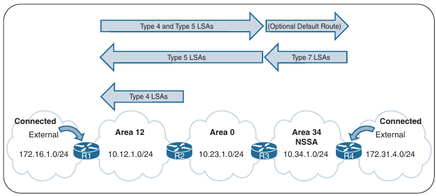

- Below are shown the routing tables of R1, R3 and R4 before Area 34 is converted into an NSSA

- Notice that R1 and R4 have received external routes from each other

- R1:

```
R1#show ip route 172.31.4.0 255.255.255.0 
Routing entry for 172.31.4.0/24
  Known via "ospf 1", distance 110, metric 20, type extern 2, forward metric 3
  Last update from 10.1.12.2 on GigabitEthernet1, 00:03:44 ago
  Routing Descriptor Blocks:
  * 10.1.12.2, from 192.168.4.4, 00:03:44 ago, via GigabitEthernet1
      Route metric is 20, traffic share count is 1

R1#show ip route ospf | s 172.31
      172.31.0.0/24 is subnetted, 1 subnets
O E2     172.31.4.0 [110/20] via 10.1.12.2, 00:04:24, GigabitEthernet1

```

- R3:

```
R3(config-router)#do sh ip ro ospf | b Gate
Gateway of last resort is not set

      10.0.0.0/8 is variably subnetted, 5 subnets, 2 masks
O IA     10.1.12.0/24 [110/2] via 10.1.23.2, 00:08:00, GigabitEthernet1
      172.16.0.0/24 is subnetted, 1 subnets
O E1     172.16.1.0 [110/22] via 10.1.23.2, 00:00:06, GigabitEthernet1
      172.31.0.0/24 is subnetted, 1 subnets
O E2     172.31.4.0 [110/20] via 10.1.34.4, 00:07:50, GigabitEthernet2
      192.168.1.0/32 is subnetted, 1 subnets
O IA     192.168.1.1 [110/3] via 10.1.23.2, 00:08:00, GigabitEthernet1
      192.168.2.0/32 is subnetted, 1 subnets
O IA     192.168.2.2 [110/2] via 10.1.23.2, 00:08:00, GigabitEthernet1
      192.168.4.0/32 is subnetted, 1 subnets
O        192.168.4.4 [110/2] via 10.1.34.4, 00:07:50, GigabitEthernet2
```

- R4:

```
R4(config-router)#do sh ip ro ospf | b Gate
Gateway of last resort is not set

      10.0.0.0/8 is variably subnetted, 4 subnets, 2 masks
O IA     10.1.12.0/24 [110/3] via 10.1.34.3, 00:08:25, GigabitEthernet1
O IA     10.1.23.0/24 [110/2] via 10.1.34.3, 00:08:25, GigabitEthernet1
      172.16.0.0/24 is subnetted, 1 subnets
O E1     172.16.1.0 [110/23] via 10.1.34.3, 00:00:41, GigabitEthernet1
      192.168.1.0/32 is subnetted, 1 subnets
O IA     192.168.1.1 [110/4] via 10.1.34.3, 00:08:25, GigabitEthernet1
      192.168.2.0/32 is subnetted, 1 subnets
O IA     192.168.2.2 [110/3] via 10.1.34.3, 00:08:25, GigabitEthernet1
      192.168.3.0/32 is subnetted, 1 subnets
O IA     192.168.3.3 [110/2] via 10.1.34.3, 00:08:25, GigabitEthernet1
```

- The command `area <area-id> nssa [default-information-originate]` is placed under the OSPF process on the ABR

- All routers in an NSSA must be configured with the `nssa` option, or they do not become adjacent because the area type flags must match in the OSPF hello protocol in order to become adjacent

- A default route is not injected into the ABRs automatically for NSSAs, but the optional command `default-information-originate` can be appended to the configuration if a default route is needed in the NSSA

- Below is shown the OSPF configuration of R3 and R4 after making area 34 an NSSA

- R3 is configured with the optional `default-information-originate` keyword to inject the default route into Area 34

- Notice that R4 is allowed to redistribute networks into the NSSA

- R3:

```
R3(config-router)#do sh run | s router ospf
router ospf 1
 router-id 192.168.3.3
 area 34 nssa default-information-originate
```

- R4:

```
R4(config-router)#do sh run | s router ospf
router ospf 1
 router-id 192.168.4.4
 area 34 nssa
 redistribute connected metric-type 1 subnets
```

- Below is shown the routing tables of R3 and R4 after converting Area 34 to an NSSA

- On R3, the previous external route from R1 still exists as an OSPF External Type 1 (O E1) route, and R4's external route is now an OSPF External NSSA Type 1 (O N1) route

- On R4, R1's external route is no longer present

- R3 is configured to advertise a default route, which appears as an OSPF external NSSA Type 2 (O N2) route

- The OSPF external routes are representative of a Type 7 LSA, which exists only in an NSSA

- R3:

```
R3#show ip route ospf | b Gate
Gateway of last resort is not set

      10.0.0.0/8 is variably subnetted, 5 subnets, 2 masks
O IA     10.1.12.0/24 [110/2] via 10.1.23.2, 00:23:43, GigabitEthernet1
      172.16.0.0/24 is subnetted, 1 subnets
O E1     172.16.1.0 [110/22] via 10.1.23.2, 00:23:43, GigabitEthernet1
      172.31.0.0/24 is subnetted, 1 subnets
O N1     172.31.4.0 [110/22] via 10.1.34.4, 00:21:56, GigabitEthernet2
      192.168.1.0/32 is subnetted, 1 subnets
O IA     192.168.1.1 [110/3] via 10.1.23.2, 00:23:43, GigabitEthernet1
      192.168.2.0/32 is subnetted, 1 subnets
O IA     192.168.2.2 [110/2] via 10.1.23.2, 00:23:43, GigabitEthernet1
      192.168.4.0/32 is subnetted, 1 subnets
O        192.168.4.4 [110/2] via 10.1.34.4, 00:23:27, GigabitEthernet2

```

- R4:

```
R4#show ip route ospf | b Gate
Gateway of last resort is 10.1.34.3 to network 0.0.0.0

O*N2  0.0.0.0/0 [110/1] via 10.1.34.3, 00:24:18, GigabitEthernet1
      10.0.0.0/8 is variably subnetted, 4 subnets, 2 masks
O IA     10.1.12.0/24 [110/3] via 10.1.34.3, 00:24:18, GigabitEthernet1
O IA     10.1.23.0/24 [110/2] via 10.1.34.3, 00:24:18, GigabitEthernet1
      192.168.1.0/32 is subnetted, 1 subnets
O IA     192.168.1.1 [110/4] via 10.1.34.3, 00:24:18, GigabitEthernet1
      192.168.2.0/32 is subnetted, 1 subnets
O IA     192.168.2.2 [110/3] via 10.1.34.3, 00:24:18, GigabitEthernet1
      192.168.3.0/32 is subnetted, 1 subnets
O IA     192.168.3.3 [110/2] via 10.1.34.3, 00:24:18, GigabitEthernet1
```

#### Totally NSSAs

- Totally Stubby Areas prohibit Type 3 LSAs (inter-area), Type 4 LSAs (ASBR summary LSAs), and Type 5 LSAs (external routes) from entering the area at ABR, and they prohibit routes from being redistributed within that area

- OSPF areas that need to block Type 3 and Type 5 LSAs and still provide the capability of redistributing external routes into OSPF should use the OSPF totally NSSA areas

- When the ASBR redistributes the route into OSPF, the ASBR advertises the route with a Type 7 LSA

- As the Type 7 LSA reaches the ABR, the ABR converts the Type 7 LSA to a Type 5 LSA

- When an ABR for a Totally NSSA receives a Type 3 LSA from the backbone, the ABR generates a default route for the totally NSSA

- When an interface in the ABR is assigned to Area 0, it acts as a trigger for the Type 3 LSA that leads to the default route generation within the Totally NSSA

- Below is demonstrated how LSAs are processed on the ABR for a totally NSSA

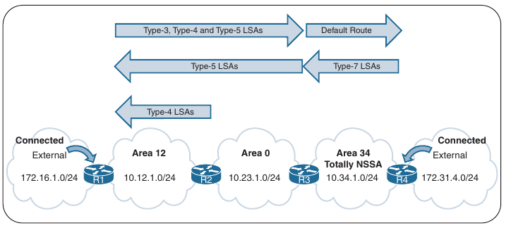

- Below is displayed the routing table of R1, R3 and R4 before Area 34 is converted into an OSPF totally NSSA area

- R1:

```
R1#show ip route ospf | b Gate
Gateway of last resort is not set

      10.0.0.0/8 is variably subnetted, 4 subnets, 2 masks
O IA     10.1.23.0/24 [110/2] via 10.1.12.2, 02:09:50, GigabitEthernet1
O IA     10.1.34.0/24 [110/3] via 10.1.12.2, 02:09:48, GigabitEthernet1
      172.31.0.0/24 is subnetted, 1 subnets
O E1     172.31.4.0 [110/23] via 10.1.12.2, 00:00:48, GigabitEthernet1
      192.168.2.0/32 is subnetted, 1 subnets
O        192.168.2.2 [110/2] via 10.1.12.2, 02:09:50, GigabitEthernet1
      192.168.3.0/32 is subnetted, 1 subnets
O IA     192.168.3.3 [110/3] via 10.1.12.2, 02:09:48, GigabitEthernet1
      192.168.4.0/32 is subnetted, 1 subnets
O IA     192.168.4.4 [110/4] via 10.1.12.2, 00:00:48, GigabitEthernet1
```

- R3:

```
R3(config-router)#do sh ip ro ospf | b Gate
Gateway of last resort is not set

      10.0.0.0/8 is variably subnetted, 5 subnets, 2 masks
O IA     10.1.12.0/24 [110/2] via 10.1.23.2, 00:01:25, GigabitEthernet1
      172.16.0.0/24 is subnetted, 1 subnets
O E1     172.16.1.0 [110/22] via 10.1.23.2, 00:01:25, GigabitEthernet1
      172.31.0.0/24 is subnetted, 1 subnets
O E1     172.31.4.0 [110/21] via 10.1.34.4, 00:01:21, GigabitEthernet2
      192.168.1.0/32 is subnetted, 1 subnets
O IA     192.168.1.1 [110/3] via 10.1.23.2, 00:01:25, GigabitEthernet1
      192.168.2.0/32 is subnetted, 1 subnets
O IA     192.168.2.2 [110/2] via 10.1.23.2, 00:01:25, GigabitEthernet1
      192.168.4.0/32 is subnetted, 1 subnets
O        192.168.4.4 [110/2] via 10.1.34.4, 00:01:21, GigabitEthernet2
```

- R4:

```
R4(config-router)#do sh ip ro ospf | b Gate
Gateway of last resort is not set

      10.0.0.0/8 is variably subnetted, 4 subnets, 2 masks
O IA     10.1.12.0/24 [110/3] via 10.1.34.3, 00:01:51, GigabitEthernet1
O IA     10.1.23.0/24 [110/2] via 10.1.34.3, 00:01:51, GigabitEthernet1
      172.16.0.0/24 is subnetted, 1 subnets
O E1     172.16.1.0 [110/23] via 10.1.34.3, 00:01:51, GigabitEthernet1
      192.168.1.0/32 is subnetted, 1 subnets
O IA     192.168.1.1 [110/4] via 10.1.34.3, 00:01:51, GigabitEthernet1
      192.168.2.0/32 is subnetted, 1 subnets
O IA     192.168.2.2 [110/3] via 10.1.34.3, 00:01:51, GigabitEthernet1
      192.168.3.0/32 is subnetted, 1 subnets
O IA     192.168.3.3 [110/2] via 10.1.34.3, 00:01:51, GigabitEthernet1
```

- Member routers of a totally NSSA use the same configuration as members of the NSSA

- ABRs of the NSSA area have `no-summary` appended to the configuration

- The command `area <area-id> nssa no-summary` is configured under the OSPF process

- Below is shown the R3's and R4's configuration to convert Area 34 into a totally NSSA

- Notice the `no-summary` keyword appended to R3's NSSA command

- Below is shown the routing tables of R3 and R4 after Area 34 is converted into a totally NSSA

- R3 detects R1's redistributed source as O E1 (Type 5 LSA) and R4 redistributed source as O N1 (Type 7 LSA)

- Notice that only the default route exists on R4.

- R3's loopback is a member of Area 0, but if it were a member of Area 34, it would appear as an inter-area route

- R3:

```
R3(config-router)#do sh ip ro ospf | b Gate
Gateway of last resort is not set

      10.0.0.0/8 is variably subnetted, 5 subnets, 2 masks
O IA     10.1.12.0/24 [110/2] via 10.1.23.2, 00:06:30, GigabitEthernet1
      172.16.0.0/24 is subnetted, 1 subnets
O E1     172.16.1.0 [110/22] via 10.1.23.2, 00:06:30, GigabitEthernet1
      172.31.0.0/24 is subnetted, 1 subnets
O N1     172.31.4.0 [110/22] via 10.1.34.4, 00:06:10, GigabitEthernet2
      192.168.1.0/32 is subnetted, 1 subnets
O IA     192.168.1.1 [110/3] via 10.1.23.2, 00:06:30, GigabitEthernet1
      192.168.2.0/32 is subnetted, 1 subnets
O IA     192.168.2.2 [110/2] via 10.1.23.2, 00:06:30, GigabitEthernet1
      192.168.4.0/32 is subnetted, 1 subnets
O        192.168.4.4 [110/2] via 10.1.34.4, 00:06:10, GigabitEthernet2
```

- R4:

```
R4(config-router)#do sh ip ro ospf | b Gate
Gateway of last resort is 10.1.34.3 to network 0.0.0.0

O*IA  0.0.0.0/0 [110/2] via 10.1.34.3, 00:06:46, GigabitEthernet1
```

### OSPF Path Selection

- OSPF executed Dijkstra's shortest path first (SPF) algorithm to create a loop-free topology of shortest paths

- All routers use the same logic to calculate the shortest path for each network

- Path selection prioritizes paths in the following order:

    1. Intra-area

    2. Inter-area

    3. External Type 1

    4. External Type 2

- Below each component is explained in detail

#### Link Costs

- Interface cost is an essential component for Dijkstra's SPF calculation because the shortest path metric is based on the cumulative interface cost (that is, metric) from the router to the destination

- OSPF assigns the OSPF link cost (that is, metric) for an interface using the formula from below

```
Cost = Reference Bandwidth / Interface Bandwidth
```

- The default reference bandwidth is 100 Mbps

- There is no differenciation in the link cost associated with a Fast Ethernet interface and a 10-Gigabit Ethernet interface

- Changing the reference bandwidth to a higher value allows for differenciation of cost between higher-speed interfaces

- The OSPF LSA metric field is 16-bits, and the interface cost cannot exceed 65535

- Under the OSPF process, the command `auto-cost reference-bandwidth <bandwidth-in-mbps>` changes the reference bandwidth for all OSPF interfaces associated with that process

```
conf t
 router ospf 1
  auto-cost reference-bandwidth <bandwidth-in-mbps>
```

- If the reference bandwidth is changed on one router, then the reference bandwidth should be changed on all OSPF routers to ensure that SPF uses the same logic to prevent routing loops

- It is a best practice to set the same reference bandwidth for all OSPF routers

- The OSPF cost can be set manually with the command `ip ospf cost <1-65535>` under the interface

```
conf t
 interface g1
  ip ospf cost <cost>
```

- While the interface cost is limited to 65535 because of LSA field limitations, the path metric can exceed a 16-bit value (65535) because all the link metrics are calculated locally

- NX-OS uses a default reference-bandwidth of 40000 Mbps

#### Intra-Area routes

- OSPF intra-area routes (Type 1 and Type 2 LSAs) are always preferred over inter-area routes (Type 3 LSAs)

- If multiple intra-are routes exist for the same network, the path with the lowest total path metric is installed in the OSPF Routing Information Base (RIB) and is then presented to the router's global RIB

- If there is a tie in metric, both routes are installed into the OSPF RIB

- Below R1 is calculating the route to the 10.4.4.0/24 network

- Instead of taking the faster Ethernet connection (R1 -> R2 -> R4), R1 takes the path across the slower serial link to R4 (R1-> R3-> R4) because that is the intra-area path

- We can see the routing table entry on R1 for the 10.4.4.0/24 network

- Notice that the metric is 111 and the intra-area path selected takes the inter-area path with the lower total path metric

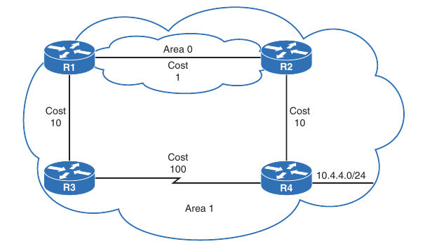

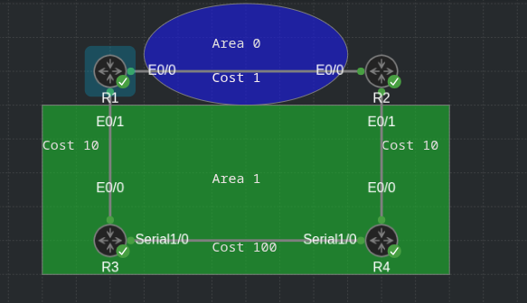

```
R1#show ip route 10.4.4.0
Routing entry for 10.4.4.0/24
  Known via "ospf 1", distance 110, metric 111, type intra area
  Last update from 10.1.13.3 on Ethernet0/1, 00:00:56 ago
  Routing Descriptor Blocks:
  * 10.1.13.3, from 192.168.4.4, 00:00:56 ago, via Ethernet0/1
      Route metric is 111, traffic share count is 1
```

#### Inter-Area routes

- The next priority for selecting a path to a network in a different area is selection of the path with the lowest total path metric to the destination

- If there is a tie in metric, both paths install into the OSPF RIB

- All inter-area paths for a route must go through Area 0 to be considered

- Below, R1 is computing the path to R6

- R1 uses the path R1-> R3-> R5 -> R6 because it's total path metric is 35 as compared to the metric of 40 for the R1-> R2 -> R4 -> R6 path

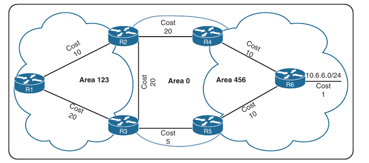

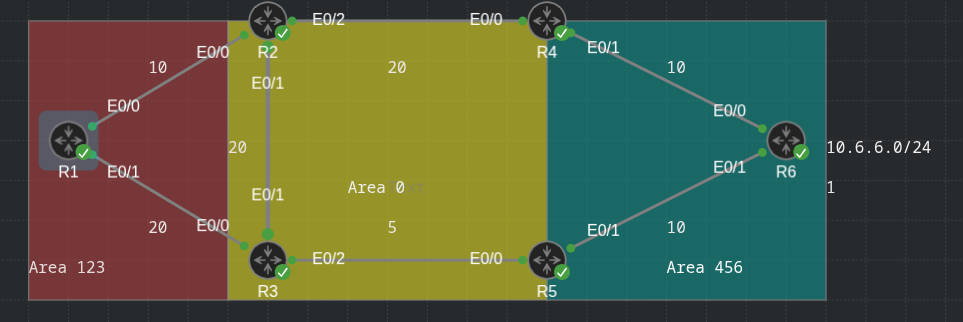

```
R1(config-if)#do sh ip route 10.6.6.0
Routing entry for 10.6.6.0/24
  Known via "ospf 1", distance 110, metric 36, type inter area
  Last update from 10.1.13.3 on Ethernet0/1, 00:00:33 ago
  Routing Descriptor Blocks:
  * 10.1.13.3, from 192.168.3.3, 00:00:33 ago, via Ethernet0/1
      Route metric is 36, traffic share count is 1
```

#### External Route Selection

