## Advanced OSPF

1. Link-State Advertisements

2. OSPF Stubby Areas

3. OSPF Path Selection

4. Summarization of Routes

5. Discontiguous Network

6. Virtual Links

- Solid understanding of the route advertisements within a multi-area OSPF domain, path selection and techniques to optimize the OSPF environment

### Link-State Advertisements

- An OSPF link-state advertisement (LSA) contains the link state and link metric to a neighboring router

- Received LSAs are stored in a local dababase called the link-state database (LSDB); the LSDB advertises the link-state information to neighboring routers exactly as the original advertising router advertises it

- This process floods the LSA through the OSPF routing domain, just as the advertising router advertised it

- All OSPF routers in the same area maintain a synchronized identical copy of the LSDB for that area

- The LSDB provides the topology of the network, in essence providing the router the complete map of the network

- All OSPF routers run Dijkstra's shortest path first (SPF) algorithm to construct a loop-free topology of shortest paths

- OSPF dynamically detects topology changes within the routing domain and calculates loop-free paths in a short amount of time with minimal routing protocol traffic

- When OSPF routers become adjacent, the LSDBs synchronize between the OSPF routers

- As an OSPF router adds or removes a directly connected network link to or from it's database, the router floods the LSA out all active OSPF interfaces

- The OSPF LSA contains a complete list of networks advertised from that router

- OSPF uses six LSA types for IPv4 routing:

    - **Type 1, router**: LSAs that advertise prefixes within an area

    - **Type 2, network**: LSAs that indicate the routers attached to a broadcast segment within an area

    - **Type 3, summary**: LSAs that advertise prefixes that originate from a different area

    - **Type 4, ASBR summary**: LSA used to locate the ASBR from a different area

    - **Type 5, AS external**: LSA that advertises prefixes that were redistributed in to OSPF

    - **Type 7, NSSA external**: LSA for external prefixes that were redistributed in a local NSSA area

- LSA types 1, 2 and 3 are used for building the SPF tree for inter-area and intra-area route routes

- LSA types 4, 5 and 7 are related to external OSPF routes (that is, routes that were redistributed into the OSPF routing domain)

- Below we can see a packet capture of an OSPF update LSA and shows the important components of the LSA: The LSA type, the LSA age, the sequence, and the advertising router

- Because this is a Type 1 LSA, the link IDs add relevance as they list the attached networks and the associated OSPF cost for each interface

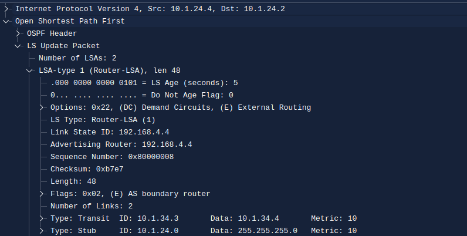

- Below is shown a sample topology to demonstrate the different LSA types

- In this topology:

    - R1, R2 and R3 are nembers (internal) routers

    - R4 and R5 are area border routers (ABRs)

    - R6 is the ASBR which is redistributing the 172.16.6.0/24 network into OSPF

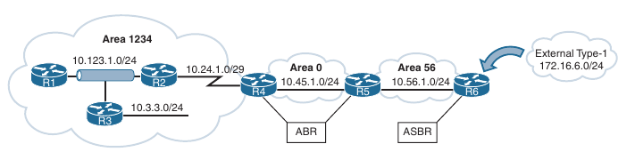

#### LSA Sequences

- OSPF uses the sequence number to overcome problems caused by delays in LSA propagation in a network

- The LSA sequence number is a 32-bit number used to control versioning

- When the originating router sends out LSAs, the LSA sequence number is incremented

- If a router receives an LSA sequence, that is greater than the one in the LSDB, it processes the LSA

- If the LSA sequence number is lower than the one in the LSDB, the router deems the LSA old and discards it

#### LSA Age and Flooding

- Every OSPF LSA includes an age that is entered into the local LSDB that increments by 1 every second

- When a router's OSPF LSA exceeds 1800 seconds (that is, 30 minutes), for it's prefixes, the originating router advertises a new LSA with the LSA age set to 0

- As each router forwards the LSA, the LSA age is incremented with a calculated delay that reflects the link (which is minimal)

- If the LSA age reaches 3600, the LSA is deemed invalid and is purged from the LSDB

- The repetitive flooding of LSAs is a secondary safety mechanism to ensure that all routers maintain a consistent LSDB within an area

#### LSA Types

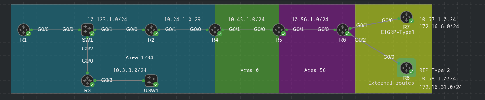

- All routers within an OSPF area have an identical set of LSAs for that area

- The ABRs maintain a separate set of LSAs for each OSPF area

- Most LSAs in one area are different from the LSAs in another area

- You can see generic router LSA output by using the command `show ip ospf database`

```
R1#show ip ospf database 

            OSPF Router with ID (192.168.1.1) (Process ID 1)

                Router Link States (Area 1234)

Link ID         ADV Router      Age         Seq#       Checksum Link count
192.168.1.1     192.168.1.1     1142        0x80000006 0x007456 2
192.168.2.2     192.168.2.2     856         0x80000007 0x0082EB 3
192.168.3.3     192.168.3.3     1142        0x80000005 0x00514B 3
192.168.4.4     192.168.4.4     856         0x80000002 0x00A9E3 2

                Net Link States (Area 1234)

Link ID         ADV Router      Age         Seq#       Checksum
10.123.1.2      192.168.2.2     1151        0x80000002 0x004FA7

                Summary Net Link States (Area 1234)

Link ID         ADV Router      Age         Seq#       Checksum
10.45.1.0       192.168.4.4     859         0x80000001 0x00A7EA
10.56.1.0       192.168.4.4     805         0x80000001 0x002D59
10.67.1.0       192.168.4.4     799         0x80000001 0x00B2C7
10.68.1.0       192.168.4.4     799         0x80000001 0x00A6D2
192.168.5.5     192.168.4.4     805         0x80000001 0x004214
192.168.6.6     192.168.4.4     799         0x80000001 0x00371C

                Summary ASB Link States (Area 1234)

Link ID         ADV Router      Age         Seq#       Checksum
192.168.6.6     192.168.4.4     799         0x80000001 0x001F34

                Type-5 AS External Link States

Link ID         ADV Router      Age         Seq#       Checksum Tag
172.16.6.0      192.168.6.6     795         0x80000001 0x006AD8 0
172.16.31.0     192.168.6.6     796         0x80000001 0x00D53B 0
```

##### LSA Type 1: Router Link

- Every OSPF router advertises a Type 1 LSA (Router LSA)

- Type 1 LSAs are the essential building blocks in the LSDB

- A Type 1 OSPF LSA entry exists for each OSPF-enabled link (that is an interface and it's attached networks)

- Below is shown that the Type 1 LSAs are not advertised outside Area 1234, thus making the underlying topology in an area invisible to other areas

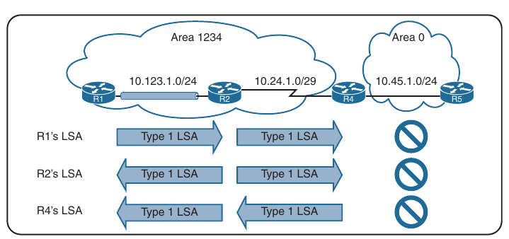

- For a summary view of Type 1 LSAs for an area, look under Router Link States column within the LSDB (output from above)

```
R1#show ip ospf database        

            OSPF Router with ID (192.168.1.1) (Process ID 1)

                Router Link States (Area 1234)

Link ID         ADV Router      Age         Seq#       Checksum Link count
192.168.1.1     192.168.1.1     835         0x80000007 0x007257 2
192.168.2.2     192.168.2.2     603         0x80000008 0x0080EC 3
192.168.3.3     192.168.3.3     830         0x80000006 0x004F4C 3
192.168.4.4     192.168.4.4     478         0x80000003 0x00A7E4 2
```

- Below is an overview of the fields in the LSDB output

```
Field                           Description

Link ID                         Identifies the object that the link connects to. It can refer to the neighboring router's RID, the IP address
                                of the DRs interface, or the IP network address

ADV Router                      The OSPF Router ID for this LSA

Age                             The age of the LSA on the router on which the command is being run. Values over 1800 are expected to refresh soon

Seq #                           The sequence number for the LSA to protect out-of-order LSAs

Checksum                        The checksum of the LSA to verify integrity during flooding

Link count                      The number of links on this router in the Type 1 LSA
```

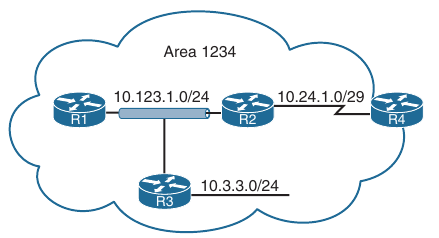

- You can examine the Type 1 OSPF LSAs by using the command `show ip ospf database router` as shown below

- Notice in the output that entries exist for all four routers in an area

```
R1#show ip ospf database router 

            OSPF Router with ID (192.168.1.1) (Process ID 1)

                Router Link States (Area 1234)

  LS age: 332
  Options: (No TOS-capability, DC)
  LS Type: Router Links
  Link State ID: 192.168.1.1
  Advertising Router: 192.168.1.1
  LS Seq Number: 80000008
  Checksum: 0x7058
  Length: 48
  Number of Links: 2

    Link connected to: a Stub Network
     (Link ID) Network/subnet number: 192.168.1.1
     (Link Data) Network Mask: 255.255.255.255
      Number of MTID metrics: 0
       TOS 0 Metrics: 1

    Link connected to: a Transit Network
     (Link ID) Designated Router address: 10.123.1.2
     (Link Data) Router Interface address: 10.123.1.1
      Number of MTID metrics: 0
       TOS 0 Metrics: 1


  LS age: 71
  Options: (No TOS-capability, DC)
  LS Type: Router Links
  Link State ID: 192.168.2.2
  Advertising Router: 192.168.2.2
  LS Seq Number: 80000009
  Checksum: 0x7EED
  Length: 60
  Number of Links: 3

    Link connected to: a Transit Network
     (Link ID) Designated Router address: 10.123.1.2
     (Link Data) Router Interface address: 10.123.1.2
      Number of MTID metrics: 0
       TOS 0 Metrics: 1

    Link connected to: another Router (point-to-point)
     (Link ID) Neighboring Router ID: 192.168.4.4
     (Link Data) Router Interface address: 10.24.1.2
      Number of MTID metrics: 0
       TOS 0 Metrics: 1

    Link connected to: a Stub Network
     (Link ID) Network/subnet number: 10.24.1.0
     (Link Data) Network Mask: 255.255.255.248
      Number of MTID metrics: 0
       TOS 0 Metrics: 1


  LS age: 315
  Options: (No TOS-capability, DC)
  LS Type: Router Links
  Link State ID: 192.168.3.3
  Advertising Router: 192.168.3.3
  LS Seq Number: 80000007
  Checksum: 0x4D4D
  Length: 60
  Number of Links: 3

    Link connected to: a Stub Network
     (Link ID) Network/subnet number: 192.168.3.3
     (Link Data) Network Mask: 255.255.255.255
      Number of MTID metrics: 0
       TOS 0 Metrics: 1

    Link connected to: a Stub Network
     (Link ID) Network/subnet number: 10.3.3.0
     (Link Data) Network Mask: 255.255.255.0
      Number of MTID metrics: 0
       TOS 0 Metrics: 1

    Link connected to: a Transit Network
     (Link ID) Designated Router address: 10.123.1.2
     (Link Data) Router Interface address: 10.123.1.3
      Number of MTID metrics: 0
       TOS 0 Metrics: 1


  LS age: 1977
  Options: (No TOS-capability, DC)
  LS Type: Router Links
  Link State ID: 192.168.4.4
  Advertising Router: 192.168.4.4
  LS Seq Number: 80000003
  Checksum: 0xA7E4
  Length: 48
  Area Border Router
  Number of Links: 2

    Link connected to: another Router (point-to-point)
     (Link ID) Neighboring Router ID: 192.168.2.2
     (Link Data) Router Interface address: 10.24.1.4
      Number of MTID metrics: 0
       TOS 0 Metrics: 1

    Link connected to: a Stub Network
     (Link ID) Network/subnet number: 10.24.1.0
     (Link Data) Network Mask: 255.255.255.248
      Number of MTID metrics: 0
       TOS 0 Metrics: 1
```

- The initial fields of each Type 1 LSA are the same as explained above

- If a router is functioning as an ABR, an ASBR or a virtual-link endpoint, the function is listed between the Length field and the Number of Links field

- In the output from above we can see that R4 (192.168.4.4) is an ABR

- Each OSPF-enabled interface is listed under the number of links for each router

- Each network link on a router contains the following information, in this order:

    - Link type that appears after "Link connected to:". The fields can be corelated with the table from below

    - Link ID, using the values based on the link type listed in the table below

    - Link Data, when applicable

    - Metric for the interface

- OSPF Neighbor states for Type 1 LSA

```
Description                 Link Type                   Link ID Value                       Link Data

Point-to-point (IP          1                           Neighbor RID                        Interface IP address
address assigned)

Point-to-point (IP          1                           Neighbor RID                        MIB II IfIndex value
unnumbered)

Link to transit network     2                           Interface address of DR             Interface IP address

Link to stub network        3                           Network address                     Subnet mask

Virtual link                4                           Neighbor RID                        Interface IP address
```

- During the SPF tree calculation, the network link type is one of the following:

    - **Transit**: A transit network indicates that an adjacency was formed and that a DR was elected on that link

    - **Point-to-point**: A point-to-point link indicates that an adjacency was formed on a network type that does not use a DR

    - Interfaces using point-to-point network type advertise two links: One link is the point-to-point link type that identifies the 
    OSPF neighbor RID for that segment, and the other link is a stub network link that provides the subnet mask for that network

    - **Stub**: A stub network indicates that no neighbor adjacencies were established on that link

    - Point-to-point and transit link types that did not become adjacent with another OSPF router are classified as a stub network link type

    - When an OSPF neighbor adjacency forms, the link type changes to the appropriate type: point-to-point or transit

- Secondary connected networks are always advertised as stub link types because OSPF adjacencies can never form on them

- If you correlate just the Type 1 LSAs from our reference topology, then we can see the topology built by all routers in Area 1234, using the LSA attributes for Area 1234 from all four routers

- Using only Type 1 LSAs, a connection is made between R2 and R4 because they point to each other's RID in the point-to-point LSA

- Notice that the three router links on R1, R2 and R3 (10.123.1.0) have not been directly connected yet

- Type 1 LSA view:

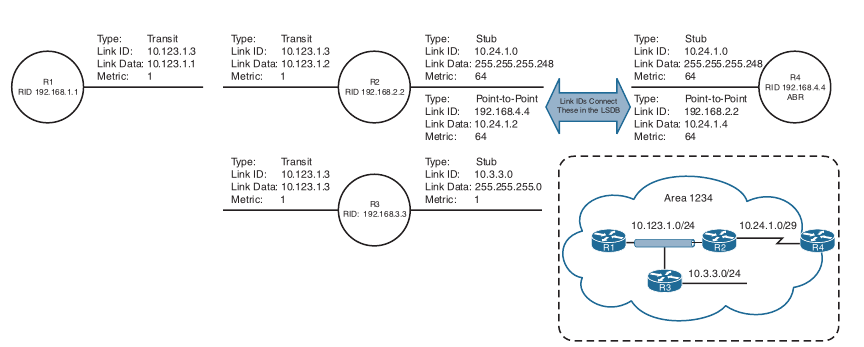

##### LSA Type 2: Network Link

- A Type 2 LSA (Network LSA) represents a multi-access network segment that uses a DR

- The DR always advertises the Type 2 LSA and identifies all the routers attached to that network segment

- If a DR has not been elected, a type 2 LSA is not present in the LSDB because the corresponding Type 1 transit link type LSA is a stub

- Type 2 LSAs are not flooded outside of the originating OSPF area in an identical fashion to Type 1 LSAs

- A brief summary view of the Type 2 LSAs is shown in the LSDB under Net Link States

- Below we can see the output for Type 2 LSAs in Area 1234 from our reference topology

```
R2#show ip ospf database        

            OSPF Router with ID (192.168.2.2) (Process ID 1)
(...)

                Net Link States (Area 1234)

Link ID         ADV Router      Age         Seq#       Checksum
10.123.1.3      192.168.3.3     88          0x80000002 0x0028CB

(...)
```

- Area 1234 has only one DR segment that connects R1, R2 and R3, because R3 has not formed an OSPF adjacency on the 10.3.3.0/24 network segment

- To see detailed Type 2 LSA information, you use the command `show ip ospf database network` 

- Below is shown the Type 2 LSA that is advertised by R3 and shows that the link state ID 10.123.1.3 attaches to R1, R2 and R3 (by listing their RIDs at the bottom)

- The network mask for the subnet is included in the Type 2 LSA

```
R1#show ip ospf database network 

            OSPF Router with ID (192.168.1.1) (Process ID 1)

                Net Link States (Area 1234)

  LS age: 346
  Options: (No TOS-capability, DC)
  LS Type: Network Links
  Link State ID: 10.123.1.3 (address of Designated Router)
  Advertising Router: 192.168.3.3
  LS Seq Number: 80000002
  Checksum: 0x28CB
  Length: 36
  Network Mask: /24
        Attached Router: 192.168.3.3
        Attached Router: 192.168.1.1
        Attached Router: 192.168.2.2

```

- Now that you have the Type 2 LSA for Area 1234, all the network links are connected

- Below we can see a visualization of the Type 1 and Type 2 LSAs; it corresponds with Area 1234 perfectly

- When the DR changes for the network segment, a new Type 2 LSA is created, causing SPF to run again within the OSPF area

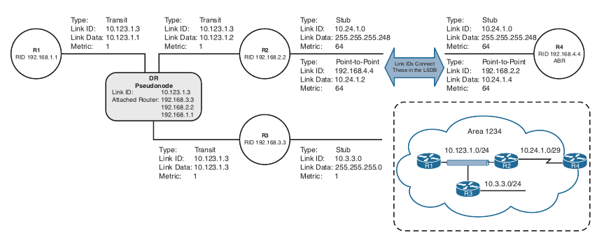

##### LSA Type 3: Summary Link

- Type 3 LSAs, (summary LSAs) represent networks from other areas

- The role of the ABRs is to participate in multiple OSPF areas and ensures that the networks associated with Type 1 LSAs are reachable in the nonoriginating OSPF areas

- As explained earlier, ABRs do not forward Type 1 or Type 2 LSAs into other areas

- When an ABR receives a Type 1 LSA, it creates a Type 3 LSA referencing the network in the original Type 1 LSA

- (The Type 2 LSA is used to determine the network mask of the multi-access network)

- The ABR then advertises the Type 3 LSA into other areas

- If an ABR receives a Type 3 LSA from Area 0 (backbone area), it regenerates a Type 3 LSA for the non-backbone area and lists itself as the advertising router with the additional cost metric

- Below we can see the Type 3 LSA interaction with Type 1 LSAs

- Notice that the Type 1 LSAs exist only in the area of origination and convert to Type 3 when they cross the ABRs (R4 and R5)

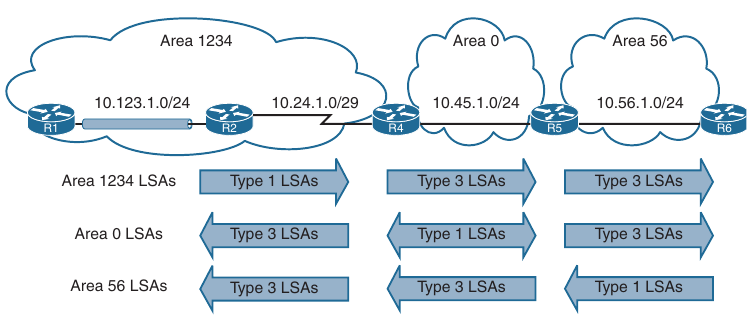

- For a summary view of the Type 3 LSAs, look under Summary Net Link States

- The Type 3 LSAs show up under the appropriate area where they exist in the OSPF domain

```
R2#show ip ospf database 

            OSPF Router with ID (192.168.2.2) (Process ID 1)

(...)

                Summary Net Link States (Area 1234)

Link ID         ADV Router      Age         Seq#       Checksum
10.45.1.0       192.168.4.4     1461        0x80000002 0x00A5EB
10.56.1.0       192.168.4.4     1461        0x80000002 0x002B5A
10.67.1.0       192.168.4.4     1461        0x80000002 0x00B0C8
10.68.1.0       192.168.4.4     1461        0x80000002 0x00A4D3
192.168.5.5     192.168.4.4     1461        0x80000002 0x004015
192.168.6.6     192.168.4.4     1461        0x80000002 0x00351D

(...)
```

- R4 - the ABR:

```
R4#show ip ospf database 

            OSPF Router with ID (192.168.4.4) (Process ID 1)

(...)
                Summary Net Link States (Area 0)

Link ID         ADV Router      Age         Seq#       Checksum
10.3.3.0        192.168.4.4     1443        0x80000002 0x009D1A
10.24.1.0       192.168.4.4     1443        0x80000002 0x007835
10.56.1.0       192.168.5.5     1494        0x80000002 0x001470
10.67.1.0       192.168.5.5     1494        0x80000002 0x0099DE
10.68.1.0       192.168.5.5     1494        0x80000002 0x008DE9
10.123.1.0      192.168.4.4     1443        0x80000002 0x00043E
192.168.1.1     192.168.4.4     1443        0x80000002 0x009EBD
192.168.3.3     192.168.4.4     1443        0x80000002 0x0074E3
192.168.5.5     192.168.5.5     1494        0x80000002 0x00292B
192.168.6.6     192.168.5.5     1494        0x80000002 0x001E33

(...)
                Summary Net Link States (Area 1234)

Link ID         ADV Router      Age         Seq#       Checksum
10.45.1.0       192.168.4.4     1443        0x80000002 0x00A5EB
10.56.1.0       192.168.4.4     1443        0x80000002 0x002B5A
10.67.1.0       192.168.4.4     1443        0x80000002 0x00B0C8
10.68.1.0       192.168.4.4     1443        0x80000002 0x00A4D3
192.168.5.5     192.168.4.4     1443        0x80000002 0x004015
192.168.6.6     192.168.4.4     1443        0x80000002 0x00351D

```

- For example, the 10.56.1.0 Type 3 LSA exists only in Area 0 and Area 1234 on R4

- R5 contains the 10.56.1.0 Type 3 LSA only for Area 0, but not for Area 56 because Area 56 has a Type 1 LSA

```
R5#show ip ospf database 

            OSPF Router with ID (192.168.5.5) (Process ID 1)

(...)
                Summary Net Link States (Area 0)

Link ID         ADV Router      Age         Seq#       Checksum
10.3.3.0        192.168.4.4     1873        0x80000002 0x009D1A
10.24.1.0       192.168.4.4     1873        0x80000002 0x007835
10.56.1.0       192.168.5.5     1922        0x80000002 0x001470
10.67.1.0       192.168.5.5     1922        0x80000002 0x0099DE
10.68.1.0       192.168.5.5     1922        0x80000002 0x008DE9
10.123.1.0      192.168.4.4     1873        0x80000002 0x00043E
192.168.1.1     192.168.4.4     1873        0x80000002 0x009EBD
192.168.3.3     192.168.4.4     1873        0x80000002 0x0074E3
192.168.5.5     192.168.5.5     1922        0x80000002 0x00292B
192.168.6.6     192.168.5.5     1922        0x80000002 0x001E33

(...)

                Router Link States (Area 56)

Link ID         ADV Router      Age         Seq#       Checksum Link count
192.168.5.5     192.168.5.5     1922        0x80000006 0x006CC3 2
192.168.6.6     192.168.6.6     1864        0x80000006 0x00B5B2 4

                Net Link States (Area 56)

Link ID         ADV Router      Age         Seq#       Checksum
10.56.1.6       192.168.6.6     1864        0x80000002 0x008B06

                Summary Net Link States (Area 56)

Link ID         ADV Router      Age         Seq#       Checksum
10.3.3.0        192.168.5.5     1922        0x80000002 0x009A1A
10.24.1.0       192.168.5.5     1922        0x80000002 0x007535
10.45.1.0       192.168.5.5     1922        0x80000002 0x0098F6
10.123.1.0      192.168.5.5     1922        0x80000002 0x00013E
192.168.1.1     192.168.5.5     1922        0x80000002 0x009BBD
192.168.3.3     192.168.5.5     1922        0x80000002 0x0071E3

(...)
```

- To see detailed Type 3 LSA information, you use the command `show ip ospf database summary`

- You can restrict the output to a specific LSA by adding the prefix at the end of the command

- The advertising router for Type 3 LSAs is the last ABR that advertises the prefix

- The metric in the Type 3 LSA uses the following logic:

    - If the Type 3 LSA is created from a Type 1 LSA, is the total path metric to reach the originating router in the Type 1 LSA

    - If the Type 3 LSA is created from a Type 3 LSA from Area 0, it is the total path metric to the ABR plus the metric in the original Type 3 LSA

- Below is shown the Type 3 LSA for Area 56 prefix 10.56.1.0 (10.56.1.0/24) from R4's LSDB

- R4 is an ABR, and the information is shown for both Area 1234 and Area 0

- Notice that the metric increases in Area 1234's LSA compared to in Area 0's LSA

```
R4#show ip ospf database summary 10.56.1.0 

            OSPF Router with ID (192.168.4.4) (Process ID 1)

                Summary Net Link States (Area 0)

  LS age: 608
  Options: (No TOS-capability, DC, Upward)
  LS Type: Summary Links(Network)
  Link State ID: 10.56.1.0 (summary Network Number)
  Advertising Router: 192.168.5.5
  LS Seq Number: 80000003
  Checksum: 0x1271
  Length: 28
  Network Mask: /24
        MTID: 0         Metric: 1 


                Summary Net Link States (Area 1234)

  LS age: 599
  Options: (No TOS-capability, DC, Upward)
  LS Type: Summary Links(Network)
  Link State ID: 10.56.1.0 (summary Network Number)
  Advertising Router: 192.168.4.4
  LS Seq Number: 80000003
  Checksum: 0x295B
  Length: 28
  Network Mask: /24
        MTID: 0         Metric: 2 

```

- Below is an explanation of the fields in a Type 3 LSA

```
Field                                   Description

Link ID                                 Network number

Advertising Router                      RID of the router advertising the route (ABR)

Network Mask                            Prefix length of the advertising network

Metric                                  Metric for the LSA
```

- Understanding the metric in Type 3 LSAs is an important concept

- Below we can see R4's perspective of the Type 3 LSA creared by ABR (R5) for the 10.56.1.0/24 network

- R4 does not know if the 10.56.1.0/24 network is directly attached to the ABR (R5) or if it is multiple hops away

- R4 knows that it's metric to reach the ABR (R5) is 1 and the Type 3 LSA already has a metric of 1, so it's total path metric to reach the 10.56.1.0/24 network is 2

```
R3(config)#do sh ip ospf dat summ 10.56.1.0

            OSPF Router with ID (192.168.3.3) (Process ID 1)

                Summary Net Link States (Area 1234)

  LS age: 56
  Options: (No TOS-capability, DC, Upward)
  LS Type: Summary Links(Network)
  Link State ID: 10.56.1.0 (summary Network Number)
  Advertising Router: 192.168.4.4
  LS Seq Number: 80000004
  Checksum: 0x275C
  Length: 28
  Network Mask: /24
        MTID: 0         Metric: 2 

R3(config)#do sh ip ro 10.56.1.0
Routing entry for 10.56.1.0/24
  Known via "ospf 1", distance 110, metric 67, type inter area
  Last update from 10.123.1.2 on GigabitEthernet0/0, 00:00:34 ago
  Routing Descriptor Blocks:
  * 10.123.1.2, from 192.168.4.4, 00:00:34 ago, via GigabitEthernet0/0
      Route metric is 67, traffic share count is 1
```

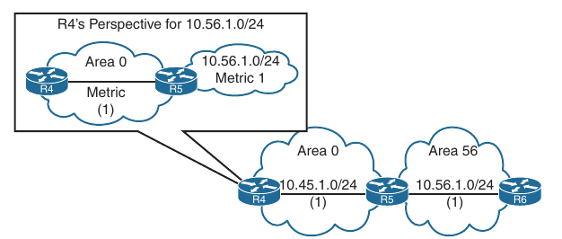

- Below we can see R3's perspective of the Type 3 LSA created by the ABR (R4) for the 10.56.1.0/24 network

- R3 does not know if the 10.56.1.0/24 is directly attached to the ABR (R4) or if it is multiple hops away

- R3 knows that it's metric to the ABR (R4) is 65 and that the Type 3 LSA already has a metric of 2, so the total path metric is 67 to reach the 10.56.1.0/24 network

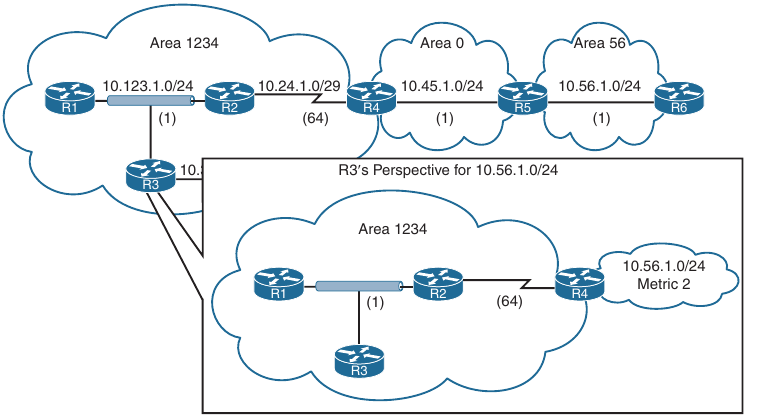

- **IMPORTANT**: The ABR advertises only **ONE** Type 3 LSA for a prefix, even if it's aware of multiple paths from within it's area (Type 1 LSAs) or from outside it's area (Type 3 LSAs). The metric for the best path is used when the LSA is advertised into a different area

##### LSA Type 5: External Routes

- When a route is redistributed into OSPF, the router is known as an *autonomous system boundary router* (ASBR)

- The external route is flooded throughout the entire OSPF domain as a Type 5 LSA (external LSAs)

- Type 5 LSAs are not associated with a specific area and are flooded throughout the OSPF domain

- Only the LSA age is modified during flooding for Type 2 external OSPF routes

- Below we can see R6 redistributing the 172.16.6.0/24 route within the OSPF domain

- Notice that Type 5 LSA exists in all OSPF areas of the routing domain

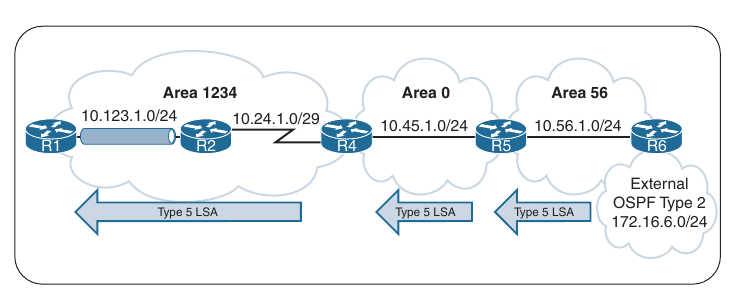

- Below is provided a brief summary view of the Type 5 LSAs under Type-5 AS External

- The link ID is the external network number, and the advertising router is the RID for the router originating the Type 5 LSA

- Notice that Type 5 LSA is not associated with a specific OSPF area

- This is because Type 5 LSAs are flooded throughout the OSPF routing domain by default

```
R4#show ip ospf database
(...)
                Type-5 AS External Link States

Link ID         ADV Router      Age         Seq#       Checksum Tag
172.16.6.0      192.168.6.6     594         0x80000001 0x006AD8 0
```

- You can see Type 5 LSAs in detail by using the `show ip ospf database external` command

- ABRs only modify the LSA age as the Type 5 LSA propagates through the OSPF domain

- Below you can see the detailed output for the OSPF external LSAs in the routing domain

- Notice that only the LS age is modified between the routers

```
R6#show ip ospf database external 

            OSPF Router with ID (192.168.6.6) (Process ID 1)

                Type-5 AS External Link States

  LS age: 16
  Options: (No TOS-capability, DC, Upward)
  LS Type: AS External Link
  Link State ID: 172.16.6.0 (External Network Number )
  Advertising Router: 192.168.6.6
  LS Seq Number: 80000001
  Checksum: 0xCA48
  Length: 36
  Network Mask: /24
        Metric Type: 2 (Larger than any link state path)
        MTID: 0 
        Metric: 20 
        Forward Address: 10.67.1.7
        External Route Tag: 0

```

```
R1#show ip ospf database external 

            OSPF Router with ID (192.168.1.1) (Process ID 1)

                Type-5 AS External Link States

  LS age: 225
  Options: (No TOS-capability, DC, Upward)
  LS Type: AS External Link
  Link State ID: 172.16.6.0 (External Network Number )
  Advertising Router: 192.168.6.6
  LS Seq Number: 80000001
  Checksum: 0xCA48
  Length: 36
  Network Mask: /24
        Metric Type: 2 (Larger than any link state path)
        MTID: 0 
        Metric: 20 
        Forward Address: 10.67.1.7
        External Route Tag: 0

```

- Below we can see an explanation of the fields in a Type 5 LSA 

```
Field                                               Description

Link ID                                             External network number

Network Mask                                        Subnet mask for the external network

Advertising Router                                  RID of the router advertising the route (ASBR)

Metric Type                                         OSPF external metric type (Type 1 O E1 or Type 2 O E2)

Metric                                              Metric upon redistribution

External Route Tag                                  32-bit field included with an external route, which is not used by OSPF under
                                                    normal operation but can be used to communicate AS boundaries or other relevant information
                                                    to prevent routing loops
```

##### LSA Type 4: ASBR Summary

- A Type 4 LSA (ASBR summary LSA) locates the ASBR for a Type 5 LSA

- A Type 5 LSA is flooded through the OSPF domain, and the only mechanism to identify the ASBR is the RID

- Routers examine the Type 5 LSA, check whether the RID is in the local area, and if the ASBR is not local, they require a mechanism to locate the ASBR

- Remember that the RID does not have to match an IP address on any OSPF router (including ASBRs)

- Only Type 1 or Type 2 LSAs provide a method to locate the RID within an area

- Type 4 LSAs provide a way for routers to locate the ASBR when the router is in a different area from the ASBR

- A Type 4 LSA is created by the first ABR, and it provides a summary route strictly for the ASBR of a Type 5 LSA

- The metric for the Type 4 LSA uses the following logic:

    - When the Type 5 LSA crosses the first ABR, the ABR creates a Type 4 LSA with a metric set to the total path metric to the ASBR

    - When an ABR receives a Type 4 LSA from Area 0, the ABR creates a new Type 4 LSA with a metric set to the total path metric of the first ABR plus the metric of the original Type 4 LSA

- Below is shown how the ABRs (R4 and R5) create Type 4 LSAs for the ASBR (R6)

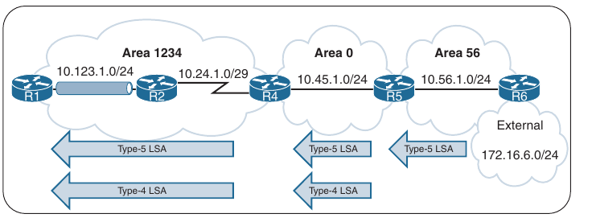

- Below is a brief summary view of the Type 4 LSAs for R4 under "Summary ASB Link States"

- Notice how the advertising router changes as the LSA crosses from ABR to ABR

```
R4#show ip ospf database 

(...)
                Summary ASB Link States (Area 0)

Link ID         ADV Router      Age         Seq#       Checksum
192.168.6.6     192.168.5.5     861         0x80000002 0x00064B

(...)
                Summary ASB Link States (Area 1234)

Link ID         ADV Router      Age         Seq#       Checksum
192.168.6.6     192.168.4.4     919         0x80000002 0x001D35
```

- To view the details of the Type 4 LSAs, you use the command `show ip ospf database asbr-summary`

- Below is provided the detailed output of the Type 4 LSA on R4

```
R4#show ip ospf database asbr-summary 

            OSPF Router with ID (192.168.4.4) (Process ID 1)

                Summary ASB Link States (Area 0)

  LS age: 1065
  Options: (No TOS-capability, DC, Upward)
  LS Type: Summary Links(AS Boundary Router)
  Link State ID: 192.168.6.6 (AS Boundary Router address)
  Advertising Router: 192.168.5.5
  LS Seq Number: 80000002
  Checksum: 0x64B
  Length: 28
  Network Mask: /0
        MTID: 0         Metric: 1 


                Summary ASB Link States (Area 1234)

  LS age: 1123
  Options: (No TOS-capability, DC, Upward)
  LS Type: Summary Links(AS Boundary Router)
  Link State ID: 192.168.6.6 (AS Boundary Router address)
  Advertising Router: 192.168.4.4
  LS Seq Number: 80000002
  Checksum: 0x1D35
  Length: 28
  Network Mask: /0
        MTID: 0         Metric: 2 

```

- Notice that the metric and advertising router change between the OSPF areas

- An ABR advertises only one Type 4 LSA for every ASBR, even if the ASBR advertises thousands of Type 5 LSAs

##### LSA Type 7: NSSA External Summary

- Later we will be using not-so-stubby areas (NSSAs) to reduce the LSDB in an area

- A Type 7 LSA (NSSA external LSA) exists only in NSSAs where route redistribution is occuring

- An ASBR injects external routes as Type 7 LSAs in an NSSA

- The ABR does not advertise the Type 7 LSAs outside the originating NSSA, but it converts the Type 7 LSA into a Type 5 LSA for the other OSPF areas

- If the Type 5 LSA crosses Area 0, the second ABR creates a Type 4 LSA for the Type 5 LSA

- Below is shown Area 56 as a NSSA and R6 redistributing the 172.16.6.0/24 prefix

- The Type 7 LSA exists only for Area 56

- R5 injects the Type 5 LSA in Area 0, which propagates to Area 1234, and R4 creates the Type 4 LSA for Area 1234

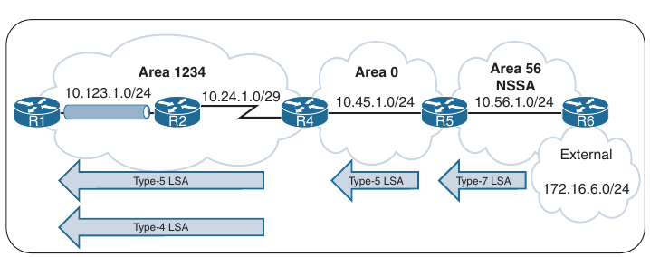

- Below is provided a brief view of the Type 7 LSAs, under Type 7 AS External Link States

- Type 7 LSAs are present only in the OSPF NSSA area where redistribution is occuring

- Notice that the Type 7 LSA is not present on R4; R4 contains a Type 5 LSA that was created by R5 and the Type 4 LSA (created by R4 for Area 1234)

- R5:

```
R5#show ip ospf database 

            OSPF Router with ID (192.168.5.5) (Process ID 1)
(...)
                Type-7 AS External Link States (Area 56)

Link ID         ADV Router      Age         Seq#       Checksum Tag
172.16.6.0      192.168.6.6     431         0x80000001 0x0036D2 0

                Type-5 AS External Link States

Link ID         ADV Router      Age         Seq#       Checksum Tag
172.16.6.0      192.168.5.5     423         0x80000001 0x00D73D 0
```

- R4:

```
R4#show ip ospf database 

            OSPF Router with ID (192.168.4.4) (Process ID 1)
(...)
                Summary ASB Link States (Area 1234)

Link ID         ADV Router      Age         Seq#       Checksum
192.168.5.5     192.168.4.4     518         0x80000001 0x002A2C

                Type-5 AS External Link States

Link ID         ADV Router      Age         Seq#       Checksum Tag
172.16.6.0      192.168.5.5     494         0x80000001 0x00D73D 0
```

- To see the specific Type 7 LSA details, you use the command `show ip ospf database nssa-external`

- Below we can see this command on R5:

```
R5#show ip ospf database nssa-external 

            OSPF Router with ID (192.168.5.5) (Process ID 1)

                Type-7 AS External Link States (Area 56)

  LS age: 652
  Options: (No TOS-capability, Type 7/5 translation, DC, Upward)
  LS Type: AS External Link
  Link State ID: 172.16.6.0 (External Network Number )
  Advertising Router: 192.168.6.6
  LS Seq Number: 80000001
  Checksum: 0x36D2
  Length: 36
  Network Mask: /24
        Metric Type: 2 (Larger than any link state path)
        MTID: 0 
        Metric: 20 
        Forward Address: 10.67.1.7
        External Route Tag: 0

```

- Below is provided a explanation of the fields in the Type 7 LSA

```
Field                                           Description

Link ID                                         External network number

Network Mask                                    Subnet mask for the external network

Advertising Router                              RID of the router advertising the the route (ASBR)

Metric Type                                     Type 1 (O N1 or Type 2 O N2)

Metric                                          Metric upon redistribution

External Route Tag                              32-bit field that is included with an external route, which is not used by OSPF itself and
                                                can be used to communicate AS boundaries or other relevant information to prevent routing loops
```

##### LSA Type Summary

- OSPF LSA types are important when troubleshooting a router's behavior for a specific prefix

- Below is a summary of the OSPF LSA types covered:

```
LSA Type                                        Description

1                                               Router Link

2                                               Network Link

3                                               Summary Link

4                                               ASBR Summary

5                                               AS external

7                                               NSSA External
```

- Below are shown the network prefixes from our sample topology and the relevant LSAs that are present

- Notice that Type 2 LSAs are present only on the broadcast network segments that have established adjacencies with other routers (10.123.1.0/24, 10.45.1.0/24 and 10.56.1.0/24); they are not advertised outside their local area

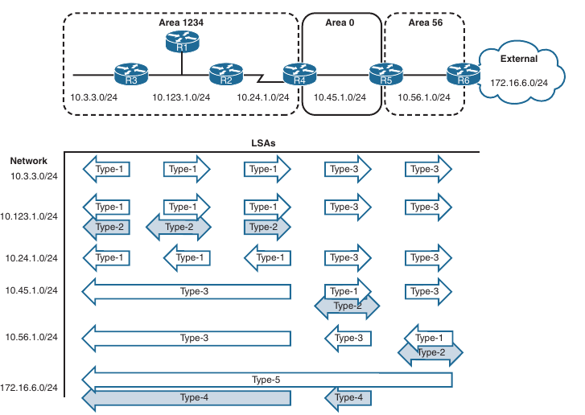

### OSPF Stubby Areas

- OSPF Stubby Areas provide a method to filter out external routes and the option to block inter-area routes

- OSPF stubby areas are identified by the Area flag in the OSPF hello packet

- Every router within an OSPF stubby area needs to be configured as a stub so that the routers can establish/maintain OSPF adjacencies

- There are the following types of OSPF stubby areas:

    - Stub Areas

    - Totally stubby areas

    - Not-so-stubby Areas (NSSAs)
    
    - Totally NSSAs

- Totally stubby areas and totally NSSAs are not defined in RFC 2328 but are compliant and commonly implemented by Cisco and other network vendors

#### Stub Areas

- OSPF stub areas prohibit Type 5 LSAs (external routes) and Type 4 LSAs (ASBR summary LSAs) from entering the area at the ABR

- RFC 2328 states that when a Type 5 LSA reaches the ABR of a stub area, the ABR generates a default route for the stub via a Type 3 LSA

- A Cisco ABR generates a default route when the area is configured as a stub and has an OSPF-enabled interface configured for Area 0

- Below we can see the concept

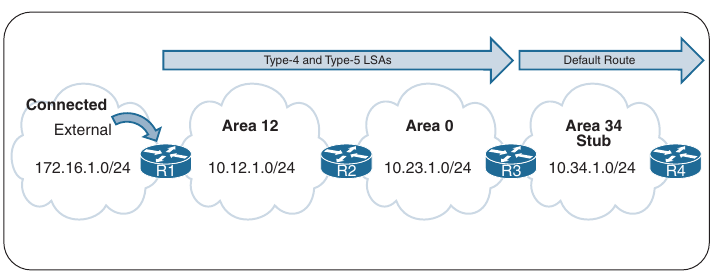

- Below are shown the routing table for R3 and R4 before Area 34 is configured as a stub area

- Notice that the external 172.16.1.0/24 route that R1 has redistributed into the routing table and that is visible on R3 and R4

- R3:

```
R3#show ip route ospf | b Gate
Gateway of last resort is not set

      10.0.0.0/8 is variably subnetted, 5 subnets, 2 masks
O IA     10.1.12.0/24 [110/2] via 10.1.23.2, 00:02:15, GigabitEthernet1
      172.16.0.0/24 is subnetted, 1 subnets
O E2     172.16.1.0 [110/20] via 10.1.23.2, 00:02:15, GigabitEthernet1
      192.168.1.0/32 is subnetted, 1 subnets
O IA     192.168.1.1 [110/3] via 10.1.23.2, 00:02:15, GigabitEthernet1
      192.168.2.0/32 is subnetted, 1 subnets
O IA     192.168.2.2 [110/2] via 10.1.23.2, 00:02:15, GigabitEthernet1
      192.168.4.0/32 is subnetted, 1 subnets
O        192.168.4.4 [110/2] via 10.1.34.4, 00:01:49, GigabitEthernet2
```

- R4:

```
R4#show ip route ospf | b Gate
Gateway of last resort is not set

      10.0.0.0/8 is variably subnetted, 4 subnets, 2 masks
O IA     10.1.12.0/24 [110/3] via 10.1.34.3, 00:02:19, GigabitEthernet1
O IA     10.1.23.0/24 [110/2] via 10.1.34.3, 00:02:19, GigabitEthernet1
      172.16.0.0/24 is subnetted, 1 subnets
O E2     172.16.1.0 [110/20] via 10.1.34.3, 00:02:19, GigabitEthernet1
      192.168.1.0/32 is subnetted, 1 subnets
O IA     192.168.1.1 [110/4] via 10.1.34.3, 00:02:19, GigabitEthernet1
      192.168.2.0/32 is subnetted, 1 subnets
O IA     192.168.2.2 [110/3] via 10.1.34.3, 00:02:19, GigabitEthernet1
      192.168.3.0/32 is subnetted, 1 subnets
O IA     192.168.3.3 [110/2] via 10.1.34.3, 00:02:19, GigabitEthernet1
```

- All routers in the stub area must be configured as stubs, or an adjacency cannot form because the area type flags in the OSPF hello packets do not match

- An area is configured as a stub with the OSPF process command `area <area-id> stub`

- Configuring area 34 as stub on R3 and R4:

- R3:

```
conf t
 router ospf 1
  area 34 stub
```

- R4:

```
conf t
 router ospf 1
  area 34 stub
```

- Below is shown the routing table for R3 and R4 after Area 34 is made an OSPF stub area

- The routing table from R3's perspective is not modified as it receives the Type 4 and Type 5 LSAs from Area 0

- When the Type 5 LSA (172.16.1.0/24) reaches the ABR (R3), the ABR generates a default route a default route by using a Type 3 LSA

- While R4 does not see the route to the 172.16.1.0/24 in it's routing table, it has connectivity to that network through the default route

- Notice that inter-area routes are allowed in Area 34

```
R3#sh ip ro ospf | b Gate
Gateway of last resort is not set

      10.0.0.0/8 is variably subnetted, 5 subnets, 2 masks
O IA     10.1.12.0/24 [110/2] via 10.1.23.2, 00:07:40, GigabitEthernet1
      172.16.0.0/24 is subnetted, 1 subnets
O E2     172.16.1.0 [110/20] via 10.1.23.2, 00:07:40, GigabitEthernet1
      192.168.1.0/32 is subnetted, 1 subnets
O IA     192.168.1.1 [110/3] via 10.1.23.2, 00:07:40, GigabitEthernet1
      192.168.2.0/32 is subnetted, 1 subnets
O IA     192.168.2.2 [110/2] via 10.1.23.2, 00:07:40, GigabitEthernet1
      192.168.4.0/32 is subnetted, 1 subnets
O        192.168.4.4 [110/2] via 10.1.34.4, 00:07:16, GigabitEthernet2
```

```
R4#show ip route ospf | b Gate
Gateway of last resort is 10.1.34.3 to network 0.0.0.0

O*IA  0.0.0.0/0 [110/2] via 10.1.34.3, 00:07:46, GigabitEthernet1
      10.0.0.0/8 is variably subnetted, 4 subnets, 2 masks
O IA     10.1.12.0/24 [110/3] via 10.1.34.3, 00:07:46, GigabitEthernet1
O IA     10.1.23.0/24 [110/2] via 10.1.34.3, 00:07:46, GigabitEthernet1
      192.168.1.0/32 is subnetted, 1 subnets
O IA     192.168.1.1 [110/4] via 10.1.34.3, 00:07:46, GigabitEthernet1
      192.168.2.0/32 is subnetted, 1 subnets
O IA     192.168.2.2 [110/3] via 10.1.34.3, 00:07:46, GigabitEthernet1
      192.168.3.0/32 is subnetted, 1 subnets
O IA     192.168.3.3 [110/2] via 10.1.34.3, 00:07:46, GigabitEthernet1
```

- Default routes are Type 3 LSAs (inter-area summaries) because stub areas do not allow Type 5 LSAs within them

- A benefit of using a Type 3 LSA is that it cannot be advertised from a nonbackbone area into a backbone area

- The concept is explained later

#### Totally Stubby Areas

- An OSPF totally stubby area prohibits Type 3 LSAs (inter-area), Type 4 LSAs (ASBR external LSAs), and Type 5 LSAs (external routes) from entering the area at the ABR

- When an ABR of a totally stubby area receives a Type 3 or Type 5 LSA, the ABR generates a default route for the totally stubby area

- In fact, the ABR for a totally stubby area advertises the default route into the totally stubby area the instant an interface is assigned to Area 0

- Assigning the interface acts as the trigger for the Type 3 LSA that leads to the generation of the default route

- Only intra-area and default routes should exist within a totally stubby area

- Below we can see the totally stubby area concept

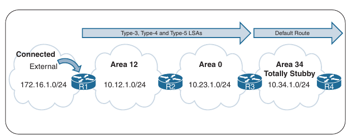

- Below we can see the routing table of R3 and R4 before area 34 is converted to a totally stubby area

- R3:

```
R3(config-router)#do sh ip ro ospf | b Gate
Gateway of last resort is not set

      10.0.0.0/8 is variably subnetted, 5 subnets, 2 masks
O IA     10.1.12.0/24 [110/2] via 10.1.23.2, 00:00:39, GigabitEthernet1
      172.16.0.0/24 is subnetted, 1 subnets
O E2     172.16.1.0 [110/20] via 10.1.23.2, 00:00:39, GigabitEthernet1
      192.168.1.0/32 is subnetted, 1 subnets
O IA     192.168.1.1 [110/3] via 10.1.23.2, 00:00:39, GigabitEthernet1
      192.168.2.0/32 is subnetted, 1 subnets
O IA     192.168.2.2 [110/2] via 10.1.23.2, 00:00:39, GigabitEthernet1
      192.168.4.0/32 is subnetted, 1 subnets
O        192.168.4.4 [110/2] via 10.1.34.4, 00:00:27, GigabitEthernet2
```

- R4:

```
R4(config-router)#do sh ip ro ospf | b Gatew 
Gateway of last resort is not set

      10.0.0.0/8 is variably subnetted, 4 subnets, 2 masks
O IA     10.1.12.0/24 [110/3] via 10.1.34.3, 00:01:00, GigabitEthernet1
O IA     10.1.23.0/24 [110/2] via 10.1.34.3, 00:01:00, GigabitEthernet1
      172.16.0.0/24 is subnetted, 1 subnets
O E2     172.16.1.0 [110/20] via 10.1.34.3, 00:01:00, GigabitEthernet1
      192.168.1.0/32 is subnetted, 1 subnets
O IA     192.168.1.1 [110/4] via 10.1.34.3, 00:01:00, GigabitEthernet1
      192.168.2.0/32 is subnetted, 1 subnets
O IA     192.168.2.2 [110/3] via 10.1.34.3, 00:01:00, GigabitEthernet1
      192.168.3.0/32 is subnetted, 1 subnets
O IA     192.168.3.3 [110/2] via 10.1.34.3, 00:01:00, GigabitEthernet1
```

- Member routers, (no ABRs) of a totally stubby area are configured the same as those in a stub area

- ABRs of a totally stubby area have `no-summary` appended to the configuration

- The command `area <area-id> stub no-summary` is configured under the OSPF process

- The keyword `no-summary` does exactly what it states: It blocks all Type 3 (summary) LSAs going into the stub area, making it a totally stubby area

- Below is shown the configuration for R3 and R4 to make area 34 a totally stubby area for both routers

- R3:

```
conf t
 router ospf 1
  area 34 stub no-summary
```

- R4:

```
conf t
 router ospf 1
  area 34 stub
```

- Below is shown the routing tables for R3 and R4 after Area 34 is converted to a totally stubby area

- Notice that only the default route exists on R4

- R3's loopback is a member of Area 0, but if it were a member of Area 34, it would appear as an intra-area route

- The routing table on R3 has not been impacted at all

- R3:

```
R3(config-router)#do sh ip ro ospf | b Gate
Gateway of last resort is not set

      10.0.0.0/8 is variably subnetted, 5 subnets, 2 masks
O IA     10.1.12.0/24 [110/2] via 10.1.23.2, 00:04:14, GigabitEthernet1
      172.16.0.0/24 is subnetted, 1 subnets
O E2     172.16.1.0 [110/20] via 10.1.23.2, 00:04:14, GigabitEthernet1
      192.168.1.0/32 is subnetted, 1 subnets
O IA     192.168.1.1 [110/3] via 10.1.23.2, 00:04:14, GigabitEthernet1
      192.168.2.0/32 is subnetted, 1 subnets
O IA     192.168.2.2 [110/2] via 10.1.23.2, 00:04:14, GigabitEthernet1
      192.168.4.0/32 is subnetted, 1 subnets
O        192.168.4.4 [110/2] via 10.1.34.4, 00:04:01, GigabitEthernet2
```

- R4:

```
R4(config-router)#do sh ip ro ospf | b Gate
Gateway of last resort is 10.1.34.3 to network 0.0.0.0

O*IA  0.0.0.0/0 [110/2] via 10.1.34.3, 00:04:46, GigabitEthernet1
```

#### Not-so-Stubby Areas

- An OSPF stub area prohibits Type 5 LSAs (external routes) and Type 4 LSAs (ASBR summary LSAs) from entering the area at the ABR, and it prohibits redistribution of external routes into the stub area too

- An OSPF not-so-stubby area (NSSA) prohibits Type 5 LSAs from entering at the ABR but allows for redistribution of external routes into the NSSA

- As the ASBR redistributes the routes into OSPF in the NSSA, the ASBR advertises the route with a Type 7 LSA instead of a Type 5 LSA

- When the Type 7 LSA reaches the ABR, the ABR converts the Type 7 LSA to a Type 5 LSA

- The ABR does not automatically advertise a default route when a Type 5 or Type 7 LSA is blocked

- During configuration, an option exists to advertise a default route to provide connectivity to the blocked LSAs; in addition, other techniques can be used to ensure bidirectional connectivity

- Below is demonstrated the concept of LSAs being processed on the ABR for the NSSA

- Notice that the default route is optional and depends on the configuration

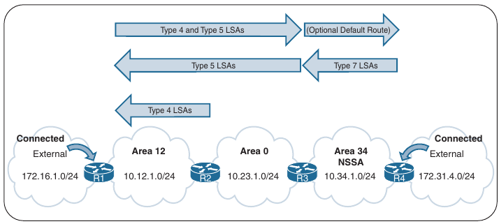

- Below are shown the routing tables of R1, R3 and R4 before Area 34 is converted into an NSSA

- Notice that R1 and R4 have received external routes from each other

- R1:

```
R1#show ip route 172.31.4.0 255.255.255.0 
Routing entry for 172.31.4.0/24
  Known via "ospf 1", distance 110, metric 20, type extern 2, forward metric 3
  Last update from 10.1.12.2 on GigabitEthernet1, 00:03:44 ago
  Routing Descriptor Blocks:
  * 10.1.12.2, from 192.168.4.4, 00:03:44 ago, via GigabitEthernet1
      Route metric is 20, traffic share count is 1

R1#show ip route ospf | s 172.31
      172.31.0.0/24 is subnetted, 1 subnets
O E2     172.31.4.0 [110/20] via 10.1.12.2, 00:04:24, GigabitEthernet1

```

- R3:

```
R3(config-router)#do sh ip ro ospf | b Gate
Gateway of last resort is not set

      10.0.0.0/8 is variably subnetted, 5 subnets, 2 masks
O IA     10.1.12.0/24 [110/2] via 10.1.23.2, 00:08:00, GigabitEthernet1
      172.16.0.0/24 is subnetted, 1 subnets
O E1     172.16.1.0 [110/22] via 10.1.23.2, 00:00:06, GigabitEthernet1
      172.31.0.0/24 is subnetted, 1 subnets
O E2     172.31.4.0 [110/20] via 10.1.34.4, 00:07:50, GigabitEthernet2
      192.168.1.0/32 is subnetted, 1 subnets
O IA     192.168.1.1 [110/3] via 10.1.23.2, 00:08:00, GigabitEthernet1
      192.168.2.0/32 is subnetted, 1 subnets
O IA     192.168.2.2 [110/2] via 10.1.23.2, 00:08:00, GigabitEthernet1
      192.168.4.0/32 is subnetted, 1 subnets
O        192.168.4.4 [110/2] via 10.1.34.4, 00:07:50, GigabitEthernet2
```

- R4:

```
R4(config-router)#do sh ip ro ospf | b Gate
Gateway of last resort is not set

      10.0.0.0/8 is variably subnetted, 4 subnets, 2 masks
O IA     10.1.12.0/24 [110/3] via 10.1.34.3, 00:08:25, GigabitEthernet1
O IA     10.1.23.0/24 [110/2] via 10.1.34.3, 00:08:25, GigabitEthernet1
      172.16.0.0/24 is subnetted, 1 subnets
O E1     172.16.1.0 [110/23] via 10.1.34.3, 00:00:41, GigabitEthernet1
      192.168.1.0/32 is subnetted, 1 subnets
O IA     192.168.1.1 [110/4] via 10.1.34.3, 00:08:25, GigabitEthernet1
      192.168.2.0/32 is subnetted, 1 subnets
O IA     192.168.2.2 [110/3] via 10.1.34.3, 00:08:25, GigabitEthernet1
      192.168.3.0/32 is subnetted, 1 subnets
O IA     192.168.3.3 [110/2] via 10.1.34.3, 00:08:25, GigabitEthernet1
```

- The command `area <area-id> nssa [default-information-originate]` is placed under the OSPF process on the ABR

- All routers in an NSSA must be configured with the `nssa` option, or they do not become adjacent because the area type flags must match in the OSPF hello protocol in order to become adjacent

- A default route is not injected into the ABRs automatically for NSSAs, but the optional command `default-information-originate` can be appended to the configuration if a default route is needed in the NSSA

- Below is shown the OSPF configuration of R3 and R4 after making area 34 an NSSA

- R3 is configured with the optional `default-information-originate` keyword to inject the default route into Area 34

- Notice that R4 is allowed to redistribute networks into the NSSA

- R3:

```
R3(config-router)#do sh run | s router ospf
router ospf 1
 router-id 192.168.3.3
 area 34 nssa default-information-originate
```

- R4:

```
R4(config-router)#do sh run | s router ospf
router ospf 1
 router-id 192.168.4.4
 area 34 nssa
 redistribute connected metric-type 1 subnets
```

- Below is shown the routing tables of R3 and R4 after converting Area 34 to an NSSA

- On R3, the previous external route from R1 still exists as an OSPF External Type 1 (O E1) route, and R4's external route is now an OSPF External NSSA Type 1 (O N1) route

- On R4, R1's external route is no longer present

- R3 is configured to advertise a default route, which appears as an OSPF external NSSA Type 2 (O N2) route

- The OSPF external routes are representative of a Type 7 LSA, which exists only in an NSSA

- R3:

```
R3#show ip route ospf | b Gate
Gateway of last resort is not set

      10.0.0.0/8 is variably subnetted, 5 subnets, 2 masks
O IA     10.1.12.0/24 [110/2] via 10.1.23.2, 00:23:43, GigabitEthernet1
      172.16.0.0/24 is subnetted, 1 subnets
O E1     172.16.1.0 [110/22] via 10.1.23.2, 00:23:43, GigabitEthernet1
      172.31.0.0/24 is subnetted, 1 subnets
O N1     172.31.4.0 [110/22] via 10.1.34.4, 00:21:56, GigabitEthernet2
      192.168.1.0/32 is subnetted, 1 subnets
O IA     192.168.1.1 [110/3] via 10.1.23.2, 00:23:43, GigabitEthernet1
      192.168.2.0/32 is subnetted, 1 subnets
O IA     192.168.2.2 [110/2] via 10.1.23.2, 00:23:43, GigabitEthernet1
      192.168.4.0/32 is subnetted, 1 subnets
O        192.168.4.4 [110/2] via 10.1.34.4, 00:23:27, GigabitEthernet2

```

- R4:

```
R4#show ip route ospf | b Gate
Gateway of last resort is 10.1.34.3 to network 0.0.0.0

O*N2  0.0.0.0/0 [110/1] via 10.1.34.3, 00:24:18, GigabitEthernet1
      10.0.0.0/8 is variably subnetted, 4 subnets, 2 masks
O IA     10.1.12.0/24 [110/3] via 10.1.34.3, 00:24:18, GigabitEthernet1
O IA     10.1.23.0/24 [110/2] via 10.1.34.3, 00:24:18, GigabitEthernet1
      192.168.1.0/32 is subnetted, 1 subnets
O IA     192.168.1.1 [110/4] via 10.1.34.3, 00:24:18, GigabitEthernet1
      192.168.2.0/32 is subnetted, 1 subnets
O IA     192.168.2.2 [110/3] via 10.1.34.3, 00:24:18, GigabitEthernet1
      192.168.3.0/32 is subnetted, 1 subnets
O IA     192.168.3.3 [110/2] via 10.1.34.3, 00:24:18, GigabitEthernet1
```

#### Totally NSSAs

- Totally Stubby Areas prohibit Type 3 LSAs (inter-area), Type 4 LSAs (ASBR summary LSAs), and Type 5 LSAs (external routes) from entering the area at ABR, and they prohibit routes from being redistributed within that area

- OSPF areas that need to block Type 3 and Type 5 LSAs and still provide the capability of redistributing external routes into OSPF should use the OSPF totally NSSA areas

- When the ASBR redistributes the route into OSPF, the ASBR advertises the route with a Type 7 LSA

- As the Type 7 LSA reaches the ABR, the ABR converts the Type 7 LSA to a Type 5 LSA

- When an ABR for a Totally NSSA receives a Type 3 LSA from the backbone, the ABR generates a default route for the totally NSSA

- When an interface in the ABR is assigned to Area 0, it acts as a trigger for the Type 3 LSA that leads to the default route generation within the Totally NSSA

- Below is demonstrated how LSAs are processed on the ABR for a totally NSSA

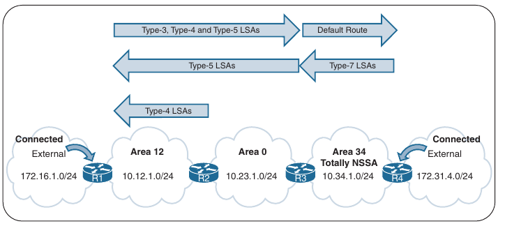

- Below is displayed the routing table of R1, R3 and R4 before Area 34 is converted into an OSPF totally NSSA area

- R1:

```
R1#show ip route ospf | b Gate
Gateway of last resort is not set

      10.0.0.0/8 is variably subnetted, 4 subnets, 2 masks
O IA     10.1.23.0/24 [110/2] via 10.1.12.2, 02:09:50, GigabitEthernet1
O IA     10.1.34.0/24 [110/3] via 10.1.12.2, 02:09:48, GigabitEthernet1
      172.31.0.0/24 is subnetted, 1 subnets
O E1     172.31.4.0 [110/23] via 10.1.12.2, 00:00:48, GigabitEthernet1
      192.168.2.0/32 is subnetted, 1 subnets
O        192.168.2.2 [110/2] via 10.1.12.2, 02:09:50, GigabitEthernet1
      192.168.3.0/32 is subnetted, 1 subnets
O IA     192.168.3.3 [110/3] via 10.1.12.2, 02:09:48, GigabitEthernet1
      192.168.4.0/32 is subnetted, 1 subnets
O IA     192.168.4.4 [110/4] via 10.1.12.2, 00:00:48, GigabitEthernet1
```

- R3:

```
R3(config-router)#do sh ip ro ospf | b Gate
Gateway of last resort is not set

      10.0.0.0/8 is variably subnetted, 5 subnets, 2 masks
O IA     10.1.12.0/24 [110/2] via 10.1.23.2, 00:01:25, GigabitEthernet1
      172.16.0.0/24 is subnetted, 1 subnets
O E1     172.16.1.0 [110/22] via 10.1.23.2, 00:01:25, GigabitEthernet1
      172.31.0.0/24 is subnetted, 1 subnets
O E1     172.31.4.0 [110/21] via 10.1.34.4, 00:01:21, GigabitEthernet2
      192.168.1.0/32 is subnetted, 1 subnets
O IA     192.168.1.1 [110/3] via 10.1.23.2, 00:01:25, GigabitEthernet1
      192.168.2.0/32 is subnetted, 1 subnets
O IA     192.168.2.2 [110/2] via 10.1.23.2, 00:01:25, GigabitEthernet1
      192.168.4.0/32 is subnetted, 1 subnets
O        192.168.4.4 [110/2] via 10.1.34.4, 00:01:21, GigabitEthernet2
```

- R4:

```
R4(config-router)#do sh ip ro ospf | b Gate
Gateway of last resort is not set

      10.0.0.0/8 is variably subnetted, 4 subnets, 2 masks
O IA     10.1.12.0/24 [110/3] via 10.1.34.3, 00:01:51, GigabitEthernet1
O IA     10.1.23.0/24 [110/2] via 10.1.34.3, 00:01:51, GigabitEthernet1
      172.16.0.0/24 is subnetted, 1 subnets
O E1     172.16.1.0 [110/23] via 10.1.34.3, 00:01:51, GigabitEthernet1
      192.168.1.0/32 is subnetted, 1 subnets
O IA     192.168.1.1 [110/4] via 10.1.34.3, 00:01:51, GigabitEthernet1
      192.168.2.0/32 is subnetted, 1 subnets
O IA     192.168.2.2 [110/3] via 10.1.34.3, 00:01:51, GigabitEthernet1
      192.168.3.0/32 is subnetted, 1 subnets
O IA     192.168.3.3 [110/2] via 10.1.34.3, 00:01:51, GigabitEthernet1
```

- Member routers of a totally NSSA use the same configuration as members of the NSSA

- ABRs of the NSSA area have `no-summary` appended to the configuration

- The command `area <area-id> nssa no-summary` is configured under the OSPF process

- Below is shown the R3's and R4's configuration to convert Area 34 into a totally NSSA

- Notice the `no-summary` keyword appended to R3's NSSA command

- Below is shown the routing tables of R3 and R4 after Area 34 is converted into a totally NSSA

- R3 detects R1's redistributed source as O E1 (Type 5 LSA) and R4 redistributed source as O N1 (Type 7 LSA)

- Notice that only the default route exists on R4.

- R3's loopback is a member of Area 0, but if it were a member of Area 34, it would appear as an inter-area route

- R3:

```
R3(config-router)#do sh ip ro ospf | b Gate
Gateway of last resort is not set

      10.0.0.0/8 is variably subnetted, 5 subnets, 2 masks
O IA     10.1.12.0/24 [110/2] via 10.1.23.2, 00:06:30, GigabitEthernet1
      172.16.0.0/24 is subnetted, 1 subnets
O E1     172.16.1.0 [110/22] via 10.1.23.2, 00:06:30, GigabitEthernet1
      172.31.0.0/24 is subnetted, 1 subnets
O N1     172.31.4.0 [110/22] via 10.1.34.4, 00:06:10, GigabitEthernet2
      192.168.1.0/32 is subnetted, 1 subnets
O IA     192.168.1.1 [110/3] via 10.1.23.2, 00:06:30, GigabitEthernet1
      192.168.2.0/32 is subnetted, 1 subnets
O IA     192.168.2.2 [110/2] via 10.1.23.2, 00:06:30, GigabitEthernet1
      192.168.4.0/32 is subnetted, 1 subnets
O        192.168.4.4 [110/2] via 10.1.34.4, 00:06:10, GigabitEthernet2
```

- R4:

```
R4(config-router)#do sh ip ro ospf | b Gate
Gateway of last resort is 10.1.34.3 to network 0.0.0.0

O*IA  0.0.0.0/0 [110/2] via 10.1.34.3, 00:06:46, GigabitEthernet1
```

### OSPF Path Selection

- OSPF executed Dijkstra's shortest path first (SPF) algorithm to create a loop-free topology of shortest paths

- All routers use the same logic to calculate the shortest path for each network

- Path selection prioritizes paths in the following order:

    1. Intra-area

    2. Inter-area

    3. External Type 1

    4. External Type 2

- Below each component is explained in detail

#### Link Costs

- Interface cost is an essential component for Dijkstra's SPF calculation because the shortest path metric is based on the cumulative interface cost (that is, metric) from the router to the destination

- OSPF assigns the OSPF link cost (that is, metric) for an interface using the formula from below

```
Cost = Reference Bandwidth / Interface Bandwidth
```

- The default reference bandwidth is 100 Mbps

- There is no differenciation in the link cost associated with a Fast Ethernet interface and a 10-Gigabit Ethernet interface

- Changing the reference bandwidth to a higher value allows for differenciation of cost between higher-speed interfaces

- The OSPF LSA metric field is 16-bits, and the interface cost cannot exceed 65535

- Under the OSPF process, the command `auto-cost reference-bandwidth <bandwidth-in-mbps>` changes the reference bandwidth for all OSPF interfaces associated with that process

```
conf t
 router ospf 1
  auto-cost reference-bandwidth <bandwidth-in-mbps>
```

- If the reference bandwidth is changed on one router, then the reference bandwidth should be changed on all OSPF routers to ensure that SPF uses the same logic to prevent routing loops

- It is a best practice to set the same reference bandwidth for all OSPF routers

- The OSPF cost can be set manually with the command `ip ospf cost <1-65535>` under the interface

```
conf t
 interface g1
  ip ospf cost <cost>
```

- While the interface cost is limited to 65535 because of LSA field limitations, the path metric can exceed a 16-bit value (65535) because all the link metrics are calculated locally

- NX-OS uses a default reference-bandwidth of 40000 Mbps

#### Intra-Area routes

- OSPF intra-area routes (Type 1 and Type 2 LSAs) are always preferred over inter-area routes (Type 3 LSAs)

- If multiple intra-are routes exist for the same network, the path with the lowest total path metric is installed in the OSPF Routing Information Base (RIB) and is then presented to the router's global RIB

- If there is a tie in metric, both routes are installed into the OSPF RIB

- Below R1 is calculating the route to the 10.4.4.0/24 network

- Instead of taking the faster Ethernet connection (R1 -> R2 -> R4), R1 takes the path across the slower serial link to R4 (R1-> R3-> R4) because that is the intra-area path

- We can see the routing table entry on R1 for the 10.4.4.0/24 network

- Notice that the metric is 111 and the intra-area path selected takes the inter-area path with the lower total path metric

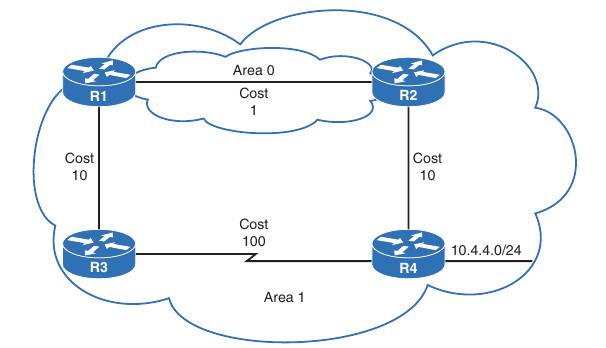

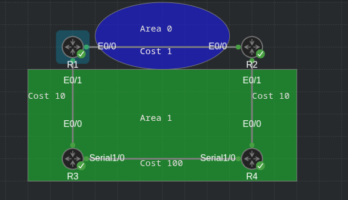

```
R1#show ip route 10.4.4.0
Routing entry for 10.4.4.0/24
  Known via "ospf 1", distance 110, metric 111, type intra area
  Last update from 10.1.13.3 on Ethernet0/1, 00:00:56 ago
  Routing Descriptor Blocks:
  * 10.1.13.3, from 192.168.4.4, 00:00:56 ago, via Ethernet0/1
      Route metric is 111, traffic share count is 1
```

#### Inter-Area routes

- The next priority for selecting a path to a network in a different area is selection of the path with the lowest total path metric to the destination

- If there is a tie in metric, both paths install into the OSPF RIB

- All inter-area paths for a route must go through Area 0 to be considered

- Below, R1 is computing the path to R6

- R1 uses the path R1-> R3-> R5 -> R6 because it's total path metric is 35 as compared to the metric of 40 for the R1-> R2 -> R4 -> R6 path

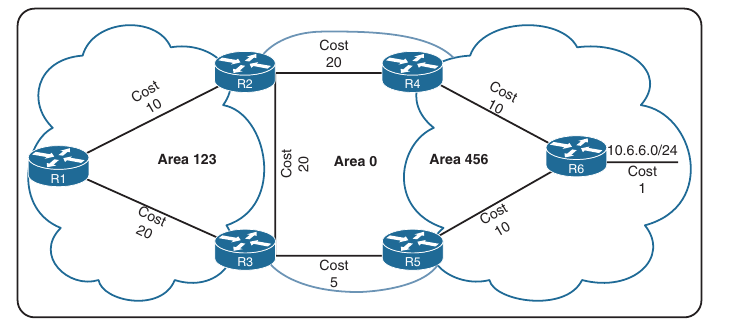

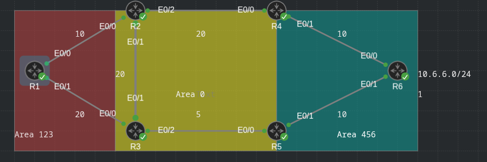

```
R1(config-if)#do sh ip route 10.6.6.0
Routing entry for 10.6.6.0/24
  Known via "ospf 1", distance 110, metric 36, type inter area
  Last update from 10.1.13.3 on Ethernet0/1, 00:00:33 ago
  Routing Descriptor Blocks:
  * 10.1.13.3, from 192.168.3.3, 00:00:33 ago, via Ethernet0/1
      Route metric is 36, traffic share count is 1
```

#### External Route Selection

- External routes are classified as Type 1 or Type 2

- The main differences between Type 1 and Type 2 external OSPF routes are as follows:

    - Type 1 routes are preferred over Type 2 routes

    - The Type 1 metric equals the redistribution metric plus the total path metric to the ASBR. In other words, as the LSA propagates away from the originating ASBR, the metric increases

    - The Type 2 metric equals with the redistribution metric. The metric is the same for the router next to the ASBR as for the router 30 hops away from the originating ASBR

    - This is the default external metric type that OSPF uses

- Explanations of the best-path calculation for external routes

##### E1 and N1 External routes

- External OSPF Type 1 route calculation involves the redistribution metric plus the lowest path metric to reach the ASBR that advertised the network

- Type 1 path metrics are lower for routes closer to the originating ASBR, whereas the path metric is higher for a router 10 hops away from the ASBR

- If there is a tie in the path metric, both routes are installed into the RIB

- If the ASBR is in a different area, the path of the traffic must go through Area 0

- An ABR does not install O E1 and O N1 routes into the RIB on the same time for the same prefix

- O N1 is always given preference for a typical NSSA, and it's presence prevents O E1 from being installed on the ABR for the same prefix

##### E2 and N2 External routes

- External OSPF Type 2 routes do not increment in metric, regardless of the path metric to the ASBR

- If there is a tie in the redistribution metric, the router compares the forwarding cost

- The forwarding cost is the metric to the ASBR that advertised that network, and the lower forwarding cost is preferred

- If there is a tie in forwarding cost, both routes are installed into the routing table

- An ABR does not install O E2 and O N2 routes into the RIB at the same time for the same prefix

- O N2 is always given preference for a Typical NSSA, and it's presence prevents the O E2 from being installed on the ABR for the same prefix

- Below is shown the topology for R1 computing a path to the external network (172.16.0.0/24) that is being redistributed

- The path R1 -> R2 -> R4 -> R6 has a metric of 20, which ties with the path R1 -> R3 -> R5 -> R7

- The forwarding metric of the R1 -> R2 -> R4 -> R6 is 31 and the forwarding metric of the R1 -> R3 -> R5 -> R7 path is 30

- R1 installs the R1 -> R3 -> R5 -> R7 path into the routing table

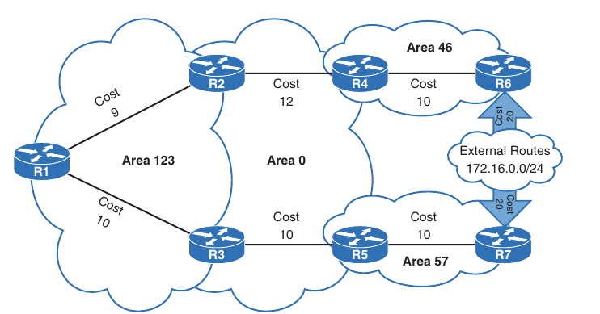

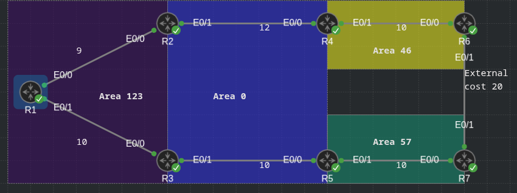

- Below is shown R1's metric and forwarding metric to the 172.16.0.0/24 network

```
R1-CSR#show ip route 172.16.0.0 
Routing entry for 172.16.0.0/24, 1 known subnets
O E2     172.16.0.0 [110/20] via 10.1.13.3, 00:00:36, GigabitEthernet2
R1-CSR#show ip route 172.16.0.0 255.255.255.0
Routing entry for 172.16.0.0/24
  Known via "ospf 1", distance 110, metric 20, type extern 2, forward metric 30
  Last update from 10.1.13.3 on GigabitEthernet2, 00:00:43 ago
  Routing Descriptor Blocks:
  * 10.1.13.3, from 192.168.7.7, 00:00:43 ago, via GigabitEthernet2
      Route metric is 20, traffic share count is 1
```

- **IMPORTANT**:

- The logic for chosing an O Nx route (Type 7 LSA) over an O Ex route (Type 5 LSA) is defined in RFC 3101

- Choosing an O Nx is the current default for IOS XE implementations

- RFC1583 prefers an O Ex route (Type 5 LSA) over an O Nx route (Type 7 LSA)

- RFC1583 path selection can be enabled with the command `compatible rfc1583`

- R7:

```
conf t
 router ospf 1
  compatible rfc1583
```

```
R7(config-router)#compatible ?
  rfc1583  compatible with RFC 1583
  rfc1587  compatible with RFC 1587
  rfc5243  supports DBD exchange optimization
```

#### Equal-Cost Multipathing

- If OSPF identifies multiple paths in the algorithms discussed, these routes are installed into the routing table using equal-cost multipathing (ECMP)

- The default maximum number of ECMP paths is four

- The default ECMP setting can be overwritten with the command `maximum-paths <maximum-paths>` under the OSPF process to modify the default setting

```
conf t
 router ospf 1
  maximum-paths 6
```

### Summarization of Routes

- Route scalability is a large factor for the Interior Gateway Protocols used by service providers because there can be thousands of routers running in the network

- Splitting up an OSPF routing domain into multiple areas reduces the size of each area's LSDB

- While the number of routers and networks remain the same within the OSPF routing domain, the detailed Type 1 and Type 2 LSAs are exchanged for simpler Type 3 LSAs

- For example, look at our original topology (the one with area 1234, area 0 and area 56)

- For area 1234 there are three Type 1 LSAs and one Type 2 LSA for the 10.123.1.0/24 network

- Those 4 LSAs become one Type 3 LSA outside of area 1234

- Below is ilustrated the reduction of LSAs through area segmentation for network 10.123.1.0/24

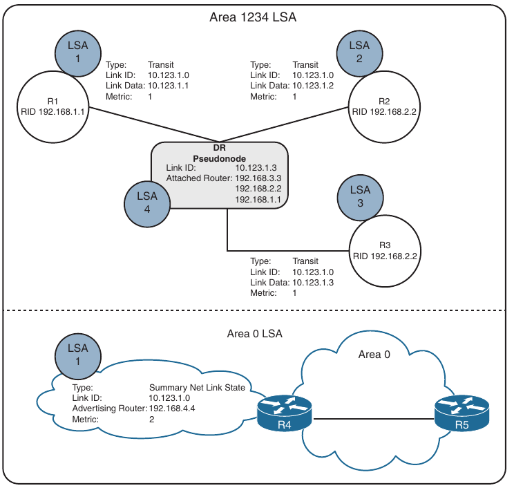

#### Summarization Fundamentals

- Another method from shrinking the LSDB involves summarizing network prefixes

- Newer routers have more memory and faster processors than do older ones, but because all routers have an identical copy of the LSDB, an OSPF area needs to accomodate the smallest and slowest router in that area

- Summarization of routes also helps SPF calculations run faster

- A router that has 10000 network routes will take longer to run the SPF calculation than a router with 500 network routes

- Because all routers within an area must maintain an identical copy of the LSDB, summarization occurs between areas on the ABRs

- Summarization can eliminate the SPF calculation outside the area for the summarized prefixes because the smaller prefixes are hidden

- Below is a simple network topology in which the serial link (between R3 and R4) significantly adds to the path metric, and all traffic uses the path through R2 to reach the 172.16.46.0/24 network

- If the 10.1.12.0/24 link fails, all routers in Area 1 have to run SPF calculations

- R2 identifies that the 10.1.13.0/24 and 10.1.34.0/24 networks change their next hop through the serial link

- Both of the Type 3 LSAs for these networks need to be updated with the new path metrics and advertised into Area 0

- The routers in Area 0 run an SPF calculation only on those two prefixes

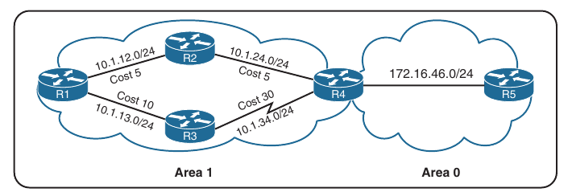

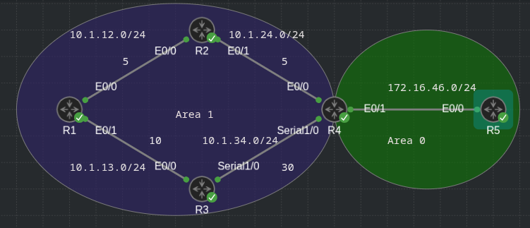

- Below are shown the networks in Area 1 being summarized at the ABR into the aggregate 10.1.0.0/18 prefix

- If the 10.1.12.0/24 network link fails, all the routers in Area 1 can still perform the SPF calculation, but routers in Area 0 are not affected because the 10.1.13.0/24 and 10.1.34.0/24 networks are not known outside Area 1

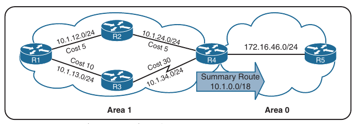

- This concept applies to networks of varying sizes but is beneficial for networks with carefully developed IP addressing and proper summarization

#### Inter-Area Summarization

- Inter-area summarization reduces the number of Type 3 LSAs that an ABR advertises into an area when it receives Type 1 LSAs

- The network summarization range is associated with a specific source area for Type 1 LSAs

- When a Type 1 LSA in the summarization range reaches the ABR from the source area, the ABR creates a Type 3 LSA for the summarized network range

- The ABR suppresses the more specific Type 3 LSAs from being generated and advertised in the neighboring areas

- Inter-area summarization does not impact the Type 1 LSAs within the source area

- Below is illustrated the concept, with the three Type 1 LSAs (172.16.1.0/24, 172.16.2.0/24 and 172.16.3.0/24) being summarized into one Type 3 LSA, as the 172.16.0.0/20 network

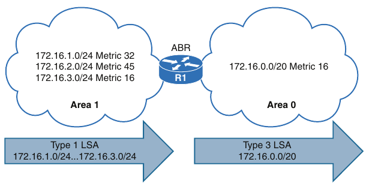

- Summarization works only on Type 1 LSAs and is normally configured, or designed so that summarization occurs as routes enter the backbone area from nonbackbone areas (or goes from the backbone to another area)

- Cisco IOS-XE set the default metric for the summary LSA to be the lowest metric associated with a LSA based on RFC1583 guidelines

- However, the summary metric can statically be set as part of the configuration

- In the picture from above R1 summarizes three prefixes with various path costs

- The 172.16.3.0/24 prefix has the lowest metric, so that metric will be used for the summarized route

- OSPF behaves similar to Enhanced Interior Gateway Routing Protocol (EIGRP) in that it checks every prefix in the summarization range when a matching Type 1 LSA is added or removed

- If a lower metric is available, the summary LSA is advertised with the newer metric; if the lowest metric is removed a newer and higher metric is identified, and a new summary LSA is advertised with the higher metric

#### Configuration of Inter-area Summarization

- You define the summarization range and associated area by using the command `area <area-id> range <network> <subnet-mask> [advertise|not-advertise|cost <metric>]` under the OSPF process:

- R4:

```
conf t
 router ospf 1
  area 1 range 10.1.0.0 255.255.192.0
  !!! THE AREA ID IS THE AREA FROM WHERE THE RANGE IS ADVERTISED
```

- The default behaviour is to advertise the summary prefix, so the keyword `advertise` is not necessary

- Appending the `cost <metric>` on the command statically sets the metric on the summary route

- Below is a topology example on which R1 is advertising the 172.16.1.0/24, 172.16.2.0/24 and 172.16.3.0/24 networks 

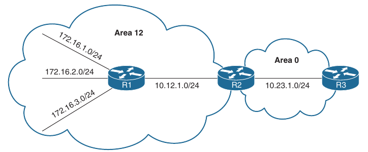

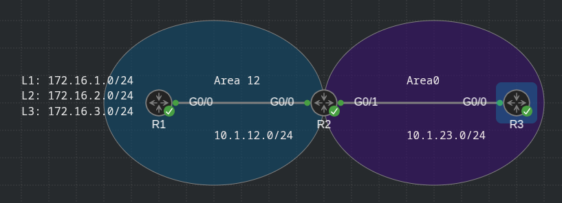

- Below is shown the routing table of R3 before summarization

- Notice that 172.16.1.0/24, 172.16.2.0/24 and 172.16.3.0/24 routes are all present

```
R3(config-router)#do sh ip ro ospf | b Gate
Gateway of last resort is not set

      10.0.0.0/8 is variably subnetted, 3 subnets, 2 masks
O IA     10.1.12.0/24 [110/2] via 10.1.23.2, 00:08:28, GigabitEthernet0/0
      172.16.0.0/24 is subnetted, 3 subnets
O IA     172.16.1.0 [110/3] via 10.1.23.2, 00:08:28, GigabitEthernet0/0
O IA     172.16.2.0 [110/3] via 10.1.23.2, 00:08:28, GigabitEthernet0/0
O IA     172.16.3.0 [110/3] via 10.1.23.2, 00:08:28, GigabitEthernet0/0
      192.168.1.0/32 is subnetted, 1 subnets
O IA     192.168.1.1 [110/3] via 10.1.23.2, 00:08:28, GigabitEthernet0/0
      192.168.2.0/32 is subnetted, 1 subnets
O        192.168.2.2 [110/2] via 10.1.23.2, 00:08:28, GigabitEthernet0/0
```

- As the component routes 172.16.1.0/24, 172.16.2.0/24 and 172.16.3.0/24 are being advertised into Area 0, R2 summarizes them into a single summary route: 172.16.0.0/16

- Below is provided the R2 configuration for inter-area summarization into an aggregate route 172.16.0.0/16

- A static cost of 45 has been added to the summary route to reduce CPU load if any of the three networks flap

- R2:

```
conf t
 router ospf 1
  area 12 range 172.16.0.0 255.255.0.0 cost 45
```

- Below is shown R3's routing table, which can be used to verify that the smaller component routes were suppressed while the summary route was aggregated

- Notice in this output that the path metric is 46, whereas previously the metric for the 172.16.1.0/24 was 3

```
R3(config-router)#do sh ip ro ospf | b Gate
Gateway of last resort is not set

      10.0.0.0/8 is variably subnetted, 3 subnets, 2 masks
O IA     10.1.12.0/24 [110/2] via 10.1.23.2, 00:16:09, GigabitEthernet0/0
O IA  172.16.0.0/16 [110/46] via 10.1.23.2, 00:03:19, GigabitEthernet0/0
      192.168.1.0/32 is subnetted, 1 subnets
O IA     192.168.1.1 [110/3] via 10.1.23.2, 00:16:09, GigabitEthernet0/0
      192.168.2.0/32 is subnetted, 1 subnets
O        192.168.2.2 [110/2] via 10.1.23.2, 00:16:09, GigabitEthernet0/0
```

- The ABR performing inter-area summarization installs discard routes, which are routes to the Null0 interface that match the summarized network

- Discard routes prevent routing loops where portions of the summarized network range do not have a more specific route in the RIB

- The administrative distance (AD) for OSPF summary discard route for internal networks is 110, and it is 254 for external networks

- Below is shown the discard route to Null0 on R2

```
R2(config-router)#do sh ip ro ospf | b Gate
Gateway of last resort is not set

      172.16.0.0/16 is variably subnetted, 4 subnets, 2 masks
O        172.16.0.0/16 is a summary, 00:08:17, Null0
O        172.16.1.0/24 [110/2] via 10.1.12.1, 00:08:17, GigabitEthernet0/0
O        172.16.2.0/24 [110/2] via 10.1.12.1, 00:08:17, GigabitEthernet0/0
O        172.16.3.0/24 [110/2] via 10.1.12.1, 00:08:17, GigabitEthernet0/0
      192.168.1.0/32 is subnetted, 1 subnets
O        192.168.1.1 [110/2] via 10.1.12.1, 00:08:17, GigabitEthernet0/0
      192.168.3.0/32 is subnetted, 1 subnets
O        192.168.3.3 [110/2] via 10.1.23.3, 00:08:17, GigabitEthernet0/1
```

- Area ramge - O IA routes - summarization performed by the ABR

- Area ID in the command is the origin area of the routes (FROM where the routes are coming)

#### External Summarization

- During OSPF redistribution, external routes are redistributed into the OSPF domain into Type 5 or Type 7 LSAs (NSSA)

- External summarization reduces the number of external LSAs in an OSPF domain

- As external summarization route is configured on the ASBR router, and a smaller component route that matches the network range does not generate a Type 5/Type 7 LSA for the specific prefix

- Instead a Type 5/Type 7 LSA with the external summary route is created, and the smaller component routes in the summary routes are suppressed

- Below is demonstrated the concept with the external network summarization range 172.16.0.0/20 configured on the ASBR (R6)

- The ASBR creates only one Type 5/Type 7 LSA in Area 56 where EIGRP redistributes routes into OSPF

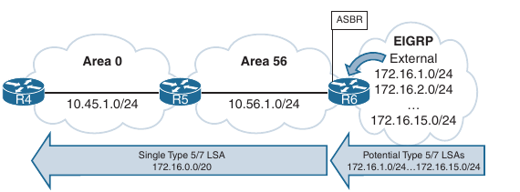

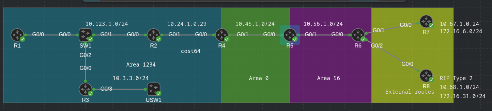

- Routing table on R5 before external summarization:

```
R5(config-router)#do sh ip ro ospf | b Gate
Gateway of last resort is not set

      10.0.0.0/8 is variably subnetted, 9 subnets, 3 masks
O IA     10.3.3.0/24 [110/67] via 10.45.1.4, 00:00:44, GigabitEthernet0/0
O IA     10.24.1.0/29 [110/65] via 10.45.1.4, 00:00:44, GigabitEthernet0/0
O E2     10.67.1.0/24 [110/20] via 10.56.1.6, 00:00:14, GigabitEthernet0/1
O E2     10.68.1.0/24 [110/250] via 10.56.1.6, 00:00:14, GigabitEthernet0/1
O IA     10.123.1.0/24 [110/66] via 10.45.1.4, 00:00:44, GigabitEthernet0/0
      172.16.0.0/24 is subnetted, 16 subnets
O E2     172.16.1.0 [110/20] via 10.56.1.6, 00:00:14, GigabitEthernet0/1
O E2     172.16.2.0 [110/20] via 10.56.1.6, 00:00:14, GigabitEthernet0/1
O E2     172.16.3.0 [110/20] via 10.56.1.6, 00:00:14, GigabitEthernet0/1
O E2     172.16.4.0 [110/20] via 10.56.1.6, 00:00:14, GigabitEthernet0/1
O E2     172.16.5.0 [110/20] via 10.56.1.6, 00:00:14, GigabitEthernet0/1
O E2     172.16.6.0 [110/20] via 10.56.1.6, 00:00:14, GigabitEthernet0/1
O E2     172.16.7.0 [110/20] via 10.56.1.6, 00:00:14, GigabitEthernet0/1
O E2     172.16.8.0 [110/20] via 10.56.1.6, 00:00:14, GigabitEthernet0/1
O E2     172.16.9.0 [110/20] via 10.56.1.6, 00:00:14, GigabitEthernet0/1
O E2     172.16.10.0 [110/20] via 10.56.1.6, 00:00:14, GigabitEthernet0/1
O E2     172.16.11.0 [110/20] via 10.56.1.6, 00:00:14, GigabitEthernet0/1
O E2     172.16.12.0 [110/20] via 10.56.1.6, 00:00:14, GigabitEthernet0/1
O E2     172.16.13.0 [110/20] via 10.56.1.6, 00:00:14, GigabitEthernet0/1
O E2     172.16.14.0 [110/20] via 10.56.1.6, 00:00:14, GigabitEthernet0/1
O E2     172.16.15.0 [110/20] via 10.56.1.6, 00:00:14, GigabitEthernet0/1
O E2     172.16.31.0 [110/250] via 10.56.1.6, 00:00:14, GigabitEthernet0/1
      192.168.1.0/32 is subnetted, 1 subnets
O IA     192.168.1.1 [110/67] via 10.45.1.4, 00:00:44, GigabitEthernet0/0
      192.168.3.0/32 is subnetted, 1 subnets
O IA     192.168.3.3 [110/67] via 10.45.1.4, 00:00:44, GigabitEthernet0/0
      192.168.6.0/32 is subnetted, 1 subnets
O        192.168.6.6 [110/2] via 10.56.1.6, 00:00:14, GigabitEthernet0/1
```

- To configure external summarization, you use the command `summary-address <prefix> <subnet-mask>` under the OSPF process

- Below is demonstrated the configuration for external route summarization on R6, the ASBR

```
conf t
 router ospf 1
  router-id 192.168.6.6
  summary-address 172.16.0.0 255.255.240.0 # 172.16.0.0/20
  redistribute eigrp 65001 subnets
  passive-interface Loopback0
  network 10.56.1.0 0.0.0.255 area 56
  network 192.168.6.6 0.0.0.0 area 56
```

- Below is shown R5's routing table after summarization, which verifies that the component routes were summarized into the 172.16.0.0/20 summary network

```
R5(config-router)#do sh ip ro ospf | b Gate
Gateway of last resort is not set

      10.0.0.0/8 is variably subnetted, 9 subnets, 3 masks
O IA     10.3.3.0/24 [110/67] via 10.45.1.4, 00:04:43, GigabitEthernet0/0
O IA     10.24.1.0/29 [110/65] via 10.45.1.4, 00:04:43, GigabitEthernet0/0
O E2     10.67.1.0/24 [110/20] via 10.56.1.6, 00:04:13, GigabitEthernet0/1
O E2     10.68.1.0/24 [110/250] via 10.56.1.6, 00:04:13, GigabitEthernet0/1
O IA     10.123.1.0/24 [110/66] via 10.45.1.4, 00:04:43, GigabitEthernet0/0
      172.16.0.0/16 is variably subnetted, 2 subnets, 2 masks
O E2     172.16.0.0/20 [110/20] via 10.56.1.6, 00:00:19, GigabitEthernet0/1
O E2     172.16.31.0/24 [110/250] via 10.56.1.6, 00:04:13, GigabitEthernet0/1
      192.168.1.0/32 is subnetted, 1 subnets
O IA     192.168.1.1 [110/67] via 10.45.1.4, 00:04:43, GigabitEthernet0/0
      192.168.3.0/32 is subnetted, 1 subnets
O IA     192.168.3.3 [110/67] via 10.45.1.4, 00:04:43, GigabitEthernet0/0
      192.168.6.0/32 is subnetted, 1 subnets
O        192.168.6.6 [110/2] via 10.56.1.6, 00:04:13, GigabitEthernet0/1
```

- R5:

```
R5#show ip route 172.16.0.0 255.255.240.0
Routing entry for 172.16.0.0/20
  Known via "ospf 1", distance 110, metric 20, type extern 2, forward metric 1
  Last update from 10.56.1.6 on GigabitEthernet0/1, 00:00:33 ago
  Routing Descriptor Blocks:
  * 10.56.1.6, from 192.168.6.6, 00:00:33 ago, via GigabitEthernet0/1
      Route metric is 20, traffic share count is 1
```

- Summary-address command - O E1/O E2/O N1/ O N2 routes - Summarization performed by the ASBR

- You also can use `not-advertise` keyword when creating a summary external route. The route will not be advertised to other OSPF routers

```
conf t
 router ospf 1
  summary-address 172.16.0.0 255.255.240.0 not-advertise
```

- Routing table of R5 when `not-advertise` is used

```
R5#show ip route ospf | b Gate
Gateway of last resort is not set

      10.0.0.0/8 is variably subnetted, 9 subnets, 3 masks
O IA     10.3.3.0/24 [110/67] via 10.45.1.4, 00:22:27, GigabitEthernet0/0
O IA     10.24.1.0/29 [110/65] via 10.45.1.4, 00:22:27, GigabitEthernet0/0
O E2     10.67.1.0/24 [110/20] via 10.56.1.6, 00:21:57, GigabitEthernet0/1
O E2     10.68.1.0/24 [110/250] via 10.56.1.6, 00:21:57, GigabitEthernet0/1
O IA     10.123.1.0/24 [110/66] via 10.45.1.4, 00:22:27, GigabitEthernet0/0
      172.16.0.0/24 is subnetted, 1 subnets
O E2     172.16.31.0 [110/250] via 10.56.1.6, 00:21:57, GigabitEthernet0/1
      192.168.1.0/32 is subnetted, 1 subnets
O IA     192.168.1.1 [110/67] via 10.45.1.4, 00:22:27, GigabitEthernet0/0
      192.168.3.0/32 is subnetted, 1 subnets
O IA     192.168.3.3 [110/67] via 10.45.1.4, 00:22:27, GigabitEthernet0/0
      192.168.6.0/32 is subnetted, 1 subnets
O        192.168.6.6 [110/2] via 10.56.1.6, 00:21:57, GigabitEthernet0/1
```

- The summary ASBR installs a discard route to Null0 that matches the summary route as part of a loop-prevention mechanism

- Below is shown the routing table of R6 with the external summary discard route

```
R6(config-router)#do sh ip ro ospf | b Gate
Gateway of last resort is not set

      10.0.0.0/8 is variably subnetted, 10 subnets, 3 masks
O IA     10.3.3.0/24 [110/68] via 10.56.1.5, 00:25:57, GigabitEthernet0/0
O IA     10.24.1.0/29 [110/66] via 10.56.1.5, 00:25:57, GigabitEthernet0/0
O IA     10.45.1.0/24 [110/2] via 10.56.1.5, 00:25:57, GigabitEthernet0/0
O IA     10.123.1.0/24 [110/67] via 10.56.1.5, 00:25:57, GigabitEthernet0/0
      172.16.0.0/16 is variably subnetted, 17 subnets, 2 masks
O        172.16.0.0/20 is a summary, 00:03:05, Null0
      192.168.1.0/32 is subnetted, 1 subnets
O IA     192.168.1.1 [110/68] via 10.56.1.5, 00:25:57, GigabitEthernet0/0
      192.168.3.0/32 is subnetted, 1 subnets
O IA     192.168.3.3 [110/68] via 10.56.1.5, 00:25:57, GigabitEthernet0/0
      192.168.5.0/32 is subnetted, 1 subnets
O        192.168.5.5 [110/2] via 10.56.1.5, 00:25:57, GigabitEthernet0/0
```

- When `not-advertise` is used, the route is not installed even on the local router's routing table, as discard route

```
R6(config-router)#do sh ip ro ospf | b Gate
Gateway of last resort is not set

      10.0.0.0/8 is variably subnetted, 10 subnets, 3 masks
O IA     10.3.3.0/24 [110/68] via 10.56.1.5, 00:26:43, GigabitEthernet0/0
O IA     10.24.1.0/29 [110/66] via 10.56.1.5, 00:26:43, GigabitEthernet0/0
O IA     10.45.1.0/24 [110/2] via 10.56.1.5, 00:26:43, GigabitEthernet0/0
O IA     10.123.1.0/24 [110/67] via 10.56.1.5, 00:26:43, GigabitEthernet0/0
      192.168.1.0/32 is subnetted, 1 subnets
O IA     192.168.1.1 [110/68] via 10.56.1.5, 00:26:43, GigabitEthernet0/0
      192.168.3.0/32 is subnetted, 1 subnets
O IA     192.168.3.3 [110/68] via 10.56.1.5, 00:26:43, GigabitEthernet0/0
      192.168.5.0/32 is subnetted, 1 subnets
O        192.168.5.5 [110/2] via 10.56.1.5, 00:26:43, GigabitEthernet0/0
```

- The summary route is also not present on the LSDB in this case

```
R6(config-router)#do sh ip ospf database ext 172.16.0.0

            OSPF Router with ID (192.168.6.6) (Process ID 1)
```

- ABRs for NSSAs act as ASBRs when a Type 7 LSA is converted to a Type 5 LSA 

- External summarization can be performed on ABRs only when they match this scenario

- R5 - configure area 56 as NSSA with a default route:

```
R5(config-router)#do sh run | s router ospf
router ospf 1
 router-id 192.168.5.5
 area 56 nssa default-information-originate
 passive-interface Loopback0
 network 10.45.1.0 0.0.0.255 area 0
 network 0.0.0.0 255.255.255.255 area 56
```

- R6 - Configure area 56 as NSSA:

```
R6(config-router)#do sh run | s router ospf
router ospf 1
 router-id 192.168.6.6
 area 56 nssa
 redistribute eigrp 65001 subnets
 passive-interface Loopback0
 network 10.56.1.0 0.0.0.255 area 56
 network 192.168.6.6 0.0.0.0 area 56
```

- Database on R5 before:

```
R5(config-router)#do sh ip ospf database                     

            OSPF Router with ID (192.168.5.5) (Process ID 1)

(...)          
                Type-7 AS External Link States (Area 56)

Link ID         ADV Router      Age         Seq#       Checksum Tag
0.0.0.0         192.168.5.5     476         0x80000001 0x00BF7E 0
10.67.1.0       192.168.6.6     532         0x80000001 0x001746 0
10.68.1.0       192.168.6.6     532         0x80000001 0x001065 0
172.16.1.0      192.168.6.6     498         0x80000001 0x003BB2 0
172.16.2.0      192.168.6.6     498         0x80000001 0x0030BC 0
172.16.3.0      192.168.6.6     498         0x80000001 0x0025C6 0
172.16.4.0      192.168.6.6     498         0x80000001 0x001AD0 0
172.16.5.0      192.168.6.6     498         0x80000001 0x000FDA 0
172.16.6.0      192.168.6.6     498         0x80000001 0x0004E4 0
172.16.7.0      192.168.6.6     498         0x80000001 0x00F8EE 0
172.16.8.0      192.168.6.6     498         0x80000001 0x00EDF8 0
172.16.9.0      192.168.6.6     498         0x80000001 0x00E203 0
172.16.10.0     192.168.6.6     498         0x80000001 0x00D70D 0
172.16.11.0     192.168.6.6     498         0x80000001 0x00CC17 0
172.16.12.0     192.168.6.6     498         0x80000001 0x00C121 0
172.16.13.0     192.168.6.6     498         0x80000001 0x00B62B 0
172.16.14.0     192.168.6.6     498         0x80000001 0x00AB35 0
172.16.15.0     192.168.6.6     498         0x80000001 0x00A03F 0

                Type-5 AS External Link States

Link ID         ADV Router      Age         Seq#       Checksum Tag
10.67.1.0       192.168.5.5     465         0x80000001 0x00B8B0 0
10.68.1.0       192.168.5.5     465         0x80000001 0x00B1CF 0
172.16.1.0      192.168.5.5     218         0x80000001 0x00DC1D 0
172.16.2.0      192.168.5.5     218         0x80000001 0x00D127 0
172.16.3.0      192.168.5.5     218         0x80000001 0x00C631 0
172.16.4.0      192.168.5.5     218         0x80000001 0x00BB3B 0
172.16.5.0      192.168.5.5     218         0x80000001 0x00B045 0
172.16.6.0      192.168.5.5     218         0x80000001 0x00A54F 0
172.16.7.0      192.168.5.5     218         0x80000001 0x009A59 0
172.16.8.0      192.168.5.5     218         0x80000001 0x008F63 0
172.16.9.0      192.168.5.5     218         0x80000001 0x00846D 0
172.16.10.0     192.168.5.5     218         0x80000001 0x007977 0
172.16.11.0     192.168.5.5     218         0x80000001 0x006E81 0
172.16.12.0     192.168.5.5     218         0x80000001 0x00638B 0
172.16.13.0     192.168.5.5     218         0x80000001 0x005895 0
172.16.14.0     192.168.5.5     218         0x80000001 0x004D9F 0
172.16.15.0     192.168.5.5     218         0x80000001 0x0042A9 0
```

- Configure summary address on R5 (the router that is the ABR that converts Type 7 LSA to Type 5 LSA)

```
conf t
 router ospf 1
  summary-address 172.16.0.0 255.255.240.0
```

- R4's OSPF routing table before summarization on R5:

```
R4#show ip route ospf | b Gate
Gateway of last resort is not set

      10.0.0.0/8 is variably subnetted, 9 subnets, 3 masks
O        10.3.3.0/24 [110/66] via 10.24.1.2, 00:13:16, GigabitEthernet0/0
O IA     10.56.1.0/24 [110/2] via 10.45.1.5, 00:12:34, GigabitEthernet0/1
O E2     10.67.1.0/24 [110/20] via 10.45.1.5, 00:04:17, GigabitEthernet0/1
O E2     10.68.1.0/24 [110/250] via 10.45.1.5, 00:04:17, GigabitEthernet0/1
O        10.123.1.0/24 [110/65] via 10.24.1.2, 00:13:16, GigabitEthernet0/0
      172.16.0.0/24 is subnetted, 15 subnets
O E2     172.16.1.0 [110/20] via 10.45.1.5, 00:00:11, GigabitEthernet0/1
O E2     172.16.2.0 [110/20] via 10.45.1.5, 00:00:11, GigabitEthernet0/1
O E2     172.16.3.0 [110/20] via 10.45.1.5, 00:00:11, GigabitEthernet0/1
O E2     172.16.4.0 [110/20] via 10.45.1.5, 00:00:11, GigabitEthernet0/1
O E2     172.16.5.0 [110/20] via 10.45.1.5, 00:00:11, GigabitEthernet0/1
O E2     172.16.6.0 [110/20] via 10.45.1.5, 00:00:11, GigabitEthernet0/1
O E2     172.16.7.0 [110/20] via 10.45.1.5, 00:00:11, GigabitEthernet0/1
O E2     172.16.8.0 [110/20] via 10.45.1.5, 00:00:11, GigabitEthernet0/1
O E2     172.16.9.0 [110/20] via 10.45.1.5, 00:00:11, GigabitEthernet0/1
O E2     172.16.10.0 [110/20] via 10.45.1.5, 00:00:11, GigabitEthernet0/1
O E2     172.16.11.0 [110/20] via 10.45.1.5, 00:00:11, GigabitEthernet0/1
O E2     172.16.12.0 [110/20] via 10.45.1.5, 00:00:11, GigabitEthernet0/1
O E2     172.16.13.0 [110/20] via 10.45.1.5, 00:00:11, GigabitEthernet0/1
O E2     172.16.14.0 [110/20] via 10.45.1.5, 00:00:11, GigabitEthernet0/1
O E2     172.16.15.0 [110/20] via 10.45.1.5, 00:00:11, GigabitEthernet0/1
      192.168.1.0/32 is subnetted, 1 subnets
O        192.168.1.1 [110/66] via 10.24.1.2, 00:13:16, GigabitEthernet0/0
      192.168.3.0/32 is subnetted, 1 subnets
O        192.168.3.3 [110/66] via 10.24.1.2, 00:13:16, GigabitEthernet0/0
      192.168.5.0/32 is subnetted, 1 subnets
O IA     192.168.5.5 [110/2] via 10.45.1.5, 00:12:34, GigabitEthernet0/1
      192.168.6.0/32 is subnetted, 1 subnets
O IA     192.168.6.6 [110/3] via 10.45.1.5, 00:04:18, GigabitEthernet0/1
```

- R5's OSPF database after summarization:

```
R5(config-router)#do sh ip ospf database                     

            OSPF Router with ID (192.168.5.5) (Process ID 1)

(...)
          
                Type-7 AS External Link States (Area 56)

Link ID         ADV Router      Age         Seq#       Checksum Tag
0.0.0.0         192.168.5.5     598         0x80000001 0x00BF7E 0
10.67.1.0       192.168.6.6     654         0x80000001 0x001746 0
10.68.1.0       192.168.6.6     654         0x80000001 0x001065 0
172.16.1.0      192.168.6.6     620         0x80000001 0x003BB2 0
172.16.2.0      192.168.6.6     620         0x80000001 0x0030BC 0
172.16.3.0      192.168.6.6     620         0x80000001 0x0025C6 0
172.16.4.0      192.168.6.6     620         0x80000001 0x001AD0 0
172.16.5.0      192.168.6.6     620         0x80000001 0x000FDA 0
172.16.6.0      192.168.6.6     620         0x80000001 0x0004E4 0
172.16.7.0      192.168.6.6     620         0x80000001 0x00F8EE 0
172.16.8.0      192.168.6.6     620         0x80000001 0x00EDF8 0
172.16.9.0      192.168.6.6     620         0x80000001 0x00E203 0
172.16.10.0     192.168.6.6     620         0x80000001 0x00D70D 0
172.16.11.0     192.168.6.6     620         0x80000001 0x00CC17 0
172.16.12.0     192.168.6.6     620         0x80000001 0x00C121 0
172.16.13.0     192.168.6.6     620         0x80000001 0x00B62B 0
172.16.14.0     192.168.6.6     620         0x80000001 0x00AB35 0
172.16.15.0     192.168.6.6     620         0x80000001 0x00A03F 0

                Type-5 AS External Link States

Link ID         ADV Router      Age         Seq#       Checksum Tag
10.67.1.0       192.168.5.5     587         0x80000001 0x00B8B0 0
10.68.1.0       192.168.5.5     587         0x80000001 0x00B1CF 0
172.16.0.0      192.168.5.5     11          0x80000001 0x00C9B5 0
```

- Routing table on R5 is the same (as it prefers NSSA routes by default - RFC3101)

- Also R5 installs an OSPF route to Null0 for the summary prefix

```
R5(config-router)#do sh ip ro ospf | b Gate
Gateway of last resort is not set

      10.0.0.0/8 is variably subnetted, 9 subnets, 3 masks
O IA     10.3.3.0/24 [110/67] via 10.45.1.4, 00:12:06, GigabitEthernet0/0
O IA     10.24.1.0/29 [110/65] via 10.45.1.4, 00:12:06, GigabitEthernet0/0
O N2     10.67.1.0/24 [110/20] via 10.56.1.6, 00:11:56, GigabitEthernet0/1
O N2     10.68.1.0/24 [110/250] via 10.56.1.6, 00:11:56, GigabitEthernet0/1
O IA     10.123.1.0/24 [110/66] via 10.45.1.4, 00:12:06, GigabitEthernet0/0
      172.16.0.0/16 is variably subnetted, 16 subnets, 2 masks
O        172.16.0.0/20 is a summary, 00:02:19, Null0
O N2     172.16.1.0/24 [110/20] via 10.56.1.6, 00:11:56, GigabitEthernet0/1
O N2     172.16.2.0/24 [110/20] via 10.56.1.6, 00:11:56, GigabitEthernet0/1
O N2     172.16.3.0/24 [110/20] via 10.56.1.6, 00:11:56, GigabitEthernet0/1
O N2     172.16.4.0/24 [110/20] via 10.56.1.6, 00:11:56, GigabitEthernet0/1
O N2     172.16.5.0/24 [110/20] via 10.56.1.6, 00:11:56, GigabitEthernet0/1
O N2     172.16.6.0/24 [110/20] via 10.56.1.6, 00:11:56, GigabitEthernet0/1
O N2     172.16.7.0/24 [110/20] via 10.56.1.6, 00:11:56, GigabitEthernet0/1
O N2     172.16.8.0/24 [110/20] via 10.56.1.6, 00:11:56, GigabitEthernet0/1
O N2     172.16.9.0/24 [110/20] via 10.56.1.6, 00:11:56, GigabitEthernet0/1
O N2     172.16.10.0/24 [110/20] via 10.56.1.6, 00:11:56, GigabitEthernet0/1
O N2     172.16.11.0/24 [110/20] via 10.56.1.6, 00:11:56, GigabitEthernet0/1
O N2     172.16.12.0/24 [110/20] via 10.56.1.6, 00:11:56, GigabitEthernet0/1
O N2     172.16.13.0/24 [110/20] via 10.56.1.6, 00:11:56, GigabitEthernet0/1
O N2     172.16.14.0/24 [110/20] via 10.56.1.6, 00:11:56, GigabitEthernet0/1
O N2     172.16.15.0/24 [110/20] via 10.56.1.6, 00:11:56, GigabitEthernet0/1
      192.168.1.0/32 is subnetted, 1 subnets
O IA     192.168.1.1 [110/67] via 10.45.1.4, 00:12:06, GigabitEthernet0/0
      192.168.3.0/32 is subnetted, 1 subnets
O IA     192.168.3.3 [110/67] via 10.45.1.4, 00:12:06, GigabitEthernet0/0
      192.168.6.0/32 is subnetted, 1 subnets
O        192.168.6.6 [110/2] via 10.56.1.6, 00:11:56, GigabitEthernet0/1
```

- Routing table of R4 now:

```
R4#show ip route ospf | b Gate
Gateway of last resort is not set

      10.0.0.0/8 is variably subnetted, 9 subnets, 3 masks
O        10.3.3.0/24 [110/66] via 10.24.1.2, 00:28:33, GigabitEthernet0/0
O IA     10.56.1.0/24 [110/2] via 10.45.1.5, 00:27:51, GigabitEthernet0/1
O E2     10.67.1.0/24 [110/20] via 10.45.1.5, 00:19:34, GigabitEthernet0/1
O E2     10.68.1.0/24 [110/250] via 10.45.1.5, 00:19:34, GigabitEthernet0/1
O        10.123.1.0/24 [110/65] via 10.24.1.2, 00:28:33, GigabitEthernet0/0
      172.16.0.0/20 is subnetted, 1 subnets
O E2     172.16.0.0 [110/20] via 10.45.1.5, 00:09:59, GigabitEthernet0/1
      192.168.1.0/32 is subnetted, 1 subnets
O        192.168.1.1 [110/66] via 10.24.1.2, 00:28:33, GigabitEthernet0/0
      192.168.3.0/32 is subnetted, 1 subnets
O        192.168.3.3 [110/66] via 10.24.1.2, 00:28:33, GigabitEthernet0/0
      192.168.5.0/32 is subnetted, 1 subnets
O IA     192.168.5.5 [110/2] via 10.45.1.5, 00:27:51, GigabitEthernet0/1
      192.168.6.0/32 is subnetted, 1 subnets
O IA     192.168.6.6 [110/3] via 10.45.1.5, 00:19:35, GigabitEthernet0/1
```

#### Discontiguous Network

- A network engineer who does not fully understand OSPF design might create a topology such as the one from below

- While R2 and R4 have OSPF interfaces in Area 0, traffic from Area 12 must cross Area 234 to reach Area 45

- An OSPF network with this design is a discontiguous network because inter-area traffic is trying to cross a non-backbone Area

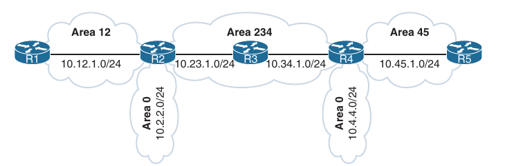

- Upon first glance at the routing table on R2 and R4, it seems as though routes are being advertised across Area 234; however that is not the case

- The 10.1.45.0/24 network is received by R4, injected into R4's area 0, and then readvertised to Area 234, where R2 installs the route

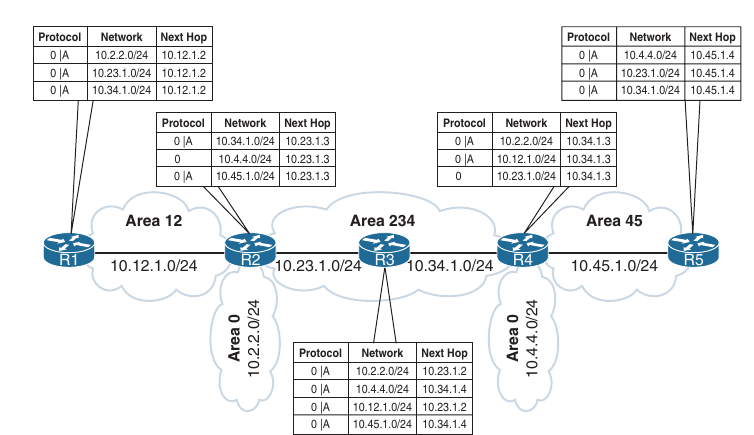

- Most people will assume that R1 would learn about the route learned by Area 45 because R4 is an ABR. However, they would be wrong

- ABRs follow three fundamental rules for creating Type 3 LSAs:

    - Type 1 LSAs received from an Area create Type 3 LSAs into backbone area and non-backbone areas

    - Type 3 LSAs received from Area 0 are created for the non-backbone area

    - Type 3 LSAs received from a non-backbone area are only inserted into the LSDB for the source area. The ABR does not create a Type 3 LSA for the other areas (including a segmented Area 0)

- The simplest fix for a discontiguous networks is to ensure that Area 0 is contiguous and convert the interfaces on R2, R3 and R4 to Area 0

- Another option is to use a virtual link

- R2's summary LSAs

```
R2(config-router)#do sh ip ospf data            

            OSPF Router with ID (192.168.2.2) (Process ID 1)

                Summary Net Link States (Area 0)

Link ID         ADV Router      Age         Seq#       Checksum
10.1.12.0       192.168.2.2     675         0x80000001 0x00B4F9
10.1.23.0       192.168.2.2     675         0x80000001 0x003B68
10.1.34.0       192.168.2.2     522         0x80000001 0x002668
192.168.1.1     192.168.2.2     597         0x80000001 0x000B4E
192.168.3.3     192.168.2.2     455         0x80000001 0x00E074


                Summary Net Link States (Area 12)

Link ID         ADV Router      Age         Seq#       Checksum
10.1.23.0       192.168.2.2     675         0x80000001 0x003B68
10.1.34.0       192.168.2.2     522         0x80000001 0x002668
10.2.2.0        192.168.2.2     675         0x80000001 0x00BC04
192.168.3.3     192.168.2.2     455         0x80000001 0x00E074

                Summary Net Link States (Area 234)

Link ID         ADV Router      Age         Seq#       Checksum
10.1.12.0       192.168.2.2     675         0x80000001 0x00B4F9
10.1.45.0       192.168.4.4     352         0x80000001 0x002E5B
10.2.2.0        192.168.2.2     675         0x80000001 0x00BC04
10.4.4.0        192.168.4.4     397         0x80000001 0x007444
192.168.1.1     192.168.2.2     597         0x80000001 0x000B4E
192.168.5.5     192.168.4.4     244         0x80000001 0x009CB0
```

- As you can see, the LSA for 10.45.1.0/24 is not sent out to Area 12, as the advertising router is not R2, but R4

#### Virtual Links

- OSPF virtual links provide a method to overcome discontiguous networks 

- Using a virtual link is similar to running a virtual tunnel within OSPF between an ABR and another multi-area OSPF router

- The tunnel belongs to the backbone (Area 0), and therefore the router terminating the virtual link becomes an ABR if it does not have an interface already associated with Area 0

- Below we can see our discontiguous network topology and shows a contiguous backbone between R2 and R4, with a virtual link across Area 234

- With the virtual link established, the routes from Area 12 are advertised into Area 45 and vice versa

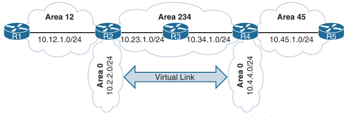

- Virtual links are built between routers in the same area

- The area in which the virtual link endpoints are established is known as the transit area

- Each router identifies the remote router by it's RID

- The virtual link can be one hop away or multiple hops away from the remote device

- The virtual link is built using Type 1 LSAs, where the neighbor state is Type 4

- You configure the virtual link by using the command `area <area-id> virtual-link <endpoint-rid>`

- The configuration is performed on both endpoints of the virtual link

- At least one end point virtual link router has to be a member of Area 0, and virtual links cannot be formed on any OSPF stubby areas

- In our topology, Area 234 cannot be an OSPF stub area

- Below we can see the link configuration between R2 and R4

- Notice that the RID is specified as the remote tunnel endpoint, even though it is not advertised into OSPF

- R2:

```
conf t
 router ospf 1
  area 234 virtual-link 192.168.4.4
```

- R4:

```
conf t
 router ospf 1
  area 234 virtual-link 192.168.2.2
```

- To verify the virtual links status, you use the command `show ip ospf virtual-links`. Below we can see the output

- Notice that the output includes the virtual link status, the outbound interface to the endpoints, and the interface cost

- Interface cost for a virtual link cannot be set or dynamically generated as the metric for the intra-area distance between the two virtual link endpoints

- R2:

```
R2(config-router)#do sh ip ospf virtual-links
Virtual Link OSPF_VL0 to router 192.168.4.4 is up
  Run as demand circuit
  DoNotAge LSA allowed.
  Transit area 234, via interface Ethernet0/1
 Topology-MTID    Cost    Disabled     Shutdown      Topology Name
        0           20        no          no            Base
  Transmit Delay is 1 sec, State POINT_TO_POINT,
  Timer intervals configured, Hello 10, Dead 40, Wait 40, Retransmit 5
    Hello due in 00:00:01
    Adjacency State FULL (Hello suppressed)
    Index 1/1/3, retransmission queue length 0, number of retransmission 0
    First 0x0(0)/0x0(0)/0x0(0) Next 0x0(0)/0x0(0)/0x0(0)
    Last retransmission scan length is 0, maximum is 0
    Last retransmission scan time is 0 msec, maximum is 0 msec
```

- R4:

```
R4#show ip ospf virtual-links 
Virtual Link OSPF_VL0 to router 192.168.2.2 is up
  Run as demand circuit
  DoNotAge LSA allowed.
  Transit area 234, via interface Ethernet0/0
 Topology-MTID    Cost    Disabled     Shutdown      Topology Name
        0           20        no          no            Base
  Transmit Delay is 1 sec, State POINT_TO_POINT,
  Timer intervals configured, Hello 10, Dead 40, Wait 40, Retransmit 5
    Hello due in 00:00:01
    Adjacency State FULL (Hello suppressed)
    Index 1/1/3, retransmission queue length 0, number of retransmission 0
    First 0x0(0)/0x0(0)/0x0(0) Next 0x0(0)/0x0(0)/0x0(0)
    Last retransmission scan length is 0, maximum is 0
    Last retransmission scan time is 0 msec, maximum is 0 msec
```

- A virtual link appears as a specific interface

- Notice here that the cost here is 20, which accounts for the metrics between R2 and R4 (10 Mb link)

```
R4#show ip ospf interface brief 
Interface    PID   Area            IP Address/Mask    Cost  State Nbrs F/C
VL0          1     0               10.1.34.4/24       20    P2P   1/1
Lo0          1     0               10.4.4.1/24        1     P2P   0/0
Et0/1        1     45              10.1.45.4/24       10    BDR   1/1
Et0/0        1     234             10.1.34.4/24       10    DR    1/1
```

- Notice that R4 views R2 as a neighbor even though it is not directly connected

```
R4#show ip ospf neighbor 

Neighbor ID     Pri   State           Dead Time   Address         Interface
192.168.2.2       0   FULL/  -           -        10.1.23.1       OSPF_VL0
192.168.5.5       1   FULL/DR         00:00:34    10.1.45.5       Ethernet0/1
192.168.3.3       1   FULL/BDR        00:00:31    10.1.34.3       Ethernet0/0
```

- Below are shown the routing tables of R2 and R5 after the virtual link is established

- Notice that now R1 has the 10.1.45.0/24 route in it's routing table, and R5 has the 10.1.12.0/24 route in it's routing table

```
R1#show ip route ospf | b Gate
Gateway of last resort is not set

      10.0.0.0/8 is variably subnetted, 7 subnets, 2 masks
O IA     10.1.23.0/24 [110/20] via 10.1.12.2, 00:41:55, Ethernet0/0
O IA     10.1.34.0/24 [110/30] via 10.1.12.2, 00:41:55, Ethernet0/0
O IA     10.1.45.0/24 [110/40] via 10.1.12.2, 00:24:43, Ethernet0/0
O IA     10.2.2.0/24 [110/11] via 10.1.12.2, 00:41:55, Ethernet0/0
O IA     10.4.4.0/24 [110/31] via 10.1.12.2, 00:24:43, Ethernet0/0
      192.168.3.0/32 is subnetted, 1 subnets
O IA     192.168.3.3 [110/21] via 10.1.12.2, 00:41:55, Ethernet0/0
      192.168.5.0/32 is subnetted, 1 subnets
O IA     192.168.5.5 [110/41] via 10.1.12.2, 00:24:43, Ethernet0/0
```

```
R5#show ip route ospf | b Gate
Gateway of last resort is not set

      10.0.0.0/8 is variably subnetted, 7 subnets, 2 masks
O IA     10.1.12.0/24 [110/40] via 10.1.45.4, 00:25:19, Ethernet0/0
O IA     10.1.23.0/24 [110/30] via 10.1.45.4, 00:42:31, Ethernet0/0
O IA     10.1.34.0/24 [110/20] via 10.1.45.4, 00:42:31, Ethernet0/0
O IA     10.2.2.0/24 [110/31] via 10.1.45.4, 00:25:19, Ethernet0/0
O IA     10.4.4.0/24 [110/11] via 10.1.45.4, 00:42:31, Ethernet0/0
      192.168.1.0/32 is subnetted, 1 subnets
O IA     192.168.1.1 [110/41] via 10.1.45.4, 00:25:19, Ethernet0/0
      192.168.3.0/32 is subnetted, 1 subnets
O IA     192.168.3.3 [110/21] via 10.1.45.4, 00:42:31, Ethernet0/0
```

- In the LSDB of R2 we can see some LSAs that have a DNA (DoNotAge) flag set

```

R2#show ip ospf database                               

            OSPF Router with ID (192.168.2.2) (Process ID 1)

(...)
                Summary Net Link States (Area 0)

Link ID         ADV Router      Age         Seq#       Checksum
10.1.12.0       192.168.2.2     728         0x80000002 0x00B2FA
10.1.23.0       192.168.2.2     728         0x80000002 0x003969
10.1.23.0       192.168.4.4     1039  (DNA) 0x80000001 0x008510
10.1.34.0       192.168.2.2     728         0x80000002 0x002469
10.1.34.0       192.168.4.4     1079  (DNA) 0x80000001 0x00A7EC
10.1.45.0       192.168.4.4     1079  (DNA) 0x80000001 0x002E5B
192.168.1.1     192.168.2.2     728         0x80000002 0x00094F
192.168.3.3     192.168.2.2     728         0x80000002 0x00DE75
192.168.3.3     192.168.4.4     1039  (DNA) 0x80000001 0x00C68A
192.168.5.5     192.168.4.4     1032  (DNA) 0x80000001 0x009CB0

(...)
                Summary Net Link States (Area 12)

Link ID         ADV Router      Age         Seq#       Checksum
10.1.23.0       192.168.2.2     728         0x80000002 0x003969
10.1.34.0       192.168.2.2     728         0x80000002 0x002469
10.1.45.0       192.168.2.2     1644        0x80000001 0x001168
10.2.2.0        192.168.2.2     728         0x80000002 0x00BA05
10.4.4.0        192.168.2.2     1644        0x80000001 0x005751
192.168.3.3     192.168.2.2     728         0x80000002 0x00DE75
192.168.5.5     192.168.2.2     1644        0x80000001 0x007FBD

(...)

                Summary Net Link States (Area 234)

Link ID         ADV Router      Age         Seq#       Checksum
10.1.12.0       192.168.2.2     728         0x80000002 0x00B2FA
10.1.45.0       192.168.4.4     694         0x80000002 0x002C5C
10.2.2.0        192.168.2.2     728         0x80000002 0x00BA05
10.4.4.0        192.168.4.4     694         0x80000002 0x007245
192.168.1.1     192.168.2.2     728         0x80000002 0x00094F
192.168.5.5     192.168.4.4     694         0x80000002 0x009AB1

R2#show ip ospf database summary adv-router 192.168.4.4

            OSPF Router with ID (192.168.2.2) (Process ID 1)

                Summary Net Link States (Area 0)

  LS age: 1039 (DoNotAge)
  Options: (No TOS-capability, DC, Upward)
  LS Type: Summary Links(Network)
  Link State ID: 10.1.23.0 (summary Network Number)
  Advertising Router: 192.168.4.4
  LS Seq Number: 80000001
  Checksum: 0x8510
  Length: 28
  Network Mask: /24
        MTID: 0         Metric: 20 

  LS age: 1079 (DoNotAge)
  Options: (No TOS-capability, DC, Upward)
  LS Type: Summary Links(Network)
  Link State ID: 10.1.34.0 (summary Network Number)
  Advertising Router: 192.168.4.4
  LS Seq Number: 80000001
  Checksum: 0xA7EC
  Length: 28
  Network Mask: /24
        MTID: 0         Metric: 10 

  LS age: 1079 (DoNotAge)
  Options: (No TOS-capability, DC, Upward)
  LS Type: Summary Links(Network)
  Link State ID: 10.1.45.0 (summary Network Number)
  Advertising Router: 192.168.4.4
  LS Seq Number: 80000001
  Checksum: 0x2E5B
  Length: 28
  Network Mask: /24
        MTID: 0         Metric: 10 

  LS age: 1039 (DoNotAge)
  Options: (No TOS-capability, DC, Upward)
  LS Type: Summary Links(Network)
  Link State ID: 192.168.3.3 (summary Network Number)
  Advertising Router: 192.168.4.4
  LS Seq Number: 80000001
  Checksum: 0xC68A
  Length: 28
  Network Mask: /32
        MTID: 0         Metric: 11 

  LS age: 1032 (DoNotAge)
  Options: (No TOS-capability, DC, Upward)
  LS Type: Summary Links(Network)
  Link State ID: 192.168.5.5 (summary Network Number)
  Advertising Router: 192.168.4.4
  LS Seq Number: 80000001
  Checksum: 0x9CB0
  Length: 28
  Network Mask: /32
        MTID: 0         Metric: 11 


                Summary Net Link States (Area 234)

  LS age: 646
  Options: (No TOS-capability, DC, Upward)
  LS Type: Summary Links(Network)
  Link State ID: 10.1.45.0 (summary Network Number)
  Advertising Router: 192.168.4.4
  LS Seq Number: 80000002
  Checksum: 0x2C5C
  Length: 28
  Network Mask: /24
        MTID: 0         Metric: 10 

  LS age: 646
  Options: (No TOS-capability, DC, Upward)
  LS Type: Summary Links(Network)
  Link State ID: 10.4.4.0 (summary Network Number)
  Advertising Router: 192.168.4.4
  LS Seq Number: 80000002
  Checksum: 0x7245
  Length: 28
  Network Mask: /24
        MTID: 0         Metric: 1 

  LS age: 646
  Options: (No TOS-capability, DC, Upward)
  LS Type: Summary Links(Network)
  Link State ID: 192.168.5.5 (summary Network Number)
  Advertising Router: 192.168.4.4
  LS Seq Number: 80000002
  Checksum: 0x9AB1
  Length: 28
  Network Mask: /32
        MTID: 0         Metric: 11 

```

- NOTE: When using a virtual link over an OSPF area, the virtual link interface is threated like an demand circuit

- Here the 'DoNotAge (DNA)' LSA flag is allowed, as shown in `show ip ospf virtual-links`

```
R4#show ip ospf virtual-links 
Virtual Link OSPF_VL0 to router 192.168.2.2 is up
  Run as demand circuit
  DoNotAge LSA allowed.
  Transit area 234, via interface Ethernet0/0
 Topology-MTID    Cost    Disabled     Shutdown      Topology Name
        0           20        no          no            Base
  Transmit Delay is 1 sec, State POINT_TO_POINT,
  Timer intervals configured, Hello 10, Dead 40, Wait 40, Retransmit 5
    Hello due in 00:00:03
    Adjacency State FULL (Hello suppressed)
    Index 1/1/2, retransmission queue length 0, number of retransmission 0
    First 0x0(0)/0x0(0)/0x0(0) Next 0x0(0)/0x0(0)/0x0(0)
    Last retransmission scan length is 0, maximum is 0
    Last retransmission scan time is 0 msec, maximum is 0 msec
```

- As you can see 'Run as demand circuit' is present in output

- Also DoNotAge LSA is allowed

- Hellos are suppressed over the virtual link as they are sent as unicast packets

### OSPFv2 in VRF LITE

- OSPFv2 can run in VRFs

- By default, OSPF expects MPLS to be active/enabled to work in VRFs

- Due to this fact, all routers believe they are ABRs and are connected to a special area named MPLS Superbackbone

```
R1#show ip ospf | i MPLS
 Connected to MPLS VPN Superbackbone, VRF TEST
```

- Due to this, the routers that are in other areas, and not Area 0, do not get the routing table and the OSPF RIB populated with inter-area routes from Area 0

- The solution is below after config explaining

- Topology:

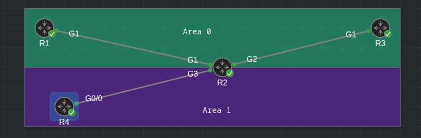

- Create VRFs and assign the interfaces to them

```
R1#sh run | s vrf
vrf definition TEST
 !
 address-family ipv4
 exit-address-family
 !
 address-family ipv6
 exit-address-family

R1#show run int g1
Building configuration...

Current configuration : 161 bytes
!
interface GigabitEthernet1
 vrf forwarding TEST
 ip address 10.1.12.1 255.255.255.0
 ip ospf priority 100
 ip ospf 1 area 0
 negotiation auto
 cdp enable
end

R1#show run int l0
Building configuration...

Current configuration : 106 bytes
!
interface Loopback0
 vrf forwarding TEST
 ip address 192.168.1.1 255.255.255.255
 ip ospf 1 area 0
end

router ospf 1 vrf TEST
 router-id 192.168.1.1
 capability vrf-lite
```

- Turning on `capability vrf-lite` eliminates the need for the routers to be connected to the MPLS Superbackbone (area 0 only) and allows the routers in other areas to populate the routing table with OSPF routes as needed

- Without `capability vrf-lite`, the router is considered an ABR, even if all interfaces are part of Area 0

```
R1(config-router)#do sh ip protocols vrf TEST
*** IP Routing is NSF aware ***

Routing Protocol is "ospf 1"
  Outgoing update filter list for all interfaces is not set
  Incoming update filter list for all interfaces is not set
  Router ID 192.168.1.1
  It is an area border router
  Number of areas in this router is 1. 1 normal 0 stub 0 nssa
  Maximum path: 4
  Routing for Networks:
  Routing on Interfaces Configured Explicitly (Area 0):
    Loopback0
    GigabitEthernet1
  Routing Information Sources:
    Gateway         Distance      Last Update
    192.168.3.3          110      00:00:04
    192.168.2.2          110      00:00:04
  Distance: (default is 110)

R1(config-router)#do sh ip OSPF
 Routing Process "ospf 1" with ID 192.168.1.1
   Domain ID type 0x0005, value 0.0.0.1
 Start time: 00:01:36.213, Time elapsed: 00:25:29.424
 Supports only single TOS(TOS0) routes
 Supports opaque LSA
 Supports Link-local Signaling (LLS)
 Supports area transit capability
 Supports NSSA (compatible with RFC 3101)
 Supports Database Exchange Summary List Optimization (RFC 5243)
 Connected to MPLS VPN Superbackbone, VRF TEST   ################ CONNECTED TO MPLS SUPERBACKBONE ###############
 Maximum number of non self-generated LSA allowed 50000
    Current number of non self-generated LSA 6
    Threshold for warning message 75%
    Ignore-time 5 minutes, reset-time 10 minutes
    Ignore-count allowed 5, current ignore-count 0
 Event-log disabled
 It is an area border router
 Router is not originating router-LSAs with maximum metric
 Initial SPF schedule delay 50 msecs
 Minimum hold time between two consecutive SPFs 200 msecs
 Maximum wait time between two consecutive SPFs 5000 msecs
 Incremental-SPF disabled
 Per-prefix-distribution disabled
 Initial LSA throttle delay 50 msecs
 Minimum hold time for LSA throttle 200 msecs
 Maximum wait time for LSA throttle 5000 msecs
 Minimum LSA arrival 100 msecs
 LSA group pacing timer 240 secs
 Interface flood pacing timer 33 msecs
 Retransmission pacing timer 66 msecs
 EXCHANGE/LOADING adjacency limit: initial 300, process maximum 300
 Number of external LSA 0. Checksum Sum 0x000000
 Number of opaque AS LSA 0. Checksum Sum 0x000000
 Number of DCbitless external and opaque AS LSA 0
 Number of DoNotAge external and opaque AS LSA 0
 Number of areas in this router is 1. 1 normal 0 stub 0 nssa
 Number of areas transit capable is 0
 External flood list length 0
 IETF NSF helper support enabled
 Cisco NSF helper support enabled
 Reference bandwidth unit is 100 mbps
    Area BACKBONE(0)
        Number of interfaces in this area is 2 (1 loopback)
        Area has no authentication
        SPF algorithm last executed 00:00:26.128 ago
        SPF algorithm executed 5 times
        Area ranges are
        Number of LSA 7. Checksum Sum 0x02C950
        Number of opaque link LSA 0. Checksum Sum 0x000000
        Number of DCbitless LSA 0
        Number of indication LSA 0
        Number of DoNotAge LSA 0
        Flood list length 0

```

- With `capability vrf-lite` enabled:

```
R1(config-router)#do sh ip protocols vrf TEST
*** IP Routing is NSF aware ***

Routing Protocol is "ospf 1"
  Outgoing update filter list for all interfaces is not set
  Incoming update filter list for all interfaces is not set
  Router ID 192.168.1.1
  Number of areas in this router is 1. 1 normal 0 stub 0 nssa
  Maximum path: 4
  Routing for Networks:
  Routing on Interfaces Configured Explicitly (Area 0):
    Loopback0
    GigabitEthernet1
  Routing Information Sources:
    Gateway         Distance      Last Update
    192.168.3.3          110      00:00:00
    192.168.2.2          110      00:00:00
  Distance: (default is 110)

```

- The router is no longer an ABR

- No more MPLS superbackbone dependence

```
R1(config-router)#do sh ip ospf | i MPLS
R1(config-router)#do sh ip ospf | i MPLS
R1(config-router)#
```

- R2:

```
R2#sh run | s vrf def
vrf definition TEST
 !
 address-family ipv4
 exit-address-family
 !
 address-family ipv6
 exit-address-family

R2#sh run int g1
Building configuration...

Current configuration : 139 bytes
!
interface GigabitEthernet1
 vrf forwarding TEST
 ip address 10.1.12.2 255.255.255.0
 ip ospf 1 area 0
 negotiation auto
 cdp enable
end

R2#sh run int g2
Building configuration...

Current configuration : 178 bytes
!
interface GigabitEthernet2
 vrf forwarding TEST
 ip address 10.1.23.2 255.255.255.0
 ip ospf authentication key-chain TEST
 ip ospf 1 area 0
 negotiation auto
 cdp enable
end

R2#sh run | s key chain
key chain TEST
 key 1
  key-string CISCO
  cryptographic-algorithm hmac-sha-256

R2#sh run int g3       
Building configuration...

Current configuration : 109 bytes
!
interface GigabitEthernet3
 vrf forwarding TEST
 ip address 10.1.34.2 255.255.255.0
 negotiation auto
end

R2#sh run int l0
Building configuration...

Current configuration : 106 bytes
!
interface Loopback0
 vrf forwarding TEST
 ip address 192.168.2.2 255.255.255.255
 ip ospf 1 area 0
end


R2#sh run | s router ospf
router ospf 1 vrf TEST
 router-id 192.168.2.2
 capability vrf-lite
 network 10.1.34.2 0.0.0.0 area 1
```

- R2 is the ABR so the output is correct

- No MPLS dependency

```
R2#show ip protocols vrf TEST
*** IP Routing is NSF aware ***

Routing Protocol is "ospf 1"
  Outgoing update filter list for all interfaces is not set
  Incoming update filter list for all interfaces is not set
  Router ID 192.168.2.2
  It is an area border router
  Number of areas in this router is 2. 2 normal 0 stub 0 nssa
  Maximum path: 4
  Routing for Networks:
    10.1.34.2 0.0.0.0 area 1
  Routing on Interfaces Configured Explicitly (Area 0):
    Loopback0
    GigabitEthernet2
    GigabitEthernet1
  Routing Information Sources:
    Gateway         Distance      Last Update
    192.168.4.4          110      00:27:51
    192.168.3.3          110      00:30:02
    192.168.1.1          110      00:04:16
  Distance: (default is 110)

R2#show ip ospf | i MPLS
R2#
```

- R3:

```
R3#show run | s vrf def 
vrf definition TEST
 !
 address-family ipv4
 exit-address-family
 !
 address-family ipv6
 exit-address-family

R3#show run int g1     
Building configuration...

Current configuration : 178 bytes
!
interface GigabitEthernet1
 vrf forwarding TEST
 ip address 10.1.23.3 255.255.255.0
 ip ospf authentication key-chain test
 ip ospf 1 area 0
 negotiation auto
 cdp enable
end

R3#show run | s key chain
key chain test
 key 1
  key-string CISCO
  cryptographic-algorithm hmac-sha-256

R3#sh run | s router ospf
router ospf 1 vrf TEST
 router-id 192.168.3.3
 capability vrf-lite

R3#sh run int l0
Building configuration...

Current configuration : 106 bytes
!
interface Loopback0
 vrf forwarding TEST
 ip address 192.168.3.3 255.255.255.255
 ip ospf 1 area 0
end

```

- R4 configuration

```
R4#sh run | s vrf def
vrf definition TEST
 !
 address-family ipv4
 exit-address-family
 !
 address-family ipv6
 exit-address-family

R4#sh run int g0/0            
Building configuration...

Current configuration : 135 bytes
!
interface GigabitEthernet0/0
 vrf forwarding TEST
 ip address 10.1.34.4 255.255.255.0
 duplex auto
 speed auto
 media-type rj45
end

R4#
R4#sh run | s router ospf
router ospf 1 vrf TEST
 router-id 192.168.4.4
 capability vrf-lite
 network 10.1.34.0 0.0.0.255 area 1
 network 192.168.4.4 0.0.0.0 area 1
```

```
R4#show ip route vrf TEST ospf | b Gate
Gateway of last resort is not set

      10.0.0.0/8 is variably subnetted, 4 subnets, 2 masks
O IA     10.1.12.0/24 [110/2] via 10.1.34.2, 00:09:35, GigabitEthernet0/0
O IA     10.1.23.0/24 [110/2] via 10.1.34.2, 00:33:11, GigabitEthernet0/0
      192.168.1.0/32 is subnetted, 1 subnets
O IA     192.168.1.1 [110/3] via 10.1.34.2, 00:09:40, GigabitEthernet0/0
      192.168.2.0/32 is subnetted, 1 subnets
O IA     192.168.2.2 [110/2] via 10.1.34.2, 00:33:11, GigabitEthernet0/0
      192.168.3.0/32 is subnetted, 1 subnets
O IA     192.168.3.3 [110/3] via 10.1.34.2, 00:33:11, GigabitEthernet0/0

```

### Using OSPF in a DMVPN network

- In DMVPN, we must use the OSPF point-to-multipoint network type

- In this network type no DR/BDR election takeing place. The timers for this are 30/120, so you might want to adjust them

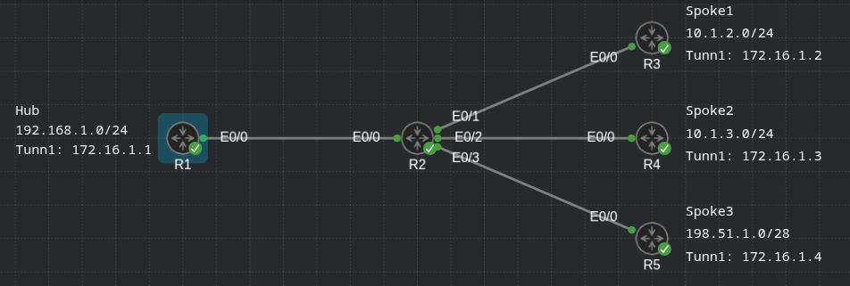

- First, OSPF advertises the spoke IP addresses as /32 OSPF routes and add them into the routing table

Example:

```
R1(config-router)#do sh ip ro ospf | b Gate

Gateway of last resort is 10.1.12.2 to network 0.0.0.0

      10.0.0.0/8 is variably subnetted, 4 subnets, 2 masks
O        10.1.2.0/24 [110/1001] via 172.16.1.2, 00:44:44, Tunnel1
O        10.1.3.0/24 [110/1001] via 172.16.1.3, 00:44:17, Tunnel1
      172.16.0.0/16 is variably subnetted, 5 subnets, 2 masks
O        172.16.1.2/32 [110/1000] via 172.16.1.2, 00:44:44, Tunnel1
O        172.16.1.3/32 [110/1000] via 172.16.1.3, 00:44:17, Tunnel1
O        172.16.1.4/32 [110/1000] via 172.16.1.4, 00:21:23, Tunnel1
      198.51.1.0/28 is subnetted, 1 subnets
O        198.51.1.0 [110/1001] via 172.16.1.4, 00:20:47, Tunnel1
```

- You may want to block these routes from entering the routing table, because you have already a directly connected route for the tunnel interface subnet

```
R1#show ip route connected | i Tunn  
C        172.16.1.0/29 is directly connected, Tunnel1
L        172.16.1.1/32 is directly connected, Tunnel1
```

- Use a distribute list to block them for entering the routing table

```
ip prefix-list BLOCK-32 seq 5 deny 172.16.1.0/29 ge 32
ip prefix-list BLOCK-32 seq 10 permit 0.0.0.0/0 le 32

router ospf 100
(...)
 distribute-list prefix BLOCK-32 in
```

- Do this on all hub and spoke routers

- R1 - underlay, tunnel and OSPF configuration:

```
R1#sh run int e0/0
Building configuration...

Current configuration : 65 bytes
!
interface Ethernet0/0
 ip address 10.1.12.1 255.255.255.0
end

R1#sh run int l0  
Building configuration...

Current configuration : 63 bytes
!
interface Loopback0
 ip address 1.1.1.1 255.255.255.255
end

R1#sh run int l1
Building configuration...

Current configuration : 117 bytes
!
interface Loopback1
 ip address 192.168.1.1 255.255.255.0
 ip ospf network point-to-point
 ip ospf 100 area 0
end

R1#sh run int tun 1
Building configuration...

Current configuration : 347 bytes
!
interface Tunnel1
 ip address 172.16.1.1 255.255.255.248
 no ip redirects
 ip mtu 1400
 ip nhrp authentication cisco
 ip nhrp network-id 1
 ip nhrp redirect
 ip tcp adjust-mss 1360
 ip ospf network point-to-multipoint
 ip ospf dead-interval 40
 ip ospf hello-interval 10
 tunnel source Loopback0
 tunnel mode gre multipoint
 tunnel key 123
end

!!!!! Use a default route for underlay prefix routing

R1#sh run | i ip ro 
ip route 0.0.0.0 0.0.0.0 10.1.12.2

R1#sh run | i prefix
ip prefix-list BLOCK-32 seq 5 deny 172.16.1.0/29 ge 32
ip prefix-list BLOCK-32 seq 10 permit 0.0.0.0/0 le 32

R1#sh run | s router ospf
router ospf 100
 router-id 1.1.1.2
 network 172.16.1.0 0.0.0.7 area 0
 network 192.168.1.0 0.0.0.255 area 0
 distribute-list prefix BLOCK-32 in
```

- OSPF interfaces and neighbors on R1:

- (Make sure the OSPF interfaces are shown properly for the correct process ID)

```
R1#show ip ospf int br
Interface    PID   Area            IP Address/Mask    Cost  State Nbrs F/C
Lo1          100   0               192.168.1.1/24     1     P2P   0/0
Tu1          100   0               172.16.1.1/29      1000  P2MP  3/3

R1#show ip ospf neighbor 

Neighbor ID     Pri   State           Dead Time   Address         Interface
5.5.5.5           0   FULL/  -        00:00:30    172.16.1.4      Tunnel1
4.4.4.5           0   FULL/  -        00:00:30    172.16.1.3      Tunnel1
2.2.2.3           0   FULL/  -        00:00:32    172.16.1.2      Tunnel1
```

- R2 configuration - it includes only directly connected interfaces and static routes to the loopback addresses of Hub and spokes, as tunnel sources are the loopback interfaces on R1, R3, R4 and R5

```
R2#sh run int e0/0
Building configuration...

Current configuration : 65 bytes
!
interface Ethernet0/0
 ip address 10.1.12.2 255.255.255.0
end

R2#sh run int e0/1
Building configuration...

Current configuration : 65 bytes
!
interface Ethernet0/1
 ip address 10.1.23.2 255.255.255.0
end

R2#sh run int e0/2
Building configuration...

Current configuration : 65 bytes
!
interface Ethernet0/2
 ip address 10.1.24.2 255.255.255.0
end

R2#sh run int e0/3
Building configuration...

Current configuration : 65 bytes
!
interface Ethernet0/3
 ip address 10.1.25.2 255.255.255.0
end

!!!!!! Not needed but present in case of
R2#sh run int l0
Building configuration...

Current configuration : 63 bytes
!
interface Loopback0
 ip address 2.2.2.2 255.255.255.255
end

R2#sh run | s ip route
ip route 1.1.1.1 255.255.255.255 10.1.12.1
ip route 3.3.3.3 255.255.255.255 10.1.23.3
ip route 4.4.4.4 255.255.255.255 10.1.24.4
ip route 5.5.5.5 255.255.255.255 10.1.25.5
```

- R3 configuration: underlay, tunnel, OSPF, interfaces

```
R3#sh run int e0/0
Building configuration...

Current configuration : 65 bytes
!
interface Ethernet0/0
 ip address 10.1.23.3 255.255.255.0
end

R3#sh run int l0  
Building configuration...

Current configuration : 63 bytes
!
interface Loopback0
 ip address 3.3.3.3 255.255.255.255
end

R3#sh run int l1
Building configuration...

Current configuration : 114 bytes
!
interface Loopback1
 ip address 10.1.2.1 255.255.255.0
 ip ospf network point-to-point
 ip ospf 100 area 0
end

R3#sh run int tunn 1
Building configuration...

Current configuration : 436 bytes
!
interface Tunnel1
 ip address 172.16.1.2 255.255.255.248
 no ip redirects
 ip mtu 1400
 ip nhrp authentication cisco
 ip nhrp map multicast 1.1.1.1
 ip nhrp map 172.16.1.1 1.1.1.1
 ip nhrp network-id 1
 ip nhrp nhs 172.16.1.1
 ip tcp adjust-mss 1360
 ip ospf network point-to-multipoint
 ip ospf dead-interval 40
 ip ospf hello-interval 10
 ip ospf 100 area 0
 tunnel source Loopback0
 tunnel mode gre multipoint
 tunnel key 123
end

R3(config-router)#do sh run | i prefix
ip prefix-list BLOCK-32 seq 5 deny 172.16.1.0/29 ge 32
ip prefix-list BLOCK-32 seq 10 permit 0.0.0.0/0 le 32

R3(config-router)#do sh run | s router ospf
router ospf 100
 router-id 2.2.2.3
 network 172.16.1.0 0.0.0.15 area 0
 distribute-list prefix BLOCK-32 in

R3#sh run | i ip ro
ip route 0.0.0.0 0.0.0.0 10.1.23.2

R3#sh ip ospf int br
Interface    PID   Area            IP Address/Mask    Cost  State Nbrs F/C
Lo1          100   0               10.1.2.1/24        1     P2P   0/0
Tu1          100   0               172.16.1.2/29      1000  P2MP  1/1

R3#sh ip ro ospf | b Gate
Gateway of last resort is 10.1.23.2 to network 0.0.0.0

      10.0.0.0/8 is variably subnetted, 5 subnets, 2 masks
O        10.1.3.0/24 [110/2001] via 172.16.1.1, 01:20:40, Tunnel1
O     192.168.1.0/24 [110/1001] via 172.16.1.1, 01:20:40, Tunnel1
      198.51.1.0/28 is subnetted, 1 subnets
O        198.51.1.0 [110/2001] via 172.16.1.1, 01:20:40, Tunnel1
```

- R4 configuration: OSPF, tunnel, interfaces and static routes

```
R4(config)#do sh run int e0/0
Building configuration...

Current configuration : 65 bytes
!
interface Ethernet0/0
 ip address 10.1.24.4 255.255.255.0
end


R4(config)#do sh run int l0 
Building configuration...

Current configuration : 63 bytes
!
interface Loopback0
 ip address 4.4.4.4 255.255.255.255
end


R4(config)#do sh run int l1
Building configuration...

Current configuration : 114 bytes
!
interface Loopback1
 ip address 10.1.3.1 255.255.255.0
 ip ospf network point-to-point
 ip ospf 100 area 0
end

R4(config)#do sh run int tunn 1
Building configuration...

Current configuration : 436 bytes
!
interface Tunnel1
 ip address 172.16.1.3 255.255.255.248
 no ip redirects
 ip mtu 1400
 ip nhrp authentication cisco
 ip nhrp map multicast 1.1.1.1
 ip nhrp map 172.16.1.1 1.1.1.1
 ip nhrp network-id 1
 ip nhrp nhs 172.16.1.1
 ip tcp adjust-mss 1360
 ip ospf network point-to-multipoint
 ip ospf dead-interval 40
 ip ospf hello-interval 10
 ip ospf 100 area 0
 tunnel source Loopback0
 tunnel mode gre multipoint
 tunnel key 123
end

R4(config)#do sh run | s ip route
ip route 0.0.0.0 0.0.0.0 10.1.24.2

R4(config)#do sh run | i prefix  
ip prefix-list BLOCK-32 seq 5 deny 172.16.1.0/29 le 32
ip prefix-list BLOCK-32 seq 10 permit 0.0.0.0/0 le 32

R4(config)#do sh run | s router ospf
router ospf 100
 router-id 4.4.4.5
 distribute-list prefix BLOCK-32 in

R4(config)#do sh ip ospf nei 

Neighbor ID     Pri   State           Dead Time   Address         Interface
1.1.1.2           0   FULL/  -        00:00:38    172.16.1.1      Tunnel1

R4(config)#do sh ip ro ospf | b Gate
Gateway of last resort is 10.1.24.2 to network 0.0.0.0

      10.0.0.0/8 is variably subnetted, 5 subnets, 2 masks
O        10.1.2.0/24 [110/2001] via 172.16.1.1, 00:07:49, Tunnel1
O     192.168.1.0/24 [110/1001] via 172.16.1.1, 00:07:49, Tunnel1
      198.51.1.0/28 is subnetted, 1 subnets
O        198.51.1.0 [110/2001] via 172.16.1.1, 00:07:49, Tunnel1
```

- R5 configuration:

```
R5#sh run int e0/0
Building configuration...

Current configuration : 65 bytes
!
interface Ethernet0/0
 ip address 10.1.25.5 255.255.255.0
end

R5#sh run int l0  
Building configuration...

Current configuration : 63 bytes
!
interface Loopback0
 ip address 5.5.5.5 255.255.255.255
end

R5#sh run int l1
Building configuration...

Current configuration : 118 bytes
!
interface Loopback1
 ip address 198.51.1.1 255.255.255.240
 ip ospf network point-to-point
 ip ospf 100 area 0
end

R5#sh run int tun 1
Building configuration...

Current configuration : 436 bytes
!
interface Tunnel1
 ip address 172.16.1.4 255.255.255.248
 no ip redirects
 ip mtu 1400
 ip nhrp authentication cisco
 ip nhrp map multicast 1.1.1.1
 ip nhrp map 172.16.1.1 1.1.1.1
 ip nhrp network-id 1
 ip nhrp nhs 172.16.1.1
 ip tcp adjust-mss 1360
 ip ospf network point-to-multipoint
 ip ospf dead-interval 40
 ip ospf hello-interval 10
 ip ospf 100 area 0
 tunnel source Loopback0
 tunnel mode gre multipoint
 tunnel key 123
end

R5#sh run | s ip ro
ip route 0.0.0.0 0.0.0.0 10.1.25.2

R5#sh run | i prefix
ip prefix-list BLOCK-32 seq 5 deny 172.16.1.0/29 ge 32
ip prefix-list BLOCK-32 seq 10 permit 0.0.0.0/0 le 32

R5#sh run | s router ospf
router ospf 100
 router-id 5.5.5.5
 passive-interface Loopback1
 distribute-list prefix BLOCK-32 in

R5#sh ip ospf int br
Interface    PID   Area            IP Address/Mask    Cost  State Nbrs F/C
Lo1          100   0               198.51.1.1/28      1     P2P   0/0
Tu1          100   0               172.16.1.4/29      1000  P2MP  1/1

R5#sh ip ospf nei

Neighbor ID     Pri   State           Dead Time   Address         Interface
1.1.1.2           0   FULL/  -        00:00:34    172.16.1.1      Tunnel1
```

- Traceroute from R5 to R2's subnet. The second traceroute goes directly to next hop 172.16.1.2 after NHRP kicks in

```
R5#traceroute 10.1.2.1 source l1
Type escape sequence to abort.
Tracing the route to 10.1.2.1
VRF info: (vrf in name/id, vrf out name/id)
  1 172.16.1.1 1 msec 1 msec 1 msec
  2 172.16.1.2 1 msec 2 msec * 
R5#traceroute 10.1.2.1 source l1
Type escape sequence to abort.
Tracing the route to 10.1.2.1
VRF info: (vrf in name/id, vrf out name/id)
  1 172.16.1.2 1 msec 2 msec * 
R5#show dmvpn 
Legend: Attrb --> S - Static, D - Dynamic, I - Incomplete
        N - NATed, L - Local, X - No Socket
        T1 - Route Installed, T2 - Nexthop-override, B - BGP
        C - CTS Capable, I2 - Temporary
        # Ent --> Number of NHRP entries with same NBMA peer
        NHS Status: E --> Expecting Replies, R --> Responding, W --> Waiting
        UpDn Time --> Up or Down Time for a Tunnel
==========================================================================

Interface: Tunnel1, IPv4 NHRP Details 
Type:Spoke, NHRP Peers:2, 

 # Ent  Peer NBMA Addr Peer Tunnel Add State  UpDn Tm Attrb
 ----- --------------- --------------- ----- -------- -----
     2 3.3.3.3              172.16.1.2    UP 00:00:37   DT2
                            172.16.1.2    UP 00:00:37   DT1
     1 1.1.1.1              172.16.1.1    UP 01:57:30     S
```

- Ip routing on R5 when DMVPN is up:

```
R5#show ip route ospf | b Gate
Gateway of last resort is 10.1.25.2 to network 0.0.0.0

      10.0.0.0/8 is variably subnetted, 4 subnets, 2 masks
O   %    10.1.2.0/24 [110/2001] via 172.16.1.1, 01:28:59, Tunnel1
O        10.1.3.0/24 [110/2001] via 172.16.1.1, 01:28:59, Tunnel1
O     192.168.1.0/24 [110/1001] via 172.16.1.1, 01:28:59, Tunnel1

R5#traceroute 10.1.3.1
Type escape sequence to abort.
Tracing the route to 10.1.3.1
VRF info: (vrf in name/id, vrf out name/id)
  1 172.16.1.1 1 msec 1 msec 0 msec
  2 172.16.1.3 1 msec 2 msec * 
R5#traceroute 10.1.3.1
Type escape sequence to abort.
Tracing the route to 10.1.3.1
VRF info: (vrf in name/id, vrf out name/id)
  1 172.16.1.3 1 msec 2 msec * 
R5#sh
R5#show dm
R5#show dmvpn 
Legend: Attrb --> S - Static, D - Dynamic, I - Incomplete
        N - NATed, L - Local, X - No Socket
        T1 - Route Installed, T2 - Nexthop-override, B - BGP
        C - CTS Capable, I2 - Temporary
        # Ent --> Number of NHRP entries with same NBMA peer
        NHS Status: E --> Expecting Replies, R --> Responding, W --> Waiting
        UpDn Time --> Up or Down Time for a Tunnel
==========================================================================

Interface: Tunnel1, IPv4 NHRP Details 
Type:Spoke, NHRP Peers:3, 

 # Ent  Peer NBMA Addr Peer Tunnel Add State  UpDn Tm Attrb
 ----- --------------- --------------- ----- -------- -----
     2 3.3.3.3              172.16.1.2    UP 00:04:06   DT2
                            172.16.1.2    UP 00:04:06   DT1
     2 4.4.4.4              172.16.1.3    UP 00:00:45   DT2
                            172.16.1.3    UP 00:00:45   DT1
     1 1.1.1.1              172.16.1.1    UP 02:00:59     S

R5#show ip ro ospf | b Gate
Gateway of last resort is 10.1.25.2 to network 0.0.0.0

      10.0.0.0/8 is variably subnetted, 4 subnets, 2 masks
O   %    10.1.2.0/24 [110/2001] via 172.16.1.1, 01:31:19, Tunnel1
O   %    10.1.3.0/24 [110/2001] via 172.16.1.1, 01:31:19, Tunnel1
O     192.168.1.0/24 [110/1001] via 172.16.1.1, 01:31:19, Tunnel1

R5#show ip nhrp brief 
****************************************************************************
    NOTE: Link-Local, No-socket and Incomplete entries are not displayed
****************************************************************************
Legend: Type --> S - Static, D - Dynamic
        Flags --> u - unique, r - registered, e - temporary, c - claimed
        a - authoritative, t - route
============================================================================

Intf     NextHop Address                                    NBMA Address
         Target Network                              T/Flag
-------- ------------------------------------------- ------ ----------------
Tu1      172.16.1.1                                         1.1.1.1
         172.16.1.1/32                               S/    
Tu1      172.16.1.2                                         3.3.3.3
         172.16.1.2/32                               D/t   
         10.1.2.0/24                                 D/t   
Tu1      172.16.1.3                                         4.4.4.4
         172.16.1.3/32                               D/t   
         10.1.3.0/24                                 D/t   

R5#show ip nhrp tunnel 1
10.1.2.0/24 via 172.16.1.2
   Tunnel1 created 00:08:11, expire 00:01:48
   Type: dynamic, Flags: router rib nho 
   NBMA address: 3.3.3.3
10.1.3.0/24 via 172.16.1.3
   Tunnel1 created 00:04:50, expire 00:05:09
   Type: dynamic, Flags: router used rib nho 
   NBMA address: 4.4.4.4
172.16.1.1/32 via 172.16.1.1
   Tunnel1 created 02:05:04, never expire 
   Type: static, Flags: used 
   NBMA address: 1.1.1.1
172.16.1.2/32 via 172.16.1.2
   Tunnel1 created 00:08:11, expire 00:01:48
   Type: dynamic, Flags: router nhop rib 
   NBMA address: 3.3.3.3
172.16.1.3/32 via 172.16.1.3
   Tunnel1 created 00:04:50, expire 00:05:09
   Type: dynamic, Flags: router nhop rib 
   NBMA address: 4.4.4.4
172.16.1.4/32 via 172.16.1.4
   Tunnel1 created 00:04:50, expire 00:05:09
   Type: dynamic, Flags: router unique local 
   NBMA address: 5.5.5.5
    (no-socket) 
198.51.1.0/28 via 172.16.1.4
   Tunnel1 created 00:08:11, expire 00:01:48
   Type: dynamic, Flags: router unique local 
   NBMA address: 5.5.5.5
    (no-socket) 
```

### More OSPF things

#### Maximum metric LSAs

- To prevent Area 0 in certain situation from becoming a transit area, we may want to advertise some type 1 LSAs in some areas with a maximum metric

- To configure this:

```
conf t
 router ospf 123
  max-metric router-lsa 
```

```
R3(config)#do sh run | s router ospf
router ospf 123
 router-id 3.3.3.3
 max-metric router-lsa
 network 10.1.3.3 0.0.0.0 area 123
 network 10.3.5.3 0.0.0.0 area 35
 network 10.24.35.3 0.0.0.0 area 0
```

- R1 - before setting this up:

```
R1#show ip route ospf | b Gate

Gateway of last resort is not set

      10.0.0.0/8 is variably subnetted, 6 subnets, 2 masks
O IA     10.3.5.0/24 [110/2] via 10.1.3.3, 00:01:16, Ethernet0/1
O IA     10.24.35.0/24 [110/2] via 10.1.3.3, 00:01:16, Ethernet0/1
                       [110/2] via 10.1.2.2, 00:02:05, Ethernet0/0
```

- R1 after setting this up:

```
R1#show ip route ospf | b Gate
Gateway of last resort is not set

      10.0.0.0/8 is variably subnetted, 6 subnets, 2 masks
O IA     10.3.5.0/24 [110/2] via 10.1.3.3, 00:09:26, Ethernet0/1
O IA     10.24.35.0/24 [110/2] via 10.1.2.2, 00:10:15, Ethernet0/0
```

```
R1#show ip ospf database router adv-router 3.3.3.3

            OSPF Router with ID (1.1.1.1) (Process ID 123)

                Router Link States (Area 123)

  LS age: 303
  Options: (No TOS-capability, DC)
  LS Type: Router Links
  Link State ID: 3.3.3.3
  Advertising Router: 3.3.3.3
  LS Seq Number: 80000006
  Checksum: 0x6C76
  Length: 48
  Area Border Router
  Number of Links: 2

    Link connected to: another Router (point-to-point)
     (Link ID) Neighboring Router ID: 1.1.1.1
     (Link Data) Router Interface address: 10.1.3.3
      Number of MTID metrics: 0
       TOS 0 Metrics: 65535

    Link connected to: a Stub Network
     (Link ID) Network/subnet number: 10.1.3.0
     (Link Data) Network Mask: 255.255.255.0
      Number of MTID metrics: 0
       TOS 0 Metrics: 1
```

- As you can see R3 is advertising a router LSA with maximum metric for P2P link on it's interface

- R3 is originating router LSAs with maximum metric as shown below

```
R3(config)#do sh ip ospf
 Routing Process "ospf 123" with ID 3.3.3.3
 Start time: 00:40:09.213, Time elapsed: 00:18:22.157
 Supports only single TOS(TOS0) routes
 Supports opaque LSA
 Supports Link-local Signaling (LLS)
 Supports area transit capability
 Supports NSSA (compatible with RFC 3101)
 Supports Database Exchange Summary List Optimization (RFC 5243)
 Maximum number of non self-generated LSA allowed 50000
    Current number of non self-generated LSA 9
    Threshold for warning message 75%
    Ignore-time 5 minutes, reset-time 10 minutes
    Ignore-count allowed 5, current ignore-count 0
 Event-log enabled, Maximum number of events: 1000, Mode: cyclic
 It is an area border router
 Originating router-LSAs with maximum metric !!!!!!!!
    Condition: always, State: active
 Initial SPF schedule delay 50 msecs
 Minimum hold time between two consecutive SPFs 200 msecs
 Maximum wait time between two consecutive SPFs 5000 msecs
 Incremental-SPF disabled
 Per-prefix-distribution disabled
 Initial LSA throttle delay 50 msecs
 Minimum hold time for LSA throttle 200 msecs
 Maximum wait time for LSA throttle 5000 msecs
 Minimum LSA arrival 100 msecs
 LSA group pacing timer 240 secs
 Interface flood pacing timer 33 msecs
 Retransmission pacing timer 66 msecs
 EXCHANGE/LOADING adjacency limit: initial 300, process maximum 300
 Number of external LSA 0. Checksum Sum 0x000000
 Number of opaque AS LSA 0. Checksum Sum 0x000000
 Number of DCbitless external and opaque AS LSA 0
 Number of DoNotAge external and opaque AS LSA 0
 Number of areas in this router is 3. 3 normal 0 stub 0 nssa
 Number of areas transit capable is 0
 External flood list length 0
 IETF NSF helper support enabled
 Cisco NSF helper support enabled
 Reference bandwidth unit is 100 mbps
    Area BACKBONE(0)
        Number of interfaces in this area is 1
        Area has no authentication
        SPF algorithm last executed 00:03:36.204 ago
        SPF algorithm executed 4 times
        Area ranges are
        Number of LSA 8. Checksum Sum 0x03A4E5
        Number of opaque link LSA 0. Checksum Sum 0x000000
        Number of DCbitless LSA 0
        Number of indication LSA 0
        Number of DoNotAge LSA 0
        Flood list length 0
    Area 35
        Number of interfaces in this area is 1
        Area has no authentication
        SPF algorithm last executed 00:03:36.204 ago
        SPF algorithm executed 4 times
        Area ranges are
        Number of LSA 5. Checksum Sum 0x026156
        Number of opaque link LSA 0. Checksum Sum 0x000000
        Number of DCbitless LSA 0
        Number of indication LSA 0
        Number of DoNotAge LSA 0
        Flood list length 0
    Area 123
        Number of interfaces in this area is 1
        Area has no authentication
        SPF algorithm last executed 00:03:36.204 ago
        SPF algorithm executed 5 times
        Area ranges are
        Number of LSA 7. Checksum Sum 0x026F1C
        Number of opaque link LSA 0. Checksum Sum 0x000000
        Number of DCbitless LSA 0
        Number of indication LSA 0
        Number of DoNotAge LSA 0
        Flood list length 0
 Maintenance Mode ID:     131857716519648
 Maintenance Mode:        disabled
 Maintenance Mode Timer:  stopped (0)
  Graceful Reload FSU Global status : None (global: None)
```

#### Manipulating AD (Administrative distance) for OSPF

- There are two options to manipulate the AD for a router:

    1. Based on Router ID of a neighbor

    2. Based on LSA/Route types

1. Based on Router ID of a neighbor:

```
conf t
 router ospf 110
  distance <1-255> ...


  distance 125 3.3.3.3 0.0.0.0 


R1(config-router)#distance ?    
  <1-255>  Administrative distance

R1(config-router)#distance 125 ?  !!!!!!! THIS IS WRONG. SHOULD BE THE NEIGHBOR'S ROUTER ID, NOT IP ADDRESS
  A.B.C.D  IP Source address
  <cr>     <cr>

```

```
R1(config-router)#do sh ip ro ospf 
(...)

Gateway of last resort is not set

      2.0.0.0/32 is subnetted, 1 subnets
O E2     2.2.2.2 [110/20] via 10.1.2.2, 00:03:20, Ethernet0/0
      3.0.0.0/32 is subnetted, 1 subnets
O E2     3.3.3.3 [125/20] via 10.1.3.3, 00:03:20, Ethernet0/1
      10.0.0.0/8 is variably subnetted, 7 subnets, 2 masks
O E2     10.2.4.0/24 [110/20] via 10.1.2.2, 00:03:20, Ethernet0/0
O E2     10.3.5.0/24 [125/20] via 10.1.3.3, 00:03:20, Ethernet0/1
O IA     10.24.35.0/24 [125/2] via 10.1.3.3, 00:03:20, Ethernet0/1
                       [125/2] via 10.1.2.2, 00:03:20, Ethernet0/0
      192.168.2.0/32 is subnetted, 3 subnets
O E2     192.168.2.1 [110/20] via 10.1.2.2, 00:03:20, Ethernet0/0
O E2     192.168.2.2 [110/20] via 10.1.2.2, 00:03:20, Ethernet0/0
O E2     192.168.2.3 [110/20] via 10.1.2.2, 00:03:20, Ethernet0/0
      192.168.3.0/32 is subnetted, 3 subnets
O E2     192.168.3.1 [125/20] via 10.1.3.3, 00:03:20, Ethernet0/1
O E2     192.168.3.2 [125/20] via 10.1.3.3, 00:03:20, Ethernet0/1
O E2     192.168.3.3 [125/20] via 10.1.3.3, 00:03:20, Ethernet0/1
```

2. Based on specific LSA or route types:

```
conf t
 router ospf 110
  distance ospf ?

R1(config-router)#distance  ospf ?
external    External type 5 and type 7 routes
inter-area  Inter-area routes
intra-area  Intra-area routes
```

- Cannot use both of them on the same time

- Modify the AD of some routes only based on an access-list:

- R1:

```
conf t
 router ospf 110
 distance 125 3.3.3.3 0.0.0.0 1

 access-list 1 permit 192.168.3.0 0.0.0.3
```

- Now the AD changed only for routes in the 192.168.3.X range

```
R1(config)#do sh ip ro ospf | b Gate
Gateway of last resort is not set

      2.0.0.0/32 is subnetted, 1 subnets
O E2     2.2.2.2 [110/20] via 10.1.2.2, 00:02:37, Ethernet0/0
      3.0.0.0/32 is subnetted, 1 subnets
O E2     3.3.3.3 [110/20] via 10.1.3.3, 00:02:37, Ethernet0/1
      10.0.0.0/8 is variably subnetted, 7 subnets, 2 masks
O E2     10.2.4.0/24 [110/20] via 10.1.2.2, 00:02:37, Ethernet0/0
O E2     10.3.5.0/24 [110/20] via 10.1.3.3, 00:02:37, Ethernet0/1
O IA     10.24.35.0/24 [110/2] via 10.1.3.3, 00:02:37, Ethernet0/1
                       [110/2] via 10.1.2.2, 00:02:37, Ethernet0/0
      192.168.2.0/32 is subnetted, 3 subnets
O E2     192.168.2.1 [110/20] via 10.1.2.2, 00:02:37, Ethernet0/0
O E2     192.168.2.2 [110/20] via 10.1.2.2, 00:02:37, Ethernet0/0
O E2     192.168.2.3 [110/20] via 10.1.2.2, 00:02:37, Ethernet0/0
      192.168.3.0/32 is subnetted, 3 subnets
O E2     192.168.3.1 [125/20] via 10.1.3.3, 00:02:37, Ethernet0/1
O E2     192.168.3.2 [125/20] via 10.1.3.3, 00:02:37, Ethernet0/1
O E2     192.168.3.3 [125/20] via 10.1.3.3, 00:02:37, Ethernet0/1
```

- The process can also take 2 or more distance commands for different routers at the same time

```
R1(config-router)#do sh run | s router ospf
router ospf 110
 router-id 1.1.1.1
 network 0.0.0.0 255.255.255.255 area 0
 distance 125 3.3.3.3 0.0.0.0 1
 distance 115 2.2.2.2 0.0.0.0
```

- You cannot have duplicate entries for the same router ID

- Modify ADs based on the route types:

```
conf t
 router ospf 110
  distance ospf intra-area 210 inter-area 220 external 225
```

```
R1(config-router)#do sh ip ro ospf | b Gate
Gateway of last resort is not set

      3.0.0.0/32 is subnetted, 1 subnets
O E2     3.3.3.3 [225/20] via 10.1.3.3, 00:01:05, Ethernet0/1
      10.0.0.0/8 is variably subnetted, 6 subnets, 2 masks
O E2     10.3.5.0/24 [225/20] via 10.1.3.3, 00:01:05, Ethernet0/1
O IA     10.24.35.0/24 [220/2] via 10.1.3.3, 00:01:05, Ethernet0/1
                       [220/2] via 10.1.2.2, 00:01:05, Ethernet0/0
      192.168.2.0/32 is subnetted, 3 subnets
O        192.168.2.1 [210/2] via 10.1.2.2, 00:01:05, Ethernet0/0
O        192.168.2.2 [210/2] via 10.1.2.2, 00:01:05, Ethernet0/0
O        192.168.2.3 [210/2] via 10.1.2.2, 00:01:05, Ethernet0/0
      192.168.3.0/32 is subnetted, 3 subnets
O E2     192.168.3.1 [225/20] via 10.1.3.3, 00:01:05, Ethernet0/1
O E2     192.168.3.2 [225/20] via 10.1.3.3, 00:01:05, Ethernet0/1
O E2     192.168.3.3 [225/20] via 10.1.3.3, 00:01:05, Ethernet0/1
```

#### OSPF Graceful Restart

- Used when we want to perform maintenaince on some router participating in OSPF

- The router will be dropping the router ID of the neighbor from the hello packet

- From the perspective of the neighboring router, the adjancency will not be killed completely but it will be left in the INIT state until the dead interval for that router will be reached

- Topology:

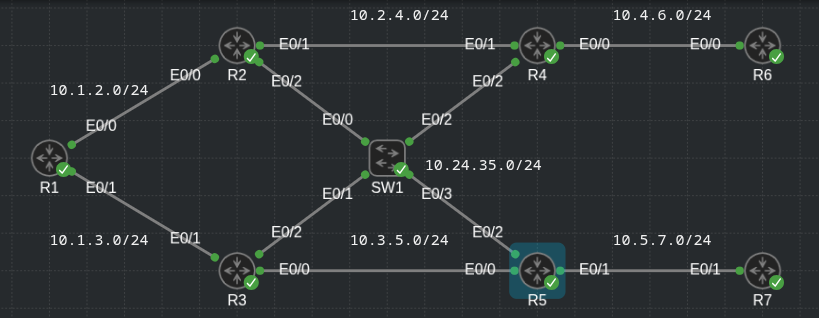

- Here R3 has an adjacency with R5. We will perform maintenaince on R5

- Configuration for this:

- R3:

```
debug ip ospf adj

R3(config-router)#do debug ip ospf adj

*Nov  8 12:16:44.985: OSPF-110 ADJ   Et0/0: Cannot see ourself in hello from 5.5.5.5, state INIT
R3(config-router)#
```

- R5

```
conf t
 router ospf 110
  shutdown
```

- Debug when the adjacency comes back. It comes back almost instantly

```
R3(config-router)#         
*Nov  8 12:16:44.985: OSPF-110 ADJ   Et0/0: Cannot see ourself in hello from 5.5.5.5, state INIT
R3(config-router)#
*Nov  8 12:17:24.985: OSPF-110 ADJ   Et0/0: 5.5.5.5 address 10.3.5.5 is dead
*Nov  8 12:17:24.985: OSPF-110 ADJ   Et0/0: 5.5.5.5 address 10.3.5.5 is dead, state DOWN
R3(config-router)#
*Nov  8 12:17:24.985: %OSPF-5-ADJCHG: Process 110, Nbr 5.5.5.5 on Ethernet0/0 from INIT to DOWN, Neighbor Down: Dead timer expired
R3(config-router)#
*Nov  8 12:17:51.154: OSPF-110 ADJ   Et0/0: 2 Way Communication to 5.5.5.5, state 2WAY
*Nov  8 12:17:51.154: OSPF-110 ADJ   Et0/0: Nbr 5.5.5.5: Prepare dbase exchange
*Nov  8 12:17:51.154: OSPF-110 ADJ   Et0/0: Send DBD to 5.5.5.5 seq 0x1A1A opt 0x52 flag 0x7 len 32
*Nov  8 12:17:51.155: OSPF-110 ADJ   Et0/0: Rcv DBD from 5.5.5.5 seq 0x744 opt 0x52 flag 0x7 len 32  mtu 1500 state EXSTART
*Nov  8 12:17:51.155: OSPF-110 ADJ   Et0/0: NBR Negotiation Done. We are the SLAVE
*Nov  8 12:17:51.155: OSPF-110 ADJ   Et0/0: Nbr 5.5.5.5: Summary list built, size 6
*Nov  8 12:17:51.155: OSPF-110 ADJ   Et0/0: Send DBD to 5.5.5.5 seq 0x744 opt 0x52 flag 0x2 len 152
*Nov  8 12:17:51.155: OSPF-110 ADJ   Et0/0: Rcv DBD from 5.5.5.5 seq 0x745 opt 0x52 flag 0x1 len 32  mtu 1500 state EXCHANGE
*Nov  8 12:17:51.155: OSPF-110 ADJ   Et0/0: Exchange Done with 5.5.5.5
*Nov  8 12:17:51.155: OSPF-110 ADJ   Et0/0: Synchronized with 5.5.5.5, state FULL
*Nov  8 12:17:51.155: %OSPF-5-ADJCHG: Process 110, Nbr 5.5.5.5 on Ethernet0/0 from LOADING to FULL, Loading Done
R3(config-router)#
*Nov  8 12:17:51.155: OSPF-110 ADJ   Et0/0: Send DBD to 5.5.5.5 seq 0x745 opt 0x52 flag 0x0 len 32
*Nov  8 12:17:51.155: OSPF-110 ADJ   Et0/0: Rcv LS REQ from 5.5.5.5 length 96 LSA count 6
R3(config-router)#
*Nov  8 12:18:31.155: OSPF-110 ADJ   Et0/0: Nbr 5.5.5.5: Clean-up dbase exchange
R3(config-router)#
```

- This also can be done on the interface level:

```
conf t
 interface e0/0
  ip ospf shutdown
```

- The effect is the same:

```
R3(config-router)#
*Nov  8 12:25:25.444: OSPF-110 ADJ   Et0/0: Cannot see ourself in hello from 5.5.5.5, state INIT
*Nov  8 12:25:25.444: OSPF-110 ADJ   Et0/0: Nbr 5.5.5.5: Clean-up dbase exchange

R3(config-router)#do sh ip ospf nei 

Neighbor ID     Pri   State           Dead Time   Address         Interface
5.5.5.5           0   INIT/  -        00:00:30    10.3.5.5        Ethernet0/0
1.1.1.1           0   FULL/  -        00:00:36    10.1.3.1        Ethernet0/1
R3(config-router)#
R3(config-router)#
R3(config-router)#
*Nov  8 12:26:05.444: OSPF-110 ADJ   Et0/0: 5.5.5.5 address 10.3.5.5 is dead
*Nov  8 12:26:05.444: OSPF-110 ADJ   Et0/0: 5.5.5.5 address 10.3.5.5 is dead, state DOWN
R3(config-router)#
*Nov  8 12:26:05.444: %OSPF-5-ADJCHG: Process 110, Nbr 5.5.5.5 on Ethernet0/0 from INIT to DOWN, Neighbor Down: Dead timer expired
R3(config-router)#
*Nov  8 12:26:54.492: OSPF-110 ADJ   Et0/0: 2 Way Communication to 5.5.5.5, state 2WAY
*Nov  8 12:26:54.492: OSPF-110 ADJ   Et0/0: Nbr 5.5.5.5: Prepare dbase exchange
*Nov  8 12:26:54.492: OSPF-110 ADJ   Et0/0: Send DBD to 5.5.5.5 seq 0xC75 opt 0x52 flag 0x7 len 32
*Nov  8 12:26:54.493: OSPF-110 ADJ   Et0/0: Rcv DBD from 5.5.5.5 seq 0x187 opt 0x52 flag 0x7 len 32  mtu 1500 state EXSTART
*Nov  8 12:26:54.493: OSPF-110 ADJ   Et0/0: NBR Negotiation Done. We are the SLAVE
*Nov  8 12:26:54.493: OSPF-110 ADJ   Et0/0: Nbr 5.5.5.5: Summary list built, size 7
*Nov  8 12:26:54.493: OSPF-110 ADJ   Et0/0: Send DBD to 5.5.5.5 seq 0x187 opt 0x52 flag 0x2 len 172
*Nov  8 12:26:54.493: OSPF-110 ADJ   Et0/0: Rcv DBD from 5.5.5.5 seq 0x188 opt 0x52 flag 0x1 len 72  mtu 1500 state EXCHANGE
*Nov  8 12:26:54.493: OSPF-110 ADJ   Et0/0: Exchange Done with 5.5.5.5
*Nov  8 12:26:54.493: OSPF-110 ADJ   Et0/0: Send LS REQ to 5.5.5.5 length 36
*Nov  8 12:26:54.493: OSPF-110 ADJ   Et0/0: Send DBD to 5.5.5.5 seq 0x188 opt 0x52 flag 0x0 len 32
*Nov  8 12:26:54.493: OSPF-110 ADJ   Et0/0: Rcv LS UPD from Nbr ID 5.5.5.5 length 52 LSA count 1
*Nov  8 12:26:54.493: OSPF-110 ADJ   Et0/0: Synchronized with 5.5.5.5, state FULL
*Nov  8 12:26:54.493: %OSPF-5-ADJCHG: Process 110, Nbr 5.5.5.5 on Ethernet0/0 from LOADING to FULL, Loading Done
R3(config-router)#
*Nov  8 12:26:54.493: OSPF-110 ADJ   Et0/0: Rcv LS REQ from 5.5.5.5 length 36 LSA count 1
R3(config-router)#
```

- Enabling this feature for OSPFv3:

```
conf t
 ipv6 unicast-routing
 router ospfv3 100
  shutdown
```

- R5:

```
R5(config-if)#do sh ospfv3 nei

          OSPFv3 100 address-family ipv4 (router-id 5.5.5.6)

Neighbor ID     Pri   State           Dead Time   Interface ID    Interface
3.3.3.4           1   FULL/DR         00:00:37    1               Ethernet0/0

          OSPFv3 100 address-family ipv6 (router-id 5.5.5.6)

Neighbor ID     Pri   State           Dead Time   Interface ID    Interface
3.3.3.4           1   FULL/DR         00:00:38    1               Ethernet0/0

5(config-if)#router ospfv3 100
R5(config-router)#sh
R5(config-router)#shutdown 
R5(config-router)#
*Nov  8 12:37:45.751: %OSPFv3-6-SHUTDOWN_START: OSPFv3-100-IPv4 Shutdown started
*Nov  8 12:37:45.751: %OSPFv3-6-SHUTDOWN_START: OSPFv3-100-IPv6 Shutdown started
R5(config-router)#
*Nov  8 12:38:15.850: %OSPFv3-5-ADJCHG: Process 100, IPv6, Nbr 3.3.3.4 on Ethernet0/0 from FULL to DOWN, Neighbor Down: Interface down or detached
*Nov  8 12:38:15.851: %OSPFv3-6-SHUTDOWN_COMPLETE: OSPFv3-100-IPv6 Shutdown completed
*Nov  8 12:38:15.851: %OSPFv3-5-ADJCHG: Process 100, IPv4, Nbr 3.3.3.4 on Ethernet0/0 from FULL to DOWN, Neighbor Down: Interface down or detached
R5(config-router)#
*Nov  8 12:38:15.851: %OSPFv3-6-SHUTDOWN_COMPLETE: OSPFv3-100-IPv4 Shutdown completed
R5(config-router)#no sh
R5(config-router)#no shutdown 
R5(config-router)#
*Nov  8 12:38:43.442: %OSPFv3-5-ADJCHG: Process 100, IPv6, Nbr 3.3.3.4 on Ethernet0/0 from LOADING to FULL, Loading Done
*Nov  8 12:38:43.442: %OSPFv3-5-ADJCHG: Process 100, IPv4, Nbr 3.3.3.4 on Ethernet0/0 from LOADING to FULL, Loading Done
```

- R3:

```
R3#debug ospfv3 adj

R3#sh ospfv3 nei   

          OSPFv3 100 address-family ipv4 (router-id 3.3.3.4)

Neighbor ID     Pri   State           Dead Time   Interface ID    Interface
5.5.5.6           0   FULL/DROTHER    00:00:34    1               Ethernet0/0

          OSPFv3 100 address-family ipv6 (router-id 3.3.3.4)

Neighbor ID     Pri   State           Dead Time   Interface ID    Interface
5.5.5.6           0   FULL/DROTHER    00:00:37    1               Ethernet0/0
R3#
*Nov  8 12:38:15.752: OSPFv3-100-IPv6 ADJ   Et0/0: Cannot see ourself in hello from 5.5.5.6 , state INIT
*Nov  8 12:38:15.752: OSPFv3-100-IPv6 ADJ   Et0/0: Neighbor change Event
*Nov  8 12:38:15.752: OSPFv3-100-IPv6 ADJ   Et0/0: DR/BDR election
*Nov  8 12:38:15.752: OSPFv3-100-IPv6 ADJ   Et0/0: Elect BDR 0.0.0.0
*Nov  8 12:38:15.752: OSPFv3-100-IPv6 ADJ   Et0/0: Elect DR 3.3.3.4
*Nov  8 12:38:15.752: OSPFv3-100-IPv6 ADJ   Et0/0: DR: 3.3.3.4 (Id)
*Nov  8 12:38:15.752: OSPFv3-100-IPv6 ADJ   Et0/0:    BDR: none 
*Nov  8 12:38:15.752: OSPFv3-100-IPv4 ADJ   Et0/0: Cannot see ourself in hello from 5.5.5.6 , state INIT
R3#
*Nov  8 12:38:15.752: OSPFv3-100-IPv4 ADJ   Et0/0: Neighbor change Event
*Nov  8 12:38:15.752: OSPFv3-100-IPv4 ADJ   Et0/0: DR/BDR election
*Nov  8 12:38:15.752: OSPFv3-100-IPv4 ADJ   Et0/0: Elect BDR 0.0.0.0
*Nov  8 12:38:15.752: OSPFv3-100-IPv4 ADJ   Et0/0: Elect DR 3.3.3.4
*Nov  8 12:38:15.752: OSPFv3-100-IPv4 ADJ   Et0/0: DR: 3.3.3.4 (Id)
*Nov  8 12:38:15.752: OSPFv3-100-IPv4 ADJ   Et0/0:    BDR: none 
R3#sh ospfv3 nei

          OSPFv3 100 address-family ipv4 (router-id 3.3.3.4)

Neighbor ID     Pri   State           Dead Time   Interface ID    Interface
5.5.5.6           0   INIT/DROTHER    00:00:34    1               Ethernet0/0

          OSPFv3 100 address-family ipv6 (router-id 3.3.3.4)

Neighbor ID     Pri   State           Dead Time   Interface ID    Interface
5.5.5.6           0   INIT/DROTHER    00:00:34    1               Ethernet0/0
R3#sh ospfv3 nei

          OSPFv3 100 address-family ipv4 (router-id 3.3.3.4)

Neighbor ID     Pri   State           Dead Time   Interface ID    Interface
5.5.5.6           0   INIT/DROTHER    00:00:16    1               Ethernet0/0

          OSPFv3 100 address-family ipv6 (router-id 3.3.3.4)

Neighbor ID     Pri   State           Dead Time   Interface ID    Interface
5.5.5.6           0   INIT/DROTHER    00:00:16    1               Ethernet0/0
R3#
*Nov  8 12:38:43.440: OSPFv3-100-IPv4 ADJ   Et0/0: 2 Way Communication to 5.5.5.6, state 2WAY
*Nov  8 12:38:43.440: OSPFv3-100-IPv4 ADJ   Et0/0: Neighbor change Event
*Nov  8 12:38:43.440: OSPFv3-100-IPv4 ADJ   Et0/0: DR/BDR election
*Nov  8 12:38:43.440: OSPFv3-100-IPv4 ADJ   Et0/0: Elect BDR 5.5.5.6
*Nov  8 12:38:43.440: OSPFv3-100-IPv4 ADJ   Et0/0: Elect DR 3.3.3.4
*Nov  8 12:38:43.440: OSPFv3-100-IPv4 ADJ   Et0/0: DR: 3.3.3.4 (Id)
*Nov  8 12:38:43.440: OSPFv3-100-IPv4 ADJ   Et0/0:    BDR: 5.5.5.6 (Id)
*Nov  8 12:38:43.440: OSPFv3-100-IPv4 ADJ   Et0/0: Nbr 5.5.5.6: Prepare dbase exchange
*Nov  8 12:38:43.440: OSPFv3-100-IPv4 ADJ   Et0/0: Send DBD to 5.5.5.6 seq 0xACB2549 opt 0x112 flag 0x7 len 28
*Nov  8 12:38:43.440: OSPFv3-100-IPv4 ADJ   Et0/0: Neighbor change Event
*Nov  8 12:38:43.440: OSPFv3-100-IPv4 ADJ   Et0/0: DR/BDR election
*Nov  8 12:38:43.440: OSPFv3-100-IPv4 ADJ   Et0/0: Elect BDR 5.5.5.6
*Nov  8 12:38:43.440: OSPFv3-100-IPv4 ADJ   Et0/0: Elect DR 3.3.3.4
*Nov  8 12:38:43.440: OSPFv3-100-IPv4 ADJ   Et0/0: DR: 3.3.3.4 (Id)
*Nov  8 12:38:43.440: OSPFv3-100-IPv4 ADJ   Et0/0:    BDR: 5.5.5.6 (Id)
*Nov  8 12:38:43.440: OSPFv3-100-IPv4 ADJ   Et0/0: Neighbor change Event
*Nov  8 12:38:43.441: OSPFv3-100-IPv4 ADJ   Et0/0: DR/BDR election
*Nov  8 12:38:43.441: OSPFv3-100-IPv4 ADJ   Et0/0: Elect BDR 5.5.5.6
*Nov  8 12:38:43.441: OSPFv3-100-IPv4 ADJ   Et0/0: Elect DR 3.3.3.4
*Nov  8 12:38:43.441: OSPFv3-100-IPv4 ADJ   Et0/0: DR: 3.3.3.4 (Id)
*Nov  8 12:38:43.441: OSPFv3-100-IPv4 ADJ   Et0/0:    BDR: 5.5.5.6 (Id)
*Nov  8 12:38:43.441: OSPFv3-100-IPv6 ADJ   Et0/0: 2 Way Communication to 5.5.5.6, state 2WAY
*Nov  8 12:38:43.441: OSPFv3-100-IPv6 ADJ   Et0/0: Neighbor change Event
*Nov  8 12:38:43.441: OSPFv3-100-IPv6 ADJ   Et0/0: DR/BDR election
*Nov  8 12:38:43.441: OSPFv3-100-IPv6 ADJ   Et0/0: Elect BDR 5.5.5.6
*Nov  8 12:38:43.441: OSPFv3-100-IPv6 ADJ   Et0/0: Elect DR 3.3.3.4
*Nov  8 12:38:43.441: OSPFv3-100-IPv6 ADJ   Et0/0: DR: 3.3.3.4 (Id)
*Nov  8 12:38:43.441: OSPFv3-100-IPv6 ADJ   Et0/0:    BDR: 5.5.5.6 (Id)
*Nov  8 12:38:43.441: OSPFv3-100-IPv6 ADJ   Et0/0: Nbr 5.5.5.6: Prepare dbase exchange
*Nov  8 12:38:43.441: OSPFv3-100-IPv6 ADJ   Et0/0: Send DBD to 5.5.5.6 seq 0x35D80D09 opt 0x13 flag 0x7 len 28
*Nov  8 12:38:43.441: OSPFv3-100-IPv6 ADJ   Et0/0: Neighbor change Event
*Nov  8 12:38:43.441: OSPFv3-100-IPv6 ADJ   Et0/0: DR/BDR election
*Nov  8 12:38:43.441: OSPFv3-100-IPv6 ADJ   Et0/0: Elect BDR 5.5.5.6
*Nov  8 12:38:43.441: OSPFv3-100-IPv6 ADJ   Et0/0: Elect DR 3.3.3.4
*Nov  8 12:38:43.441: OSPFv3-100-IPv6 ADJ   Et0/0: DR: 3.3.3.4 (Id)
*Nov  8 12:38:43.441: OSPFv3-100-IPv6 ADJ   Et0/0:    BDR: 5.5.5.6 (Id)
*Nov  8 12:38:43.441: OSPFv3-100-IPv6 ADJ   Et0/0: Neighbor change Event
*Nov  8 12:38:43.441: OSPFv3-100-IPv6 ADJ   Et0/0: DR/BDR election
*Nov  8 12:38:43.441: OSPFv3-100-IPv6 ADJ   Et0/0: Elect BDR 5.5.5.6
*Nov  8 12:38:43.441: OSPFv3-100-IPv6 ADJ   Et0/0: Elect DR 3.3.3.4
*Nov  8 12:38:43.441: OSPFv3-100-IPv6 ADJ   Et0/0: DR: 3.3.3.4 (Id)
*Nov  8 12:38:43.441: OSPFv3-100-IPv6 ADJ   Et0/0:    BDR: 5.5.5.6 (Id)
*Nov  8 12:38:43.441: OSPFv3-100-IPv4 ADJ   Et0/0: Rcv DBD from 5.5.5.6 seq 0x8185937 opt 0x112 flag 0x7 len 28 mtu 1500 state EXSTART
*Nov  8 12:38:43.441: OSPFv3-100-IPv4 ADJ   Et0/0: NBR Negotiation Done. We are the SLAVE
*Nov  8 12:38:43.441: OSPFv3-100-IPv4 ADJ   Et0/0: Nbr 5.5.5.6: Summary list built, size 4
*Nov  8 12:38:43.441: OSPFv3-100-IPv4 ADJ   Et0/0: Send DBD to 5.5.5.6 seq 0x8185937 opt 0x112 flag 0x2 len 108
*Nov  8 12:38:43.441: OSPFv3-100-IPv6 ADJ   Et0/0: Rcv DBD from 5.5.5.6 seq 0x6173AA0 opt 0x13 flag 0x7 len 28 mtu 1500 state EXSTART
*Nov  8 12:38:43.441: OSPFv3-100-IPv6 ADJ   Et0/0: NBR Negotiation Done. We are the SLAVE
*Nov  8 12:38:43.441: OSPFv3-100-IPv6 ADJ   Et0/0: Nbr 5.5.5.6: Summary list built, size 3
*Nov  8 12:38:43.441: OSPFv3-100-IPv6 ADJ   Et0/0: Send DBD to 5.5.5.6 seq 0x6173AA0 opt 0x13 flag 0x2 len 88
*Nov  8 12:38:43.441: OSPFv3-100-IPv4 ADJ   Et0/0: Rcv DBD from 5.5.5.6 seq 0x8185938 opt 0x112 flag 0x1 len 88 mtu 1500 state EXCHANGE
*Nov  8 12:38:43.441: OSPFv3-100-IPv4 ADJ   Et0/0: Exchange Done with 5.5.5.6
*Nov  8 12:38:43.441: OSPFv3-100-IPv4 ADJ   Et0/0: Send LS REQ to 5.5.5.6 length 52
*Nov  8 12:38:43.441: OSPFv3-100-IPv4 ADJ   Et0/0: Send DBD to 5.5.5.6 seq 0x8185938 opt 0x112 flag 0x0 len 28
*Nov  8 12:38:43.441: OSPFv3-100-IPv6 ADJ   Et0/0: Rcv DBD from 5.5.5.6 seq 0x6173AA1 opt 0x13 flag 0x1 len 68 mtu 1500 state EXCHANGE
*Nov  8 12:38:43.441: OSPFv3-100-IPv6 ADJ   Et0/0: Exchange Done with 5.5.5.6
*Nov  8 12:38:43.441: OSPFv3-100-IPv6 ADJ   Et0/0: Send LS REQ to 5.5.5.6 length 40
*Nov  8 12:38:43.441: OSPFv3-100-IPv6 ADJ   Et0/0: Send DBD to 5.5.5.6 seq 0x6173AA1 opt 0x13 flag 0x0 len 28
*Nov  8 12:38:43.442: OSPFv3-100-IPv6 ADJ   Et0/0: Rcv LS UPD from Nbr ID 5.5.5.6 length 88 LSA count 2
*Nov  8 12:38:43.442: OSPFv3-100-IPv6 ADJ   Et0/0: Synchronized with 5.5.5.6, state FULL
*Nov  8 12:38:43.442: %OSPFv3-5-ADJCHG: Process 100, IPv6, Nbr 5.5.5.6 on Ethernet0/0 from LOADING to FULL, Loading Done
*Nov  8 12:38:43.442: OSPFv3-100-IPv6 ADJ   Et0/0: Rcv LS REQ from 5.5.5.6 length 40 LSA count 2
*Nov  8 12:38:43.442: OSPFv3-100-IPv4 ADJ   Et0/0: Rcv LS UPD from Nbr ID 5.5.5.6 length 136 LSA count 3
*Nov  8 12:38:43.442: OSPFv3-100-IPv4 ADJ   Et0/0: Synchronized with 5.5.5.6, state FULL
*Nov  8 12:38:43.442: %OSPFv3-5-ADJCHG: Process 100, IPv4, Nbr 5.5.5.6 on Ethernet0/0 from LOADING to FULL, Loading Done
R3#
*Nov  8 12:38:43.442: OSPFv3-100-IPv4 ADJ   Et0/0: Rcv LS REQ from 5.5.5.6 length 52 LSA count 3
R3#
*Nov  8 12:38:58.441: OSPFv3-100-IPv4 ADJ   Et0/0: Nbr 5.5.5.6: Clean-up dbase exchange
*Nov  8 12:38:58.441: OSPFv3-100-IPv6 ADJ   Et0/0: Nbr 5.5.5.6: Clean-up dbase exchange
```

#### OSPF TTL Security

- Can be enabled globally or per interface

- It is required to protect OSPF packets from being forwarded further than it needs to be

- Enabling it between R1 and R2

- R2:

```
conf t
 router ospf 12
  ttl-security all-interfaces
```

```
R2(config-router)#do debug ip ospf adj
OSPF adjacency debugging is on
R2(config-router)#
R2(config-router)#
R2(config-router)#do debug ip ospf adh
*Nov  8 13:04:49.581: OSPF-122 ADJ   Et0/0: Drop packet from 10.1.2.1 with TTL: 1
R2(config-router)#                    
R2(config-router)#
R2(config-router)#
*Nov  8 13:04:58.723: OSPF-122 ADJ   Et0/0: Drop packet from 10.1.2.1 with TTL: 1
R2(config-router)#
*Nov  8 13:05:08.395: OSPF-122 ADJ   Et0/0: Drop packet from 10.1.2.1 with TTL: 1
R2(config-router)#
*Nov  8 13:05:17.636: OSPF-122 ADJ   Et0/0: Drop packet from 10.1.2.1 with TTL: 1
R2(config-router)#
*Nov  8 13:05:27.472: OSPF-122 ADJ   Et0/0: Drop packet from 10.1.2.1 with TTL: 1
R2(config-router)#
*Nov  8 13:05:36.556: OSPF-122 ADJ   Et0/0: Drop packet from 10.1.2.1 with TTL: 1
R2(config-router)#
*Nov  8 13:05:46.095: OSPF-122 ADJ   Et0/0: Drop packet from 10.1.2.1 with TTL: 1
R2(config-router)#
*Nov  8 13:05:55.594: OSPF-122 ADJ   Et0/0: Drop packet from 10.1.2.1 with TTL: 1
R2(config-router)#
*Nov  8 13:06:05.567: OSPF-122 ADJ   Et0/0: Drop packet from 10.1.2.1 with TTL: 1
R2(config-router)#
*Nov  8 13:06:14.799: OSPF-122 ADJ   Et0/0: Drop packet from 10.1.2.1 with TTL: 1
R2(config-router)#
*Nov  8 13:06:24.157: OSPF-122 ADJ   Et0/0: Drop packet from 10.1.2.1 with TTL: 1
R2(config-router)#
*Nov  8 13:06:33.655: OSPF-122 ADJ   Et0/0: Drop packet from 10.1.2.1 with TTL: 1
R2(config-router)#
*Nov  8 13:06:43.001: OSPF-122 ADJ   Et0/0: Drop packet from 10.1.2.1 with TTL: 1
R2(config-router)#
*Nov  8 13:06:52.211: OSPF-122 ADJ   Et0/0: Drop packet from 10.1.2.1 with TTL: 1
R2(config-router)#
```

- After configuring TTL security on R1:

```
R2(config-router)#
*Nov  8 13:07:20.554: OSPF-122 ADJ   Et0/0: Drop packet from 10.1.2.1 with TTL: 1
R2(config-router)#
*Nov  8 13:07:29.621: OSPF-122 ADJ   Et0/0: 2 Way Communication to 1.1.1.1, state 2WAY
*Nov  8 13:07:29.621: OSPF-122 ADJ   Et0/0: Nbr 1.1.1.1: Prepare dbase exchange
*Nov  8 13:07:29.621: OSPF-122 ADJ   Et0/0: Send DBD to 1.1.1.1 seq 0x2508 opt 0x52 flag 0x7 len 32
*Nov  8 13:07:29.622: OSPF-122 ADJ   Et0/0: Rcv DBD from 1.1.1.1 seq 0x7B8 opt 0x52 flag 0x7 len 32  mtu 1500 state EXSTART
*Nov  8 13:07:29.622: OSPF-122 ADJ   Et0/0: First DBD and we are not SLAVE
*Nov  8 13:07:29.622: OSPF-122 ADJ   Et0/0: Rcv DBD from 1.1.1.1 seq 0x2508 opt 0x52 flag 0x2 len 72  mtu 1500 state EXSTART
*Nov  8 13:07:29.622: OSPF-122 ADJ   Et0/0: NBR Negotiation Done. We are the MASTER
*Nov  8 13:07:29.622: OSPF-122 ADJ   Et0/0: Nbr 1.1.1.1: Summary list built, size 2
*Nov  8 13:07:29.622: OSPF-122 ADJ   Et0/0: Send DBD to 1.1.1.1 seq 0x2509 opt 0x52 flag 0x1 len 72
*Nov  8 13:07:29.622: OSPF-122 ADJ   Et0/0: Rcv LS REQ from 1.1.1.1 length 36 LSA count 1
*Nov  8 13:07:29.622: OSPF-122 ADJ   Et0/0: Send LS UPD to 10.1.2.1 length 136 LSA count 1
*Nov  8 13:07:29.622: OSPF-122 ADJ   Et0/0: Rcv DBD from 1.1.1.1 seq 0x2509 opt 0x52 flag 0x0 len 32  mtu 1500 state EXCHANGE
*Nov  8 13:07:29.622: OSPF-122 ADJ   Et0/0: Exchange Done with 1.1.1.1
*Nov  8 13:07:29.622: OSPF-122 ADJ   Et0/0: Send LS REQ to 1.1.1.1 length 36
*Nov  8 13:07:29.623: OSPF-122 ADJ   Et0/0: Rcv LS UPD from Nbr ID 1.1.1.1 length 124 LSA count 1
*Nov  8 13:07:29.623: OSPF-122 ADJ   Et0/0: Synchronized with 1.1.1.1, state FULL
R2(config-router)#
*Nov  8 13:07:29.623: %OSPF-5-ADJCHG: Process 122, Nbr 1.1.1.1 on Ethernet0/0 from LOADING to FULL, Loading Done
R2(config-router)#do un all
```

- R1:

```
R1(config-router)#ttl-security all-interfaces 
R1(config-router)#int e0/1
R1(config-if)#no ip os
R1(config-if)#no ip ospf tt
R1(config-if)#no ip ospf ttl-security 
*Nov  8 13:07:29.621: OSPF-12 ADJ   Et0/0: 2 Way Communication to 2.2.2.2, state 2WAY
*Nov  8 13:07:29.621: OSPF-12 ADJ   Et0/0: Nbr 2.2.2.2: Prepare dbase exchange
*Nov  8 13:07:29.621: OSPF-12 ADJ   Et0/0: Send DBD to 2.2.2.2 seq 0x7B8 opt 0x52 flag 0x7 len 32
*Nov  8 13:07:29.621: OSPF-12 ADJ   Et0/0: Rcv DBD from 2.2.2.2 seq 0x2508 opt 0x52 flag 0x7 len 32  mtu 1500 state EXSTART
*Nov  8 13:07:29.621: OSPF-12 ADJ   Et0/0: NBR Negotiation Done. We are the SLAVE
*Nov  8 13:07:29.621: OSPF-12 ADJ   Et0/0: Nbr 2.2.2.2: Summary list built, size 2
*Nov  8 13:07:29.621: OSPF-12 ADJ   Et0/0: Send DBD to 2.2.2.2 seq 0x2508 opt 0x52 flag 0x2 len 72
*Nov  8 13:07:29.622: OSPF-12 ADJ   Et0/0: Rcv DBD from 2.2.2.2 seq 0x2509 opt 0x52 flag 0x1 len 72  mtu 1500 state EXCHANGE
*Nov  8 13:07:29.622: OSPF-12 ADJ   Et0/0: Exchange Done with 2.2.2.2
*Nov  8 13:07:29.622: OSPF-12 ADJ   Et0/0: Send LS REQ to 2.2.2.2 length 36
*Nov  8 13:07:29.622: OSPF-12 ADJ   Et0/0: Send DBD to 2.2.2.2 seq 0x2509 opt 0x52 flag 0x0 len 32
*Nov  8 13:07:29.623: OSPF-12 ADJ   Et0/0: Rcv LS UPD from Nbr ID 2.2.2.2 length 136 LSA count 1
*Nov  8 13:07:29.623: OSPF-12 ADJ   Et0/0: Synchronized with 2.2.2.2, state FULL
*Nov  8 13:07:29.623: %OSPF-5-ADJCHG: Process 12, Nbr 2.2.2.2 on Ethernet0/0 from LOADING to FULL, Loading Done
R1(config-if)#no ip ospf ttl-security ?
  <cr>  <cr>

R1(config-if)#no ip ospf ttl-security 
*Nov  8 13:07:29.623: OSPF-12 ADJ   Et0/0: Rcv LS REQ from 2.2.2.2 length 36 LSA count 1
R1(config-if)#no ip ospf ttl-security 
R1(config-if)#do wr
Building configuration...
[OK]
R1(config-if)#
*Nov  8 13:08:09.622: OSPF-12 ADJ   Et0/0: Nbr 2.2.2.2: Clean-up dbase exchange
R1(config-if)#
```

- This can also be enabled/disabled at the interface level

- Enabling TTL security at the interface level on R1:

```
conf t
 int e0/0
  ip ospf ttl-security
```

- We can see in the capture that now the devices sent the hello packets with TTL 255

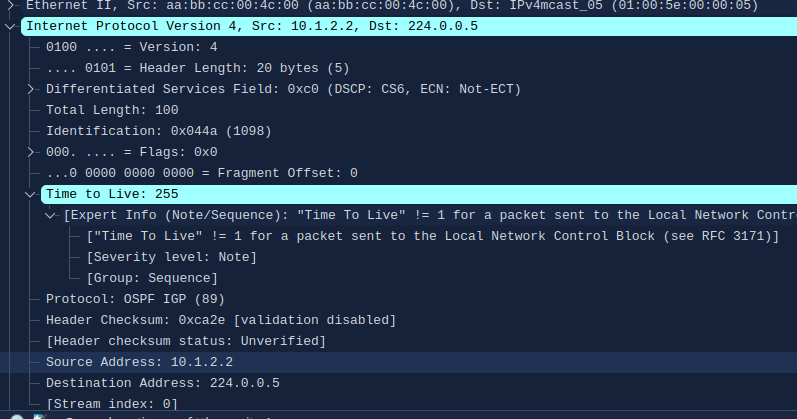

- Disabling TTL security on the interface

- R2:

```
conf t
 int e0/0
  ip ospf ttl-security disable !!!! Use this when leaving ttl-security enabled at the interface level for OSPF
```

- R1:

```
conf t
 int e0/0
  no ip ospf ttl-security
```

```
R2(config-router)#do sh ip ospf nei

Neighbor ID     Pri   State           Dead Time   Address         Interface
1.1.1.1           0   FULL/  -        00:00:34    10.1.2.1        Ethernet0/0
```

- Verify that TTL security is enabled for OSPF on the interface:

```
R2(config-if)#do sh ip ospf int e0/0
Ethernet0/0 is up, line protocol is up 
  Internet Address 10.1.2.2/24, Interface ID 2, Area 0
  Attached via Network Statement
  Process ID 122, Router ID 2.2.2.2, Network Type POINT_TO_POINT, Cost: 1
  Topology-MTID    Cost    Disabled    Shutdown      Topology Name
        0           1         no          no            Base
  Transmit Delay is 1 sec, State POINT_TO_POINT
  Timer intervals configured, Hello 10, Dead 40, Wait 40, Retransmit 5
    oob-resync timeout 40
    Hello due in 00:00:04
  Supports Link-local Signaling (LLS)
  Cisco NSF helper support enabled
  IETF NSF helper support enabled
  Strict TTL checking enabled  !!! TTL security enabled
  Can be protected by per-prefix Loop-Free FastReroute
  Can be used for per-prefix Loop-Free FastReroute repair paths
  Not Protected by per-prefix TI-LFA
  Index 1/1/1, flood queue length 0
  Next 0x0(0)/0x0(0)/0x0(0)
  Last flood scan length is 1, maximum is 2
  Last flood scan time is 0 msec, maximum is 1 msec
  Neighbor Count is 1, Adjacent neighbor count is 1 
    Adjacent with neighbor 1.1.1.1
  Suppress hello for 0 neighbor(s)
```

#### OSPF LSA Throttling

- By default OSPF will wait 5 seconds in case a link flaps before reconverging the SPF tree. This happens every time there is a link flap (up, wait 5 seconds, down, wait 5 seconds), etc

- LSA Throttling enables us to reconverge the network within miliseconds

- It also adds a few timers

- This allows to bring a network where some OSPF links flap, into a more stable network

```
R2(config-router)#do sh run all | s router ospf
router ospf 110
 router-id 2.2.2.2
 priority 64
 queue-depth update 200
 queue-depth hello unlimited
 compatible rfc1583
 no compatible rfc1587
 compatible rfc5243
 no interface-id snmp-if-index
 no ignore lsa mospf
 adjacency stagger 300 300
 event-log size 1000
 log-adjacency-changes
 discard-route external 254 internal 110
 no local-rib-criteria
 auto-cost reference-bandwidth 100
 max-lsa 50000 75 ignore-time 5 reset-time 10 ignore-count 5
 limit retransmissions dc 24 non-dc 24
 no shutdown
 no prefix-suppression
 nsf cisco helper
 nsf ietf helper
 capability opaque
 capability lls
 capability transit
 no multicast-intact
 no area 0 authentication
 area 0 default-cost 1
 timers throttle spf 50 200 5000
 timers throttle lsa 50 200 5000 !!! THESE ARE THE INTERESTING TIMERS
 timers lsa arrival 100
 timers pacing lsa-group 240
 timers pacing flood 33
 timers pacing retransmission 66
 timers nsf flush 60
 timers nsf wait 20
 redistribute maximum-prefix 10240 75
 network 10.1.2.2 0.0.0.0 area 0
 no maximum-paths per-prefix-distribution
 maximum-paths 4
 default-metric 20
 distance 110
 no bfd all-interfaces
```

- These timers are: initial start time, min hold time, and max hold time

- First is the initial start time (50 ms in our case). How much should I wait before joining a link flapping event

- The second timer tells how long should the router hold before having a duplicate LSA. If a link comes back up and I just sent out an LSA, how much should I wait, after the link comes back in order to send the same LSA (duplicate) again (also known as hold time for dup LSA)

- The third timer is the max wait time. Every time I do this, if I have duplicate LSAs, this timer is going to duble it's value. Each time a link flap happens, this timer will duble itself until it reaches the maximum timer set here

- Configuration:

```
conf t
 router ospf 110
  timers throttle lsa 0 1000 2000
```

```
R2(config-router)#do sh ip ospf | i LSA
 Supports opaque LSA
 Maximum number of non self-generated LSA allowed 50000
    Current number of non self-generated LSA 2
 Router is not originating router-LSAs with maximum metric
 Initial LSA throttle delay 0 msecs
 Minimum hold time for LSA throttle 1000 msecs !!! These are the interesting timers
 Maximum wait time for LSA throttle 2000 msecs !!! These are the interesting timers
 Minimum LSA arrival 100 msecs
 LSA group pacing timer 240 secs
 Number of external LSA 0. Checksum Sum 0x000000
 Number of opaque AS LSA 0. Checksum Sum 0x000000
 Number of DCbitless external and opaque AS LSA 0
 Number of DoNotAge external and opaque AS LSA 0
        Number of LSA 3. Checksum Sum 0x019DF1
        Number of opaque link LSA 0. Checksum Sum 0x000000
        Number of DCbitless LSA 0
        Number of indication LSA 0
        Number of DoNotAge LSA 0
```

- When you modify these timers, you should tell OSPF when it should be allowed to receive these LSAs

- "Minimum LSA arrival 100 msecs" is the timer that OSPF should wait before receiving inbound duplicate LSAs 

- Cisco recommends that "Minimum LSA arrival" timer to be equal or less than "Minimum hold time for LSA throttle"

- Typical is to set the "Minimum LSA arrival" timer to less than "Minimum hold time for LSA throttle"

```
conf t
 router ospf 110
  timers lsa arrival 500
```

```
R2(config-router)#do sh ip ospf | i LSA
 Supports opaque LSA
 Maximum number of non self-generated LSA allowed 50000
    Current number of non self-generated LSA 2
 Router is not originating router-LSAs with maximum metric
 Initial LSA throttle delay 0 msecs
 Minimum hold time for LSA throttle 1000 msecs
 Maximum wait time for LSA throttle 2000 msecs
 Minimum LSA arrival 500 msecs
 LSA group pacing timer 240 secs
 Number of external LSA 0. Checksum Sum 0x000000
 Number of opaque AS LSA 0. Checksum Sum 0x000000
 Number of DCbitless external and opaque AS LSA 0
 Number of DoNotAge external and opaque AS LSA 0
        Number of LSA 3. Checksum Sum 0x019DF1
        Number of opaque link LSA 0. Checksum Sum 0x000000
        Number of DCbitless LSA 0
        Number of indication LSA 0
        Number of DoNotAge LSA 0
```

- Default timers IOSv:

```
 timers throttle spf 5000 10000 10000
 timers throttle lsa 0 5000 5000
 timers lsa arrival 1000
```

- Default timers IOS XE:

```
 timers throttle spf 50 200 5000
 timers throttle lsa 50 200 5000
 timers lsa arrival 100
```

- R2 configuration:

```
router ospf 110
 router-id 2.2.2.2
 timers throttle lsa 0 1000 2000
 timers lsa arrival 500
 network 10.1.2.2 0.0.0.0 area 0
```

#### OSPF SPF Throttling

- SPF Throttling feature is a waiting period. When receiving the LSAs, do not process them imediately. Add them to the LSDB first and then we will have a waiting period

- Once the waiting period expires, then we will run the SPF algorithm to process the LSAs, and add the networks to the routing table

- The waiting period is as follows:

- IOS XE

```
timers throttle spf 50 200 5000
```

- IOSV

```
timers throttle spf 5000 10000 10000
```

```
R2(config-router)#do sh ip ospf | i SPF
 Initial SPF schedule delay 50 msecs
 Minimum hold time between two consecutive SPFs 200 msecs
 Maximum wait time between two consecutive SPFs 5000 msecs
 Incremental-SPF disabled
        SPF algorithm last executed 00:01:15.623 ago
        SPF algorithm executed 8 times

R1-IOSV(config-router)#do sh ip ospf | i SPF 
 Initial SPF schedule delay 5000 msecs
 Minimum hold time between two consecutive SPFs 10000 msecs
 Maximum wait time between two consecutive SPFs 10000 msecs
 Incremental-SPF disabled
        SPF algorithm last executed 00:02:34.979 ago
        SPF algorithm executed 4 times
```

- We have 3 timers for SPF

- The first is the initial SPF schedule delay - this tells what is the initial delay that should we wait before we perform the SPF algorithm

- The next timer is the minimum hold time between two consecutive SPFs - what is the minimum timer that we should wait before having a consecutive SPF calculation

- The last timer is the maximum hold time between two consecutive SPF calculations - what is the maximum timer we should wait before having another SPF calculation

- Changing the timers:

```
conf t
 router ospf 110
  timers throttle spf 1 100 1000
```

```
R1(config-router)#do sh run all | s router ospf             
router ospf 1
 router-id 1.1.1.1
 priority 64
 queue-depth update 200
 queue-depth hello unlimited
 compatible rfc1583
 no compatible rfc1587
 compatible rfc5243
 no interface-id snmp-if-index
 no ignore lsa mospf
 adjacency stagger 300 300
 event-log size 1000
 log-adjacency-changes
 discard-route external 254 internal 110
 no local-rib-criteria
 auto-cost reference-bandwidth 100
 max-lsa 50000 75 ignore-time 5 reset-time 10 ignore-count 5
 limit retransmissions dc 24 non-dc 24
 no shutdown
 no prefix-suppression
 nsf cisco helper
 nsf ietf helper
 capability opaque
 capability lls
 capability transit
 no multicast-intact
 no area 0 authentication
 area 0 default-cost 1
 timers throttle spf 1 100 1000 !!! TIMERS AFTER CHANGE
 timers throttle lsa 50 200 5000
 timers lsa arrival 100
 timers pacing lsa-group 240
 timers pacing flood 33
 timers pacing retransmission 66
 timers nsf flush 60
 timers nsf wait 20
 redistribute maximum-prefix 10240 75
 network 0.0.0.0 255.255.255.255 area 0
 no maximum-paths per-prefix-distribution
 maximum-paths 4
 default-metric 20
 distance 110
 no bfd all-interfaces
```

```
R1(config-router)#do sh run | s router ospf
router ospf 1
 router-id 1.1.1.1
 timers throttle spf 1 100 1000
 network 0.0.0.0 255.255.255.255 area 0
```

#### OSPF Fast Hellos

- Confuguring timers is done per interface in OSPF

- R1:

```
conf t
 int e0/0
  ip ospf hello-interval 10
  ip ospf dead-interval 40
```

- There are also some other timers. One of them is the retransmit timer. If no LS ACK is received for a LS Update, the LS ACK packet will be retransmitted

- The retransmit delay by default is 5 seconds

- Setting the retransmit timer on the interface:

```
conf t
 interface e0/0
  ip ospf retramsmit-interval 1
```

```
R2(config-if)#do sh ip ospf int e0/0
Ethernet0/0 is up, line protocol is up 
  Internet Address 10.1.2.2/24, Interface ID 2, Area 0
  Attached via Network Statement
  Process ID 110, Router ID 2.2.2.2, Network Type POINT_TO_POINT, Cost: 1
  Topology-MTID    Cost    Disabled    Shutdown      Topology Name
        0           1         no          no            Base
  Transmit Delay is 1 sec, State POINT_TO_POINT
  Timer intervals configured, Hello 10, Dead 40, Wait 40, Retransmit 1
    oob-resync timeout 40
    Hello due in 00:00:02
  Supports Link-local Signaling (LLS)
  Cisco NSF helper support enabled
  IETF NSF helper support enabled
  Can be protected by per-prefix Loop-Free FastReroute
  Can be used for per-prefix Loop-Free FastReroute repair paths
  Not Protected by per-prefix TI-LFA
  Index 1/1/1, flood queue length 0
  Next 0x0(0)/0x0(0)/0x0(0)
  Last flood scan length is 1, maximum is 6
  Last flood scan time is 0 msec, maximum is 1 msec
  Neighbor Count is 1, Adjacent neighbor count is 1 
    Adjacent with neighbor 1.1.1.1
  Suppress hello for 0 neighbor(s)
```

- Setting the fast hellos for OSPF

```
conf t
 interface e0/0
  ip ospf dead-interval minimal hello-multiplier 5
```

```
R2(config-if)#do sh ip ospf int e0/0
Ethernet0/0 is up, line protocol is up 
  Internet Address 10.1.2.2/24, Interface ID 2, Area 0
  Attached via Network Statement
  Process ID 110, Router ID 2.2.2.2, Network Type POINT_TO_POINT, Cost: 1
  Topology-MTID    Cost    Disabled    Shutdown      Topology Name
        0           1         no          no            Base
  Transmit Delay is 1 sec, State POINT_TO_POINT
  Timer intervals configured, Hello 200 msec, Dead 1, Wait 1, Retransmit 1
    oob-resync timeout 40
    Hello due in 148 msec
  Supports Link-local Signaling (LLS)
  Cisco NSF helper support enabled
  IETF NSF helper support enabled
  Can be protected by per-prefix Loop-Free FastReroute
  Can be used for per-prefix Loop-Free FastReroute repair paths
  Not Protected by per-prefix TI-LFA
  Index 1/1/1, flood queue length 0
  Next 0x0(0)/0x0(0)/0x0(0)
  Last flood scan length is 1, maximum is 6
  Last flood scan time is 0 msec, maximum is 1 msec
  Neighbor Count is 1, Adjacent neighbor count is 1 
    Adjacent with neighbor 1.1.1.1
  Suppress hello for 0 neighbor(s)
```

- As you can see now we have sub-second timers

- On the other side of the link, the retransmit interval still remained at the default 5 seconds

```
R1(config-if)#do sh ip ospf int e0/0
Ethernet0/0 is up, line protocol is up 
  Internet Address 10.1.2.1/24, Interface ID 2, Area 0
  Attached via Network Statement
  Process ID 1, Router ID 1.1.1.1, Network Type POINT_TO_POINT, Cost: 1
  Topology-MTID    Cost    Disabled    Shutdown      Topology Name
        0           1         no          no            Base
  Transmit Delay is 1 sec, State POINT_TO_POINT
  Timer intervals configured, Hello 200 msec, Dead 1, Wait 1, Retransmit 5
    oob-resync timeout 40
    Hello due in 133 msec
  Supports Link-local Signaling (LLS)
  Cisco NSF helper support enabled
  IETF NSF helper support enabled
  Can be protected by per-prefix Loop-Free FastReroute
  Can be used for per-prefix Loop-Free FastReroute repair paths
  Not Protected by per-prefix TI-LFA
  Index 1/1/1, flood queue length 0
  Next 0x0(0)/0x0(0)/0x0(0)
  Last flood scan length is 1, maximum is 5
  Last flood scan time is 0 msec, maximum is 0 msec
  Neighbor Count is 1, Adjacent neighbor count is 1 
    Adjacent with neighbor 2.2.2.2
  Suppress hello for 0 neighbor(s)
```

- Modifiying this timer on R1:

```
conf t
 int e0/0
  ip ospf retransmit-interval 1
```

#### Route filtering - Distribute lists

- Distribute lists are used to filter prefixes from entering in the routing table. They will not filter the LSDB, the LSDB needs to be the same on all routers in the same area

- The distribute lists will not work with the `out` options to filter for routes on the same area

- The `out` option will work on type 5 or type 7 LSAs and only on the router that redistributes them.

- Topology:

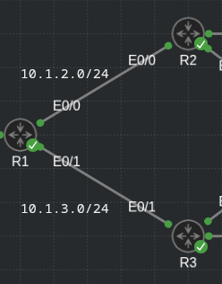

- Here, R1, R2 and R3 are in Area 0

- Each router has 3 loopbacks: R1: 192.168.1.1/32, 192.168.1.2/32, 192.168.1.3/32, R2: 192.168.2.1/32, 192.168.2.2/32, 192.168.2.3/32, R3: 192.168.3.1/32, 192.168.3.2/32, 192.168.3.3/32

- R2 and R3 have `redistribute connected` in their configuration

- R1 has OSPF enabled on all interfaces

- R1 OSPF configuration, including ACL and distribute list to filter the routes from 192.168.2.x range:

```
R1(config)#do sh run | s access
ip access-list standard 1
 10 remark OSPF_FILTER
 10 deny 192.168.2.0 0.0.0.255
 20 permit any

router ospf 123
 router-id 1.1.1.1
 network 0.0.0.0 255.255.255.255 area 0
 distribute-list 1 in

```

- Routing table of R1 now after filtering:

```
R1(config-router)#do sh ip ro ospf | b Gate
Gateway of last resort is not set

      2.0.0.0/32 is subnetted, 1 subnets
O E2     2.2.2.2 [110/20] via 10.1.2.2, 00:04:26, Ethernet0/0
      3.0.0.0/32 is subnetted, 1 subnets
O E2     3.3.3.3 [110/20] via 10.1.3.3, 00:04:26, Ethernet0/1
      10.0.0.0/8 is variably subnetted, 7 subnets, 2 masks
O E2     10.2.4.0/24 [110/20] via 10.1.2.2, 00:04:26, Ethernet0/0
O E2     10.3.5.0/24 [110/20] via 10.1.3.3, 00:04:26, Ethernet0/1
O E2     10.24.35.0/24 [110/20] via 10.1.3.3, 00:04:26, Ethernet0/1
                       [110/20] via 10.1.2.2, 00:04:26, Ethernet0/0
      192.168.3.0/32 is subnetted, 3 subnets
O E2     192.168.3.1 [110/20] via 10.1.3.3, 00:04:26, Ethernet0/1
O E2     192.168.3.2 [110/20] via 10.1.3.3, 00:04:26, Ethernet0/1
O E2     192.168.3.3 [110/20] via 10.1.3.3, 00:04:26, Ethernet0/1
```

- R2 OSPF configuration:

```
router ospf 123
 router-id 2.2.2.2
 redistribute connected
 network 10.1.2.2 0.0.0.0 area 0
```

- R3, filtering the same OSPF routes as R1, but using a prefix list:

```
ip prefix-list OSPF_FILTER seq 5 deny 192.168.2.0/24 le 32
ip prefix-list OSPF_FILTER seq 10 permit 0.0.0.0/0 le 32

R3(config)#do sh run | s router ospf
router ospf 123
 router-id 3.3.3.3
 redistribute connected
 network 10.1.3.3 0.0.0.0 area 0
 distribute-list prefix OSPF_FILTER in
```

- The result is the same, the prefixes are filtered from entering the routing table. The LSDB is the same.

```
R3(config-router)#do sh ip ro ospf | b Gate
Gateway of last resort is not set

      1.0.0.0/32 is subnetted, 1 subnets
O        1.1.1.1 [110/2] via 10.1.3.1, 00:33:51, Ethernet0/1
      2.0.0.0/32 is subnetted, 1 subnets
O E2     2.2.2.2 [110/20] via 10.1.3.1, 00:33:51, Ethernet0/1
      10.0.0.0/8 is variably subnetted, 8 subnets, 2 masks
O        10.1.2.0/24 [110/2] via 10.1.3.1, 00:33:51, Ethernet0/1
O E2     10.2.4.0/24 [110/20] via 10.1.3.1, 00:33:51, Ethernet0/1
      192.168.1.0/32 is subnetted, 3 subnets
O        192.168.1.1 [110/2] via 10.1.3.1, 00:33:51, Ethernet0/1
O        192.168.1.2 [110/2] via 10.1.3.1, 00:33:51, Ethernet0/1
O        192.168.1.3 [110/2] via 10.1.3.1, 00:33:51, Ethernet0/1

R3(config-router)#do sh ip ospf database

            OSPF Router with ID (3.3.3.3) (Process ID 123)

                Router Link States (Area 0)

Link ID         ADV Router      Age         Seq#       Checksum Link count
1.1.1.1         1.1.1.1         904         0x80000006 0x00819A 8         
2.2.2.2         2.2.2.2         1036        0x80000004 0x00A14C 2         
3.3.3.3         3.3.3.3         1197        0x80000004 0x00855D 2         

                Type-5 AS External Link States

Link ID         ADV Router      Age         Seq#       Checksum Tag
2.2.2.2         2.2.2.2         1276        0x80000002 0x004D42 0         
3.3.3.3         3.3.3.3         1197        0x80000002 0x000186 0         
10.2.4.0        2.2.2.2         1276        0x80000002 0x00E2A4 0         
10.3.5.0        3.3.3.3         1197        0x80000002 0x00ADD3 0         
10.24.35.0      2.2.2.2         1276        0x80000002 0x0083CE 0         
10.24.35.0      3.3.3.3         1197        0x80000002 0x0065E8 0         
192.168.2.1     2.2.2.2         1276        0x80000002 0x00D753 0         
192.168.2.2     2.2.2.2         1276        0x80000002 0x00CD5C 0         
192.168.2.3     2.2.2.2         1276        0x80000002 0x00C365 0         
192.168.3.1     3.3.3.3         1197        0x80000002 0x00AE77 0         
192.168.3.2     3.3.3.3         1197        0x80000002 0x00A480 0         
192.168.3.3     3.3.3.3         1197        0x80000002 0x009A89 0         
```

- Using a prefix list with `gateway` keyword on R3:

```
conf t
 router ospf 123
  distribute-list prefix OSPF_FILTER gateway OSPF_GATEWAY in
  exit
 
 ip prefix-list OSPF_GATEWAY permit 10.1.3.1/32 !!! MATCH THE NEXT HOP ADDRESS FROM THE ROUTING TABLE   
```

- The effect is the same as for the prefix list without gateway from above

```
R3(config)#do sh ip ro ospf | b Gate
Gateway of last resort is not set

      1.0.0.0/32 is subnetted, 1 subnets
O        1.1.1.1 [110/2] via 10.1.3.1, 00:02:54, Ethernet0/1
      2.0.0.0/32 is subnetted, 1 subnets
O E2     2.2.2.2 [110/20] via 10.1.3.1, 00:02:54, Ethernet0/1
      10.0.0.0/8 is variably subnetted, 8 subnets, 2 masks
O        10.1.2.0/24 [110/2] via 10.1.3.1, 00:02:54, Ethernet0/1
O E2     10.2.4.0/24 [110/20] via 10.1.3.1, 00:02:54, Ethernet0/1
      192.168.1.0/32 is subnetted, 3 subnets
O        192.168.1.1 [110/2] via 10.1.3.1, 00:02:54, Ethernet0/1
O        192.168.1.2 [110/2] via 10.1.3.1, 00:02:54, Ethernet0/1
O        192.168.1.3 [110/2] via 10.1.3.1, 00:02:54, Ethernet0/1
```

- Filtering the prefixes on R2 using a route map

```
conf t
 access-list 1 deny 192.168.3.0 0.0.0.255
 acesss-list 1 permit any

 route-map OSPF_FILTER permit 10
  match ip address 1
  exit
 
 router ospf 123
  distribute-list route-map OSPF_FILTER in
```

#### Route filtering using filter lists

- Filter lists can be applied on the ABRs to filter prefixes from an area to another area

- This filter list will be filtering our Type 3 LSAs from an area and prevent them from entering another area

- When saying area X IN - you filter the prefixes from the specified area, from entering the area

- When saying area X OUT - you filter the prefixes from the specified area to be advertised into another areas present on that router

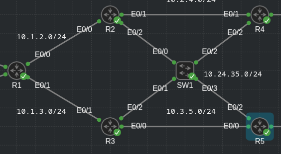

- We have OSPF area 0 between R1 and R3 and area 35 between R3 (e0/0 interface) and R5

- We want to prevent the loopbacks of R5 (192.168.5.X) prefixes from entering Area 0.

- We do this on ABR (R3)

```
conf t
 router ospf 123
  area 35 filter-list prefix OSPF_FILTER out

 ip prefix-list OSPF_FILTER deny 192.168.5.0/24 le 32
 ip prefix-list OSPF_FILTER permit 0.0.0.0/0 le 32
```

- At the moment, R5 has `redistribute connected subnets` in it's configuration, so these networks are Type 5 LSAs

- In this situation the route filtering will not work

- Area filter list command is used to filter Type 3 LSAs, not Type 5

- R5:

```
R5(config-router)#do sh run | s router ospf
router ospf 123
 router-id 5.5.5.5
 redistribute connected
 network 10.3.5.5 0.0.0.0 area 35
```

- R3:

```
R3(config-router)#do sh run | s router ospf
router ospf 123
 router-id 3.3.3.3
 area 35 filter-list prefix OSPF_FILTER out
 network 10.1.3.3 0.0.0.0 area 0
 network 10.3.5.3 0.0.0.0 area 35
 exit

ip prefix-list OSPF_FILTER seq 5 deny 192.168.5.0/24 le 32
ip prefix-list OSPF_FILTER seq 10 permit 0.0.0.0/0 le 32
```

- Repairing this on R5:

```
conf t
 router ospf 123
  network 192.168.5.0 0.0.0.255 area 35
```

- Now we can see that the prefixes are filtered on R1 (area 0)

```
R1#sh ip ro ospf | b Gate
Gateway of last resort is not set

      5.0.0.0/32 is subnetted, 1 subnets
O E2     5.5.5.5 [110/20] via 10.1.3.3, 00:24:22, Ethernet0/1
      10.0.0.0/8 is variably subnetted, 7 subnets, 2 masks
O IA     10.3.5.0/24 [110/2] via 10.1.3.3, 00:17:03, Ethernet0/1
O E2     10.5.7.0/24 [110/20] via 10.1.3.3, 00:24:22, Ethernet0/1
O E2     10.24.35.0/24 [110/20] via 10.1.3.3, 00:05:53, Ethernet0/1
```

- Verifying the Type 3 LSAs for Area 0 on R1:

```
R1(config-router)#do sh ip ospf data

            OSPF Router with ID (1.1.1.1) (Process ID 1)

                Router Link States (Area 0)

Link ID         ADV Router      Age         Seq#       Checksum Link count
1.1.1.1         1.1.1.1         100         0x80000007 0x00350B 7         
1.1.1.100       1.1.1.100       2584        0x80000005 0x00F0AC 2         
1.1.1.101       1.1.1.101       2583        0x80000006 0x00FE99 2         
3.3.3.3         3.3.3.3         102         0x80000011 0x00686E 2         

                Summary Net Link States (Area 0)

Link ID         ADV Router      Age         Seq#       Checksum
10.3.5.0        3.3.3.3         1923        0x80000001 0x005BC2

                Summary ASB Link States (Area 0)

Link ID         ADV Router      Age         Seq#       Checksum
5.5.5.5         3.3.3.3         465         0x80000002 0x0042D7

                Type-5 AS External Link States

Link ID         ADV Router      Age         Seq#       Checksum Tag
1.1.1.101       1.1.1.101       3351        0x80000001 0x00557A 0         
5.5.5.5         5.5.5.5         487         0x80000002 0x00680F 0         
10.5.7.0        5.5.5.5         487         0x80000002 0x004332 0         
10.24.35.0      5.5.5.5         487         0x80000002 0x00291D 0         
```

- There are no 192.168.5.x prefixes to advertise into R1's LSDB

- R3 have filtered them out from being advertised from Area 35 into Area 0

```
R3(config-router)#do sh ip ospf data

            OSPF Router with ID (3.3.3.3) (Process ID 123)

                Router Link States (Area 0)

Link ID         ADV Router      Age         Seq#       Checksum Link count
1.1.1.1         1.1.1.1         258         0x80000007 0x00350B 7         
1.1.1.100       1.1.1.100       2740        0x80000005 0x00F0AC 2         
1.1.1.101       1.1.1.101       2739        0x80000006 0x00FE99 2         
3.3.3.3         3.3.3.3         258         0x80000011 0x00686E 2         

                Summary Net Link States (Area 0)

Link ID         ADV Router      Age         Seq#       Checksum
10.3.5.0        3.3.3.3         120         0x80000002 0x0059C3

                Summary ASB Link States (Area 0)

Link ID         ADV Router      Age         Seq#       Checksum
5.5.5.5         3.3.3.3         622         0x80000002 0x0042D7

                Router Link States (Area 35)

Link ID         ADV Router      Age         Seq#       Checksum Link count
3.3.3.3         3.3.3.3         1410        0x80000003 0x00913B 2         
5.5.5.5         5.5.5.5         643         0x80000005 0x001823 5         

                Summary Net Link States (Area 35)

Link ID         ADV Router      Age         Seq#       Checksum
1.1.1.1         3.3.3.3         252         0x80000005 0x000D1A
10.1.2.0        3.3.3.3         252         0x80000005 0x009687
10.1.3.0        3.3.3.3         622         0x80000003 0x00859A
192.168.1.1     3.3.3.3         252         0x80000005 0x00744B
192.168.1.2     3.3.3.3         252         0x80000005 0x006A54
192.168.1.3     3.3.3.3         252         0x80000005 0x00605D

                Type-5 AS External Link States

Link ID         ADV Router      Age         Seq#       Checksum Tag
1.1.1.101       1.1.1.101       3507        0x80000001 0x00557A 0         
5.5.5.5         5.5.5.5         643         0x80000002 0x00680F 0         
10.5.7.0        5.5.5.5         643         0x80000002 0x004332 0         
10.24.35.0      5.5.5.5         643         0x80000002 0x00291D 0         
```

- R3's routing table still has them:

```
R3(config-router)#do sh ip ro ospf | b Gate
Gateway of last resort is not set

      1.0.0.0/32 is subnetted, 1 subnets
O        1.1.1.1 [110/2] via 10.1.3.1, 00:07:02, Ethernet0/1
      5.0.0.0/32 is subnetted, 1 subnets
O E2     5.5.5.5 [110/20] via 10.3.5.5, 00:37:28, Ethernet0/0
      10.0.0.0/8 is variably subnetted, 8 subnets, 2 masks
O        10.1.2.0/24 [110/2] via 10.1.3.1, 00:07:02, Ethernet0/1
O E2     10.5.7.0/24 [110/20] via 10.3.5.5, 00:37:28, Ethernet0/0
      192.168.1.0/32 is subnetted, 3 subnets
O        192.168.1.1 [110/2] via 10.1.3.1, 00:07:02, Ethernet0/1
O        192.168.1.2 [110/2] via 10.1.3.1, 00:07:02, Ethernet0/1
O        192.168.1.3 [110/2] via 10.1.3.1, 00:07:02, Ethernet0/1
      192.168.5.0/32 is subnetted, 3 subnets
O        192.168.5.1 [110/2] via 10.3.5.5, 00:21:18, Ethernet0/0
O        192.168.5.2 [110/2] via 10.3.5.5, 00:21:18, Ethernet0/0
O        192.168.5.3 [110/2] via 10.3.5.5, 00:21:18, Ethernet0/0
```

- R1's routing table and LSDB does not have them, as shown above

#### OSPF in VRF-LITE

- OSPF needs to be in Area 0 whenever we configure a VRF

- OSPF has a down bit (DN bit)

- When distributing the routes from OSPF in something like MP-BGP (in MPLS environment) we will set the down bit on the routes 

- Down bit says to BGP to not advertise these routes back in another point of redistribution because it may cause a loop

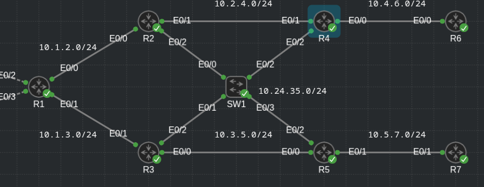

- In this topology, only the link between R1 and R2 will be in Area 0 and the link between R2 and R4 will be in Area 24

- To make this to work we may need to disable the DN bit check or create a virtual link

- Configuration on R4:

```
conf t
 ip vrf R2
  exit

 router ospf 1 vrf R2
  router-id 4.4.4.4
  network 10.2.4.4 0.0.0.0 area 24
```

- With this, only the routes from R2 are in the routing table of R4

- The routes directly connected to R1 are not present in the routing table

- This is part of the DN bit check

```
R4(config-router)#do sh ip ro vrf R2 ospf | b Gate 
Gateway of last resort is not set

      2.0.0.0/32 is subnetted, 1 subnets
O E2     2.2.2.2 [110/20] via 10.2.4.2, 00:08:27, Ethernet0/1
      10.0.0.0/8 is variably subnetted, 3 subnets, 2 masks
O E2     10.24.35.0/24 [110/20] via 10.2.4.2, 00:08:27, Ethernet0/1
      192.168.2.0/32 is subnetted, 3 subnets
O E2     192.168.2.1 [110/20] via 10.2.4.2, 00:08:27, Ethernet0/1
O E2     192.168.2.2 [110/20] via 10.2.4.2, 00:08:27, Ethernet0/1
O E2     192.168.2.3 [110/20] via 10.2.4.2, 00:08:27, Ethernet0/1
```

- The links are present in the database, but not in the routing table

```
R4(config-router)#do sh ip ospf data 

            OSPF Router with ID (4.4.4.4) (Process ID 1)

                Router Link States (Area 24)

Link ID         ADV Router      Age         Seq#       Checksum Link count
2.2.2.2         2.2.2.2         555         0x80000004 0x006F6B 2         
4.4.4.4         4.4.4.4         554         0x80000002 0x00AC28 2         

                Summary Net Link States (Area 24)

Link ID         ADV Router      Age         Seq#       Checksum
1.1.1.1         2.2.2.2         962         0x80000001 0x0033FB
10.1.2.0        2.2.2.2         962         0x80000001 0x00B274
10.1.3.0        2.2.2.2         962         0x80000001 0x00B173
192.168.1.1     2.2.2.2         962         0x80000001 0x009A2D
192.168.1.2     2.2.2.2         962         0x80000001 0x009036
192.168.1.3     2.2.2.2         962         0x80000001 0x00863F

                Type-5 AS External Link States

Link ID         ADV Router      Age         Seq#       Checksum Tag
2.2.2.2         2.2.2.2         923         0x80000001 0x004F41 0         
10.24.35.0      2.2.2.2         923         0x80000001 0x0085CD 0         
192.168.2.1     2.2.2.2         923         0x80000001 0x00D952 0         
192.168.2.2     2.2.2.2         923         0x80000001 0x00CF5B 0         
192.168.2.3     2.2.2.2         923         0x80000001 0x00C564 0        
```

- What we can do is to enable `capability vrf-lite` on R4. This command disables the DN bit check

```
conf t
 router ospf 1 vrf R2
  capability vrf-lite
```

- Configure R3 and R5 in VRF with OSPFv3 with both IPv4 and IPv6

- Configure VRF on R3:

```
conf t
 ipv6 unicast-routing
 vrf definition R5
  rd 10.1.3.0:34
  address-family ipv4
  address-family ipv6

 interface Ethernet0/0
  bandwidth 1000000
  vrf forwarding R5
  ip address 10.3.5.3 255.255.255.0
  ipv6 address 2017::3/64
  ospfv3 network point-to-point
  ospfv3 110 ipv4 area 0
  ospfv3 110 ipv6 area 0

 interface Loopback3
  vrf forwarding R5
  ip address 3.3.3.3 255.255.255.255
  ipv6 address 2033::3/128
  ospfv3 110 ipv4 area 0
  ospfv3 110 ipv6 area 0

 router ospfv3 110
  router-id 3.3.3.3
  !
  address-family ipv4 unicast vrf R5
  exit-address-family
  !
  address-family ipv6 unicast vrf R5
  exit-address-family
```

#### OSPF - BGP redistribution

- Topology:

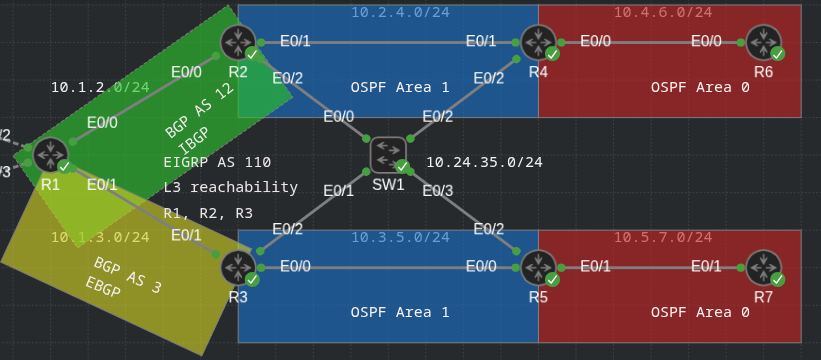

- Each router has 3 loopbacks in the 192.168.X.Y range, where X is the router number and Y can be 1, 2, or 3, with /32 masks each

- R1, R2 and R3 use EIGRP to ensure the reachability between the loopback 3 interfaces. Loopback 3 has the IP as the router IDs used by the router. R1: 1.1.1.1, R2: 2.2.2.2, R3: 3.3.3.3 etc.

- EBGP and IBGP sessions between R1, R2 and R3 is made over loopbacks

- R6 and R7 advertise all their interfaces in the OSPF process with `network 0.0.0.0 255.255.255.255 area 0` - as O routes

- R5 advertise it's prefixes (except the interfaces participating in OSPF) with `redistribute connected` - as O E2 routes

- R5 advertise it's prefixes (except the interfaces participating in OSPF) with `redistribute connected metric-type 1`- as O E1 routes

- The link with the switch in between is not advertised in OSPF

- R7 configuration:

```
R7(config-if)#do sh ip int br | e ass
Interface              IP-Address      OK? Method Status                Protocol
Ethernet0/1            10.5.7.7        YES NVRAM  up                    up      
Loopback0              192.168.7.1     YES NVRAM  up                    up      
Loopback1              192.168.7.2     YES NVRAM  up                    up      
Loopback2              192.168.7.3     YES NVRAM  up                    up      
Loopback3              7.7.7.7         YES NVRAM  up                    up      
Loopback67             172.16.67.7     YES manual up                    up      

R7(config-if)#do sh run | s router ospf
router ospf 110
 router-id 7.7.7.7
 network 0.0.0.0 255.255.255.255 area 0
```

- R6 configuration:

```
R6#sh ip int br | e ass
Interface              IP-Address      OK? Method Status                Protocol
Ethernet0/0            10.4.6.6        YES NVRAM  up                    up      
Ethernet0/1            10.6.100.1      YES NVRAM  up                    up      
Loopback0              192.168.6.1     YES NVRAM  up                    up      
Loopback1              192.168.6.2     YES NVRAM  up                    up      
Loopback2              192.168.6.3     YES NVRAM  up                    up      
Loopback3              6.6.6.6         YES NVRAM  up                    up      

R6#sh run | s router ospf
router ospf 110
 router-id 6.6.6.6
 network 0.0.0.0 255.255.255.255 area 0
```

- R5 configuration:

```
R5(config-if)#do sh ip int br | e ass
Interface              IP-Address      OK? Method Status                Protocol
Ethernet0/0            10.3.5.5        YES NVRAM  up                    up      
Ethernet0/1            10.5.7.5        YES NVRAM  up                    up      
Ethernet0/2            10.24.35.5      YES NVRAM  up                    up      
Loopback0              192.168.5.1     YES NVRAM  up                    up      
Loopback1              192.168.5.2     YES NVRAM  up                    up      
Loopback2              192.168.5.3     YES NVRAM  up                    up      
Loopback3              5.5.5.5         YES NVRAM  up                    up      


R5(config-if)#do sh run | s router ospf
router ospf 110
 router-id 5.5.5.5
 redistribute connected
 network 10.3.5.5 0.0.0.0 area 1
 network 10.5.7.5 0.0.0.0 area 0
```

- R4 configuration:

```
R4(config-if)#do sh ip int br | e ass
Interface              IP-Address      OK? Method Status                Protocol
Ethernet0/0            10.4.6.4        YES NVRAM  up                    up      
Ethernet0/1            10.2.4.4        YES NVRAM  up                    up      
Ethernet0/2            10.24.35.4      YES NVRAM  up                    up      
Loopback0              192.168.4.1     YES NVRAM  up                    up      
Loopback1              192.168.4.2     YES NVRAM  up                    up      
Loopback2              192.168.4.3     YES NVRAM  up                    up      
Loopback3              4.4.4.4         YES NVRAM  up                    up      

R4(config-if)#do sh run | s router ospf
router ospf 110
 router-id 4.4.4.4
 redistribute connected metric-type 1
 network 10.2.4.4 0.0.0.0 area 1
 network 10.4.6.4 0.0.0.0 area 0
```

- R1 configuration:

```
R1#sh ip int br | e ass
Interface              IP-Address      OK? Method Status                Protocol
Ethernet0/0            10.1.2.1        YES NVRAM  up                    up      
Ethernet0/1            10.1.3.1        YES NVRAM  up                    up      
Ethernet0/2            10.100.1.1      YES NVRAM  administratively down down    
Ethernet0/3            10.101.1.1      YES NVRAM  administratively down down    
Loopback0              192.168.1.1     YES NVRAM  up                    up      
Loopback1              192.168.1.2     YES NVRAM  up                    up      
Loopback2              192.168.1.3     YES NVRAM  up                    up      
Loopback3              1.1.1.1         YES NVRAM  up                    up      

R1#sh run | s router eigrp
router eigrp 110
 network 1.1.1.1 0.0.0.0
 network 10.1.2.1 0.0.0.0
 network 10.1.3.1 0.0.0.0
 eigrp router-id 1.1.1.1

route-map REDIST permit 10 
 match interface Loopback0 Loopback1 Loopback2

R1#sh run | s router bgp
router bgp 12
 bgp router-id 1.1.1.1
 bgp log-neighbor-changes
 neighbor 2.2.2.2 remote-as 12
 neighbor 2.2.2.2 update-source Loopback3
 neighbor 3.3.3.3 remote-as 3
 neighbor 3.3.3.3 ebgp-multihop 255
 neighbor 3.3.3.3 update-source Loopback3
 !
 address-family ipv4
  redistribute connected route-map REDIST
  neighbor 2.2.2.2 activate
  neighbor 3.3.3.3 activate
 exit-address-family
```

- On R1 we can't just redistribute the connected routes into BGP

- To maintain the reachability over the loopback interfaces in order to maintain the BGP peering the 1.1.1.1 route cannot be included in redistribution, as EBGP have an AD of 20 for routes and EIGRP has an AD of 90. To get around this a route-map that matches any loopback interfaces. except L3 on R1 is created and assigned as part of BGP redistribution of connected routes

- R2 configuration:

```
R2#sh ip int br | e ass
Interface              IP-Address      OK? Method Status                Protocol
Ethernet0/0            10.1.2.2        YES NVRAM  up                    up      
Ethernet0/1            10.2.4.2        YES NVRAM  up                    up      
Ethernet0/2            10.24.35.2      YES NVRAM  up                    up      
Loopback0              192.168.2.1     YES NVRAM  up                    up      
Loopback1              192.168.2.2     YES NVRAM  up                    up      
Loopback2              192.168.2.3     YES NVRAM  up                    up      
Loopback3              2.2.2.2         YES NVRAM  up                    up      

R2#sh run | s router eigrp
router eigrp 110
 network 2.2.2.2 0.0.0.0
 network 10.1.2.2 0.0.0.0
 passive-interface Ethernet0/2
 eigrp router-id 2.2.2.2

R2#sh run | s router ospf
router ospf 110
 router-id 2.2.2.2
 network 10.2.4.2 0.0.0.0 area 1

R2#sh run | s router bgp
router bgp 12
 bgp router-id 2.2.2.2
 bgp log-neighbor-changes
 neighbor 1.1.1.1 remote-as 12
 neighbor 1.1.1.1 update-source Loopback3
```

- R3 configuration:

```
R3(config-router-af)#do sh ip int br | e ass
Interface              IP-Address      OK? Method Status                Protocol
Ethernet0/0            10.3.5.3        YES NVRAM  up                    up      
Ethernet0/1            10.1.3.3        YES NVRAM  up                    up      
Ethernet0/2            10.24.35.3      YES NVRAM  up                    up      
Loopback0              192.168.3.1     YES NVRAM  up                    up      
Loopback1              192.168.3.2     YES NVRAM  up                    up      
Loopback2              192.168.3.3     YES NVRAM  up                    up      
Loopback3              3.3.3.3         YES NVRAM  up                    up      

R3(config-router-af)#do sh run | s router eigrp
router eigrp 110
 network 3.3.3.3 0.0.0.0
 network 10.1.3.3 0.0.0.0
 passive-interface Ethernet0/2
 eigrp router-id 3.3.3.3

R3(config-router-af)#do sh run | s router ospf
router ospf 110
 router-id 3.3.3.3
 network 10.3.5.3 0.0.0.0 area 1

R3(config-router-af)#do sh run | s router bgp
router bgp 3
 bgp router-id 3.3.3.3
 bgp log-neighbor-changes
 neighbor 1.1.1.1 remote-as 12
 neighbor 1.1.1.1 ebgp-multihop 255
 neighbor 1.1.1.1 update-source Loopback3
 !
 address-family ipv4
  redistribute ospf 110 metric 100 match internal external 1 external 2
  neighbor 1.1.1.1 activate
 exit-address-family
```

- By default, when redistributing OSPF into BGP, the metric assigned to the routes is the same as the one that the route had in OSPF

- It can be changed by setting a metric statically

- Also by default, the external routes (O E1, O E2, O N1, O N2) are not included in redistribution

- To tweak this, use `match internal nssa-external external` - or `match i n e` as part of redistribution command (adjust as needed, but consider enabling all types by default)

- BGP table on R1 now:

```
R1#show ip bgp | b Net
     Network          Next Hop            Metric LocPrf Weight Path
 *>   5.5.5.5/32       3.3.3.3                100             0 3 ?
 *>   7.7.7.7/32       3.3.3.3                100             0 3 ?
 *>   10.3.5.0/24      3.3.3.3                100             0 3 ?
 *>   10.5.7.0/24      3.3.3.3                100             0 3 ?
 *>   172.16.67.7/32   3.3.3.3                100             0 3 ?
 *>   192.168.1.1/32   0.0.0.0                  0         32768 ?
 *>   192.168.1.2/32   0.0.0.0                  0         32768 ?
 *>   192.168.1.3/32   0.0.0.0                  0         32768 ?
 *>   192.168.5.1/32   3.3.3.3                100             0 3 ?
 *>   192.168.5.2/32   3.3.3.3                100             0 3 ?
 *>   192.168.5.3/32   3.3.3.3                100             0 3 ?
 *>   192.168.7.1/32   3.3.3.3                100             0 3 ?
 *>   192.168.7.2/32   3.3.3.3                100             0 3 ?
 *>   192.168.7.3/32   3.3.3.3                100             0 3 ?
```

- Redistributing BGP into OSPF

```
R3(config-router)#do sh run | s router ospf
router ospf 110
 router-id 3.3.3.3
 redistribute bgp 3
 network 10.3.5.3 0.0.0.0 area 1
```

- On R5, view the OSPF routing table:

```
R5(config-if)#do sh ip ro ospf | b Gate
Gateway of last resort is not set

      7.0.0.0/32 is subnetted, 1 subnets
O        7.7.7.7 [110/2] via 10.5.7.7, 01:07:41, Ethernet0/1
      172.16.0.0/32 is subnetted, 1 subnets
O        172.16.67.7 [110/2] via 10.5.7.7, 00:52:56, Ethernet0/1
      192.168.1.0/32 is subnetted, 3 subnets
O E2     192.168.1.1 [110/1] via 10.3.5.3, 00:01:19, Ethernet0/0
O E2     192.168.1.2 [110/1] via 10.3.5.3, 00:01:19, Ethernet0/0
O E2     192.168.1.3 [110/1] via 10.3.5.3, 00:01:19, Ethernet0/0
      192.168.7.0/32 is subnetted, 3 subnets
O        192.168.7.1 [110/2] via 10.5.7.7, 01:07:41, Ethernet0/1
O        192.168.7.2 [110/2] via 10.5.7.7, 01:07:41, Ethernet0/1
O        192.168.7.3 [110/2] via 10.5.7.7, 01:07:41, Ethernet0/1
```

- Now the loopbacks of R1 are advertised on R5 as O E2 routes

- To change the route types, to O E1, on R3:

```
conf t
 router ospf 110
  redistribute bgp 3 metric-type 1
```

- View the routing table on R5 again:

```
R5(config-if)#do sh ip ro ospf | b Gate
Gateway of last resort is not set

      7.0.0.0/32 is subnetted, 1 subnets
O        7.7.7.7 [110/2] via 10.5.7.7, 01:09:34, Ethernet0/1
      172.16.0.0/32 is subnetted, 1 subnets
O        172.16.67.7 [110/2] via 10.5.7.7, 00:54:49, Ethernet0/1
      192.168.1.0/32 is subnetted, 3 subnets
O E1     192.168.1.1 [110/2] via 10.3.5.3, 00:01:04, Ethernet0/0
O E1     192.168.1.2 [110/2] via 10.3.5.3, 00:01:04, Ethernet0/0
O E1     192.168.1.3 [110/2] via 10.3.5.3, 00:01:04, Ethernet0/0
      192.168.7.0/32 is subnetted, 3 subnets
O        192.168.7.1 [110/2] via 10.5.7.7, 01:09:34, Ethernet0/1
O        192.168.7.2 [110/2] via 10.5.7.7, 01:09:34, Ethernet0/1
O        192.168.7.3 [110/2] via 10.5.7.7, 01:09:34, Ethernet0/1
```

- IBGP to OSPF redistribution on R2

- When redistributing OSPF into IBGP, the situation will be the same

- R2:

```
conf t
 router bgp 12
  redistribute ospf 110 match i n e metric 25
```

- R1's BGP table now:

```
R1#show ip bgp summ
BGP router identifier 1.1.1.1, local AS number 12
BGP table version is 50, main routing table version 50
25 network entries using 6200 bytes of memory
25 path entries using 3400 bytes of memory
3/3 BGP path/bestpath attribute entries using 912 bytes of memory
1 BGP AS-PATH entries using 24 bytes of memory
0 BGP route-map cache entries using 0 bytes of memory
0 BGP filter-list cache entries using 0 bytes of memory
BGP using 10536 total bytes of memory
BGP activity 33/8 prefixes, 33/8 paths, scan interval 60 secs
25 networks peaked at 17:14:23 Nov 10 2026 UTC (00:00:57.420 ago)

Neighbor        V           AS MsgRcvd MsgSent   TblVer  InQ OutQ Up/Down  State/PfxRcd
2.2.2.2         4           12      88      92       50    0    0 01:15:12       11
3.3.3.3         4            3      93      86       50    0    0 01:15:12       11

R1#show ip bgp 
BGP table version is 50, local router ID is 1.1.1.1
Status codes: s suppressed, d damped, h history, * valid, > best, i - internal, 
              r RIB-failure, S Stale, m multipath, b backup-path, f RT-Filter, 
              x best-external, a additional-path, c RIB-compressed, 
              t secondary path, L long-lived-stale,
Origin codes: i - IGP, e - EGP, ? - incomplete
RPKI validation codes: V valid, I invalid, N Not found

     Network          Next Hop            Metric LocPrf Weight Path
 *>i  4.4.4.4/32       10.2.4.4                25    100      0 ?
 *>   5.5.5.5/32       3.3.3.3                100             0 3 ?
 *>i  6.6.6.6/32       10.2.4.4                25    100      0 ?
 *>   7.7.7.7/32       3.3.3.3                100             0 3 ?
 *>i  10.2.4.0/24      2.2.2.2                 25    100      0 ?
 *>   10.3.5.0/24      3.3.3.3                100             0 3 ?
 *>i  10.4.6.0/24      10.2.4.4                25    100      0 ?
 *>   10.5.7.0/24      3.3.3.3                100             0 3 ?
 *>i  10.6.100.0/24    10.2.4.4                25    100      0 ?
 *>   172.16.67.7/32   3.3.3.3                100             0 3 ?
 *>   192.168.1.1/32   0.0.0.0                  0         32768 ?
 *>   192.168.1.2/32   0.0.0.0                  0         32768 ?
 *>   192.168.1.3/32   0.0.0.0                  0         32768 ?
     Network          Next Hop            Metric LocPrf Weight Path
 *>i  192.168.4.1/32   10.2.4.4                25    100      0 ?
 *>i  192.168.4.2/32   10.2.4.4                25    100      0 ?
 *>i  192.168.4.3/32   10.2.4.4                25    100      0 ?
 *>   192.168.5.1/32   3.3.3.3                100             0 3 ?
 *>   192.168.5.2/32   3.3.3.3                100             0 3 ?
 *>   192.168.5.3/32   3.3.3.3                100             0 3 ?
 *>i  192.168.6.1/32   10.2.4.4                25    100      0 ?
 *>i  192.168.6.2/32   10.2.4.4                25    100      0 ?
 *>i  192.168.6.3/32   10.2.4.4                25    100      0 ?
 *>   192.168.7.1/32   3.3.3.3                100             0 3 ?
 *>   192.168.7.2/32   3.3.3.3                100             0 3 ?
 *>   192.168.7.3/32   3.3.3.3                100             0 3 ?
```

- We can see the prefixes coming in with 'i' now, from IBGP

```
R1#show ip route bgp | b Gate
Gateway of last resort is not set

      4.0.0.0/32 is subnetted, 1 subnets
B        4.4.4.4 [200/25] via 10.2.4.4, 00:02:21
      5.0.0.0/32 is subnetted, 1 subnets
B        5.5.5.5 [20/100] via 3.3.3.3, 00:59:30
      6.0.0.0/32 is subnetted, 1 subnets
B        6.6.6.6 [200/25] via 10.2.4.4, 00:02:21
      7.0.0.0/32 is subnetted, 1 subnets
B        7.7.7.7 [20/100] via 3.3.3.3, 00:59:30
      10.0.0.0/8 is variably subnetted, 9 subnets, 2 masks
B        10.2.4.0/24 [200/25] via 2.2.2.2, 00:02:26
B        10.3.5.0/24 [20/100] via 3.3.3.3, 00:59:30
B        10.4.6.0/24 [200/25] via 10.2.4.4, 00:02:21
B        10.5.7.0/24 [20/100] via 3.3.3.3, 00:59:30
B        10.6.100.0/24 [200/25] via 10.2.4.4, 00:02:21
      172.16.0.0/32 is subnetted, 1 subnets
B        172.16.67.7 [20/100] via 3.3.3.3, 00:59:30
      192.168.4.0/32 is subnetted, 3 subnets
B        192.168.4.1 [200/25] via 10.2.4.4, 00:02:21
B        192.168.4.2 [200/25] via 10.2.4.4, 00:02:21
B        192.168.4.3 [200/25] via 10.2.4.4, 00:02:21
      192.168.5.0/32 is subnetted, 3 subnets
B        192.168.5.1 [20/100] via 3.3.3.3, 00:36:06
B        192.168.5.2 [20/100] via 3.3.3.3, 00:36:06
B        192.168.5.3 [20/100] via 3.3.3.3, 00:36:06
      192.168.6.0/32 is subnetted, 3 subnets
B        192.168.6.1 [200/25] via 10.2.4.4, 00:02:21
B        192.168.6.2 [200/25] via 10.2.4.4, 00:02:21
B        192.168.6.3 [200/25] via 10.2.4.4, 00:02:21
      192.168.7.0/32 is subnetted, 3 subnets
B        192.168.7.1 [20/100] via 3.3.3.3, 00:59:30
B        192.168.7.2 [20/100] via 3.3.3.3, 00:59:30
B        192.168.7.3 [20/100] via 3.3.3.3, 00:59:30
```

- As you can see the next hop for the IBGP routes is E0/1's interface IP on R4

- To correct this, on R2:

```
conf t
 router bgp 12
  neighbor 1.1.1.1 next-hop-self
  do clear ip bgp * soft out
```

- Now the routing table has the next hop R2's IP address:

```
R1#show ip bgp               
BGP table version is 60, local router ID is 1.1.1.1
Status codes: s suppressed, d damped, h history, * valid, > best, i - internal, 
              r RIB-failure, S Stale, m multipath, b backup-path, f RT-Filter, 
              x best-external, a additional-path, c RIB-compressed, 
              t secondary path, L long-lived-stale,
Origin codes: i - IGP, e - EGP, ? - incomplete
RPKI validation codes: V valid, I invalid, N Not found

     Network          Next Hop            Metric LocPrf Weight Path
 *>i  4.4.4.4/32       2.2.2.2                 25    100      0 ?
 *>   5.5.5.5/32       3.3.3.3                100             0 3 ?
 *>i  6.6.6.6/32       2.2.2.2                 25    100      0 ?
 *>   7.7.7.7/32       3.3.3.3                100             0 3 ?
 *>i  10.2.4.0/24      2.2.2.2                 25    100      0 ?
 *>   10.3.5.0/24      3.3.3.3                100             0 3 ?
 *>i  10.4.6.0/24      2.2.2.2                 25    100      0 ?
 *>   10.5.7.0/24      3.3.3.3                100             0 3 ?
 *>i  10.6.100.0/24    2.2.2.2                 25    100      0 ?
 *>   172.16.67.7/32   3.3.3.3                100             0 3 ?
 *>   192.168.1.1/32   0.0.0.0                  0         32768 ?
 *>   192.168.1.2/32   0.0.0.0                  0         32768 ?
 *>   192.168.1.3/32   0.0.0.0                  0         32768 ?
     Network          Next Hop            Metric LocPrf Weight Path
 *>i  192.168.4.1/32   2.2.2.2                 25    100      0 ?
 *>i  192.168.4.2/32   2.2.2.2                 25    100      0 ?
 *>i  192.168.4.3/32   2.2.2.2                 25    100      0 ?
 *>   192.168.5.1/32   3.3.3.3                100             0 3 ?
 *>   192.168.5.2/32   3.3.3.3                100             0 3 ?
 *>   192.168.5.3/32   3.3.3.3                100             0 3 ?
 *>i  192.168.6.1/32   2.2.2.2                 25    100      0 ?
 *>i  192.168.6.2/32   2.2.2.2                 25    100      0 ?
 *>i  192.168.6.3/32   2.2.2.2                 25    100      0 ?
 *>   192.168.7.1/32   3.3.3.3                100             0 3 ?
 *>   192.168.7.2/32   3.3.3.3                100             0 3 ?
 *>   192.168.7.3/32   3.3.3.3                100             0 3 ?
```

- Redistribute IBGP routes into OSPF on R2:

```
conf t
 router ospf 110
  redistribute bgp 12 metric 25 metric-type 1
```

- On R4 we are still not getting any new prefixes in OSPF

- IBGP has a rule - DO NOT REDISTRIBUTE INTO AN IGP

- By default, IBGP will not do this

- What we need to do, is to enable `redistribute-internal` under the BGP process:

```
conf t
 router bgp 12
  bgp redistribute-internal
```

- `bgp redistribute-internal` command will allow BGP to inject these BGP routes into an IGP

- The OSPF routing table on R4 now:

```
4(config-if)#do sh ip route ospf | b Gate 
Gateway of last resort is not set

      5.0.0.0/32 is subnetted, 1 subnets
O E1     5.5.5.5 [110/26] via 10.2.4.2, 00:00:20, Ethernet0/1
      6.0.0.0/32 is subnetted, 1 subnets
O        6.6.6.6 [110/2] via 10.4.6.6, 01:32:45, Ethernet0/0
      7.0.0.0/32 is subnetted, 1 subnets
O E1     7.7.7.7 [110/26] via 10.2.4.2, 00:00:20, Ethernet0/1
      10.0.0.0/8 is variably subnetted, 9 subnets, 2 masks
O E1     10.3.5.0/24 [110/26] via 10.2.4.2, 00:00:20, Ethernet0/1
O E1     10.5.7.0/24 [110/26] via 10.2.4.2, 00:00:20, Ethernet0/1
O        10.6.100.0/24 [110/2] via 10.4.6.6, 01:32:45, Ethernet0/0
      172.16.0.0/32 is subnetted, 1 subnets
O E1     172.16.67.7 [110/26] via 10.2.4.2, 00:00:20, Ethernet0/1
      192.168.1.0/32 is subnetted, 3 subnets
O E1     192.168.1.1 [110/26] via 10.2.4.2, 00:00:20, Ethernet0/1
O E1     192.168.1.2 [110/26] via 10.2.4.2, 00:00:20, Ethernet0/1
O E1     192.168.1.3 [110/26] via 10.2.4.2, 00:00:20, Ethernet0/1
      192.168.5.0/32 is subnetted, 3 subnets
O E1     192.168.5.1 [110/26] via 10.2.4.2, 00:00:20, Ethernet0/1
O E1     192.168.5.2 [110/26] via 10.2.4.2, 00:00:20, Ethernet0/1
O E1     192.168.5.3 [110/26] via 10.2.4.2, 00:00:20, Ethernet0/1
      192.168.6.0/32 is subnetted, 3 subnets
O        192.168.6.1 [110/2] via 10.4.6.6, 01:32:45, Ethernet0/0
O        192.168.6.2 [110/2] via 10.4.6.6, 01:32:45, Ethernet0/0
O        192.168.6.3 [110/2] via 10.4.6.6, 01:32:45, Ethernet0/0
      192.168.7.0/32 is subnetted, 3 subnets
O E1     192.168.7.1 [110/26] via 10.2.4.2, 00:00:20, Ethernet0/1
O E1     192.168.7.2 [110/26] via 10.2.4.2, 00:00:20, Ethernet0/1
O E1     192.168.7.3 [110/26] via 10.2.4.2, 00:00:20, Ethernet0/1
```

- At the moment we have full reachablility. R6 can ping the loopback interfaces in R7

R6 (OSPF area 0) -> R4 (OSPF area 1) -> R2 (iBGP AS 12) -> R1 (EBGP AS 3) -> R3 (OSPF area 1) -> R5 (OSPF area 0) -> R7 (OSPF)

```
R6#ping 192.168.7.1 so l1
Type escape sequence to abort.
Sending 5, 100-byte ICMP Echos to 192.168.7.1, timeout is 2 seconds:
Packet sent with a source address of 192.168.6.2 
!!!!!
Success rate is 100 percent (5/5), round-trip min/avg/max = 1/1/2 ms
R6#
R6#
R6#ping 192.168.7.1 so l0
Type escape sequence to abort.
Sending 5, 100-byte ICMP Echos to 192.168.7.1, timeout is 2 seconds:
Packet sent with a source address of 192.168.6.1 
!!!!!
Success rate is 100 percent (5/5), round-trip min/avg/max = 1/1/1 ms
R6#
```

#### OSPF - EIGRP redistribution

- Topology:

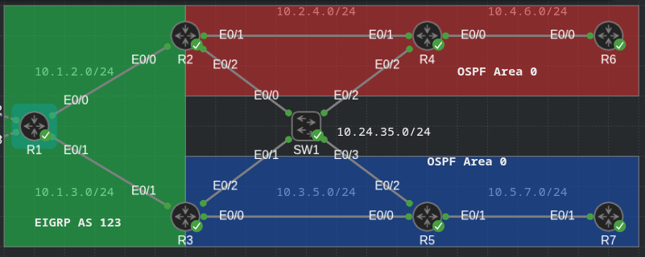

- The goal is R7 should reach the loopback IP addresses on R6 (192.168.6.x) after redistribution in EIGRP and back in OSPF in R2 and R3

- R4 and R5 have `redistribute connected subnets` commands enabled. R4 with `metric-type 1` and R5 with normal `metric-type 2`

- R6 and R7 have OSPF enabled on all interfaces

- R2 and R1 use EIGRP named mode, R3 uses EIGRP classic mode

- R7 configuration:

```
R7#sh ip int br | e ass
Interface              IP-Address      OK? Method Status                Protocol
Ethernet0/1            10.5.7.7        YES NVRAM  up                    up      
Loopback0              192.168.7.1     YES NVRAM  up                    up      
Loopback1              192.168.7.2     YES NVRAM  up                    up      
Loopback2              192.168.7.3     YES NVRAM  up                    up      
Loopback3              7.7.7.7         YES NVRAM  up                    up      
Loopback67             172.16.67.7     YES NVRAM  up                    up      

R7#sh run | s router ospf
router ospf 110
 router-id 7.7.7.7
 network 0.0.0.0 255.255.255.255 area 0
```

- R6 configuration:

```
R6#sh ip int br | e ass
Interface              IP-Address      OK? Method Status                Protocol
Ethernet0/0            10.4.6.6        YES NVRAM  up                    up      
Ethernet0/1            10.6.100.1      YES NVRAM  up                    up      
Loopback0              192.168.6.1     YES NVRAM  up                    up      
Loopback1              192.168.6.2     YES NVRAM  up                    up      
Loopback2              192.168.6.3     YES NVRAM  up                    up      
Loopback3              6.6.6.6         YES NVRAM  up                    up      

R6#sh run | s router ospf
router ospf 110
 router-id 6.6.6.6
 network 0.0.0.0 255.255.255.255 area 0
```

- R4 configuration:

```
R4(config-router)#do sh ip int br | e ass
Interface              IP-Address      OK? Method Status                Protocol
Ethernet0/0            10.4.6.4        YES NVRAM  up                    up      
Ethernet0/1            10.2.4.4        YES NVRAM  up                    up      
Ethernet0/2            10.24.35.4      YES NVRAM  up                    up      
Loopback0              192.168.4.1     YES NVRAM  up                    up      
Loopback1              192.168.4.2     YES NVRAM  up                    up      
Loopback2              192.168.4.3     YES NVRAM  up                    up      
Loopback3              4.4.4.4         YES NVRAM  up                    up      

R4(config-router)#do sh run | s router ospf
router ospf 110
 router-id 4.4.4.4
 redistribute connected metric-type 1
 passive-interface Ethernet0/2
 network 10.2.4.4 0.0.0.0 area 0
 network 10.4.6.4 0.0.0.0 area 0
```

- R5 configuration:

```
R5(config-router)#do sh ip int br | e ass
Interface              IP-Address      OK? Method Status                Protocol
Ethernet0/0            10.3.5.5        YES NVRAM  up                    up      
Ethernet0/1            10.5.7.5        YES NVRAM  up                    up      
Ethernet0/2            10.24.35.5      YES NVRAM  up                    up      
Loopback0              192.168.5.1     YES NVRAM  up                    up      
Loopback1              192.168.5.2     YES NVRAM  up                    up      
Loopback2              192.168.5.3     YES NVRAM  up                    up      
Loopback3              5.5.5.5         YES NVRAM  up                    up      

R5(config-router)#do sh run | s router ospf
router ospf 110
 router-id 5.5.5.5
 redistribute connected
 passive-interface Ethernet0/2
 network 10.5.7.5 0.0.0.0 area 0
 network 10.3.5.5 0.0.0.0 area 0
```

- R3 OSPF configuration:

```
R3(config-router)#do sh ip int br | e ass
Interface              IP-Address      OK? Method Status                Protocol
Ethernet0/0            10.3.5.3        YES NVRAM  up                    up      
Ethernet0/1            10.1.3.3        YES NVRAM  up                    up      
Ethernet0/2            10.24.35.3      YES NVRAM  up                    up      
Loopback0              192.168.3.1     YES NVRAM  up                    up      
Loopback1              192.168.3.2     YES NVRAM  up                    up      
Loopback2              192.168.3.3     YES NVRAM  up                    up      
Loopback3              3.3.3.3         YES NVRAM  up                    up      

R3(config-router)#do sh run | s router ospf 
router ospf 110
 router-id 3.3.3.3
 passive-interface Ethernet0/2
 network 10.3.5.3 0.0.0.0 area 0
```

- R2 OSPF configuration:

```
R2(config-router)#do sh ip int br | e ass
Interface              IP-Address      OK? Method Status                Protocol
Ethernet0/0            10.1.2.2        YES NVRAM  up                    up      
Ethernet0/1            10.2.4.2        YES NVRAM  up                    up      
Ethernet0/2            10.24.35.2      YES NVRAM  up                    up      
Loopback0              192.168.2.1     YES NVRAM  up                    up      
Loopback1              192.168.2.2     YES NVRAM  up                    up      
Loopback2              192.168.2.3     YES NVRAM  up                    up      
Loopback3              2.2.2.2         YES NVRAM  up                    up      

R2(config-router)#do sh run | s router ospf
router ospf 110
 router-id 2.2.2.2
 passive-interface Ethernet0/2
 network 10.2.4.2 0.0.0.0 area 0
```

- R1 - EIGRP configuration:

```
router eigrp REDIST
 !
 address-family ipv4 unicast autonomous-system 123
  !
  topology base
  exit-af-topology
  network 0.0.0.0
 exit-address-family
```

- R3: Redistribute OSPF routes into EIGRP:

```
conf t
 router eigrp 123
  network 10.1.3.3 0.0.0.0
  network 192.168.3.0
  redistribute ospf 110 metric 1000000 1 255 1 1500
```

- R3: Redistribute EIGRP routes into OSPF:

```
R3(config-router)#do sh run | s router ospf 
router ospf 110
 router-id 3.3.3.3
 redistribute eigrp 123 metric-type 1
 passive-interface Ethernet0/2
 network 10.3.5.3 0.0.0.0 area 0
```

- R2: Redistribute OSPF routes into EIGRP named mode:

```
conf t
 router eigrp REDIST
  address-family ipv4 autonomous-system 123
   topology base
    redistribute ospf 110 metric 1000000 1 255 1 1500
   exit
   network 10.1.2.2 0.0.0.0
   network 192.168.2.0
   eigrp router-id 2.2.2.2
```

- R2: Redistribute EIGRP routes into OSPF:

```
conf t
 router ospf 110
  router-id 2.2.2.2
  redistribute eigrp 123 metric-type 1
  passive-interface Ethernet0/2
  network 10.2.4.2 0.0.0.0 area 0
```

#### OSPF - RIPv2 redistribution

- RIPv2 uses hop count to calculate the metric for a specific route

- OSPF uses the LSAs to calculate the metric

- RIPv2 will not be able to understand the metric of the redistributed routes from OSPF, so it is indicated to set the metrics manually

- Topology:

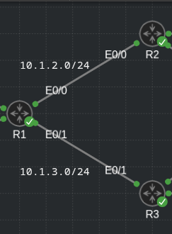

- R1 and R3 run OSPF in area 0

- R1 and R2 run RIPv2

- Implement redistribution between RIPv2 and OSPF on R1

- R1 - OSPF and RIP configuration:

```
R1#sh run | s router rip
router rip
 version 2
 redistribute connected metric 5 route-map REDIST
 redistribute ospf 110 metric 15
 network 10.0.0.0
 no auto-summary

R1#sh run | s router ospf
router ospf 110
 router-id 1.1.1.1
 redistribute connected metric-type 1
 redistribute rip metric 125 metric-type 1
 network 10.1.3.1 0.0.0.0 area 0

route-map REDIST permit 10 
 match interface Loopback1
```

- R2 - RIP configuration:

```
R2(config-router)#do sh run | s router rip
router rip
 version 2
 redistribute connected
 network 10.0.0.0
 no auto-summary
```

- R3 - OSPF configuration:

```
R3(config-router)#do sh run | s router ospf
router ospf 110
 router-id 3.3.3.3
 redistribute connected metric-type 1
 network 10.1.3.3 0.0.0.0 area 0
```

#### OSPF BFD

- BFD allows devices to detect failures on a link and report back to our IGP (in this case OSPF) or EGP (BGP)

- It allows the routing protocol to cut that link immediately when a failure is reported

- We do not have to wait for the entire dead timer to expire before cuting down an adjacency

- The routing protocol will drop that neighbor and then will use maybe the redundant path to that network (if it exist)

- It can take seconds (dead timers) and cut them down to miliseconds

- BFD will use two different types of packets: Control packets and Echo packets

- Echo packets are optional (can be disabled, but is not recommended)

- The control packets will use UDP port 3784. These packets are basically negotiating different timers. These also can be considered keepalives, because they can be sent on a periodic level

- Echo packets are equivalent with keepalives

- When firstly enabling BFD on interfaces, the devices will send the control packets to one another

- This will send/ negociate different timers:

    - BFD interval - interval for sending BFD Echo packets (in miliseconds)

    - Min_rx - How often I am prepared to receive a packet from you. Just in case you are configured differently, I am prepared to receive a BFD packet from you every 50 ms (as an example). Ideally the BFD interval and Min_rx interval can be the same

    - Multiplier - Is basically a dead interval. I am prepared to lose 3 echo packets from you in order to declare that adjacency down

- Steps to enable BFD:

    1. Interface

    2. Routing protocol

- Once BFD is enabled on the routing protocol, the routing protocol makes a call to BFD configured on the interface 

- Once we agreed the timers to use on the interface, we will start sending the Echo packets

- The echo packets function very interesting: The L2 destination (MAC address) of these packets will be the neighbor's MAC

- The destination L3 address, will going to be my IP address. When the destination router sees this packet, it will be looping the packet right back into the original router sending it

- This is how we know that we have a fully functioning link

- If I do not receive back the packets that I send, and I miss 3 (multiplier) of them, I will drop the BFD adjancency, report back to the routing protocol in cause. The third step here is that the protocol will be turning down the adjacency

- BFD configuration in OSPF:

- R1:

```
conf t
 int e0/1
  bfd interval 150 min_rx 150 multiplier 5
  
 router ospf 110
  bfd all-interfaces
```

```
R1#sh run int e0/1
Building configuration...

Current configuration : 157 bytes
!
interface Ethernet0/1
 bandwidth 1000000
 ip address 10.1.3.1 255.255.255.0
 ip ospf network point-to-point
 bfd interval 150 min_rx 150 multiplier 5
end

R1#sh run | s router ospf
router ospf 110
 router-id 1.1.1.1
 network 10.1.3.1 0.0.0.0 area 0
 bfd all-interfaces
```

- R3:

```
conf t
 int e0/1
  bfd interval 150 min_rx 150 multiplier 5

 router ospf 110
  bfd all-interfaces
```

```
R3#sh run int e0/1
Building configuration...

Current configuration : 157 bytes
!
interface Ethernet0/1
 bandwidth 1000000
 ip address 10.1.3.3 255.255.255.0
 ip ospf network point-to-point
 bfd interval 150 min_rx 150 multiplier 5
end

R3#sh run int e0/0
Building configuration...

Current configuration : 136 bytes
!
interface Ethernet0/0
 bandwidth 1000000
 ip address 10.3.5.3 255.255.255.0
 ip ospf network point-to-point
 ip ospf bfd disable
end


R3#sh run | s router ospf
router ospf 110
 router-id 3.3.3.3
 network 10.1.3.3 0.0.0.0 area 0
 bfd all-interfaces
```

- Disabling BFD for OSPF on an unwanted interface on R3:

```
conf t
 int e0/0
  ip ospf bfd disable
```

#### OSPF Route-tagging

- Topology:

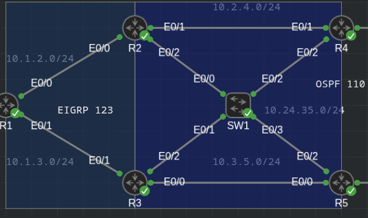

- When both R2 and R3 redistibute External routes from one routing protocol to another, we might end up with suboptimal routing in our network and may cause routing loops (D EX -> O E2; O E2 -> D EX)

- In case one of the routers have internal OSPF or EIGRP routes to redistribute we do not have this problem, as they will end up in the other routing protocol's routing table as External (D EX or O E1 or O E2 ...): D -> O E2; O -> D EX 

- To prevent this we need to set up route tagging

- R4 configuration:

```
R4(config-router)#do sh ip int br | e ass
Interface              IP-Address      OK? Method Status                Protocol
Ethernet0/0            10.4.6.4        YES NVRAM  up                    up      
Ethernet0/1            10.2.4.4        YES NVRAM  up                    up      
Ethernet0/2            10.24.35.4      YES NVRAM  up                    up      
Loopback0              192.168.4.1     YES NVRAM  up                    up      
Loopback1              192.168.4.2     YES NVRAM  up                    up      
Loopback2              192.168.4.3     YES NVRAM  up                    up      
Loopback3              4.4.4.4         YES NVRAM  up                    up      

R4(config-router)#do sh run | s router ospf
router ospf 110
 router-id 4.4.4.4
 network 0.0.0.0 255.255.255.255 area 0
```

- R5 configuration:

```
R5(config-router)# do sh ip int br | e ass
Interface              IP-Address      OK? Method Status                Protocol
Ethernet0/0            10.3.5.5        YES NVRAM  up                    up      
Ethernet0/1            10.5.7.5        YES NVRAM  up                    up      
Ethernet0/2            10.24.35.5      YES NVRAM  up                    up      
Loopback0              192.168.5.1     YES NVRAM  up                    up      
Loopback1              192.168.5.2     YES NVRAM  up                    up      
Loopback2              192.168.5.3     YES NVRAM  up                    up      
Loopback3              5.5.5.5         YES NVRAM  up                    up      

R5(config-router)#do sh run | s router ospf
router ospf 110
 router-id 5.5.5.5
 network 0.0.0.0 255.255.255.255 area 0

R5(config-router)#do sh run | s router ospf
router ospf 110
 router-id 5.5.5.5
 redistribute connected
 network 10.3.5.5 0.0.0.0 area 0
 network 10.24.35.5 0.0.0.0 area 0
```

- R1 - EIGRP configuration:

```
R1(config-if)#do sh ip int br | e ass
Interface              IP-Address      OK? Method Status                Protocol
Ethernet0/0            10.1.2.1        YES NVRAM  up                    up      
Ethernet0/1            10.1.3.1        YES NVRAM  up                    up      
Ethernet0/2            10.100.1.1      YES NVRAM  administratively down down    
Ethernet0/3            10.101.1.1      YES NVRAM  administratively down down    
Loopback0              192.168.1.1     YES NVRAM  up                    up      
Loopback1              192.168.1.2     YES NVRAM  up                    up      
Loopback2              192.168.1.3     YES NVRAM  up                    up      
Loopback3              1.1.1.1         YES NVRAM  up                    up      

R1(config-if)#do sh run | s router eigrp
router eigrp TAG
 !
 address-family ipv4 unicast autonomous-system 123
  !
  topology base
   redistribute connected
  exit-af-topology
  network 10.1.2.1 0.0.0.0
  network 10.1.3.1 0.0.0.0
 exit-address-family
```

- R3 - OSPF and EIGRP configuration

```
R3(config-router)#do sh ip int br | e ass
Interface              IP-Address      OK? Method Status                Protocol
Ethernet0/0            10.3.5.3        YES NVRAM  up                    up      
Ethernet0/1            10.1.3.3        YES NVRAM  up                    up      
Ethernet0/2            10.24.35.3      YES NVRAM  up                    up      
Loopback0              192.168.3.1     YES NVRAM  up                    up      
Loopback1              192.168.3.2     YES NVRAM  up                    up      
Loopback2              192.168.3.3     YES NVRAM  up                    up      
Loopback3              3.3.3.3         YES NVRAM  up                    up      

R3(config-router)#do sh run | s router ospf
router ospf 110
 router-id 3.3.3.3
 redistribute eigrp 123 route-map TAG
 network 10.1.3.3 0.0.0.0 area 0
 network 10.3.5.3 0.0.0.0 area 0
 network 192.168.3.1 0.0.0.0 area 0
 distribute-list route-map TAG in

R3(config-router)#do sh run | s router eigrp
router eigrp TAG
 !
 address-family ipv4 unicast autonomous-system 123
  !
  topology base
   redistribute ospf 110 metric 1000000 1 255 1 1500 route-map TAG
  exit-af-topology
  network 10.1.3.3 0.0.0.0
 exit-address-family

route-map TAG deny 10 
 match tag 2
route-map TAG permit 20 
 set tag 3
```

- EIGRP topology on R3:

```
R3(config-router)#do sh ip eigrp topo
EIGRP-IPv4 VR(TAG) Topology Table for AS(123)/ID(192.168.3.3)
Codes: P - Passive, A - Active, U - Update, Q - Query, R - Reply,
       r - reply Status, s - sia Status 

P 192.168.3.1/32, 1 successors, FD is 1310720, tag is 3
        via Redistributed (1310720/0)
P 192.168.1.3/32, 1 successors, FD is 66273280
        via 10.1.3.1 (66273280/163840), Ethernet0/1
P 4.4.4.4/32, 1 successors, FD is 1310720, tag is 3
        via Redistributed (1310720/0)
P 10.1.3.0/24, 1 successors, FD is 66191360
        via Connected, Ethernet0/1
P 192.168.4.3/32, 1 successors, FD is 1310720, tag is 3
        via Redistributed (1310720/0)
P 5.5.5.5/32, 1 successors, FD is 1310720, tag is 3
        via Redistributed (1310720/0)
P 10.1.2.0/24, 1 successors, FD is 131727360
        via 10.1.3.1 (131727360/66191360), Ethernet0/1
P 192.168.1.1/32, 1 successors, FD is 66273280
        via 10.1.3.1 (66273280/163840), Ethernet0/1
P 10.3.5.0/24, 1 successors, FD is 1310720, tag is 3
        via Redistributed (1310720/0)
P 10.2.4.0/24, 1 successors, FD is 1310720, tag is 3
        via Redistributed (1310720/0)
P 192.168.2.1/32, 1 successors, FD is 1310720, tag is 3
        via Redistributed (1310720/0)
P 192.168.4.2/32, 1 successors, FD is 1310720, tag is 3
        via Redistributed (1310720/0)
P 192.168.5.1/32, 1 successors, FD is 1310720, tag is 3
        via Redistributed (1310720/0)
P 192.168.4.1/32, 1 successors, FD is 1310720, tag is 3
        via Redistributed (1310720/0)
P 192.168.1.2/32, 1 successors, FD is 66273280
        via 10.1.3.1 (66273280/163840), Ethernet0/1
P 192.168.5.2/32, 1 successors, FD is 1310720, tag is 3
        via Redistributed (1310720/0)
P 192.168.5.3/32, 1 successors, FD is 1310720, tag is 3
        via Redistributed (1310720/0)
P 1.1.1.1/32, 1 successors, FD is 66273280
        via 10.1.3.1 (66273280/163840), Ethernet0/1
P 10.4.6.0/24, 1 successors, FD is 1310720, tag is 3
        via Redistributed (1310720/0)
P 10.5.7.0/24, 1 successors, FD is 1310720, tag is 3
        via Redistributed (1310720/0)

R3(config-router)#do sh ip ro 1.1.1.1 255.255.255.255
Routing entry for 1.1.1.1/32
  Known via "eigrp 123", distance 170, metric 517760, precedence routine (0), type external
  Redistributing via ospf 110, eigrp 123
  Advertised by ospf 110 subnets route-map TAG
  Last update from 10.1.3.1 on Ethernet0/1, 00:14:26 ago
  Routing Descriptor Blocks:
  * 10.1.3.1, from 10.1.3.1, 00:14:26 ago, via Ethernet0/1
      Route metric is 517760, traffic share count is 1
      Total delay is 1001 microseconds, minimum bandwidth is 1000000 Kbit
      Reliability 255/255, minimum MTU 1500 bytes
      Loading 1/255, Hops 1
```

- R2 - OSPF and EIGRP configuration:

```
R2(config-router)#do sh ip int br | e ass
Interface              IP-Address      OK? Method Status                Protocol
Ethernet0/0            10.1.2.2        YES NVRAM  up                    up      
Ethernet0/1            10.2.4.2        YES NVRAM  up                    up      
Ethernet0/2            10.24.35.2      YES NVRAM  up                    up      
Loopback0              192.168.2.1     YES NVRAM  up                    up      
Loopback1              192.168.2.2     YES NVRAM  up                    up      
Loopback2              192.168.2.3     YES NVRAM  up                    up      
Loopback3              2.2.2.2         YES NVRAM  up                    up      


R2(config-router)#do sh run | s router ospf
router ospf 110
 router-id 2.2.2.2
 redistribute eigrp 123 route-map TAG
 network 10.2.4.2 0.0.0.0 area 0
 network 192.168.2.1 0.0.0.0 area 0
 distribute-list route-map TAG in

R2(config-router)#do sh run | s router eigrp
router eigrp TAG
 !
 address-family ipv4 unicast autonomous-system 123
  !
  topology base
   redistribute ospf 110 metric 1000000 1 255 1 1500 route-map TAG
  exit-af-topology
  network 10.1.2.2 0.0.0.0
 exit-address-family

route-map TAG deny 10 
 match tag 3
route-map TAG permit 20 
 set tag 2
```

```
R3(config-router)#do sh ip eigrp topology
EIGRP-IPv4 VR(TAG) Topology Table for AS(123)/ID(192.168.3.3)
Codes: P - Passive, A - Active, U - Update, Q - Query, R - Reply,
       r - reply Status, s - sia Status 

P 192.168.3.1/32, 1 successors, FD is 1310720, tag is 3
        via Redistributed (1310720/0)
P 192.168.1.3/32, 1 successors, FD is 66273280
        via 10.1.3.1 (66273280/163840), Ethernet0/1
P 4.4.4.4/32, 1 successors, FD is 1310720, tag is 3
        via Redistributed (1310720/0)
P 10.1.3.0/24, 1 successors, FD is 66191360
        via Connected, Ethernet0/1
P 192.168.4.3/32, 1 successors, FD is 1310720, tag is 3
        via Redistributed (1310720/0)
P 5.5.5.5/32, 1 successors, FD is 1310720, tag is 3
        via Redistributed (1310720/0)
P 10.1.2.0/24, 1 successors, FD is 131727360
        via 10.1.3.1 (131727360/66191360), Ethernet0/1
P 192.168.1.1/32, 1 successors, FD is 66273280
        via 10.1.3.1 (66273280/163840), Ethernet0/1
P 10.3.5.0/24, 1 successors, FD is 1310720, tag is 3
        via Redistributed (1310720/0)
P 10.2.4.0/24, 1 successors, FD is 1310720, tag is 3
        via Redistributed (1310720/0)
P 192.168.2.1/32, 1 successors, FD is 1310720, tag is 3
        via Redistributed (1310720/0)
P 192.168.4.2/32, 1 successors, FD is 1310720, tag is 3
        via Redistributed (1310720/0)
P 192.168.5.1/32, 1 successors, FD is 1310720, tag is 3
        via Redistributed (1310720/0)
P 192.168.4.1/32, 1 successors, FD is 1310720, tag is 3
        via Redistributed (1310720/0)
P 192.168.1.2/32, 1 successors, FD is 66273280
        via 10.1.3.1 (66273280/163840), Ethernet0/1
P 192.168.5.2/32, 1 successors, FD is 1310720, tag is 3
        via Redistributed (1310720/0)
P 192.168.5.3/32, 1 successors, FD is 1310720, tag is 3
        via Redistributed (1310720/0)
P 1.1.1.1/32, 1 successors, FD is 66273280
        via 10.1.3.1 (66273280/163840), Ethernet0/1
P 10.4.6.0/24, 1 successors, FD is 1310720, tag is 3
        via Redistributed (1310720/0)
P 10.5.7.0/24, 1 successors, FD is 1310720, tag is 3
        via Redistributed (1310720/0)
```

- When applying a route map to a redistribution in OSPF, not necessarily it also filters the routes based on the set tags

- In this case, we might also want to apply a distribute list in OSPF process to deny the unwanted routes based on a route map, as set above

#### OSPF MD5 authentication

- Can be made at the interface level, or ar the area level

- Can be done configuring MD5 keys on an interface or using key chains

- On interface level:

- R2:

```
conf t
 interface e0/1
  ip ospf authentication message-digest
  ip ospf message-digest-key 1 md5 OSPF?  !!!! ctrl + v - shift + ?
```

- R4:

```
conf t
 int e0/1
  ip ospf authentication message-digest
  ip ospf message-digest-key 1 md5 OSPF?
```

- Configuring Area authentication:

- First remove the `ip ospf authentication message-digest` command from the interface

```
conf t
 int e0/1
  no ip ospf authentication message-digest
```

- Enabling the authentication on the OSPF process for the area

```
conf t
 router ospf 110
  area 0 authentication message-digest
```

- Configuring MD5 auth using a key chain:

```
conf t
 int e0/1
  ip ospf authentication key-chain OSPF

 key chain OSPF
  key 1
   key-string OSPF?
   cryptographic-algorithm md5
```

#### OSPF HMAC-SHA256 authentication

- This is not supported directly in OSPF, but within the key chain itself

- To enable passwords to be shown as AES128 (type 6) in config, use the following commands:

- This password is like a master password to encrypt all passwords shown in the running config

```
conf t
 password encryption aes
 key config-key password-encrypt <pass>
```

- Create a key chain and set cryptographic algorithm sha256

```
key chain HMAC-SHA
 key 1
  key-string <my-pass>
  cryptographic algorithm hmac-sha-256
```

- When viewing the running config now the encryption is set to type 6 (still receive a warning about it - may be a IOL-XE problem?)

```
R4(config)#do sh run | s key chain         
key chain HMAC-SHA
 key 1
  key-string 6 VCYQaJRhZSNfaEMIRZLLZ[^[DO_AAB
  cryptographic-algorithm hmac-sha-256
```

- Apply the key chain for OSPF authentication on the interface:

```
conf t
 int e0/0
  ip ospf authentication key-chain HMAC-SHA
```

```
R4(config)#do sh ip ospf int e0/0
Ethernet0/0 is up, line protocol is up 
  Internet Address 10.4.6.4/24, Interface ID 2, Area 0
  Attached via Network Statement
  Process ID 110, Router ID 4.4.4.4, Network Type POINT_TO_POINT, Cost: 1
  Topology-MTID    Cost    Disabled    Shutdown      Topology Name
        0           1         no          no            Base
  Transmit Delay is 1 sec, State POINT_TO_POINT
  Timer intervals configured, Hello 10, Dead 40, Wait 40, Retransmit 5
    oob-resync timeout 40
    Hello due in 00:00:00
  Supports Link-local Signaling (LLS)
  Cisco NSF helper support enabled
  IETF NSF helper support enabled
  Can be protected by per-prefix Loop-Free FastReroute
  Can be used for per-prefix Loop-Free FastReroute repair paths
  Not Protected by per-prefix TI-LFA
  Index 1/1/1, flood queue length 0
  Next 0x0(0)/0x0(0)/0x0(0)
  Last flood scan length is 1, maximum is 7
  Last flood scan time is 1 msec, maximum is 1 msec
  Neighbor Count is 1, Adjacent neighbor count is 1 
    Adjacent with neighbor 6.6.6.6
  Suppress hello for 0 neighbor(s)
  Cryptographic authentication enabled
    Sending SA: Key 1, Algorithm HMAC-SHA-256 - key chain HMAC-SHA
```

#### OSPFv3 Authentication using IPsec

- OSPFv3 uses build in IPsec security in IPv6 in order to do authentication. It does not rely anymore on the OSPF process for authentication

- You still have per area or per interface authentication methods/types

- It sets an encrypted session between the OSPFv3 neighbors

- Setting this up between R1 and R2:

- R1:

```
 ipv6 unicast-routing
 router ospfv3 111
  router-id 1.1.1.1
  !
  address-family ipv4 unicast
  exit-address-family
  !
  address-family ipv6 unicast
  exit-address-family

 1(config-if)#do sh run int e0/0
Building configuration...

Current configuration : 383 bytes
!
interface Ethernet0/0
 bandwidth 1000000
 ip address 10.1.2.1 255.255.255.0
 ip ospf network point-to-point
 ipv6 address 2017::1/64
 ospfv3 encryption ipsec spi 256 esp aes-cbc 256 4E1F40C484F603EB77F22F2A1D79D67F80E0FA623925BC734B4440438B4F08CC sha1 B8CDA77C3E7B5DDA14699D47D790EFC95ECDFF88
 ospfv3 111 network point-to-point
 ospfv3 111 ipv4 area 0
 ospfv3 111 ipv6 area 0
end
```

- R2:

```
ipv6 unicast-routing

R2#sh run int e0/0
Building configuration...

Current configuration : 408 bytes
!
interface Ethernet0/0
 bandwidth 1000000
 ip address 10.1.2.2 255.255.255.0
 ip ospf network point-to-point
 ipv6 address 2017::1/64
 ipv6 address 2017::2/64
 ospfv3 encryption ipsec spi 256 esp aes-cbc 256 4E1F40C484F603EB77F22F2A1D79D67F80E0FA623925BC734B4440438B4F08CC sha1 B8CDA77C3E7B5DDA14699D47D790EFC95ECDFF88
 ospfv3 111 network point-to-point
 ospfv3 111 ipv4 area 0
 ospfv3 111 ipv6 area 0
end

R2#sh run | s router ospf   
router ospfv3 111
 router-id 2.2.2.2
 !
 address-family ipv4 unicast
 exit-address-family
 !
 address-family ipv6 unicast
 exit-address-family
```

- To generate hex strings as needed in linux do:

```
openssl rand -hex 32
```

- The last number is the number of bytes (the number of bytes is 2x less the number of required characters)

```
openssl rand -hex 32
4e1f40c484f603eb77f22f2a1d79d67f80e0fa623925bc734b4440438b4f08cc
openssl rand -hex 20
b8cda77c3e7b5dda14699d47d790efc95ecdff88
```

- Verifying:

```
R2#sh ospfv3 ipv6 int e0/0
Ethernet0/0 is up, line protocol is up 
  Link Local Address FE80::A8BB:CCFF:FE00:4C00, Interface ID 1 (snmp-if-index)
  Area 0, Process ID 111, Instance ID 0, Router ID 2.2.2.2
  Network Type POINT_TO_POINT, Cost: 1
  AES-CBC-256 encryption SHA-1 auth SPI 256, secure socket UP (errors: 0)
  Transmit Delay is 1 sec, State POINT_TO_POINT
  Timer intervals configured, Hello 10, Dead 40, Wait 40, Retransmit 5
    Hello due in 00:00:03
  Graceful restart helper support enabled
  Index 1/1/1, flood queue length 0
  Next 0x0(0)/0x0(0)/0x0(0)
  Last flood scan length is 1, maximum is 1
  Last flood scan time is 1 msec, maximum is 1 msec
  Neighbor Count is 1, Adjacent neighbor count is 1 
    Adjacent with neighbor 1.1.1.1
  Suppress hello for 0 neighbor(s)

R2#sh ospfv3 ipv4 int e0/0      
Ethernet0/0 is up, line protocol is up 
  Link Local Address FE80::A8BB:CCFF:FE00:4C00, Interface ID 1 (snmp-if-index)
  Internet Address 10.1.2.2/24
  Area 0, Process ID 111, Instance ID 64, Router ID 2.2.2.2
  Network Type POINT_TO_POINT, Cost: 1
  AES-CBC-256 encryption SHA-1 auth SPI 256, secure socket UP (errors: 0)
  Transmit Delay is 1 sec, State POINT_TO_POINT
  Timer intervals configured, Hello 10, Dead 40, Wait 40, Retransmit 5
    Hello due in 00:00:07
  Graceful restart helper support enabled
  Index 1/1/1, flood queue length 0
  Next 0x0(0)/0x0(0)/0x0(0)
  Last flood scan length is 1, maximum is 1
  Last flood scan time is 0 msec, maximum is 0 msec
  Neighbor Count is 1, Adjacent neighbor count is 1 
    Adjacent with neighbor 1.1.1.1
  Suppress hello for 0 neighbor(s)

R2#show crypto ipsec sa 

interface: Ethernet0/0
    Crypto map tag: Ethernet0/0-OSPF-MAP, local addr FE80::A8BB:CCFF:FE00:4C00

   IPsecv6 policy name: OSPFv3-256

   protected vrf: (none)
   local  ident (addr/mask/prot/port): (FE80::/10/89/0)
   remote ident (addr/mask/prot/port): (::/0/89/0)
   current_peer FF02::5 port 500
     PERMIT, flags={origin_is_acl,}
    #pkts encaps: 204, #pkts encrypt: 204, #pkts digest: 204
    #pkts decaps: 184, #pkts decrypt: 184, #pkts verify: 184
    #pkts compressed: 0, #pkts decompressed: 0
    #pkts not compressed: 0, #pkts compr. failed: 0
    #pkts not decompressed: 0, #pkts decompress failed: 0
    #send errors 0, #recv errors 0

     local crypto endpt.: FE80::A8BB:CCFF:FE00:4C00,
     remote crypto endpt.: FF02::5
     plaintext mtu 1462, path mtu 1500, ipv6 mtu 1500, ipv6 mtu idb Ethernet0/0
     current outbound spi: 0x100(256)
     PFS (Y/N): N, DH group: none
          
     inbound esp sas:
      spi: 0x100(256)
        transform: esp-256-aes esp-sha-hmac ,
        in use settings ={Transport, }
        conn id: 1, flow_id: 1, sibling_flags FFFFFFFF80000001, crypto map: Ethernet0/0-OSPF-MAP, initiator : False
        sa timing: remaining key lifetime (sec): 0
        Kilobyte Volume Rekey has been disabled
        IV size: 16 bytes
        replay detection support: N
        Status: ACTIVE(ACTIVE)

     inbound ah sas:

     inbound pcp sas:

     outbound esp sas:
      spi: 0x100(256)
        transform: esp-256-aes esp-sha-hmac ,
        in use settings ={Transport, }
        conn id: 2, flow_id: 2, sibling_flags FFFFFFFF80000001, crypto map: Ethernet0/0-OSPF-MAP, initiator : False
        sa timing: remaining key lifetime (sec): 0
        Kilobyte Volume Rekey has been disabled
        IV size: 16 bytes
        replay detection support: N
        Status: ACTIVE(ACTIVE)

     outbound ah sas:

     outbound pcp sas:
```

- Enabling this at area level

- At area level there are 2 commands:

```
conf t
 router ospfv3 111
  R2(config-router)#area 0 ?
  authentication  Enable authentication
  encryption      Enable encryption
```

- Authentication keyword - uses AH with IPsec

- Encryption keyword - uses ESP with IPsec

```
conf t
 router ospfv3 111
 area 0 encryption ipsec spi 256 esp aes-cbc 256 4e1f40c484f603eb77f22f2a1d79d67f80e0fa623925bc734b4440438b4f08cc sha1 b8cda77c3e7b5dda14699d47d790efc95ecdff88
```

- **IMPORTANT**: Cannot use the same SPI ID for both the interface and the area authentication

- If you want to do both, you need to use a different SPI ID

```
R2(config-router)#$0438b4f08cc sha1 b8cda77c3e7b5dda14699d47d790efc95ecdff88 
% OSPFv3: Encryption was not enabled
R2(config-router)#
R2(config-router)#
R2(config-router)#
R2(config-router)#$0438b4f08cc sha1 b8cda77c3e7b5dda14699d47d790efc95ecdff88 
*Nov 14 18:06:58.247: %OSPFv3-3-IPSEC_POLICY_ALREADY_EXIST: OSPFv3 SPI 256 is already in use with ospf
R2(config-router)#                                                           
```