## Troubleshooting OSPFv2

1. Troubleshooting OSPFv2 Neighbor Adjacencies

2. Troubleshooting OSPFv2 Routes

3. Troubleshooting Miscellaneous OSPFv2 Issues

4. OSPFv2 Trouble Tickets

- The Open Shortest Path First (OSPF) dynamic routing protocol is a link-state routing protocol that uses *Dijkstra's Shortest Path First* algorithm

- It is an extremely scalable routing protocol because of it's hierarchical design

- OSPF can route both IPv4 and IPv6 protocols

- Before any routes are exchanged between OSPF routers on the same LAN or across a WAN, an OSPF neighbor relationship must be formed

- There are many reasons an OSPF neighbor relationship may not form, and as a troubleshooter, you need to be aware of them

- Delves deeply into the reasons for which this can happen and gives you the tools needed to identify them and successfully solve neighbor issues

- Once neighbor relationships are formed, neighboring routers exchange OSPF LSAs, which contain information about routes

- In various cases routes may end up missing, and you need to be able to determine why the routes are missing

- The various ways that OSPF routes could go missing, how to identify the reasons they are missing, and how to solve route-related issues

- You will also learn how to troubleshoot issues related to load-balancing, summarization, and discontiguous areas

### Troubleshooting OSPFv2 Neighbor Adjacencies

- OSPF establishes neighbor relationships by sending hello packets out interfaces participating in the OSPF process

- To enable the OSPF process on an interface and place it in an OSPF area, you use the `network <ip_address> <wildcard_mask> area <area-id>` command in router OSPF configuration mode or the `ip ospf <process-id> area <area-id>` command in an interface configuration mode

- For example, the following `network <ip_address> <wildcard-mask> area <area-id>` command enables OSPF on all interfaces with an IP address from 10.1.1.0 through 10.1.1.255 and places them in Area 0: `network 10.1.1.0 0.0.0.255 area 0`

- The following interface configuration command enables the OSPF process on the interface and places it in Area 51: `ip ospf 1 area 51`

```
conf t
 router ospf 1
  network 10.1.1.0 0.0.0.255 area 0
```

```
conf t
 interface g0/1
  ip ospf 1 area 51
```

- Because there are two different ways to enable OSPFv2 on an interface, you must be very careful when troubleshooting neighbor adjacencies so that you are not let down the wrong path, thinking that the OSPF process was not enabled on an interface when in fact it was

- You need to check both places

- This section focuses on the reasons an OSPF neighbor relationship may not form and how to identify them during the troubleshooting process

- To verify the OSPFv2 neighbors, you use the `show ip ospf neighbor` command

- Below is shown a sample output of the `show ip ospf neighbor` command

- It lists the neighbor ID, which is the router ID (RID) of the neighbor, the priority of the neighbor for the designated router/ backup designated router (BR/BDR) election process, the state of the neighbor, and whether the neighbor is a DR, BDR or DROTHER

- In addition, it displays the dead time, which is how long the local router waits until it declares the neighbor down if it does not hear another hello packet within that time (The default is 40 seconds on a LAN)

- You can also see the neighbor's interface IP address from which the hello packet was sent and the local router interface used to reach that neighbor

```
R2#show ip ospf neighbor 

Neighbor ID     Pri   State           Dead Time   Address         Interface
192.168.4.4       0   FULL/  -           -        10.1.34.4       OSPF_VL0
192.168.1.1       1   FULL/BDR        00:00:33    10.1.12.1       Ethernet0/0
192.168.3.3       1   FULL/DR         00:00:37    10.1.23.3       Ethernet0/1
```

- When an OSPF neighbor relationship is successfully formed, you receive a syslog message similar to the following:

```
*Oct 11 19:24:32.198: %OSPF-5-ADJCHG: Process 1, Nbr 192.168.1.1 on Ethernet0/0 from LOADING to FULL, Loading Done
```

- The following are some of the reasons an OSPFv2 neighbor relationship might not form:

    - **Interface is down**: The interface must be up/up

    - **Interface not running the OSPF process**: If the interface is not enabled for OSPF, it does not send hello packets or form adjacencies

    - **Mismatched timers**: Hello and dead timers must match between neighbors

    - **Mismatched Area numbers**: The two ends of the link must be in the same OSPF area

    - **Mismatched Area type**: In addition to a normal OSPF area type, an area type could be either a stub area or a not-so-stubby area (NSSA). The routers must agree on the type of area they are in

    - **Different subnets**: Neighbors must be in the same subnet

    - **Passive interface**: The passive interface feature supresses the sending and receiving of hello packets while still allowing the interface's network to be advertised

    - **Mismatched authentication information**: If one OSPF interface is configured for authentication, the OSPF interface at the other end of the link must be configured with matching authentication information

    - **ACLs**: An ACL may be denying packets to the OSPF multicast address 224.0.0.5

    - **MTU mismatch**: Neighboring interfaces must have maximum transmission unit (MTU) values

    - **Duplicate Router IDs**: Router IDs must be unique

    - **Mismatched network types**: Based on the OSPF network type characteristics and default values, two neighbors configured with a different OSPF network type might not form an adjacency

- Adjacencies are not established upon the immediate receipt of hello messages

- Rather, an adjacency transition through the various states described below:

```
State                           Description

Down                            This state indicates that no hellos have been received from a neighbor

Attempt                         This state occurs after a router sends a unicast hello (as opossed to a multicast hello) to a configured neighbor and has not
                                yet received a hello from that neighbor

Init                            This state occurs on a router that has received a hello message from it's neighbor; however, the OSPF RID of the receiving
                                router was not contained in the hello message. If a router remains in this state for a long period, something is probably
                                preventing that router from correctly receiving hello packets from the neighboring router

2-Way                           This state occurs when two OSPF routers have received hello messages from each other, and each router saw it's own RID in 
                                the hello message it received. The 2-Way state is an acceptable state to stay in between DROTHERs on an ethernet LAN

ExStart                         This state occurs when the routers forming a full neighbor adjacency decide who will sent their routing information first.
                                This is accomplished using the RID. The router with the higher RID becomes the primary, and the other one becomes the secondary.
                                The primary sends the routing information first. In a multi-access network, the DR and BDR have to be determined before this
                                state. However, the DR does not have to be the primary because each primary/secondary election is on a per-neighbor basis.
                                If a router remains in this state for a long period, an MTU mismatch could exist between the neighboring routers, or a duplicate RID might exist

Exchange                        This state occurs when the two routers forming an adjacency send one another database destriptor (DBD) packets containing
                                information about a router's link-state database. Each router compares the DBD packets received from the other router to identify
                                missing entries in it's own database. If a router remains in this state for a long period, an MTU mismatch could exist between
                                the neighboring routers

Loading                         Based on the missing link-state database entries identified in the Exchange state, the Loading state occurs when each neighboring
                                router requests the other router to send those missing entries. If a router remains in this state for a long period, a packet
                                might have been corrupted, or a router might have a memory issue. Alternatively, it is possible that such a condition could
                                result from the neighboring routers having an MTU mismatch

Full                            This state indicates that the neighboring OSPF routers have successfully exchanged their link-state information with one
                                another, and an adjacency has been formed
```

- When an OSPF neighbor relationship does not form, the neighbor is not listed in the OSPF neighbor table

- Therefore, you need the assistance of an accurate physical and logical network diagram and the `show cdp neighbors` command to verify who should be the neighbors

- When troubleshooting OSPF adjacencies, you need to be aware of how to verify the parameters associated with each of the reasons listed earlier

- Let's look at them individually

#### Interface is Down

- The interface must be up/up if you plan on forming an OSPF neighbor adjacency

- You can verify the status of an interface with the `show ip interface brief` command

```
R4#show ip int br
Interface                  IP-Address      OK? Method Status                Protocol
GigabitEthernet0/0         10.24.1.4       YES NVRAM  up                    up      
GigabitEthernet0/1         10.45.1.4       YES NVRAM  up                    up      
GigabitEthernet0/2         unassigned      YES NVRAM  administratively down down    
GigabitEthernet0/3         unassigned      YES NVRAM  administratively down down    
Loopback0                  192.168.4.4     YES NVRAM  up                    up      
```

#### Interface Not Running the OSPF process

- If the router OSPF configuration mode `network <ip_address> <wildcard_mask> area <area-id>` command or the `ip ospf <process-id> area <area-id` interface command is misconfigured, OSPF may not be enabled on the proper interfaces

- As a result, hello packets are not sent, and neighbor relationship are not formed

- You also must specify the OSPF area the interface belongs to

- Therefore, if the command is correct except for the area ID, the interface is participating in the OSPF process but in the wrong area

- This prevents a neighbor relationship from forming as well

- You can verify which interfaces are participating in the OSPF process by using the command `show ip ospf interface brief`, as shown below

- In this example, two interfces are participating in the OSPF process 1

- They are both in Area 1234 and are the designated router interfaces for the multi-access network

- You can also verify the IP addresses and masks of the interfaces, along with the number of full neighbor relationships formed out the interface compared to the total number of neighbors out the interface

- Remember that OSPF passive interfaces appear in the output of `show ip ospf interface brief`

```
R1(config-router)#do sh ip ospf int br
Interface    PID   Area            IP Address/Mask    Cost  State Nbrs F/C
Gi1          1     1               10.1.1.1/24        1     DR    0/0
Gi2          1     1               10.1.12.1/24       1     DR    1/1
```

- The output of `show ip protocols` displays the `network <ip_address> <wildcard_mask> area <area-id>` statements as well as interfaces that were enabled for OSPF with the `ip ospf <process-id> area <area-id>` command

- Take a look at the output below. Notice that it states `Routing for Networks:`

- These are not the networks you are routing for

- You are routing for the networks associated with the interface's OSPF will be enabled on based on the `network ... area ...` statement

- In addition, you can see which interfaces were explicitly configured to participate in the OSPF process by using the `ip ospf <process-id> area <area-id>` interface configuration mode command

- In this example, G2 was enabled for OSPF with the `ip ospf 1 area 1` command and G1 was enabled for OSPF with the `network 10.1.1.1 0.0.0.0 area 1` router ospf configuration mode command

```
R1(config-router)#do sh ip protoc
*** IP Routing is NSF aware ***

Routing Protocol is "application"
  Sending updates every 0 seconds
  Invalid after 0 seconds, hold down 0, flushed after 0
  Outgoing update filter list for all interfaces is not set
  Incoming update filter list for all interfaces is not set
  Maximum path: 32
  Routing for Networks:
  Routing Information Sources:
    Gateway         Distance      Last Update
  Distance: (default is 4)

Routing Protocol is "ospf 1"
  Outgoing update filter list for all interfaces is not set
  Incoming update filter list for all interfaces is not set
  Router ID 10.1.12.1
  Number of areas in this router is 1. 1 normal 0 stub 0 nssa
  Maximum path: 4
  Routing for Networks:
    10.1.1.1 0.0.0.0 area 1
  Routing on Interfaces Configured Explicitly (Area 1):
    GigabitEthernet2
  Routing Information Sources:
    Gateway         Distance      Last Update
  Distance: (default is 110)

```

- The `network <ip_address> <wildcard_mask> area <area-id>` command is extremely important, as is the `ip ospf <process-id> area <area-id>` command

- If either of those commands is misconfigured, interfaces that should be participating in the OSPF process might not be, and interfaces that should not be participating in the OSPF process might be

- In addition, it is possible that interfaces might be participating but in the wrong area, preventing neighbor relationships from forming

- Therefore, you should be able to recognize issues related to both of these commands

- If an interface is enabled with both the `network <ip_address> <wildcard_mask> area <area-id>` command and the `ip ospf <process-id> area <area-id>` command, the `ip ospf <process-id> area <area-id>` command takes precedence

#### Mismatched Timers

- Unlike with Enhanced Interior Gateway Routing Protocol (EIGRP), with OSPF timers do have to match between neighbors in order for neighbor adjacencies to form

- The hello timer defaults to 10 seconds for broadcast and point-to-point network types and 30 seconds for non-broadcast and point-to-multipoint network types

- The dead timers default to 40 seconds for broadcast an point-to-point network types and 120 seconds for non-broadcast and point-to-multipoint network types

- To verify the current timers associated with an OSPF interface, issue the `show ip ospf interface <type> <number>` command 

- In this example G2 is using the default hello timer of 10 and dead timer of 40 seconds

- When determining whether timers match, use the spot-the-difference methods with the outputs on the two routers

```
R1#show ip ospf interface g2
GigabitEthernet2 is up, line protocol is up 
  Internet Address 10.1.12.1/24, Interface ID 8, Area 1
  Attached via Interface Enable
  Process ID 1, Router ID 10.1.12.1, Network Type BROADCAST, Cost: 1
  Topology-MTID    Cost    Disabled    Shutdown      Topology Name
        0           1         no          no            Base
  Enabled by interface config, including secondary ip addresses
  Transmit Delay is 1 sec, State DR, Priority 1
  Designated Router (ID) 10.1.12.1, Interface address 10.1.12.1
  Backup Designated router (ID) 10.1.12.2, Interface address 10.1.12.2
  Timer intervals configured, Hello 10, Dead 40, Wait 40, Retransmit 5
    oob-resync timeout 40
    Hello due in 00:00:07
  Supports Link-local Signaling (LLS)
  Cisco NSF helper support enabled
  IETF NSF helper support enabled
  Can be protected by per-prefix Loop-Free FastReroute
  Can be used for per-prefix Loop-Free FastReroute repair paths
  Not Protected by per-prefix TI-LFA
  Index 1/1/2, flood queue length 0
  Next 0x0(0)/0x0(0)/0x0(0)
  Last flood scan length is 2, maximum is 2
  Last flood scan time is 0 msec, maximum is 0 msec
  Neighbor Count is 1, Adjacent neighbor count is 1 
    Adjacent with neighbor 10.1.12.2  (Backup Designated Router)
  Suppress hello for 0 neighbor(s)
```

- You can use the `debug ip ospf hello` command when troubleshooting adjacencies to reveal mismatched timers

```
R1#debug ip ospf hello 
OSPF hello debugging is on
*Oct 12 17:23:18.035: OSPF-1 HELLO Gi1: Rcv hello from 10.1.1.2 area 1 10.1.1.2
*Oct 12 17:23:18.035: OSPF-1 HELLO Gi1: Mismatched hello parameters from 10.1.1.2
*Oct 12 17:23:18.035: OSPF-1 HELLO Gi1: Dead R 44 C 40, Hello R 11 C 10 Mask R 255.255.255.0 C 255.255.255.0
*Oct 12 17:23:18.351: OSPF-1 HELLO Gi2: Send hello to 224.0.0.5 area 1 from 10.1.12.1
*Oct 12 17:23:18.697: OSPF-1 HELLO Gi1: Send hello to 224.0.0.5 area 1 from 10.1.1.1
R1#
*Oct 12 17:23:26.326: OSPF-1 HELLO Gi2: Rcv hello from 10.1.12.2 area 1 10.1.12.2
R1#
*Oct 12 17:23:27.638: OSPF-1 HELLO Gi2: Send hello to 224.0.0.5 area 1 from 10.1.12.1
*Oct 12 17:23:27.968: OSPF-1 HELLO Gi1: Rcv hello from 10.1.1.2 area 1 10.1.1.2
*Oct 12 17:23:27.968: OSPF-1 HELLO Gi1: Mismatched hello parameters from 10.1.1.2
*Oct 12 17:23:27.968: OSPF-1 HELLO Gi1: Dead R 44 C 40, Hello R 11 C 10 Mask R 255.255.255.0 C 255.255.255.0
*Oct 12 17:23:27.999: OSPF-1 HELLO Gi1: Send hello to 224.0.0.5 area 1 from 10.1.1.1
R1#
*Oct 12 17:23:36.146: OSPF-1 HELLO Gi2: Rcv hello from 10.1.12.2 area 1 10.1.12.2
R1#
*Oct 12 17:23:37.424: OSPF-1 HELLO Gi1: Send hello to 224.0.0.5 area 1 from 10.1.1.1
*Oct 12 17:23:37.439: OSPF-1 HELLO Gi2: Send hello to 224.0.0.5 area 1 from 10.1.12.1
R1#
*Oct 12 17:23:38.515: OSPF-1 HELLO Gi1: Rcv hello from 10.1.1.2 area 1 10.1.1.2
*Oct 12 17:23:38.515: OSPF-1 HELLO Gi1: Mismatched hello parameters from 10.1.1.2
*Oct 12 17:23:38.515: OSPF-1 HELLO Gi1: Dead R 44 C 40, Hello R 11 C 10 Mask R 255.255.255.0 C 255.255.255.0
R1#
*Oct 12 17:23:45.278: OSPF-1 HELLO Gi2: Rcv hello from 10.1.12.2 area 1 10.1.12.2
R1#
*Oct 12 17:23:46.580: OSPF-1 HELLO Gi2: Send hello to 224.0.0.5 area 1 from 10.1.12.1
*Oct 12 17:23:47.227: OSPF-1 HELLO Gi1: Send hello to 224.0.0.5 area 1 from 10.1.1.1
R1#
*Oct 12 17:23:49.437: OSPF-1 HELLO Gi1: Rcv hello from 10.1.1.2 area 1 10.1.1.2
*Oct 12 17:23:49.437: OSPF-1 HELLO Gi1: Mismatched hello parameters from 10.1.1.2
*Oct 12 17:23:49.437: OSPF-1 HELLO Gi1: Dead R 44 C 40, Hello R 11 C 10 Mask R 255.255.255.0 C 255.255.255.0
R1#
(...)

R1#
*Oct 12 17:17:46.285: %OSPF-5-ADJCHG: Process 1, Nbr 10.1.1.2 on GigabitEthernet1 from LOADING to FULL, Loading Done
R1#
```

- In this example the packet received (R) has a dead timer of 44 and hello timer of 11

- The local device, C, has a dead timer of 40 and hello timer of 10

#### Mismatched Area Numbers

- Because OSPF uses the concept of areas, it is an extremely scalable dynamic routing protocol

- For OSPF routers to form neighbor adjacencies, their neighboring interfaces must be in the same area

- You can verify the area an OSPF interface is part of by using the `show ip ospf interface <type> <number>` command, or the `show ip ospf interface brief` command

- When determining whether Area IDs match, you can use the spot-the-difference method with the output on the two routers

```
R1#show ip ospf interface g2
GigabitEthernet2 is up, line protocol is up 
  Internet Address 10.1.12.1/24, Interface ID 8, Area 1
  Attached via Interface Enable
  Process ID 1, Router ID 1.1.1.1, Network Type BROADCAST, Cost: 1
  Topology-MTID    Cost    Disabled    Shutdown      Topology Name
        0           1         no          no            Base
  Enabled by interface config, including secondary ip addresses
  Transmit Delay is 1 sec, State BDR, Priority 1
  Designated Router (ID) 3.3.3.3, Interface address 10.1.12.2
  Backup Designated router (ID) 1.1.1.1, Interface address 10.1.12.1
  Timer intervals configured, Hello 10, Dead 40, Wait 40, Retransmit 5
    oob-resync timeout 40
    Hello due in 00:00:03
  Supports Link-local Signaling (LLS)
  Cisco NSF helper support enabled
  IETF NSF helper support enabled
  Can be protected by per-prefix Loop-Free FastReroute
  Can be used for per-prefix Loop-Free FastReroute repair paths
  Not Protected by per-prefix TI-LFA
  Index 1/1/2, flood queue length 0
  Next 0x0(0)/0x0(0)/0x0(0)
  Last flood scan length is 1, maximum is 3
  Last flood scan time is 0 msec, maximum is 0 msec
  Neighbor Count is 1, Adjacent neighbor count is 1 
    Adjacent with neighbor 3.3.3.3  (Designated Router)
  Suppress hello for 0 neighbor(s)
```

```
R1#show ip ospf interface brief 
Interface    PID   Area            IP Address/Mask    Cost  State Nbrs F/C
Gi1          1     1               10.1.1.1/24        1     BDR   1/1
Gi2          1     1               10.1.12.1/24       1     BDR   1/1
```

- You can use the `debug ip ospf adj` command when troubleshooting adjacencies to find mismatched area numbers as shown below

- In this example the packet received an area ID of 1, and the local interface is participating in Area 2

```
R2(config-if)#do debug ip ospf adj
OSPF adjacency debugging is on
R2(config-if)#ip os
R2(config-if)#ip ospf 1 a 2
R2(config-if)#
*Oct 12 17:41:18.646: OSPF-1 ADJ   Gi1: Interface going Up
R2(config-if)#
R2(config-if)#
R2(config-if)#
*Oct 12 17:41:27.071: OSPF-1 ADJ   Gi1: Rcv pkt from 10.1.12.1, area 0.0.0.2, mismatched area 0.0.0.1 in the header
R2(config-if)#
*Oct 12 17:41:36.088: OSPF-1 ADJ   Gi1: Rcv pkt from 10.1.12.1, area 0.0.0.2, mismatched area 0.0.0.1 in the header

*Oct 12 17:41:45.944: OSPF-1 ADJ   Gi1: Rcv pkt from 10.1.12.1, area 0.0.0.2, mismatched area 0.0.0.1 in the header

R2(config-if)#do un all
All possible debugging has been turned off
```

#### Mismatched Area Type

- The default OSPF area type is classified as a normal area

- However, you can convert a normal area into a stub area or a NSSA area to control the types of link-state advertisements (LSAs) that will be sent into the area from an area border router (ABR)

- For routers within an area to form adjacencies, they must agree on the area type

- Within the hello packet, a stub area flag is designed to indicate the type of area the neighbor is in

- You can verify the types of areas connected to a router by using the `show ip protocols` command

- However, it does not tell you which area is which type

- Below is displayed the output of `show ip protocols`, there is only one area (Area 1); therefore, you can deduce that it is the stub area

- However, for a router with multiple areas connected to it, you can verify the areas and their type by running the `show ip ospf` command

```
R1(config-router)#do sh ip protoc
*** IP Routing is NSF aware ***

Routing Protocol is "application"
  Sending updates every 0 seconds
  Invalid after 0 seconds, hold down 0, flushed after 0
  Outgoing update filter list for all interfaces is not set
  Incoming update filter list for all interfaces is not set
  Maximum path: 32
  Routing for Networks:
  Routing Information Sources:
    Gateway         Distance      Last Update
  Distance: (default is 4)

Routing Protocol is "ospf 1"
  Outgoing update filter list for all interfaces is not set
  Incoming update filter list for all interfaces is not set
  Router ID 1.1.1.1
  Number of areas in this router is 1. 0 normal 1 stub 0 nssa
  Maximum path: 4
  Routing for Networks:
    10.1.1.1 0.0.0.0 area 1
  Routing on Interfaces Configured Explicitly (Area 1):
    GigabitEthernet2
  Routing Information Sources:
    Gateway         Distance      Last Update
  Distance: (default is 110)

```

```
R1(config-router)#do sh ip ospf
 Routing Process "ospf 1" with ID 1.1.1.1
 Start time: 00:01:15.166, Time elapsed: 00:27:19.914
 Supports only single TOS(TOS0) routes
 Supports opaque LSA
 Supports Link-local Signaling (LLS)
 Supports area transit capability
 Supports NSSA (compatible with RFC 3101)
 Supports Database Exchange Summary List Optimization (RFC 5243)
 Event-log enabled, Maximum number of events: 1000, Mode: cyclic
 Router is not originating router-LSAs with maximum metric
 Initial SPF schedule delay 50 msecs
 Minimum hold time between two consecutive SPFs 200 msecs
 Maximum wait time between two consecutive SPFs 5000 msecs
 Incremental-SPF disabled
 Initial LSA throttle delay 50 msecs
 Minimum hold time for LSA throttle 200 msecs
 Maximum wait time for LSA throttle 5000 msecs
 Minimum LSA arrival 100 msecs
 LSA group pacing timer 240 secs
 Interface flood pacing timer 33 msecs
 Retransmission pacing timer 66 msecs
 EXCHANGE/LOADING adjacency limit: initial 300, process maximum 300
 Number of external LSA 0. Checksum Sum 0x000000
 Number of opaque AS LSA 0. Checksum Sum 0x000000
 Number of DCbitless external and opaque AS LSA 0
 Number of DoNotAge external and opaque AS LSA 0
 Number of areas in this router is 1. 0 normal 1 stub 0 nssa
 Number of areas transit capable is 0
 External flood list length 0
 IETF NSF helper support enabled
 Cisco NSF helper support enabled
 Reference bandwidth unit is 100000 mbps
    Area 1
        Number of interfaces in this area is 2
        It is a stub area
        Area has no authentication
        SPF algorithm last executed 00:00:52.411 ago
        SPF algorithm executed 15 times
        Area ranges are
        Number of LSA 5. Checksum Sum 0x027DAC
        Number of opaque link LSA 0. Checksum Sum 0x000000
        Number of DCbitless LSA 0
        Number of indication LSA 0
        Number of DoNotAge LSA 0
        Flood list length 0
```

- You can use the `debug ip ospf hello` command when troubleshooting to find mismatched area types

- In this example you can see that the packet received has a mismatched Stub/Transit area option bit

```
R3(config-router)#do sh run | s router ospf
router ospf 1
 router-id 3.3.3.3
 auto-cost reference-bandwidth 100000
 area 1 stub
R3(config-router)#
R3(config-router)#
R3(config-router)#no afre
R3(config-router)#no area 1 stub
R3(config-router)#d 
*Oct 12 19:48:38.220: %OSPF-5-ADJCHG: Process 1, Nbr 1.1.1.1 on GigabitEthernet1 from FULL to DOWN, Neighbor Down: Adjacency forced to reset
R3(config-router)#do debug ip ospf hello
OSPF hello debugging is on
R3(config-router)#
R3(config-router)#
R3(config-router)#
*Oct 12 19:48:45.626: OSPF-1 HELLO Gi1: Send hello to 224.0.0.5 area 1 from 10.1.12.2
R3(config-router)#
*Oct 12 19:48:53.185: OSPF-1 HELLO Gi1: Rcv hello from 1.1.1.1 area 1 10.1.12.1
*Oct 12 19:48:53.185: OSPF-1 HELLO Gi1: Hello from 10.1.12.1 with mismatched Stub/Transit area option bit
R3(config-router)#
*Oct 12 19:48:54.671: OSPF-1 HELLO Gi1: Send hello to 224.0.0.5 area 1 from 10.1.12.2
R3(config-router)#
*Oct 12 19:49:02.425: OSPF-1 HELLO Gi1: Rcv hello from 1.1.1.1 area 1 10.1.12.1
*Oct 12 19:49:02.425: OSPF-1 HELLO Gi1: Hello from 10.1.12.1 with mismatched Stub/Transit area option bit
R3(config-router)#
*Oct 12 19:49:03.778: OSPF-1 HELLO Gi1: Send hello to 224.0.0.5 area 1 from 10.1.12.2
R3(config-router)#do debug ip ospf hello   
*Oct 12 19:49:11.916: OSPF-1 HELLO Gi1: Rcv hello from 1.1.1.1 area 1 10.1.12.1
*Oct 12 19:49:11.916: OSPF-1 HELLO Gi1: Hello from 10.1.12.1 with mismatched Stub/Transit area option bit
*Oct 12 19:49:12.894: OSPF-1 HELLO Gi1: Send hello to 224.0.0.5 area 1 from 10.1.12.2
R3(config-router)#area 1 stub           
R3(config-router)#do yub 
*Oct 12 19:49:16.969: %OSPF-5-ADJCHG: Process 1, Nbr 1.1.1.1 on GigabitEthernet1 from DOWN to DOWN, Neighbor Down: Adjacency forced to reset
R3(config-router)#do un all
All possible debugging has been turned off
R3(config-router)#
*Oct 12 19:49:21.892: OSPF-1 HELLO Gi1: Rcv hello from 1.1.1.1 area 1 10.1.12.1
*Oct 12 19:49:21.893: OSPF-1 HELLO Gi1: Send immediate hello to nbr 1.1.1.1, src address 10.1.12.1
*Oct 12 19:49:21.893: OSPF-1 HELLO Gi1: Send hello to 10.1.12.1 area 1 from 10.1.12.2
*Oct 12 19:49:21.894: OSPF-1 HELLO Gi1: Rcv hello from 1.1.1.1 area 1 10.1.12.1
R3(config-router)#
*Oct 12 19:49:21.895: %OSPF-5-ADJCHG: Process 1, Nbr 1.1.1.1 on GigabitEthernet1 from LOADING to FULL, Loading Done
R3(config-router)#
```

#### Different Subnets

- To form an OSPF neighbor adjacency, the router interfaces must be on the same subnet

- You can verify this in many ways

- The simplest way is to look at the interface configuration in the running configuration with the `show running-config interface <type> <number>`

- Below is shown the configuration on G1 on R1 and G1 on R2:

```
R1#sh run int g1 
Building configuration...

Current configuration : 117 bytes
!
interface GigabitEthernet1
 ip address 10.1.1.1 255.255.255.0
 negotiation auto
 no mop enabled
 no mop sysid
end

R2(config-if)#do sh run int g1
Building configuration...

Current configuration : 135 bytes
!
interface GigabitEthernet1
 ip address 10.1.1.2 255.255.255.0
 ip ospf 1 area 1
 negotiation auto
 no mop enabled
 no mop sysid
end

```

- Are they in the same subnet? Yes.

- Based on the IP address and subnet mask they are both in the 10.1.1.0/24 subnet

- If the subnet mask does not match, you will see this type of messages with `debug ip ospf hello` enabled

```
R2(config-if)#
*Oct 13 08:29:20.449: OSPF-1 HELLO Gi1: Rcv hello from 1.1.1.1 area 1 10.1.1.1
*Oct 13 08:29:20.449: OSPF-1 HELLO Gi1: Mismatched hello parameters from 10.1.1.1
*Oct 13 08:29:20.449: OSPF-1 HELLO Gi1: Dead R 40 C 40, Hello R 10 C 10 Mask R 255.255.255.0 C 255.255.255.252
R2(config-if)#
*Oct 13 08:29:21.511: OSPF-1 HELLO Gi1: Send hello to 224.0.0.5 area 1 from 10.1.1.2
R2(config-if)#
*Oct 13 08:29:29.514: OSPF-1 HELLO Gi1: Rcv hello from 1.1.1.1 area 1 10.1.1.1
*Oct 13 08:29:29.514: OSPF-1 HELLO Gi1: Mismatched hello parameters from 10.1.1.1
*Oct 13 08:29:29.514: OSPF-1 HELLO Gi1: Dead R 40 C 40, Hello R 10 C 10 Mask R 255.255.255.0 C 255.255.255.252
R2(config-if)#
*Oct 13 08:29:31.104: OSPF-1 HELLO Gi1: Send hello to 224.0.0.5 area 1 from 10.1.1.2
R2(config-if)#ip add
R2(config-if)#ip address 10.1.1.
*Oct 13 08:29:38.590: OSPF-1 HELLO Gi1: Rcv hello from 1.1.1.1 area 1 10.1.1.1
*Oct 13 08:29:38.590: OSPF-1 HELLO Gi1: Mismatched hello parameters from 10.1.1.1
*Oct 13 08:29:38.590: OSPF-1 HELLO Gi1: Dead R 40 C 40, Hello R 10 C 10 Mask R 255.255.255.0 C 255.255.255.252
R2(config-if)#ip address 10.1.1.2 255.255.2
*Oct 13 08:29:40.694: OSPF-1 HELLO Gi1: Send hello to 224.0.0.5 area 1 from 10.1.1.25
R2(config-if)#ip address 10.1.1.2 255.255.255.0
R2(config-if)#
*Oct 13 08:29:43.823: OSPF-1 HELLO Gi1: Send hello to 224.0.0.5 area 1 from 10.1.1.2
R2(config-if)#
```

- NOTE: R = RECEIVED (from neighbor), C = CONFIGURED (on local router)

#### Passive Interface

- The passive interface feature is important for all organizations

- It does two things: reduces the OSPF-related traffic on a network and improves OSPF security

- The passive interface feature turns off the sending and receiving of OSPF packets on an interface while still allowing the interface's network ID to be injected into the OSPF process and advertised to other OSPF neighbors

- This ensures that rogue routers that attach to the network will not be able to form adjacencies with your legitimate router on that interface since your router is not sending or receiving OSPF packets on the interface

- However, if you configure the wrong interface as passive, a legitimate OSPF neighbor relationship is not formed

- As shown in the `show ip protocols` output below, G2 is a passive interface

- If there are no passive interfaces, this section does not appear in the output of `show ip protocols`

```
R1(config-router)#do sh ip protoc
*** IP Routing is NSF aware ***

Routing Protocol is "application"
  Sending updates every 0 seconds
  Invalid after 0 seconds, hold down 0, flushed after 0
  Outgoing update filter list for all interfaces is not set
  Incoming update filter list for all interfaces is not set
  Maximum path: 32
  Routing for Networks:
  Routing Information Sources:
    Gateway         Distance      Last Update
  Distance: (default is 4)

Routing Protocol is "ospf 1"
  Outgoing update filter list for all interfaces is not set
  Incoming update filter list for all interfaces is not set
  Router ID 1.1.1.1
  Number of areas in this router is 1. 0 normal 1 stub 0 nssa
  Maximum path: 4
  Routing for Networks:
    10.1.1.1 0.0.0.0 area 1
  Routing on Interfaces Configured Explicitly (Area 1):
    GigabitEthernet2
  Passive Interface(s):
    GigabitEthernet2
  Routing Information Sources:
    Gateway         Distance      Last Update
  Distance: (default is 110)

```

- Authentication is used to ensure that your OSPF routers form neighbor relationships only with legitimate routers 

- Therefore, if authentication is implemented, both routers must agree on the settings for a neighbor relationship to form

- With authentication, you can use the spot-the-difference method when troubleshooting

- OSPF supports three types of authentication:

    1. **Null**: Known as type 0 and means no authentication

    2. **Plaintext**: Known as type 1 and sends credentials as plain text

    3. **MD5**: Known as type 2 and sends a hash

- OSPF authentication can be enabled on an interface-by-interface basis or for all interfaces in an area at the same time

- Knowing which commands to use to verify these different authentication configuration methods is important

- When is an authentication mismatch, `debug ip ospf adj` command can be used

```
R1(config-if)#do debug ip ospf adj
OSPF adjacency debugging is on
R1(config-if)#
*Oct 13 10:03:06.473: OSPF-1 ADJ   Gi0/0: Rcv pkt from 10.12.1.2 : Mismatched Authentication key - ID 1
*Oct 13 10:03:06.733: OSPF-1 ADJ   Gi0/0: Send with youngest Key 1
R1(config-if)#
*Oct 13 10:03:15.621: OSPF-1 ADJ   Gi0/0: Rcv pkt from 10.12.1.2 : Mismatched Authentication key - ID 1
*Oct 13 10:03:15.890: OSPF-1 ADJ   Gi0/0: Send with youngest Key 1
R1(config-if)#
*Oct 13 10:03:25.043: OSPF-1 ADJ   Gi0/0: Send with youngest Key 1
*Oct 13 10:03:25.211: OSPF-1 ADJ   Gi0/0: Rcv pkt from 10.12.1.2 : Mismatched Authentication key - ID 1
R1(config-if)#
*Oct 13 10:03:34.397: OSPF-1 ADJ   Gi0/0: Rcv pkt from 10.12.1.2 : Mismatched Authentication key - ID 1
*Oct 13 10:03:34.492: OSPF-1 ADJ   Gi0/0: Send with youngest Key 1
R1(config-if)#
*Oct 13 10:03:43.781: OSPF-1 ADJ   Gi0/0: Rcv pkt from 10.12.1.2 : Mismatched Authentication key - ID 1
*Oct 13 10:03:44.219: OSPF-1 ADJ   Gi0/0: Send with youngest Key 1
R1(config-if)#
*Oct 13 10:03:53.553: OSPF-1 ADJ   Gi0/0: Rcv pkt from 10.12.1.2 : Mismatched Authentication key - ID 1
*Oct 13 10:03:53.930: OSPF-1 ADJ   Gi0/0: Send with youngest Key 1
R1(config-if)#
*Oct 13 10:04:03.447: OSPF-1 ADJ   Gi0/0: Rcv pkt from 10.12.1.2 : Mismatched Authentication Key - Invalid cryptographic authentication Key ID 0 on interface
*Oct 13 10:04:03.576: OSPF-1 ADJ   Gi0/0: Send with youngest Key 1
R1(config-if)#
*Oct 13 10:04:13.112: OSPF-1 ADJ   Gi0/0: Rcv pkt from 10.12.1.2 : Mismatched Authentication Key - Invalid cryptographic authentication Key ID 0 on interface
*Oct 13 10:04:13.351: OSPF-1 ADJ   Gi0/0: Send with youngest Key 1
R1(config-if)#
*Oct 13 10:04:22.536: OSPF-1 ADJ   Gi0/0: Rcv pkt from 10.12.1.2 : Mismatched Authentication Key - Invalid cryptographic authentication Key ID 0 on interface
*Oct 13 10:04:22.988: OSPF-1 ADJ   Gi0/0: Send with youngest Key 1
R1(config-if)#
*Oct 13 10:04:32.368: OSPF-1 ADJ   Gi0/0: Rcv pkt from 10.12.1.2 : Mismatched Authentication Key - Invalid cryptographic authentication Key ID 0 on interface
*Oct 13 10:04:32.825: OSPF-1 ADJ   Gi0/0: Send with youngest Key 1
R1(config-if)#
*Oct 13 10:04:41.497: OSPF-1 ADJ   Gi0/0: Send with youngest Key 1
*Oct 13 10:04:41.498: OSPF-1 ADJ   Gi0/0: Rcv DBD from 192.168.2.2 seq 0x9A4 opt 0x52 flag 0x7 len 32  mtu 1500 state INIT
*Oct 13 10:04:41.498: OSPF-1 ADJ   Gi0/0: 2 Way Communication to 192.168.2.2, state 2WAY
*Oct 13 10:04:41.498: OSPF-1 ADJ   Gi0/0: Neighbor change event
*Oct 13 10:04:41.498: OSPF-1 ADJ   Gi0/0: DR/BDR election
*Oct 13 10:04:41.498: OSPF-1 ADJ   Gi0/0: Elect BDR 0.0.0.0
*Oct 13 10:04:41.498: OSPF-1 ADJ   Gi0/0: Elect DR 192.168.2.2
*Oct 13 10:04:41.498: OSPF-1 ADJ   Gi0/0: Elect BDR 192.168.1.1
*Oct 13 10:04:41.498: OSPF-1 ADJ   Gi0/0: Elect DR 192.168.2.2
*Oct 13 10:04:41.498: OSPF-1 ADJ   Gi0/0: DR: 192.168.2.2 (Id)
*Oct 13 10:04:41.498: OSPF-1 ADJ   Gi0/0:    BDR: 192.168.1.1 (Id)
*Oct 13 10:04:41.498: OSPF-1 ADJ   Gi0/0: Nbr 192.168.2.2: Prepare dbase exchange
*Oct 13 10:04:41.498: OSPF-1 ADJ   Gi0/0: Send DBD to 192.168.2.2 seq 0x1C7D opt 0x52 flag 0x7 len 32
*Oct 13 10:04:41.498: OSPF-1 ADJ   Gi0/0: Send with youngest Key 1
*Oct 13 10:04:41.498: OSPF-1 ADJ   Gi0/0: Set flush timer
*Oct 13 10:04:41.498: OSPF-1 ADJ   Gi0/0: Remember old DR 192.168.1.1 (id)
*Oct 13 10:04:41.498: OSPF-1 ADJ   Gi0/0: NBR Negotiation Done. We are the SLAVE
*Oct 13 10:04:41.498: OSPF-1 ADJ   Gi0/0: Nbr 192.168.2.2: Summary list built, size 6
*Oct 13 10:04:41.498: OSPF-1 ADJ   Gi0/0: Send DBD to 192.168.2.2 seq 0x9A4 opt 0x52 flag 0x2 len 152
*Oct 13 10:04:41.498: OSPF-1 ADJ   Gi0/0: Send with youngest Key 1
*Oct 13 10:04:41.499: OSPF-1 ADJ   Gi0/0: Rcv DBD from 192.168.2.2 seq 0x9A5 opt 0x52 flag 0x1 len 72  mtu 1500 state EXCHANGE
*Oct 13 10:04:41.499: OSPF-1 ADJ   Gi0/0: Exchange Done with 192.168.2.2
*Oct 13 10:04:41.499: OSPF-1 ADJ   Gi0/0: Send with youngest Key 1
*Oct 13 10:04:41.499: OSPF-1 ADJ   Gi0/0: Send LS REQ to 192.168.2.2 length 36
*Oct 13 10:04:41.499: OSPF-1 ADJ   Gi0/0: Send DBD to 192.168.2.2 seq 0x9A5 opt 0x52 flag 0x0 len 32
*Oct 13 10:04:41.499: OSPF-1 ADJ   Gi0/0: Send with youngest Key 1
*Oct 13 10:04:41.500: OSPF-1 ADJ   Gi0/0: Rcv LS UPD from Nbr ID 192.168.2.2 length 64 LSA count 1
*Oct 13 10:04:41.500: OSPF-1 ADJ   Gi0/0: Synchronized with 192.168.2.2, state FULL
*Oct 13 10:04:41.500: %OSPF-5-ADJCHG: Process 1, Nbr 192.168.2.2 on GigabitEthernet0/0 from LOADING to FULL, Loading Done
*Oct 13 10:04:41.500: OSPF-1 ADJ   Gi0/0: Rcv LS REQ from 192.168.2.2 length 48 LSA count 2
*Oct 13 10:04:41.500: OSPF-1 ADJ   Gi0/0: Send with youngest Key 1
*Oct 13 10:04:42.005: OSPF-1 ADJ   Gi0/0: Send with youngest Key 1
*Oct 13 10:04:42.605: OSPF-1 ADJ   Gi0/0: Send with youngest Key 1
*Oct 13 10:04:44.000: OSPF-1 ADJ   Gi0/0: Send with youngest Key 1
R1(config-if)#
R1(config-if)#
*Oct 13 10:04:49.002: OSPF-1 ADJ   Gi0/0: Send with youngest Key 1
R1(config-if)#
*Oct 13 10:04:50.962: OSPF-1 ADJ   Gi0/0: Neighbor change event
*Oct 13 10:04:50.962: OSPF-1 ADJ   Gi0/0: DR/BDR election
*Oct 13 10:04:50.962: OSPF-1 ADJ   Gi0/0: Elect BDR 192.168.1.1
*Oct 13 10:04:50.962: OSPF-1 ADJ   Gi0/0: Elect DR 192.168.2.2
*Oct 13 10:04:50.962: OSPF-1 ADJ   Gi0/0: DR: 192.168.2.2 (Id)
*Oct 13 10:04:50.962: OSPF-1 ADJ   Gi0/0:    BDR: 192.168.1.1 (Id)
*Oct 13 10:04:51.463: OSPF-1 ADJ   Gi0/0: Send with youngest Key 1
*Oct 13 10:04:51.855: OSPF-1 ADJ   Gi0/0: Send with youngest Key 1
R1(config-if)#do un all
All possible debugging has been turned off
```

- To verify whether authentication has been enabled for the entire area on a router, you use the `show ip ospf` command

```
R2(config-router)#do sh ip ospf 
 Routing Process "ospf 1" with ID 2.2.2.2
 Start time: 00:01:14.006, Time elapsed: 02:07:35.932
 Supports only single TOS(TOS0) routes
 Supports opaque LSA
 Supports Link-local Signaling (LLS)
 Supports area transit capability
 Supports NSSA (compatible with RFC 3101)
 Supports Database Exchange Summary List Optimization (RFC 5243)
 Event-log enabled, Maximum number of events: 1000, Mode: cyclic
 Router is not originating router-LSAs with maximum metric
 Initial SPF schedule delay 50 msecs
 Minimum hold time between two consecutive SPFs 200 msecs
 Maximum wait time between two consecutive SPFs 5000 msecs
 Incremental-SPF disabled
 Initial LSA throttle delay 50 msecs
 Minimum hold time for LSA throttle 200 msecs
 Maximum wait time for LSA throttle 5000 msecs
 Minimum LSA arrival 100 msecs
 LSA group pacing timer 240 secs
 Interface flood pacing timer 33 msecs
 Retransmission pacing timer 66 msecs
 EXCHANGE/LOADING adjacency limit: initial 300, process maximum 300
 Number of external LSA 0. Checksum Sum 0x000000
 Number of opaque AS LSA 0. Checksum Sum 0x000000
 Number of DCbitless external and opaque AS LSA 0
 Number of DoNotAge external and opaque AS LSA 0
 Number of areas in this router is 1. 0 normal 1 stub 0 nssa
 Number of areas transit capable is 0
 External flood list length 0
 IETF NSF helper support enabled
 Cisco NSF helper support enabled
 Reference bandwidth unit is 100000 mbps
    Area 1
        Number of interfaces in this area is 1
        It is a stub area
        Area has simple password authentication # AUTH per area is enabled
        SPF algorithm last executed 00:03:06.457 ago
        SPF algorithm executed 27 times
        Area ranges are
        Number of LSA 5. Checksum Sum 0x025CC1
        Number of opaque link LSA 0. Checksum Sum 0x000000
        Number of DCbitless LSA 0
        Number of indication LSA 0
        Number of DoNotAge LSA 0
        Flood list length 0

```

- However, with Message Digest 5 (MD5) or key chain authentication, you still have to verify the key ID that is being used on an interface-by-interface basis by using the `show ip ospf interface <type> <number>` command

- In addition, you must verify the case-sensitive string that is being used by using `show running-config interface <type> <number>` or `show key chain` command

```
2#show ip ospf 
 Routing Process "ospf 1" with ID 192.168.2.2
 Start time: 00:00:10.543, Time elapsed: 00:06:26.148
 Supports only single TOS(TOS0) routes
 Supports opaque LSA
 Supports Link-local Signaling (LLS)
 Supports area transit capability
 Supports NSSA (compatible with RFC 3101)
 Supports Database Exchange Summary List Optimization (RFC 5243)
 Event-log enabled, Maximum number of events: 1000, Mode: cyclic
 It is an area border router
 Router is not originating router-LSAs with maximum metric
 Initial SPF schedule delay 5000 msecs
 Minimum hold time between two consecutive SPFs 10000 msecs
 Maximum wait time between two consecutive SPFs 10000 msecs
 Incremental-SPF disabled
 Minimum LSA interval 5 secs
 Minimum LSA arrival 1000 msecs
 LSA group pacing timer 240 secs
 Interface flood pacing timer 33 msecs
 Retransmission pacing timer 66 msecs
 EXCHANGE/LOADING adjacency limit: initial 300, process maximum 300
 Number of external LSA 0. Checksum Sum 0x000000
 Number of opaque AS LSA 0. Checksum Sum 0x000000
 Number of DCbitless external and opaque AS LSA 0
 Number of DoNotAge external and opaque AS LSA 0
 Number of areas in this router is 2. 2 normal 0 stub 0 nssa
 Number of areas transit capable is 0
 External flood list length 0
 IETF NSF helper support enabled
 Cisco NSF helper support enabled
 Reference bandwidth unit is 100 mbps
    Area BACKBONE(0)
        Number of interfaces in this area is 2 (1 loopback)
        Area has message digest authentication
        SPF algorithm last executed 00:05:18.930 ago
        SPF algorithm executed 4 times
        Area ranges are
        Number of LSA 5. Checksum Sum 0x02945F
        Number of opaque link LSA 0. Checksum Sum 0x000000
        Number of DCbitless LSA 0
        Number of indication LSA 0
        Number of DoNotAge LSA 0
        Flood list length 0
    Area 12
        Number of interfaces in this area is 1
        Area has simple password authentication
        SPF algorithm last executed 00:05:28.930 ago
        SPF algorithm executed 3 times
        Area ranges are
        Number of LSA 6. Checksum Sum 0x034CC6
        Number of opaque link LSA 0. Checksum Sum 0x000000
        Number of DCbitless LSA 0
        Number of indication LSA 0
        Number of DoNotAge LSA 0
        Flood list length 0

```

```
R2#show ip ospf interface g0/1
GigabitEthernet0/1 is up, line protocol is up 
  Internet Address 10.23.1.2/24, Area 0, Attached via Interface Enable
  Process ID 1, Router ID 192.168.2.2, Network Type BROADCAST, Cost: 1
  Topology-MTID    Cost    Disabled    Shutdown      Topology Name
        0           1         no          no            Base
  Enabled by interface config, including secondary ip addresses
  Transmit Delay is 1 sec, State BDR, Priority 1
  Designated Router (ID) 192.168.3.3, Interface address 10.23.1.3
  Backup Designated router (ID) 192.168.2.2, Interface address 10.23.1.2
  Timer intervals configured, Hello 10, Dead 40, Wait 40, Retransmit 5
    oob-resync timeout 40
    Hello due in 00:00:04
  Supports Link-local Signaling (LLS)
  Cisco NSF helper support enabled
  IETF NSF helper support enabled
  Index 1/2/3, flood queue length 0
  Next 0x0(0)/0x0(0)/0x0(0)
  Last flood scan length is 1, maximum is 1
  Last flood scan time is 0 msec, maximum is 0 msec
  Neighbor Count is 1, Adjacent neighbor count is 1 
    Adjacent with neighbor 192.168.3.3  (Designated Router)
  Suppress hello for 0 neighbor(s)
  Cryptographic authentication enabled
    Youngest key id is 1
R2(config-if)#do sh run int g0/1    
Building configuration...

Current configuration : 211 bytes
!
interface GigabitEthernet0/1
 ip address 10.23.1.2 255.255.255.0
 ip ospf authentication message-digest
 ip ospf message-digest-key 1 md5 CISCO
 ip ospf 1 area 0
 duplex auto
 speed auto
 media-type rj45
end
```

- If you configure authentication on an interface-by-interface basis, the output of `show ip ospf` states *Area has no authentication*

- Therefore you need to make sure to check the output of `show ip ospf interface` as well

- You can use the `debug ip ospf adj` command, as shown above, when troubleshooting to find mismatched authentication information

- In the example below the packet received is using null authentication type (type 0) and the local router is using plain text authentication (type 1)

```
R2(config-if)#
*Oct 13 10:45:50.384: OSPF-1 ADJ   Gi0/0: Rcv pkt from 10.12.1.1 : Mismatched Authentication type. Input packet specified type 0, we use type 1
R2(config-if)#
*Oct 13 10:45:57.713: OSPF-1 ADJ   Gi0/1: Send with youngest Key 1
R2(config-if)#
*Oct 13 10:45:59.427: OSPF-1 ADJ   Gi0/0: Rcv pkt from 10.12.1.1 : Mismatched Authentication type. Input packet specified type 0, we use type 1
R2(config-if)#
*Oct 13 10:46:01.166: OSPF-1 ADJ   Gi0/0: 192.168.1.1 address 10.12.1.1 is dead
*Oct 13 10:46:01.166: OSPF-1 ADJ   Gi0/0: 192.168.1.1 address 10.12.1.1 is dead, state DOWN
*Oct 13 10:46:01.166: %OSPF-5-ADJCHG: Process 1, Nbr 192.168.1.1 on GigabitEthernet0/0 from FULL to DOWN, Neighbor Down: Dead timer expired
R2(config-if)#
*Oct 13 10:46:01.166: OSPF-1 ADJ   Gi0/0: Neighbor change event
*Oct 13 10:46:01.166: OSPF-1 ADJ   Gi0/0: DR/BDR election
*Oct 13 10:46:01.166: OSPF-1 ADJ   Gi0/0: Elect BDR 0.0.0.0
*Oct 13 10:46:01.166: OSPF-1 ADJ   Gi0/0: Elect DR 192.168.2.2
*Oct 13 10:46:01.166: OSPF-1 ADJ   Gi0/0: DR: 192.168.2.2 (Id)
*Oct 13 10:46:01.166: OSPF-1 ADJ   Gi0/0:    BDR: none 
R2(config-if)#do  
*Oct 13 10:46:06.667: OSPF-1 ADJ   Gi0/1: Send with youngest Key 1
*Oct 13 10:46:07.548: OSPF-1 ADJ   Gi0/1: Send with youngest Key 1
R2(config-if)#do unb 
*Oct 13 10:46:08.865: OSPF-1 ADJ   Gi0/0: Rcv pkt from 10.12.1.1 : Mismatched Authentication type. Input packet specified type 0, we use type 1
R2(config-if)#do un all
All possible debugging has been turned off
R2(config-if)#
*Oct 13 10:46:38.914: %OSPF-5-ADJCHG: Process 1, Nbr 192.168.1.1 on GigabitEthernet0/0 from LOADING to FULL, Loading Done
```

#### ACLs

- Access control lists (ACLs) are extremely powerful

- How they are implemented determines what they control in a network

- If an ACL is applied to an interface, and the ACL is not permitting OSPF packets, a neighbor relationship does not form

- To determine whether an ACL is applied to an interface, use the `show ip interface <interface-type> <interface-number>` command as shown in the example below

- Notice that in this example, ACL 100 is applied inbound on interface G2

- To verify ACL 100 entries, issue the command `show access-lists 100` 

- In this case, you can see that ACL 100 is denying OSPF traffic, which prevents a neighbor relationship from forming

- Note that outbound ACLs do not affect OSPF packets

- Therefore, if there is an outbound ACL configured on an interface and the neighbor adjacency is not forming, the ACL is not the problem, even though it might be denying OSPF packets, because the outbound ACL does not apply to OSPF packets generated on the local router

```
R1(config-if)#do sh ip int g2
GigabitEthernet2 is up, line protocol is up
  Internet address is 10.1.12.1/24
  Broadcast address is 255.255.255.255
  Address determined by non-volatile memory
  MTU is 1500 bytes
  Helper address is not set
  Directed broadcast forwarding is disabled
  Multicast reserved groups joined: 224.0.0.5 224.0.0.6
  Outgoing Common access list is not set 
  Outgoing access list is not set
  Inbound Common access list is not set 
  Inbound  access list is 100 ####### Incoming ACL set
  Proxy ARP is enabled
  Local Proxy ARP is disabled
  Security level is default
  Split horizon is enabled
  ICMP redirects are always sent
  ICMP unreachables are always sent
  ICMP mask replies are never sent
  IP fast switching is enabled
  IP Flow switching is disabled
  IP CEF switching is enabled
  IP CEF switching turbo vector
  IP Null turbo vector
  Associated unicast routing topologies:
        Topology "base", operation state is UP
  IP multicast fast switching is enabled
  IP multicast distributed fast switching is disabled
  IP route-cache flags are Fast, CEF
  Router Discovery is disabled
  IP output packet accounting is disabled
  IP access violation accounting is disabled
  TCP/IP header compression is disabled
  RTP/IP header compression is disabled
  Probe proxy name replies are disabled
  Policy routing is disabled
  Network address translation is disabled
  BGP Policy Mapping is disabled
  Input features: Access List, MCI Check
  IPv4 WCCP Redirect outbound is disabled
  IPv4 WCCP Redirect inbound is disabled
  IPv4 WCCP Redirect exclude is disabled
```

```
R1(config-if)#do sh access-lists 100
Extended IP access list 100
    10 deny ospf any any (12 matches)
    20 permit ip any any
```

#### MTU Mismatch

- For OSPF routers to become neighbors and achieve full adjacency state, the interface of each router forming the adjacency must have exactly the same MTU

- If the MTU differs, the routers can see each other but get stuck in the ExStart/ Exchange states

- In the output below, the `show ip ospf neighbor` command indicates that R1 is stuck in the Exchange state and that R2 is stuck in ExStart state

```
R1#show ip ospf neighbor 

Neighbor ID     Pri   State           Dead Time   Address         Interface
2.2.2.2           1   EXCHANGE/BDR    00:00:35    10.1.1.2        GigabitEthernet1
3.3.3.3           1   FULL/DR         00:00:37    10.1.12.2       GigabitEthernet2
```

```
R2(config-if)#do sh ip ospf nei

Neighbor ID     Pri   State           Dead Time   Address         Interface
1.1.1.1           1   EXSTART/DR      00:00:38    10.1.1.1        GigabitEthernet1
R2(config-if)#
```

- After some time the interfaces will go into DOWN state due to "Too many retransmissions", use `debug ip ospf adj` to see some debugs

```
R2(config-if)#do debug ip ospf adj
OSPF adjacency debugging is on
R2(config-if)#do sh ip ospf nei       

Neighbor ID     Pri   State           Dead Time   Address         Interface
1.1.1.1           1   EXSTART/DR      00:00:38    10.1.1.1        GigabitEthernet1
R2(config-if)#
*Oct 13 11:46:50.348: OSPF-1 ADJ   Gi1: Send DBD to 1.1.1.1 seq 0x122E opt 0x50 flag 0x7 len 32
*Oct 13 11:46:50.348: OSPF-1 ADJ   Gi1: Send with youngest Key 1
*Oct 13 11:46:50.348: OSPF-1 ADJ   Gi1: Retransmitting DBD to 1.1.1.1 [3]
*Oct 13 11:46:50.349: OSPF-1 ADJ   Gi1: Rcv DBD from 1.1.1.1 seq 0x122E opt 0x50 flag 0x2 len 92  mtu 1500 state EXSTART
*Oct 13 11:46:50.349: OSPF-1 ADJ   Gi1: Nbr 1.1.1.1 has larger interface MTU
R2(config-if)#
R2(config-if)#
R2(config-if)#do sh ip ospf nei

Neighbor ID     Pri   State           Dead Time   Address         Interface
1.1.1.1           1   EXSTART/DR      00:00:35    10.1.1.1        GigabitEthernet1
R2(config-if)#do sh ip ospf nei
*Oct 13 11:46:54.834: OSPF-1 ADJ   Gi1: Send with youngest Key 1
*Oct 13 11:46:55.056: OSPF-1 ADJ   Gi1: Send DBD to 1.1.1.1 seq 0x122E opt 0x50 flag 0x7 len 32
*Oct 13 11:46:55.056: OSPF-1 ADJ   Gi1: Send with youngest Key 1
*Oct 13 11:46:55.056: OSPF-1 ADJ   Gi1: Retransmitting DBD to 1.1.1.1 [4]
*Oct 13 11:46:55.056: OSPF-1 ADJ   Gi1: Rcv DBD from 1.1.1.1 seq 0x122E opt 0x50 flag 0x2 len 92  mtu 1500 state EXSTART
*Oct 13 11:46:55.056: OSPF-1 ADJ   Gi1: Nbr 1.1.1.1 has larger interface MTU
R2(config-if)#do sh ip ospf nei

Neighbor ID     Pri   State           Dead Time   Address         Interface
1.1.1.1           1   EXSTART/DR      00:00:38    10.1.1.1        GigabitEthernet1
R2(config-if)#
R2(config-if)#
R2(config-if)#
*Oct 13 11:46:59.877: OSPF-1 ADJ   Gi1: Send DBD to 1.1.1.1 seq 0x122E opt 0x50 flag 0x7 len 32
*Oct 13 11:46:59.878: OSPF-1 ADJ   Gi1: Send with youngest Key 1
*Oct 13 11:46:59.878: OSPF-1 ADJ   Gi1: Retransmitting DBD to 1.1.1.1 [5]
*Oct 13 11:46:59.879: OSPF-1 ADJ   Gi1: Rcv DBD from 1.1.1.1 seq 0x122E opt 0x50 flag 0x2 len 92  mtu 1500 state EXSTART
*Oct 13 11:46:59.879: OSPF-1 ADJ   Gi1: Nbr 1.1.1.1 has larger interface MTU
R2(config-if)#
*Oct 13 11:47:03.982: OSPF-1 ADJ   Gi1: Send with youngest Key 1
*Oct 13 11:47:04.444: OSPF-1 ADJ   Gi1: Send DBD to 1.1.1.1 seq 0x122E opt 0x50 flag 0x7 len 32
*Oct 13 11:47:04.444: OSPF-1 ADJ   Gi1: Send with youngest Key 1
*Oct 13 11:47:04.444: OSPF-1 ADJ   Gi1: Retransmitting DBD to 1.1.1.1 [6]
*Oct 13 11:47:04.445: OSPF-1 ADJ   Gi1: Rcv DBD from 1.1.1.1 seq 0x122E opt 0x50 flag 0x2 len 92  mtu 1500 state EXSTART
*Oct 13 11:47:04.445: OSPF-1 ADJ   Gi1: Nbr 1.1.1.1 has larger interface MTU
R2(config-if)#
*Oct 13 11:47:09.386: OSPF-1 ADJ   Gi1: Send DBD to 1.1.1.1 seq 0x122E opt 0x50 flag 0x7 len 32
*Oct 13 11:47:09.386: OSPF-1 ADJ   Gi1: Send with youngest Key 1
*Oct 13 11:47:09.386: OSPF-1 ADJ   Gi1: Retransmitting DBD to 1.1.1.1 [7]
*Oct 13 11:47:09.387: OSPF-1 ADJ   Gi1: Rcv DBD from 1.1.1.1 seq 0x122E opt 0x50 flag 0x2 len 92  mtu 1500 state EXSTART
*Oct 13 11:47:09.387: OSPF-1 ADJ   Gi1: Nbr 1.1.1.1 has larger interface MTU
R2(config-if)#
*Oct 13 11:47:13.955: OSPF-1 ADJ   Gi1: Send with youngest Key 1
*Oct 13 11:47:14.108: OSPF-1 ADJ   Gi1: Send DBD to 1.1.1.1 seq 0x122E opt 0x50 flag 0x7 len 32
*Oct 13 11:47:14.108: OSPF-1 ADJ   Gi1: Send with youngest Key 1
*Oct 13 11:47:14.108: OSPF-1 ADJ   Gi1: Retransmitting DBD to 1.1.1.1 [8]
*Oct 13 11:47:14.109: OSPF-1 ADJ   Gi1: Rcv DBD from 1.1.1.1 seq 0x122E opt 0x50 flag 0x2 len 92  mtu 1500 state EXSTART
*Oct 13 11:47:14.109: OSPF-1 ADJ   Gi1: Nbr 1.1.1.1 has larger interface MTU
R2(config-if)#
*Oct 13 11:47:18.801: OSPF-1 ADJ   Gi1: Send DBD to 1.1.1.1 seq 0x122E opt 0x50 flag 0x7 len 32
*Oct 13 11:47:18.801: OSPF-1 ADJ   Gi1: Send with youngest Key 1
*Oct 13 11:47:18.801: OSPF-1 ADJ   Gi1: Retransmitting DBD to 1.1.1.1 [9]
*Oct 13 11:47:18.802: OSPF-1 ADJ   Gi1: Rcv DBD from 1.1.1.1 seq 0x122E opt 0x50 flag 0x2 len 92  mtu 1500 state EXSTART
*Oct 13 11:47:18.802: OSPF-1 ADJ   Gi1: Nbr 1.1.1.1 has larger interface MTU
R2(config-if)#do un all
All possible debugging has been turned off
R2(config-if)#
R2(config-if)#
R2(config-if)#
*Oct 13 11:48:39.109: %OSPF-5-ADJCHG: Process 1, Nbr 1.1.1.1 on GigabitEthernet1 from EXSTART to DOWN, Neighbor Down: Too many retransmissions
R2(config-if)#do sh ip ospf nei

Neighbor ID     Pri   State           Dead Time   Address         Interface
1.1.1.1           1   DOWN/DROTHER       -        10.1.1.1        GigabitEthernet1
R2(config-if)#
*Oct 13 11:49:39.109: %OSPF-5-ADJCHG: Process 1, Nbr 1.1.1.1 on GigabitEthernet1 from DOWN to DOWN, Neighbor Down: Ignore timer expired
```

- In the output of `show ip ospf interface brief` you can see the Nbrs F/C column without the expected values

```
R1#show ip ospf int br
Interface    PID   Area            IP Address/Mask    Cost  State Nbrs F/C
Gi1          1     1               10.1.1.1/24        100   BDR   0/1
Gi2          1     1               10.1.12.1/24       100   BDR   1/1
```

- Our output shows 0/1 for interface G1 which indicates that there is one neighbor out the interface, but there are 0 full adjacencies

- To verify the MTU configured on an interface, issue the `show run interface <type> <number>` command

- As shown below, the MTU of G1 interface on R2 is 1436, and because nothing is listed on G1 interface on R1, it is using the default value, 1500

```
R2(config-if)#do sh run int g1
Building configuration...

Current configuration : 187 bytes
!
interface GigabitEthernet1
 ip address 10.1.1.2 255.255.255.0
 ip mtu 1436
 ip ospf authentication key-chain TEST
 ip ospf 1 area 1
 negotiation auto
 no mop enabled
 no mop sysid
end

```

```
R1#sh run int g1
Building configuration...

Current configuration : 156 bytes
!
interface GigabitEthernet1
 ip address 10.1.1.1 255.255.255.0
 ip ospf authentication key-chain TEST
 negotiation auto
 no mop enabled
 no mop sysid
end

```

- To solve the issue, you can either manually modify the MTU values on the interface so that they match, or you can use the `ip ospf mtu-ignore` interface configuration command, which stops OSPF from comparing MTU when trying to form an adjacency

```
*Oct 13 12:00:21.915: OSPF-1 ADJ   Gi1: Send with youngest Key 1
*Oct 13 12:00:21.915: OSPF-1 ADJ   Gi1: Send with youngest Key 1
*Oct 13 12:00:21.916: OSPF-1 ADJ   Gi1: Rcv DBD from 1.1.1.1 seq 0xDFE opt 0x50 flag 0x7 len 32  mtu 1500 state EXSTART
*Oct 13 12:00:21.916: OSPF-1 ADJ   Gi1: Nbr 1.1.1.1 has larger interface MTU
*Oct 13 12:00:21.916: OSPF-1 ADJ   Gi1: Rcv DBD from 1.1.1.1 seq 0xF3E opt 0x50 flag 0x2 len 132  mtu 1500 state EXSTART
*Oct 13 12:00:21.916: OSPF-1 ADJ   Gi1: Nbr 1.1.1.1 has larger interface MTU
R2(config-if)#
R2(config-if)#
R2(config-if)#
R2(config-if)#
*Oct 13 12:00:26.520: OSPF-1 ADJ   Gi1: Send DBD to 1.1.1.1 seq 0xF3E opt 0x50 flag 0x7 len 32
*Oct 13 12:00:26.520: OSPF-1 ADJ   Gi1: Send with youngest Key 1
*Oct 13 12:00:26.520: OSPF-1 ADJ   Gi1: Retransmitting DBD to 1.1.1.1 [1]
*Oct 13 12:00:26.521: OSPF-1 ADJ   Gi1: Rcv DBD from 1.1.1.1 seq 0xF3E opt 0x50 flag 0x2 len 132  mtu 1500 state EXSTART
*Oct 13 12:00:26.521: OSPF-1 ADJ   Gi1: Nbr 1.1.1.1 has larger interface MTU
R2(config-if)#
*Oct 13 12:00:29.796: OSPF-1 ADJ   Gi1: Neighbor change event
*Oct 13 12:00:29.796: OSPF-1 ADJ   Gi1: DR/BDR election
*Oct 13 12:00:29.796: OSPF-1 ADJ   Gi1: Elect BDR 2.2.2.2
*Oct 13 12:00:29.796: OSPF-1 ADJ   Gi1: Elect DR 1.1.1.1
*Oct 13 12:00:29.796: OSPF-1 ADJ   Gi1: DR: 1.1.1.1 (Id)
*Oct 13 12:00:29.796: OSPF-1 ADJ   Gi1:    BDR: 2.2.2.2 (Id)
R2(config-if)#
*Oct 13 12:00:31.084: OSPF-1 ADJ   Gi1: Send DBD to 1.1.1.1 seq 0xF3E opt 0x50 flag 0x7 len 32
*Oct 13 12:00:31.084: OSPF-1 ADJ   Gi1: Send with youngest Key 1
*Oct 13 12:00:31.084: OSPF-1 ADJ   Gi1: Retransmitting DBD to 1.1.1.1 [2]
*Oct 13 12:00:31.085: OSPF-1 ADJ   Gi1: Rcv DBD from 1.1.1.1 seq 0xF3E opt 0x50 flag 0x2 len 132  mtu 1500 state EXSTART
*Oct 13 12:00:31.085: OSPF-1 ADJ   Gi1: Nbr 1.1.1.1 has larger interface MTU
*Oct 13 12:00:31.814: OSPF-1 ADJ   Gi1: Send with youngest Key 1
R2(config-if)#
*Oct 13 12:00:35.640: OSPF-1 ADJ   Gi1: Send DBD to 1.1.1.1 seq 0xF3E opt 0x50 flag 0x7 len 32
*Oct 13 12:00:35.640: OSPF-1 ADJ   Gi1: Send with youngest Key 1
*Oct 13 12:00:35.640: OSPF-1 ADJ   Gi1: Retransmitting DBD to 1.1.1.1 [3]
*Oct 13 12:00:35.642: OSPF-1 ADJ   Gi1: Rcv DBD from 1.1.1.1 seq 0xF3E opt 0x50 flag 0x2 len 132  mtu 1500 state EXSTART
*Oct 13 12:00:35.642: OSPF-1 ADJ   Gi1: Nbr 1.1.1.1 has larger interface MTU
R2(config-if)#ip ospf mtu-ignore    
R2(config-if)#
*Oct 13 12:00:40.591: OSPF-1 ADJ   Gi1: Send DBD to 1.1.1.1 seq 0xF3E opt 0x50 flag 0x7 len 32
*Oct 13 12:00:40.591: OSPF-1 ADJ   Gi1: Send with youngest Key 1
*Oct 13 12:00:40.591: OSPF-1 ADJ   Gi1: Retransmitting DBD to 1.1.1.1 [4]
*Oct 13 12:00:40.592: OSPF-1 ADJ   Gi1: Rcv DBD from 1.1.1.1 seq 0xF3E opt 0x50 flag 0x2 len 132  mtu 1500 state EXSTART
*Oct 13 12:00:40.592: OSPF-1 ADJ   Gi1: Nbr 1.1.1.1 has larger interface MTU
*Oct 13 12:00:41.225: OSPF-1 ADJ   Gi1: Send with youngest Key 1
R2(config-if)#
*Oct 13 12:00:45.187: OSPF-1 ADJ   Gi1: Send DBD to 1.1.1.1 seq 0xF3E opt 0x50 flag 0x7 len 32
*Oct 13 12:00:45.187: OSPF-1 ADJ   Gi1: Send with youngest Key 1
*Oct 13 12:00:45.187: OSPF-1 ADJ   Gi1: Retransmitting DBD to 1.1.1.1 [5]
*Oct 13 12:00:45.188: OSPF-1 ADJ   Gi1: Rcv DBD from 1.1.1.1 seq 0xF3E opt 0x50 flag 0x2 len 132  mtu 1500 state EXSTART
*Oct 13 12:00:45.188: OSPF-1 ADJ   Gi1: NBR Negotiation Done. We are the MASTER
*Oct 13 12:00:45.188: OSPF-1 ADJ   Gi1: Nbr 1.1.1.1: Summary list built, size 4
*Oct 13 12:00:45.188: OSPF-1 ADJ   Gi1: Send DBD to 1.1.1.1 seq 0xF3F opt 0x50 flag 0x1 len 72
*Oct 13 12:00:45.188: OSPF-1 ADJ   Gi1: Send with youngest Key 1
*Oct 13 12:00:45.188: OSPF-1 ADJ   Gi1: Rcv LS REQ from 1.1.1.1 length 36 LSA count 1
*Oct 13 12:00:45.188: OSPF-1 ADJ   Gi1: Send with youngest Key 1
*Oct 13 12:00:45.188: OSPF-1 ADJ   Gi1: Send LS UPD to 10.1.1.1 length 64 LSA count 1
*Oct 13 12:00:45.188: OSPF-1 ADJ   Gi1: Rcv DBD from 1.1.1.1 seq 0xF3F opt 0x50 flag 0x0 len 32  mtu 1500 state EXCHANGE
*Oct 13 12:00:45.188: OSPF-1 ADJ   Gi1: Exchange Done with 1.1.1.1
*Oct 13 12:00:45.189: OSPF-1 ADJ   Gi1: Send with youngest Key 1
*Oct 13 12:00:45.189: OSPF-1 ADJ   Gi1: Send LS REQ to 1.1.1.1 length 48
*Oct 13 12:00:45.189: OSPF-1 ADJ   Gi1: Rcv LS UPD from Nbr ID 1.1.1.1 length 120 LSA count 2
*Oct 13 12:00:45.189: OSPF-1 ADJ   Gi1: Synchronized with 1.1.1.1, state FULL
*Oct 13 12:00:45.189: %OSPF-5-ADJCHG: Process 1, Nbr 1.1.1.1 on GigabitEthernet1 from LOADING to FULL, Loading Done
R2(config-if)#
*Oct 13 12:00:45.240: OSPF-1 ADJ   Gi1: Send with youngest Key 1
R2(config-if)#
*Oct 13 12:00:47.689: OSPF-1 ADJ   Gi1: Send with youngest Key 1
R2(config-if)#
*Oct 13 12:00:51.119: OSPF-1 ADJ   Gi1: Send with youngest Key 1
R2(config-if)#do un all
All possible debugging has been turned off
R2(config-if)#
```

#### Duplicate Router IDs

- RIDs must be unique for many reasons

- One of the reasons is that a neighbor relationship does not form between two routers if they have the same RID

- When a duplicate RID exists, you receive a syslog message similar to the following:

```
*Oct 13 15:15:13.448: %OSPF-4-DUP_RTRID_NBR: OSPF detected duplicate router-id 1.1.1.1 from 10.1.1.1 on interface GigabitEthernet1
```

- It also may create problems with SPF calculations

```
R2(config-router)#do clear ip ospf process
Reset ALL OSPF processes? [no]: y
R2(config-router)#
*Oct 13 15:15:10.980: %OSPF-5-ADJCHG: Process 1, Nbr 1.1.1.1 on GigabitEthernet1 from FULL to DOWN, Neighbor Down: Interface down or detached
R2(config-router)#
*Oct 13 15:15:13.448: %OSPF-4-DUP_RTRID_NBR: OSPF detected duplicate router-id 1.1.1.1 from 10.1.1.1 on interface GigabitEthernet1
R2(config-router)#       
R2(config-router)#
R2(config-router)#do debug ip ospf spf    
OSPF SPF debugging is on
OSPF SPF intra debugging is on
OSPF SPF inter debugging is on
OSPF SPF external debugging is on
R2(config-router)#
R2(config-router)#
R2(config-router)#
*Oct 13 15:15:51.084: OSPF-1 MON  : Begin SPF 11 at 193.371ms, process time 67ms 
*Oct 13 15:15:51.084: OSPF-1 INTRA: Running SPF 11 for area 1, SPF-type Full 
*Oct 13 15:15:51.084: OSPF-1 INTRA: Initializing to run spf 
*Oct 13 15:15:51.084: OSPF-1 INTRA: spf_intra() - rebuilding the tree 
*Oct 13 15:15:51.084: OSPF-1 INTRA:  It is a router LSA 1.1.1.1. Link Count 1 
*Oct 13 15:15:51.084: OSPF-1 INTRA:   Processing link 0, id 10.1.1.0, link data 255.255.255.0, type 3 
*Oct 13 15:15:51.084: OSPF-1 SPF  :    Add better path to LSA ID 10.1.1.255, gateway 10.1.1.0, dist 100
*Oct 13 15:15:51.084: OSPF-1 SPF  :    Add path: next-hop 10.1.1.2, interface GigabitEthernet1 
*Oct 13 15:15:51.084: OSPF-1 INTRA: Adding Stub nets 
*Oct 13 15:15:51.084: OSPF-1 INTRA: Route update succeeded for 10.1.1.0/255.255.255.0, spt metric 100, path metric 100, Next Hop: GigabitEthernet1/10.1.1.2 area 1 
*Oct 13 15:15:51.084: OSPF-1 INTRA: Entered intra-area route sync for area 1 
*Oct 13 15:15:51.084: OSPF-1 INTRA: Entered intra-area route sync for area 1 
*Oct 13 15:15:51.084: OSPF-1 INTER: Check and generate summary LSA into all areas 
*Oct 13 15:15:51.084: OSPF-1 INTER: Running spf for summaries area 1 
*Oct 13 15:15:51.084: OSPF-1 INTER: Entered inter-area route sync for area 1 
*Oct 13 15:15:51.084: OSPF-1 INTER: Entered inter-area route sync for area 1 
R2(config-router)#
*Oct 13 15:15:51.084: OSPF-1 EXTER: Started Building Type 5 External Routes 
*Oct 13 15:15:51.084: OSPF-1 EXTER: Started Building Type 7 External Routes 
*Oct 13 15:15:51.084: OSPF-1 EXTER: Entered External route sync for area dummy area 
*Oct 13 15:15:51.084: OSPF-1 EXTER: Entered External route sync for area dummy area 
*Oct 13 15:15:51.084: OSPF-1 EXTER: Entered NSSA route sync for area 1 
*Oct 13 15:15:51.084: OSPF-1 EXTER: Entered NSSA route sync for area 1 
*Oct 13 15:15:51.084: OSPF-1 MON  : End SPF 11 at 193.371ms, Total elapsed time 0ms 
R2(config-router)#
R2(config-router)#do clear ip ospf process
*Oct 13 15:16:16.551: %OSPF-4-DUP_RTRID_NBR: OSPF detected duplicate router-id 1.1.1.1 from 10.1.1.1 on interface GigabitEthernet1
R2(config-router)#do debug ip ospf adj     
OSPF adjacency debugging is on
R2(config-router)#
R2(config-router)#
R2(config-router)#
*Oct 13 15:16:36.469: OSPF-1 ADJ   Gi1: Send with youngest Key 1
R2(config-router)#do clear ip ospf process
Reset ALL OSPF processes? [no]: 
*Oct 13 15:16:46.380: OSPF-1 ADJ   Gi1: Send with youngest Key 1
y
R2(config-router)#
*Oct 13 15:16:48.199: OSPF-1 ADJ   Gi1: Interface going Down
*Oct 13 15:16:48.199: OSPF-1 ADJ   Gi1: 1.1.1.1 address 10.1.1.2 is dead, state DOWN
*Oct 13 15:16:48.199: OSPF-1 ADJ   Gi1: Neighbor change event
*Oct 13 15:16:48.199: OSPF-1 ADJ   Gi1: DR/BDR election
*Oct 13 15:16:48.199: OSPF-1 ADJ   Gi1: Elect BDR 0.0.0.0
*Oct 13 15:16:48.199: OSPF-1 ADJ   Gi1: Elect DR 0.0.0.0
*Oct 13 15:16:48.199: OSPF-1 ADJ   Gi1: Elect BDR 0.0.0.0
*Oct 13 15:16:48.199: OSPF-1 ADJ   Gi1: Elect DR 0.0.0.0
*Oct 13 15:16:48.199: OSPF-1 ADJ   Gi1: DR: none 
*Oct 13 15:16:48.199: OSPF-1 ADJ   Gi1:    BDR: none 
*Oct 13 15:16:48.199: OSPF-1 ADJ   Gi1: Flush network LSA immediately
*Oct 13 15:16:48.199: OSPF-1 ADJ   Gi1: Remember old DR 1.1.1.1 (id)
*Oct 13 15:16:48.199: OSPF-1 ADJ   Gi1: Interface going Up
*Oct 13 15:16:48.199: OSPF-1 ADJ   Gi1: Send with youngest Key 1
*Oct 13 15:16:48.250: OSPF-1 MON  : Begin SPF 12 at 250.537ms, process time 67ms 
*Oct 13 15:16:48.250: OSPF-1 INTRA: Running SPF 12 for area 1, SPF-type Full 
*Oct 13 15:16:48.250: OSPF-1 INTRA: Initializing to run spf 
*Oct 13 15:16:48.250: OSPF-1 INTRA: spf_intra() - rebuilding the tree 
*Oct 13 15:16:48.250: OSPF-1 INTRA:  It is a router LSA 1.1.1.1. Link Count 1 
*Oct 13 15:16:48.250: OSPF-1 INTRA:   Processing link 0, id 10.1.1.0, link data 255.255.255.0, type 3 
*Oct 13 15:16:48.250: OSPF-1 SPF  :    Add better path to LSA ID 10.1.1.255, gateway 10.1.1.0, dist 100
*Oct 13 15:16:48.250: OSPF-1 SPF  :    Add path: next-hop 10.1.1.2, interface GigabitEthernet1 
*Oct 13 15:16:48.250: OSPF-1 INTRA: Adding Stub nets 
*Oct 13 15:16:48.250: OSPF-1 INTRA: Route update succeeded for 10.1.1.0/255.255.255.0, spt metric 100, path metric 100, Next Hop: GigabitEthernet1/10.1.1.2 area 1 
*Oct 13 15:16:48.250: OSPF-1 INTRA: Entered intra-area route sync for area 1 
*Oct 13 15:16:48.250: OSPF-1 INTRA: Entered intra-area route sync for area 1 
*Oct 13 15:16:48.250: OSPF-1 INTER: Check and generate summary LSA into all areas 
*Oct 13 15:16:48.250: OSPF-1 INTER: Running spf for summaries area 1 
*Oct 13 15:16:48.250: OSPF-1 INTER: Entered inter-area route sync for area 1 
*Oct 13 15:16:48.250: OSPF-1 INTER: Entered inter-area route sync for area 1 
*Oct 13 15:16:48.250: OSPF-1 EXTER: Started Building Type 5 External Routes 
*Oct 13 15:16:48.250: OSPF-1 EXTER: Started Building Type 7 External Routes 
*Oct 13 15:16:48.250: OSPF-1 EXTER: Entered External route sync for area dummy area 
*Oct 13 15:16:48.250: OSPF-1 EXTER: Entered External route sync for area dummy area 
*Oct 13 15:16:48.250: OSPF-1 EXTER: Entered NSSA route sync for area 1 
R2(config-router)#
*Oct 13 15:16:48.250: OSPF-1 EXTER: Entered NSSA route sync for area 1 
*Oct 13 15:16:48.250: OSPF-1 MON  : End SPF 12 at 250.537ms, Total elapsed time 0ms 
R2(config-router)#
*Oct 13 15:16:57.380: OSPF-1 ADJ   Gi1: Send with youngest Key 1
```

- To verify the RID of an OSPF router, you use the `show ip protocols` command

- If one of the routers that have a duplicate router ID is an ASBR, it may create partial SPF processing and may lead to suboptimal database on neighbors

```
R6(config-router)#router-id 192.168.4.4 
% OSPF: Reload or use "clear ip ospf process" command, for this to take effect
R6(config-router)#do clear ip ospf process
Reset ALL OSPF processes? [no]: y
R6(config-router)#
*Oct 13 15:55:22.498: OSPF-1 ADJ   Lo0: Interface going Down
*Oct 13 15:55:22.498: OSPF-1 ADJ   Lo0: 192.168.6.6 address 192.168.6.6 is dead, state DOWN
*Oct 13 15:55:22.498: OSPF-1 ADJ   Gi0/0: Interface going Down
*Oct 13 15:55:22.498: OSPF-1 ADJ   Gi0/0: 192.168.5.5 address 10.56.1.5 is dead, state DOWN
*Oct 13 15:55:22.498: %OSPF-5-ADJCHG: Process 1, Nbr 192.168.5.5 on GigabitEthernet0/0 from FULL to DOWN, Neighbor Down: Interface down or detached
*Oct 13 15:55:22.498: OSPF-1 ADJ   Gi0/0: Neighbor change event
*Oct 13 15:55:22.498: OSPF-1 ADJ   Gi0/0: DR/BDR election
*Oct 13 15:55:22.498: OSPF-1 ADJ   Gi0/0: Elect BDR 0.0.0.0
*Oct 13 15:55:22.498: OSPF-1 ADJ   Gi0/0: Elect DR 192.168.6.6
*Oct 13 15:55:22.498: OSPF-1 ADJ   Gi0/0: DR: 192.168.6.6 (Id)
*Oct 13 15:55:22.498: OSPF-1 ADJ   Gi0/0:    BDR: none 
*Oct 13 15:55:22.498: OSPF-1 ADJ   Gi0/0: 192.168.6.6 address 10.56.1.6 is dead, state DOWN
*Oct 13 15:55:22.498: OSPF-1 ADJ   Gi0/0: Neighbor change event
*Oct 13 15:55:22.498: OSPF-1 ADJ   Gi0/0: DR/BDR election
*Oct 13 15:55:22.498: OSPF-1 ADJ   Gi0/0: Elect BDR 0.0.0.0
*Oct 13 15:55:22.498: OSPF-1 ADJ   Gi0/0: Elect DR 0.0.0.0
*Oct 13 15:55:22.498: OSPF-1 ADJ   Gi0/0: Elect BDR 0.0.0.0
*Oct 13 15:55:22.498: OSPF-1 ADJ   Gi0/0: Elect DR 0.0.0.0
*Oct 13 15:55:22.498: OSPF-1 ADJ   Gi0/0: DR: none 
*Oct 13 15:55:22.498: OSPF-1 ADJ   Gi0/0:    BDR: none 
*Oct 13 15:55:22.498: OSPF-1 ADJ   Gi0/0: Flush network LSA immediately
*Oct 13 15:55:22.498: OSPF-1 ADJ   Gi0/0: Remember old DR 192.168.6.6 (id)
*Oct 13 15:55:22.500: OSPF-1 ADJ   Lo0: Interface going Up
*Oct 13 15:55:22.500: OSPF-1 ADJ   Gi0/0: Interface going Up
*Oct 13 15:55:22.500: OSPF-1 ADJ   Gi0/0: 2 Way Communication to 192.168.5.5, state 2WAY
*Oct 13 15:55:22.500: OSPF-1 ADJ   Gi0/0: Backup seen event before WAIT timer
*Oct 13 15:55:22.500: OSPF-1 ADJ   Gi0/0: DR/BDR election
*Oct 13 15:55:22.500: OSPF-1 ADJ   Gi0/0: Elect BDR 192.168.5.5
*Oct 13 15:55:22.500: OSPF-1 ADJ 
R6(config-rout  Gi0/0: Elect DR 192.168.5.5
*Oct 13 15:55:22.500: OSPF-1 ADJ   Gi0/0: DR: 192.168.5.5 (Id)
*Oct 13 15:55:22.500: OSPF-1 ADJ   Gi0/0:    BDR: 192.168.5.5 (Id)
*Oct 13 15:55:22.500: OSPF-1 ADJ   Gi0/0: Nbr 192.168.5.5: Prepare dbase exchange
*Oct 13 15:55:22.500: OSPF-1 ADJ   Gi0/0: Send DBD to 192.168.5.5 seq 0x259 opt 0x58 flag 0x7 len 32
*Oct 13 15:55:22.501: OSPF-1 ADJ   Gi0/0: Rcv DBD from 192.168.5.5 seq 0x4A1 opt 0x58 flag 0x7 len 32  mtu 1500 state EXSTART
*Oct 13 15:55:22.501: OSPF-1 ADJ   Gi0/0: NBR Negotiation Done. We are the SLAVE
*Oct 13 15:55:22.501: OSPF-1 ADJ   Gi0/0: Nbr 192.168.5.5: Summary list built, size 0
*Oct 13 15:55:22.501: OSPF-1 ADJ   Gi0/0: Send DBD to 192.168.5.5 seq 0x4A1 opt 0x58 flag 0x0 len 32
*Oct 13 15:55:22.502: OSPF-1 ADJ   Gi0/0: Rcv DBD from 192.168.5.5 seq 0x4A2 opt 0x58 flag 0x1 len 192  mtu 1500 state EXCHANGE
*Oct 13 15:55:22.502: OSPF-1 ADJ   Gi0/0: Exchange Done with 192.168.5.5
*Oct 13 15:55:22.502: OSPF-1 ADJ   Gi0/0: Send LS REQ to 192.168.5.5 length 120
*Oct 13 15:55:22.502: OSPF-1 ADJ   Gi0/0: Send DBD to 192.168.5.5 seq 0x4A2 opt 0x58 flag 0x0 len 32
*Oct 13 15:55:22.503: OSPF-1 ADJ   Gi0/0: Rcv LS UPD from Nbr ID 192.168.5.5 length 280 LSA count 8
*Oct 13 15:55:22.503: OSPF-1 SPF  : Do not schedule partial SPF type 3, LSID 10.3.3.0, adv_rtr 192.168.5.5, area 56: INTRA/INTER spf scheduled 
*Oct 13 15:55:22.503: OSPF-1 SPF  : Do not schedule partial SPF type 3, LSID 10.24.1.0, adv_rtr 192.168.5.5, area 56: INTRA/INTER spf scheduled 
*Oct 13 15:55:22.503: OSPF-1 SPF  : Do not schedule partial SPF type 3, LSID 10.45.1.0, adv_rtr 192.168.5.5, area 56: INTRA/INTER spf scheduled 
*Oct 13 15:55:22.503: OSPF-1 SPF  : Do not schedule partial SPF type 3, LSID 10.123.1.0, adv_rtr 192.168.5.5, area 56: INTRA/INTER spf scheduled 
*Oct 13 15:55:22.503: OSPF-1 SPF  : Do not schedule partial SPF type 3, LSID 192.168.1.1, adv_rtr 192.168.5.5, area 56: INTRA/INTER spf scheduled 
*Oct 13 15:55:22.503: OSPF-1 SPF  : Do not schedule partial SPF type 3, LSID 192.168.3.3, adv_rtr 192.168.5.5, area 56: INTRA/INTER spf scheduled 
*Oct 13 15:55:22.503: OSPF-1 SPF  : Do not schedule partial SPF type 7, LSID 0.0.0.0, adv_rtr 192.168.5.5, area 56: INTRA/INTER spf scheduled 
*Oct 13 15:55:22.503: OSPF-1 ADJ   Gi0/0: Synchronized with 192.168.5.5, state FULL
*Oct 13 15:55:22.503: %OSPF-5-ADJCHG: Process 1, Nbr 192.168.5.5 on GigabitEthernet0/0 from LOADING to FULL, Loading Done
*Oct 13 15:55:27.503: OSPF-1 MON  : Begin SPF at 1076.605ms, process time 6ms 
*Oct 13 15:55:27.503: OSPF-1 INTRA: Running SPF for area 56, SPF-type Full 
*Oct 13 15:55:27.503: OSPF-1 INTRA: Initializing to run spf 
*Oct 13 15:55:27.503: OSPF-1 INTRA: spf_intra() - rebuilding the tree 
*Oct 13 15:55:27.503: OSPF-1 INTRA:  It is a router LSA 192.168.4.4. Link Count 2 
*Oct 13 15:55:27.503: OSPF-1 INTRA:   Processing link 0, id 192.168.6.6, link data 255.255.255.255, type 3 
*Oct 13 15:55:27.503: OSPF-1 SPF  :    Add better path to LSA ID 192.168.6.6, gateway 192.168.6.6, dist 1
*Oct 13 15:55:27.503: OSPF-1 SPF  :    Add path: next-hop 192.168.6.6, interface Loopback0 
*Oct 13 15:55:27.503: OSPF-1 INTRA:   Processing link 1, id 10.56.1.5, link data 10.56.1.6, type 2 
*Oct 13 15:55:27.503: OSPF-1 INTRA:   Can not find next node 10.56.1.5 listed in LSA LSA type 1, LSID 192.168.4.4 
*Oct 13 15:55:27.503: OSPF-1 INTRA: Adding Stub nets 
*Oct 13 15:55:27.503: OSPF-1 INTRA: Route update succeeded for 192.168.6.6/255.255.255.255, metric 1, Next Hop: Loopback0/192.168.6.6 area 56 
*Oct 13 15:55:27.503: OSPF-1 INTRA: Entered intra-area route sync for area 56 
*Oct 13 15:55:27.503: OSPF-1 INTRA: Entered intra-area route sync for area 56 
*Oct 13 15:55:27.503: OSPF-1 INTER: Check and generate summary LSA into all areas 
*Oct 13 15:55:27.503: OSPF-1 INTER: Running spf for summaries area 56 
*Oct 13 15:55:27.503: OSPF-1 INTER: Start processing: type 3, LSID 10.3.3.0, mask 255.255.255.0, 
*Oct 13 15:55:27.503: OSPF-1 INTER:   adv_rtr 192.168.5.5, age 1026, seq 0x80000001, area 56 
*Oct 13 15:55:27.503: OSPF-1 INTER: ABR not reachable 192.168.5.5 
*Oct 13 15:55:27.503: OSPF-1 INTER: Start processing: type 3, LSID 10.24.1.0, mask 255.255.255.248, 
*Oct 13 15:55:27.503: OSPF-1 INTER:   adv_rtr 192.168.5.5, age 1026, seq 0x80000001, area 56 
*Oct 13 15:55:27.503: OSPF-1 INTER: ABR not reachable 192.168.5.5 
*Oct 13 15:55:27.503: OSPF-1 INTER: Start processing: type 3, LSID 10.45.1.0, mask 255.255.255.0, 
*Oct 13 15:55:27.503: OSPF-1 INTER:   adv_rtr 192.168.5.5, age 1071, seq 0x80000001, area 56 
*Oct 13 15:55:27.503: OSPF-1 INTER: ABR not reachable 192.168.5.5 
*Oct 13 15:55:27.503: OSPF-1 INTER: Start processing: type 3, LSID 10.123.1.0, mask 255.255.255.0, 
*Oct 13 15:55:27.503: OSPF-1 INTER:   adv_rtr 192.168.5.5, age 1026, seq 0x80000001, area 56 
*Oct 13 15:55:27.503: OSPF-1 INTER: ABR not reachable 192.168.5.5 
*Oct 13 15:55:27.503: OSPF-1 INTER: Start processing: type 3, LSID 192.168.1.1, mask 255.255.255.255, 
*Oct 13 15:55:27.503: OSPF-1 INTER:   adv_rtr 192.168.5.5, age 1026, seq 0x80000001, area 56 
*Oct 13 15:55:27.503: OSPF-1 INTER: ABR not reachable 192.168.5.5 
*Oct 13 15:55:27.503: OSPF-1 INTER: Start processing: type 3, LSID 192.168.3.3, mask 255.255.255.255, 
*Oct 13 15:55:27.503: OSPF-1 INTER:   adv_rtr 192.168.5.5, age 1026, seq 0x80000001, area 56 
*Oct 13 15:55:27.503: OSPF-1 INTER: ABR not reachable 192.168.5.5 
*Oct 13 15:55:27.503: OSPF-1 INTER: Entered inter-area route sync for area 56 
*Oct 13 15:55:27.503: OSPF-1 INTER: Entered inter-area route sync for area 56 
*Oct 13 15:55:27.503: OSPF-1 EXTER: Started Building Type 5 External Routes 
*Oct 13 15:55:27.503: OSPF-1 EXTER: Started Building Type 7 External Routes 
*Oct 13 15:55:27.503: OSPF-1 EXTER: Start processing AS External LSA 7/0.0.0.0/192.168.5.5, mask 0.0.0.0
*Oct 13 15:55:27.503: OSPF-1 EXTER:  age 1071, seq 0x80000001, metric 1, metric-type 2, fw-addr 0.0.0.0 
*Oct 13 15:55:27.503: OSPF-1 EXTER:    Did not find route to ASBR 192.168.5.5 
*Oct 13 15:55:27.503: OSPF-1 EXTER: Entered External route sync for area dummy area 
*Oct 13 15:55:27.503: OSPF-1 EXTER: Entered External route sync for area dummy area 
*Oct 13 15:55:27.503: OSPF-1 EXTER: Entered NSSA route sync for area 56 
*Oct 13 15:55:27.503: OSPF-1 EXTER: Entered NSSA route sync for area 56 
*Oct 13 15:55:27.503: OSPF-1 MON  : End SPF at 1076.605ms, Total elapsed time 0ms er)#
R6(config-router)#
R6(config-router)#
R6(config-router)#
R6(config-router)#
R6(config-router)#
R6(config-router)#
*Oct 13 15:56:02.502: OSPF-1 ADJ   Gi0/0: Nbr 192.168.5.5: Clean-up dbase exchange
*Oct 13 15:56:02.966: OSPF-1 SPF  : Detect change in LSA type 1, LSID 192.168.5.5 from 192.168.5.5 area 56 

```

- However, almost all OSPF `show` commands display the RID in their output, so you can verify it any way you like

```
R6#show ip ospf database router 

            OSPF Router with ID (192.168.6.6) (Process ID 1)
```

```
R6#show ip ospf rib 

            OSPF Router with ID (192.168.6.6) (Process ID 1)


                Base Topology (MTID 0)

OSPF local RIB
Codes: * - Best, > - Installed in global RIB

*>  10.3.3.0/24, Inter, cost 68, area 56
      via 10.56.1.5, GigabitEthernet0/0
*>  10.24.1.0/29, Inter, cost 66, area 56
      via 10.56.1.5, GigabitEthernet0/0
*>  10.45.1.0/24, Inter, cost 2, area 56
      via 10.56.1.5, GigabitEthernet0/0
*   10.56.1.0/24, Intra, cost 1, area 56, Connected
      via 10.56.1.6, GigabitEthernet0/0
*>  10.123.1.0/24, Inter, cost 67, area 56
      via 10.56.1.5, GigabitEthernet0/0
*>  192.168.1.1/32, Inter, cost 68, area 56
      via 10.56.1.5, GigabitEthernet0/0
*>  192.168.3.3/32, Inter, cost 68, area 56
      via 10.56.1.5, GigabitEthernet0/0
*>  192.168.5.5/32, Intra, cost 2, area 56
      via 10.56.1.5, GigabitEthernet0/0
*   192.168.6.6/32, Intra, cost 1, area 56, Connected
      via 192.168.6.6, Loopback0
*>  0.0.0.0/0, NSSA2, cost 1, fwd cost 1, tag 0, area 56
      via 10.56.1.5, GigabitEthernet0/0
```

```
R6#show ip ospf | i ID
 Routing Process "ospf 1" with ID 192.168.6.6
```

```
R6#show ip ospf interface g0/0 | i Router ID
  Process ID 1, Router ID 192.168.6.6, Network Type BROADCAST, Cost: 1
```

(...)

- Below is the output of `show ip protocols` and indicates that the RID on R6 is 192.168.6.6

```
R6#show ip protocols | s ospf
Routing Protocol is "ospf 1"
  Outgoing update filter list for all interfaces is not set
  Incoming update filter list for all interfaces is not set
  Router ID 192.168.6.6
  It is an autonomous system boundary router
 Redistributing External Routes from,
    eigrp 65001, includes subnets in redistribution
    rip with metric mapped to 250, includes subnets in redistribution
  Number of areas in this router is 1. 0 normal 0 stub 1 nssa
  Maximum path: 4
  Routing for Networks:
    10.56.1.0 0.0.0.255 area 56
    192.168.6.6 0.0.0.0 area 56
  Passive Interface(s):
    Loopback0
  Routing Information Sources:
    Gateway         Distance      Last Update
    192.168.5.5          110      00:24:20
  Distance: (default is 110)
```

- If you manually change the RID with the `router-id` command in OSPF process configuration mode, you must reset the OSPF process by using the `clear ip ospf process` command in order for it to take effect

#### Mismatched Network Types

- OSPF supports multiple network types 

- Different network types have different default values

- Therefore, if two OSPF routers that are trying to form a neighbor adjacency are configured with noncompatible network types, a neighbor relationship does not form

- For example, if the network type is Broadcast on R1's interface, and NBMA on R2's interface, the timers do not match, and the adjacency does not form

- Below are listed the OSPF network types and their characteristics

```
Type                    Default                             Neighbors                       DR/BDR                      Timers

Broadcast               Default on LAN interfaces           Discovered automatically        DR and BDR elected          Hello: 10
                                                                                            automatically               Dead: 40

NBMA (nonbroadcast)     Default on Frame Relay main         Statically configured           DR must be manually         Hello: 30
                        and point-to-multipoint                                             configured on the hub       Dead: 120
                        interfaces                                                          router

Point-to-point          Default on point-to-point           Discovered automatically        No DR or BDR                Hello: 10
                        serial and point-to-point                                                                       Dead: 40
                        Frame Relay subinterfaces

Point-to-multipoint     (Not a default) Optimal for         Discovered automatically        No DR or BDR                Hello: 30
                        hub and spoke topologies                                                                        Dead: 120
                        (Frame relay)

Point-to-multipoint     (Not a default) Optimal for         Statically configured           No DR or BDR                Hello: 30
nonbroadcast            hub and spoke topologies                                                                        Dead: 120
                        (frame relay) that do not
                        support broadcast or multicast
                        traffic
```

- To determine the network type associated with an OSPF-enabled interface, you can issue the command `show ip ospf interface <interface-type> <interface-number>`

- In the output below, R1's interface G1 is using OSPF network type broadcast

- You can use the spot-the-difference troubleshooting method to determine whether the network types match

```
R1#show ip ospf interface g1
GigabitEthernet1 is up, line protocol is up 
  Internet Address 10.1.1.1/24, Interface ID 7, Area 1
  Attached via Network Statement
  Process ID 1, Router ID 1.1.1.1, Network Type BROADCAST, Cost: 100
  Topology-MTID    Cost    Disabled    Shutdown      Topology Name
        0           100       no          no            Base
  Transmit Delay is 1 sec, State BDR, Priority 1
  Designated Router (ID) 2.2.2.2, Interface address 10.1.1.2
  Backup Designated router (ID) 1.1.1.1, Interface address 10.1.1.1
  Timer intervals configured, Hello 10, Dead 40, Wait 40, Retransmit 5
    oob-resync timeout 40
    Hello due in 00:00:02
  Supports Link-local Signaling (LLS)
  Cisco NSF helper support enabled
  IETF NSF helper support enabled
  Can be protected by per-prefix Loop-Free FastReroute
  Can be used for per-prefix Loop-Free FastReroute repair paths
  Not Protected by per-prefix TI-LFA
  Index 1/2/2, flood queue length 0
  Next 0x0(0)/0x0(0)/0x0(0)
  Last flood scan length is 1, maximum is 2
  Last flood scan time is 0 msec, maximum is 0 msec
  Neighbor Count is 1, Adjacent neighbor count is 1 
    Adjacent with neighbor 2.2.2.2  (Designated Router)
  Suppress hello for 0 neighbor(s)
  Cryptographic authentication enabled
    Sending SA: Key 1, Algorithm HMAC-SHA-256 - key chain TEST
R1#show ip ospf interface g1 | i Network
  Attached via Network Statement
  Process ID 1, Router ID 1.1.1.1, Network Type BROADCAST, Cost: 100
```

### Troubleshooting OSPFv2 Routes

- OSPF routers receive LSAs from every router within the same area, meaning they learn about routes directly from the source within the same area

- As a result, the LSAs must be flooded through the area

- This is mandatory because every router in an area must have exactly the same link-state database (LSDB) for that area

- This makes troubleshooting missing OSPF routes more difficult that with distance vector routing protocols because it is harder to follow the path, especially in a multi-area OSPF domain

- Examination of the reason OSPF routes might be missing and how to determine the reason a route is missing

- Neighbor relationships are the foundation of OSPF information sharing

- If you have no neighbors, you will not learn any routes

- So, besides the lack of a neighbor, what would be the reason for missing routes in an OSPF network?

- Following are a list of some common reasons OSPF routes might be missing from either the LSDB or the routing table:

    - **Interface not running the OSPF process**: If the interface is not participating in the OSPF process, the network the interface is part of, is not injected into the OSPF process and is therefore not advertised to neighbors

    - **Better source of information**: If exactly the same network is learned from a more reliable source, it is used instead of the OSPF-learned information

    - **Route filtering**: A filter might be preventing a route from being installed in the routing table

    - **Stub area configuration**: If the wrong type of stub area is chosen, you might be receiving a default route instead of the actual route

    - **Interface is shut down**: The OSPF-enabled interface must be up/up for the network associated with the interface to be advertised

    - **Wrong designated router elected**: In a hub-and-spoke environment, if the wrong router is the DR, routes are not exchanged properly

    - **Duplicate RIDs**: If there are two or more routers with the same RID, routes are missing in the topology

- Examining each of these reasons individually and explain how to recognize them in the troubleshooting process

#### Interface Not Running the OSPF process

- When you use the `network <ip_address> <wildcard_mask> area <area-id>` command or the `ip ospf <process-id> area <area-id>` interface command, the OSPF process ID is enabled on interfaces

- OSPF then takes the network/subnet the interface is part of and injects it into the LSDB so it can be advertised to other routers in the autonomous system

- Therefore, even interfaces that do not form neighbor relationships with other routers need to be participating in the OSPF process for the interface's network ID to be advertised

- As shown before, the `show ip protocols` command displays the `network <ip-address> <wildcard-mask> area <area-id>` command in addition to the interfaces that were explicitly configured with the `ip ospf <process-id> area <area-id>` interface command

- On the text below, notice that it states "Routing for Networks:" 

- Those are not the networks you are routing for

- You are routing for the networks associated with the interface on which OSPF will be enabled, based on the network statement

```
R1#show ip protocols 
*** IP Routing is NSF aware ***

Routing Protocol is "application"
  Sending updates every 0 seconds
  Invalid after 0 seconds, hold down 0, flushed after 0
  Outgoing update filter list for all interfaces is not set
  Incoming update filter list for all interfaces is not set
  Maximum path: 32
  Routing for Networks:
  Routing Information Sources:
    Gateway         Distance      Last Update
  Distance: (default is 4)

Routing Protocol is "ospf 1"
  Outgoing update filter list for all interfaces is not set
  Incoming update filter list for all interfaces is not set
  Router ID 1.1.1.1
  Number of areas in this router is 1. 0 normal 1 stub 0 nssa
  Maximum path: 4
  Routing for Networks:
    10.1.1.1 0.0.0.0 area 1
  Routing on Interfaces Configured Explicitly (Area 1):
    GigabitEthernet2
  Routing Information Sources:
    Gateway         Distance      Last Update
    2.2.2.2              110      00:19:27
    3.3.3.3              110      00:19:27
  Distance: (default is 110)

R1#
```

- So 10.1.1.1 0.0.0.0 area 1 means to enable OSPF on the interface with the IP address 10.1.1.1 and place it in Area 1

- You can then route for the network associated with that interface

- Also you can see the GigabitEthernet2 interface was explicitly configured to participate in the OSPF process; therefore OSPF routes for the network associated with that interface as well

- So, what networks are you actually routing for? You are routing for the networks associtated with the interfaces that are now enabled for OSPF

- Below you can see the output of `show ip interface g1` and `show ip interface g2` on R1, which was piped to include the Internet address

```
R1#show ip int g1 | i Inter
  Internet address is 10.1.1.1/24

R1#show ip int g2 | i Inter
  Internet address is 10.1.12.1/24
```

- Notice that the addresses are in a /24 network

- As a result the network IDs are 10.1.1.0/24 and 10.1.12.0/24 

- *These are the networks you are routing for*

#### Better Source of Information

- For an OSPF-learned route to be installed in the routing table, it must be the most believable routing source

- Recall that believability is based on administrative distance (AD)

- OSPF's AD is 110 for all learned routes: intra, inter and external

- Therefore, if there is another source that is educating the same router about exactly the same network and that source has a better AD, the source with the better AD wins, and it's information is installed into the routing table

- Below are shown only the OSPF-installed routes on the router

- Notice that there is no OSPF route for the networks 10.1.1.0/24 and 10.1.12.0/24 

```
R1#show ip route ospf | b Gate
Gateway of last resort is 10.1.12.2 to network 0.0.0.0

O*IA  0.0.0.0/0 [110/101] via 10.1.12.2, 00:45:05, GigabitEthernet2
                [110/101] via 10.1.1.2, 00:44:32, GigabitEthernet1
      10.0.0.0/8 is variably subnetted, 6 subnets, 2 masks
O IA     10.1.24.0/24 [110/200] via 10.1.1.2, 00:44:26, GigabitEthernet1
O IA     10.1.34.0/24 [110/200] via 10.1.12.2, 00:44:57, GigabitEthernet2
O IA  203.0.113.0/24 [110/101] via 10.1.1.2, 00:02:23, GigabitEthernet1
```

- In this case, there is a better source for the 10.1.1.0/24 and 10.1.12.0/24 networks

- Below is displayed the output of the `show ip route 10.1.1.0 255.255.255.0` command

- It identifies that the network is directly connected and has an AD of 0

- Because the directly connected network has an AD of 0 and an OSPF route has an AD of 110, the directly connected source is installed in the routing table

```
R1#show ip route 10.1.1.0 255.255.255.0
Routing entry for 10.1.1.0/24
  Known via "connected", distance 0, metric 0 (connected, via interface)
  Routing Descriptor Blocks:
  * directly connected, via GigabitEthernet1
      Route metric is 0, traffic share count is 1

R1#show ip route 10.1.12.0 255.255.255.0
Routing entry for 10.1.12.0/24
  Known via "connected", distance 0, metric 0 (connected, via interface)
  Routing Descriptor Blocks:
  * directly connected, via GigabitEthernet2
      Route metric is 0, traffic share count is 1
```

- You might be questioning whether 10.1.1.0/24 is in the LSDB because it is directly connected

- Remember that when an interface is participating in the routing process, it's network is injected into the LSDB as a Type 1 (Router) LSA

- You can verify this with the `show ip ospf database` command

```
R1#show ip ospf database 

            OSPF Router with ID (1.1.1.1) (Process ID 1)

                Router Link States (Area 1)

Link ID         ADV Router      Age         Seq#       Checksum Link count
1.1.1.1         1.1.1.1         1220        0x8000000B 0x0002FD 2         
2.2.2.2         2.2.2.2         589         0x8000000B 0x006C2E 1         
3.3.3.3         3.3.3.3         1243        0x80000008 0x001966 1         

                Net Link States (Area 1)

Link ID         ADV Router      Age         Seq#       Checksum
10.1.1.2        2.2.2.2         1180        0x80000004 0x0044D2
10.1.12.2       3.3.3.3         1243        0x80000004 0x00CE35

                Summary Net Link States (Area 1)

Link ID         ADV Router      Age         Seq#       Checksum
0.0.0.0         2.2.2.2         1180        0x80000002 0x0073C1
0.0.0.0         3.3.3.3         1243        0x80000002 0x0055DB
10.1.24.0       2.2.2.2         1180        0x80000004 0x00B9F2
10.1.24.0       3.3.3.3         458         0x80000007 0x0081BF
10.1.34.0       2.2.2.2         458         0x80000005 0x003508
10.1.34.0       3.3.3.3         1243        0x80000004 0x002D71
203.0.113.0     2.2.2.2         585         0x80000001 0x003CBC
203.0.113.0     3.3.3.3         458         0x80000006 0x00EB3B
```

- However there is no listing for 10.1.1.0/24 in this example 

- This is because you are only looking at a summary of the LSAs in the LSDB

- If you want to see the specifics of the LSA, you have to open them up

- Below is shown the output of `show ip ospf database router 1.1.1.1`

```
R1#show ip ospf database router 1.1.1.1

            OSPF Router with ID (1.1.1.1) (Process ID 1)

                Router Link States (Area 1)

  LS age: 16
  Options: (No TOS-capability, DC)
  LS Type: Router Links
  Link State ID: 1.1.1.1
  Advertising Router: 1.1.1.1
  LS Seq Number: 8000000D
  Checksum: 0xFD86
  Length: 60
  Number of Links: 3

    Link connected to: another Router (point-to-point)
     (Link ID) Neighboring Router ID: 2.2.2.2
     (Link Data) Router Interface address: 10.1.1.1
      Number of MTID metrics: 0
       TOS 0 Metrics: 100

    Link connected to: a Stub Network
     (Link ID) Network/subnet number: 10.1.1.0
     (Link Data) Network Mask: 255.255.255.0
      Number of MTID metrics: 0
       TOS 0 Metrics: 100

    Link connected to: a Transit Network
     (Link ID) Designated Router address: 10.1.12.2
     (Link Data) Router Interface address: 10.1.12.1
      Number of MTID metrics: 0
       TOS 0 Metrics: 100


```

- This command opens the Type 1 (router) LSA advertised by the router with RID 1.1.1.1, which is R1

- It shows that the 10.1.1.0/24 is in the LSDB, and therefore can be advertised to the OSPF process

- Using a suboptimal source of routing information may not cause users to complain or submit a trouble ticket because they will probably still be able to access the resources they need

- However, it might cause suboptimal routing in your network

- Below is shown a network running two different routing protocols

- In this case, which path will be used to send traffic from PC1 to the 10.1.1.0/24 network?

- If you said the longer EIGRP path, you are correct

- Even though it is quicker to use the OSPF path, EIGRP wins by default because it has the lower AD, and suboptimal routing occurs

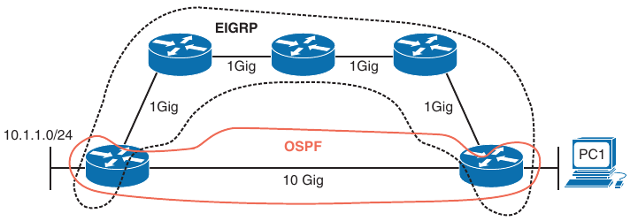

- Being able to recognize when a certain routing source should be used and when it should not be used is key to optimizing your network and reducing the number of troubleshooting instances related to the network being perceived as being slow

- In this case, you might want to consider increasing the AD of EIGRP or lowering the AD of OSPF to optimize routing

#### Route Filtering

- A distribute list applied to an OSPF process controls which routes are installed into the routing table from the LSDB

- Note that this differs from EIGRP, where the distribute list controls routes sent and received between neighbors

- The reason that this difference exists is that all OSPF routers in an area must have the same LSDB

- If you were able to control the routes sent to and received from neighbors, the LSDB would not be the same among the routers in the area, which is not permitted

- To apply a route filter to OSPF, the distribute list is applied in OSPF configuration mode inbound (meaning into the routing table), and the routes installed are controlled by ACLs, prefix lists or route maps

- Therefore, when troubleshooting route filtering for OSPF, you need to consider the following:

    - Is the distribute list applied in the correct direction?

    - If the distribute list is using an ACL, is the ACL correct?

    - If the distribute list is using a prefix list, is the prefix list correct?

    - If the distribute list is using a route map, is the route map correct?

- The `show ip protocols` command identifies whether a distribute list is applied to the OSPF process

- In this example we can see that there are no outbound filters and that there is an inbound filter that is referencing a prefix list called TEST

```
R5(config-router)#do sh ip protocols 
*** IP Routing is NSF aware ***

Routing Protocol is "application"
  Sending updates every 0 seconds
  Invalid after 0 seconds, hold down 0, flushed after 0
  Outgoing update filter list for all interfaces is not set
  Incoming update filter list for all interfaces is not set
  Maximum path: 32
  Routing for Networks:
  Routing Information Sources:
    Gateway         Distance      Last Update
  Distance: (default is 4)

Routing Protocol is "ospf 1"
  Outgoing update filter list for all interfaces is not set
  Incoming update filter list for all interfaces is (prefix-list) TEST
  Router ID 192.168.5.5
  It is an area border router
  Number of areas in this router is 2. 2 normal 0 stub 0 nssa
  Maximum path: 4
  Routing for Networks:
    10.45.1.0 0.0.0.255 area 0
    0.0.0.0 255.255.255.255 area 56
  Passive Interface(s):
    Loopback0
  Routing Information Sources:
    Gateway         Distance      Last Update
    192.168.5.5          254      00:21:53
    192.168.6.6          110      00:00:25
    192.168.4.4          110      00:00:25
  Distance: (default is 110)

```

- The inbound filter applied is referencing a prefix list called TEST

- To verify the entries in this prefix list you use the command `show ip prefix-list TEST` command

- If an ACL is applied, you issue the `show access-lists` command

- If a route map is applied, you issue the `show route-map` command

- You can verify the command that was used to apply the distribute list in the running-configuration as shown below

```
R5#show ip prefix-list TEST 
ip prefix-list TEST: 2 entries
   seq 5 deny 10.3.3.0/24
   seq 10 permit 0.0.0.0/0 le 32

R5#sh run | s router ospf
router ospf 1
 router-id 192.168.5.5
 passive-interface Loopback0
 network 10.45.1.0 0.0.0.255 area 0
 network 0.0.0.0 255.255.255.255 area 56
 distribute-list prefix TEST in
```

- Notice that the LSDB still has the prefix 10.3.3.0/24 network listed, but it is not installed into the routing table because of the distribute list that is denying 10.3.3.0/24 from being installed

```
R5#show ip ospf database 

            OSPF Router with ID (192.168.5.5) (Process ID 1)

                Router Link States (Area 0)

Link ID         ADV Router      Age         Seq#       Checksum Link count
192.168.4.4     192.168.4.4     155         0x80000004 0x00557E 1
192.168.5.5     192.168.5.5     1682        0x80000005 0x003F8E 1

                Net Link States (Area 0)

Link ID         ADV Router      Age         Seq#       Checksum
10.45.1.4       192.168.4.4     155         0x80000002 0x00188E

                Summary Net Link States (Area 0)

Link ID         ADV Router      Age         Seq#       Checksum
10.3.3.0        192.168.4.4     155         0x80000002 0x001662
10.24.1.0       192.168.4.4     155         0x80000002 0x00F07D
10.56.1.0       192.168.5.5     2033        0x80000001 0x00166F
10.123.1.0      192.168.4.4     155         0x80000002 0x007C86
192.168.1.1     192.168.4.4     155         0x80000002 0x001706
192.168.3.3     192.168.4.4     155         0x80000002 0x00EC2C
192.168.5.5     192.168.5.5     2033        0x80000001 0x002B2A
192.168.6.6     192.168.5.5     1647        0x80000001 0x002032

                Summary ASB Link States (Area 0)

Link ID         ADV Router      Age         Seq#       Checksum
192.168.6.6     192.168.5.5     1647        0x80000001 0x00084A

                Router Link States (Area 56)

Link ID         ADV Router      Age         Seq#       Checksum Link count
192.168.5.5     192.168.5.5     1638        0x80000008 0x0068C5 2
192.168.6.6     192.168.6.6     1643        0x80000008 0x0076AF 2

                Net Link States (Area 56)

Link ID         ADV Router      Age         Seq#       Checksum
10.56.1.6       192.168.6.6     1650        0x80000003 0x008907

                Summary Net Link States (Area 56)

Link ID         ADV Router      Age         Seq#       Checksum
10.24.1.0       192.168.5.5     1682        0x80000002 0x00ED7D
10.45.1.0       192.168.5.5     1682        0x80000002 0x0098F6
10.123.1.0      192.168.5.5     1682        0x80000002 0x007986
192.168.1.1     192.168.5.5     1682        0x80000002 0x001406
192.168.3.3     192.168.5.5     1682        0x80000002 0x00E92C

                Type-5 AS External Link States

Link ID         ADV Router      Age         Seq#       Checksum Tag
10.67.1.0       192.168.6.6     1654        0x80000001 0x00D804 0
10.68.1.0       192.168.6.6     1654        0x80000001 0x00D123 0
172.16.0.0      192.168.6.6     1644        0x80000001 0x00BCC0 0
172.16.31.0     192.168.6.6     1654        0x80000001 0x00B6B1 0

R5#show ip route 10.3.3.0 255.255.255.0 
% Subnet not in table

R5#show ip route ospf | b Gate
Gateway of last resort is not set

      10.0.0.0/8 is variably subnetted, 8 subnets, 3 masks
O IA     10.24.1.0/29 [110/65] via 10.45.1.4, 00:13:06, GigabitEthernet0/0
O E2     10.67.1.0/24 [110/20] via 10.56.1.6, 00:13:06, GigabitEthernet0/1
O E2     10.68.1.0/24 [110/250] via 10.56.1.6, 00:13:06, GigabitEthernet0/1
O IA     10.123.1.0/24 [110/66] via 10.45.1.4, 00:13:06, GigabitEthernet0/0
      172.16.0.0/16 is variably subnetted, 2 subnets, 2 masks
O E2     172.16.0.0/20 [110/20] via 10.56.1.6, 00:13:06, GigabitEthernet0/1
O E2     172.16.31.0/24 [110/250] via 10.56.1.6, 00:13:06, GigabitEthernet0/1
      192.168.1.0/32 is subnetted, 1 subnets
O IA     192.168.1.1 [110/67] via 10.45.1.4, 00:13:06, GigabitEthernet0/0
      192.168.3.0/32 is subnetted, 1 subnets
O IA     192.168.3.3 [110/67] via 10.45.1.4, 00:13:06, GigabitEthernet0/0
      192.168.6.0/32 is subnetted, 1 subnets
O        192.168.6.6 [110/2] via 10.56.1.6, 00:13:06, GigabitEthernet0/1
```

- Distribute lists can be used to filter routes in **ANY** OSPF router in the topology

- OSPF E2 routes does not seem to be possible to be filtered with distribute lists. Use redistribution or `summary-address <ip-addr> <subnet-mask> <not-advertise>` on the ASBR for these

#### Other OSPF filtering methods

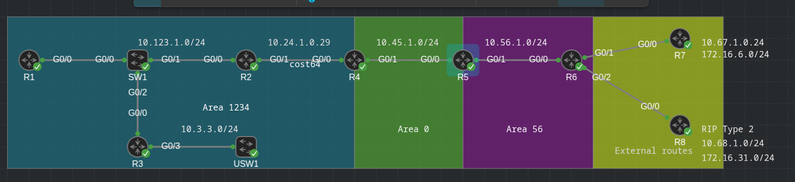

1. Filtering using `area range <ip-address> <subnet-mask> not-advertise` on the ABR to filter routes between areas

2. Filtering using `summary-address <ip-address> <subnet-mask> not-advertise` on the ASBR to filter external type 1/type 2 routes

3. Filtering prefixes that are advertised from an area to another using a `area <id> filter-list prexix <name>`

4. Filtering when using a `redistribution` command


##### Filtering routes between areas using area range command

- **THIS METHOD WORKS ONLY ON TYPE 1 LSAs**

- **THIS CAN BE USED TO FILTER ONLY PREFIXES ENTERING AREA 0**

- You can filter some routes between areas when doing summarization on an ABR

- For this, use the command `area <area-id> range <ip-address> <subnet-mask> not-advertise` in router OSPF process configuration mode

- Example: On R4 filter the area 1234 prefix 192.168.2.2 from appearing in area 0's routing table

- R4's routing table before filtering:

```
R4#show ip route ospf | b Gate
Gateway of last resort is not set

      10.0.0.0/8 is variably subnetted, 9 subnets, 3 masks
O        10.3.3.0/24 [110/66] via 10.24.1.2, 02:00:46, GigabitEthernet0/0
O IA     10.56.1.0/24 [110/2] via 10.45.1.5, 01:59:55, GigabitEthernet0/1
O E2     10.67.1.0/24 [110/20] via 10.45.1.5, 01:53:36, GigabitEthernet0/1
O E2     10.68.1.0/24 [110/250] via 10.45.1.5, 01:53:36, GigabitEthernet0/1
O        10.123.1.0/24 [110/65] via 10.24.1.2, 02:00:56, GigabitEthernet0/0
      172.16.0.0/16 is variably subnetted, 2 subnets, 2 masks
O E2     172.16.0.0/20 [110/20] via 10.45.1.5, 01:53:36, GigabitEthernet0/1
O E2     172.16.31.0/24 [110/250] via 10.45.1.5, 01:53:36, GigabitEthernet0/1
      192.168.1.0/32 is subnetted, 1 subnets
O        192.168.1.1 [110/66] via 10.24.1.2, 02:00:46, GigabitEthernet0/0
      192.168.3.0/32 is subnetted, 1 subnets
O        192.168.3.3 [110/66] via 10.24.1.2, 02:00:46, GigabitEthernet0/0
      192.168.5.0/32 is subnetted, 1 subnets
O IA     192.168.5.5 [110/2] via 10.45.1.5, 01:59:55, GigabitEthernet0/1
      192.168.6.0/32 is subnetted, 1 subnets
O IA     192.168.6.6 [110/3] via 10.45.1.5, 01:53:41, GigabitEthernet0/1
```

- Routing table of R2 before filtering:

```
R2#show ip route ospf | b Gate 
Gateway of last resort is not set

      10.0.0.0/8 is variably subnetted, 9 subnets, 3 masks
O        10.3.3.0/24 [110/2] via 10.123.1.3, 02:02:54, GigabitEthernet0/0
O IA     10.45.1.0/24 [110/65] via 10.24.1.4, 02:03:25, GigabitEthernet0/1
O IA     10.56.1.0/24 [110/66] via 10.24.1.4, 02:01:58, GigabitEthernet0/1
O E2     10.67.1.0/24 [110/20] via 10.24.1.4, 01:55:38, GigabitEthernet0/1
O E2     10.68.1.0/24 [110/250] via 10.24.1.4, 01:55:38, GigabitEthernet0/1
      172.16.0.0/16 is variably subnetted, 2 subnets, 2 masks
O E2     172.16.0.0/20 [110/20] via 10.24.1.4, 01:55:38, GigabitEthernet0/1
O E2     172.16.31.0/24 [110/250] via 10.24.1.4, 01:55:38, GigabitEthernet0/1
      192.168.1.0/32 is subnetted, 1 subnets
O        192.168.1.1 [110/2] via 10.123.1.1, 02:02:54, GigabitEthernet0/0
      192.168.3.0/32 is subnetted, 1 subnets
O        192.168.3.3 [110/2] via 10.123.1.3, 02:02:54, GigabitEthernet0/0
      192.168.5.0/32 is subnetted, 1 subnets
O IA     192.168.5.5 [110/66] via 10.24.1.4, 02:01:58, GigabitEthernet0/1
      192.168.6.0/32 is subnetted, 1 subnets
O IA     192.168.6.6 [110/67] via 10.24.1.4, 01:55:43, GigabitEthernet0/1
```

- Filtering the prefix on R4:

```
conf t
 router ospf 1
  area 0 range 192.168.2.2 255.255.255.255 not-advertise
```

- Verifying the LSDB on R4 for this LSA:

```
R4(config-router)#do sh ip ospf database router adv-router 192.168.4.4

            OSPF Router with ID (192.168.4.4) (Process ID 1)

                Router Link States (Area 0)

  LS age: 697
  Options: (No TOS-capability, DC)
  LS Type: Router Links
  Link State ID: 192.168.4.4
  Advertising Router: 192.168.4.4
  LS Seq Number: 80000009
  Checksum: 0x4B83
  Length: 36
  Area Border Router
  Number of Links: 1

    Link connected to: a Transit Network
     (Link ID) Designated Router address: 10.45.1.4
     (Link Data) Router Interface address: 10.45.1.4
      Number of MTID metrics: 0
       TOS 0 Metrics: 1


          
                Router Link States (Area 1234)

  LS age: 697
  Options: (No TOS-capability, DC)
  LS Type: Router Links
  Link State ID: 192.168.4.4
  Advertising Router: 192.168.4.4
  LS Seq Number: 80000006
  Checksum: 0x7D8D
  Length: 48
  Area Border Router
  Number of Links: 2

    Link connected to: another Router (point-to-point)
     (Link ID) Neighboring Router ID: 192.168.2.2
     (Link Data) Router Interface address: 10.24.1.4
      Number of MTID metrics: 0
       TOS 0 Metrics: 64

    Link connected to: a Stub Network
     (Link ID) Network/subnet number: 10.24.1.0
     (Link Data) Network Mask: 255.255.255.248
      Number of MTID metrics: 0
       TOS 0 Metrics: 64
```

- As you can see the prefix is present still in the LSDB of R4

- The prefix is not present in the routing table of R4

```
R4(config-router)#do sh ip route 192.168.2.2
% Network not in table
R4(config-router)#
R4(config-router)#
R4(config-router)#do sh ip route 192.168.2.2 255.255.255.255
% Network not in table
```

- On R5, the LSA is not present in LSDB

```
R5(config-router)#do sh ip ospf database summary adv-router 192.168.4.4

            OSPF Router with ID (192.168.5.5) (Process ID 1)

                Summary Net Link States (Area 0)

  LS age: 838
  Options: (No TOS-capability, DC, Upward)
  LS Type: Summary Links(Network)
  Link State ID: 10.3.3.0 (summary Network Number)
  Advertising Router: 192.168.4.4
  LS Seq Number: 80000005
  Checksum: 0x1065
  Length: 28
  Network Mask: /24
        MTID: 0         Metric: 66 

  LS age: 838
  Options: (No TOS-capability, DC, Upward)
  LS Type: Summary Links(Network)
  Link State ID: 10.24.1.0 (summary Network Number)
  Advertising Router: 192.168.4.4
  LS Seq Number: 80000005
  Checksum: 0xEA80
  Length: 28
  Network Mask: /29
        MTID: 0         Metric: 64 

  LS age: 838
  Options: (No TOS-capability, DC, Upward)
  LS Type: Summary Links(Network)
  Link State ID: 10.123.1.0 (summary Network Number)
  Advertising Router: 192.168.4.4
  LS Seq Number: 80000005
  Checksum: 0x7689
  Length: 28
  Network Mask: /24
        MTID: 0         Metric: 65 

  LS age: 838
  Options: (No TOS-capability, DC, Upward)
  LS Type: Summary Links(Network)
  Link State ID: 192.168.1.1 (summary Network Number)
  Advertising Router: 192.168.4.4
  LS Seq Number: 80000005
  Checksum: 0x1109
  Length: 28
  Network Mask: /32
        MTID: 0         Metric: 66 

  LS age: 838
  Options: (No TOS-capability, DC, Upward)
  LS Type: Summary Links(Network)
  Link State ID: 192.168.3.3 (summary Network Number)
  Advertising Router: 192.168.4.4
  LS Seq Number: 80000005
  Checksum: 0xE62F
  Length: 28
  Network Mask: /32
        MTID: 0         Metric: 66 

```

- Neither the prefix 192.168.2.2/32 in routing table

```
R5(config-router)#do sh ip ro 192.168.2.2 255.255.255.255
% Network not in table
```

##### Filtering routes on an ASBR using summary-address command

- R7 does have 16 prefixes in the 172.16.0.0/20 range and R6 is redistributing them into the OSPF domain

```
R7#show ip int br | e unas
Interface                  IP-Address      OK? Method Status                Protocol
GigabitEthernet0/0         10.67.1.7       YES NVRAM  up                    up      
Loopback0                  172.16.6.1      YES NVRAM  up                    up      
Loopback1                  172.16.1.1      YES NVRAM  up                    up      
Loopback2                  172.16.2.2      YES NVRAM  up                    up      
Loopback3                  172.16.3.3      YES NVRAM  up                    up      
Loopback4                  172.16.4.4      YES NVRAM  up                    up      
Loopback5                  172.16.5.5      YES NVRAM  up                    up      
Loopback7                  172.16.7.7      YES NVRAM  up                    up      
Loopback8                  172.16.8.8      YES NVRAM  up                    up      
Loopback9                  172.16.9.9      YES NVRAM  up                    up      
Loopback10                 172.16.10.10    YES NVRAM  up                    up      
Loopback11                 172.16.11.11    YES NVRAM  up                    up      
Loopback12                 172.16.12.12    YES NVRAM  up                    up      
Loopback13                 172.16.13.13    YES NVRAM  up                    up      
Loopback14                 172.16.14.14    YES NVRAM  up                    up      
Loopback15                 172.16.15.15    YES NVRAM  up                    up      
```

```
R6#show run | s router ospf
router ospf 1
 router-id 192.168.6.6
 summary-address 172.16.0.0 255.255.240.0
 redistribute eigrp 65001 subnets
 redistribute rip metric 250 subnets
 passive-interface Loopback0
 network 10.56.1.0 0.0.0.255 area 56
 network 192.168.6.6 0.0.0.0 area 56
```

- Use the `summary-address <ip-address> <subnet-mask> not-advertise` on the ASBR to filter these prefixes from being advertised into the OSPF domain

- R6's routing table now

```
R6#sh ip route ospf | b Gate
Gateway of last resort is not set

      10.0.0.0/8 is variably subnetted, 10 subnets, 3 masks
O IA     10.3.3.0/24 [110/68] via 10.56.1.5, 00:32:08, GigabitEthernet0/0
O IA     10.24.1.0/29 [110/66] via 10.56.1.5, 00:32:08, GigabitEthernet0/0
O IA     10.45.1.0/24 [110/2] via 10.56.1.5, 00:32:08, GigabitEthernet0/0
O IA     10.123.1.0/24 [110/67] via 10.56.1.5, 00:32:08, GigabitEthernet0/0
      172.16.0.0/16 is variably subnetted, 17 subnets, 2 masks
O        172.16.0.0/20 is a summary, 02:35:51, Null0
      192.168.1.0/32 is subnetted, 1 subnets
O IA     192.168.1.1 [110/68] via 10.56.1.5, 00:32:08, GigabitEthernet0/0
      192.168.3.0/32 is subnetted, 1 subnets
O IA     192.168.3.3 [110/68] via 10.56.1.5, 00:32:08, GigabitEthernet0/0
      192.168.5.0/32 is subnetted, 1 subnets
O        192.168.5.5 [110/2] via 10.56.1.5, 00:32:08, GigabitEthernet0/0
```

- R6's routing table after the summary-address is transformed with not-advertise keyword

```
conf t
 router ospf 1
  no summary-address 172.16.0.0 255.255.240.0
  summary-address 172.16.0.0 255.255.240.0 not-advertise
```

```
R6(config-router)#do sh ip route ospf | b Gate
Gateway of last resort is not set

      10.0.0.0/8 is variably subnetted, 10 subnets, 3 masks
O IA     10.3.3.0/24 [110/68] via 10.56.1.5, 00:35:02, GigabitEthernet0/0
O IA     10.24.1.0/29 [110/66] via 10.56.1.5, 00:35:02, GigabitEthernet0/0
O IA     10.45.1.0/24 [110/2] via 10.56.1.5, 00:35:02, GigabitEthernet0/0
O IA     10.123.1.0/24 [110/67] via 10.56.1.5, 00:35:02, GigabitEthernet0/0
      192.168.1.0/32 is subnetted, 1 subnets
O IA     192.168.1.1 [110/68] via 10.56.1.5, 00:35:02, GigabitEthernet0/0
      192.168.3.0/32 is subnetted, 1 subnets
O IA     192.168.3.3 [110/68] via 10.56.1.5, 00:35:02, GigabitEthernet0/0
      192.168.5.0/32 is subnetted, 1 subnets
O        192.168.5.5 [110/2] via 10.56.1.5, 00:35:02, GigabitEthernet0/0
```

- The 172.16.0.0/20 prefix is no longer present on R6's routing table

```
R6(config-router)#do sh ip ospf database

            OSPF Router with ID (192.168.6.6) (Process ID 1)

                Router Link States (Area 56)

Link ID         ADV Router      Age         Seq#       Checksum Link count
192.168.5.5     192.168.5.5     178         0x8000000F 0x005ACC 2
192.168.6.6     192.168.6.6     320         0x8000000E 0x006AB5 2

                Net Link States (Area 56)

Link ID         ADV Router      Age         Seq#       Checksum
10.56.1.6       192.168.6.6     320         0x80000009 0x007D0D

                Summary Net Link States (Area 56)

Link ID         ADV Router      Age         Seq#       Checksum
10.3.3.0        192.168.5.5     178         0x80000002 0x001362
10.24.1.0       192.168.5.5     178         0x80000002 0x00ED7D
10.45.1.0       192.168.5.5     178         0x80000007 0x008EFB
10.123.1.0      192.168.5.5     178         0x80000002 0x007986
192.168.1.1     192.168.5.5     178         0x80000002 0x001406
192.168.3.3     192.168.5.5     178         0x80000002 0x00E92C
          
                Type-5 AS External Link States

Link ID         ADV Router      Age         Seq#       Checksum Tag
10.67.1.0       192.168.6.6     1595        0x80000005 0x00D008 0
10.68.1.0       192.168.6.6     1595        0x80000005 0x00C927 0
172.16.31.0     192.168.6.6     1595        0x80000005 0x00AEB5 0
```

- Summary LSAs for these prefixes are not present anymore on R6's LSDB

- Also the prefix is no longer present on the routing table of R4

```
R4#show ip route 172.16.0.0 255.255.240.0
% Subnet not in table
```

- The prefix is not present in the LSDB of R4

```
R4#show ip ospf database external adv-router 192.168.6.6

            OSPF Router with ID (192.168.4.4) (Process ID 1)

                Type-5 AS External Link States

  LS age: 1708
  Options: (No TOS-capability, DC, Upward)
  LS Type: AS External Link
  Link State ID: 10.67.1.0 (External Network Number )
  Advertising Router: 192.168.6.6
  LS Seq Number: 80000005
  Checksum: 0xD008
  Length: 36
  Network Mask: /24
        Metric Type: 2 (Larger than any link state path)
        MTID: 0 
        Metric: 20 
        Forward Address: 0.0.0.0
        External Route Tag: 0

  LS age: 1708
  Options: (No TOS-capability, DC, Upward)
  LS Type: AS External Link
  Link State ID: 10.68.1.0 (External Network Number )
  Advertising Router: 192.168.6.6
  LS Seq Number: 80000005
  Checksum: 0xC927
  Length: 36
  Network Mask: /24
        Metric Type: 2 (Larger than any link state path)
        MTID: 0 
        Metric: 250 
        Forward Address: 0.0.0.0
        External Route Tag: 0

  LS age: 1708
  Options: (No TOS-capability, DC, Upward)
  LS Type: AS External Link
  Link State ID: 172.16.31.0 (External Network Number )
  Advertising Router: 192.168.6.6
  LS Seq Number: 80000005
  Checksum: 0xAEB5
  Length: 36
  Network Mask: /24
        Metric Type: 2 (Larger than any link state path)
        MTID: 0 
        Metric: 250 
        Forward Address: 0.0.0.0
        External Route Tag: 0
```

##### Route filtering on ABR using area filter-list command

- The `area <area-id> filter-list prefix <prefix-list-name> in/out` command in OSPF process configuration mode can be used to filter type 3 LSAs on an ABR and control which routes enter or exit a specific area

- **THIS IS USED TO FILTER TYPE 3 LSAs**

- **THIS CANNOT FILTER TYPE 5 LSAs**

- Configuration on R4 to deny loopbacks of R5 and R6 from entering area 1234

```
conf t
 ip prefix-list DENY-LOOPBACKS seq 5 deny 192.168.5.5/32
 ip prefix-list DENY-LOOPBACKS seq 10 deny 192.168.6.6/32
 ip prefix-list DENY-LOOPBACKS seq 15 permit 0.0.0.0/0 le 32

 router ospf 1
  area 1234 filter-list prefix DENY-LOOPBACKS in
```

- Verifying the routing table of R3:

```
R3#show ip route ospf | b Gate
Gateway of last resort is not set

      10.0.0.0/8 is variably subnetted, 9 subnets, 3 masks
O        10.24.1.0/29 [110/65] via 10.123.1.2, 00:38:57, GigabitEthernet0/0
O IA     10.45.1.0/24 [110/66] via 10.123.1.2, 00:38:57, GigabitEthernet0/0
O IA     10.56.1.0/24 [110/67] via 10.123.1.2, 00:27:33, GigabitEthernet0/0
O E2     10.67.1.0/24 [110/20] via 10.123.1.2, 00:26:53, GigabitEthernet0/0
O E2     10.68.1.0/24 [110/250] via 10.123.1.2, 00:26:53, GigabitEthernet0/0
      172.16.0.0/16 is variably subnetted, 2 subnets, 2 masks
O E2     172.16.0.0/20 [110/20] via 10.123.1.2, 00:26:53, GigabitEthernet0/0
O E2     172.16.31.0/24 [110/250] via 10.123.1.2, 00:26:53, GigabitEthernet0/0
      192.168.1.0/32 is subnetted, 1 subnets
O        192.168.1.1 [110/2] via 10.123.1.1, 00:39:07, GigabitEthernet0/0
```

- As you can see 192.168.5.5 and 192.168.6.6 are not present anymore in the routing table of R3

- And also not present on Area 1234's LSDB

```
R3#show ip ospf database summary 

            OSPF Router with ID (192.168.3.3) (Process ID 1)

                Summary Net Link States (Area 1234)

  LS age: 1039
  Options: (No TOS-capability, DC, Upward)
  LS Type: Summary Links(Network)
  Link State ID: 10.45.1.0 (summary Network Number)
  Advertising Router: 192.168.4.4
  LS Seq Number: 80000002
  Checksum: 0xA5EB
  Length: 28
  Network Mask: /24
        MTID: 0         Metric: 1 

  LS age: 530
  Options: (No TOS-capability, DC, Upward)
  LS Type: Summary Links(Network)
  Link State ID: 10.56.1.0 (summary Network Number)
  Advertising Router: 192.168.4.4
  LS Seq Number: 80000002
  Checksum: 0x2B5A
  Length: 28
  Network Mask: /24
        MTID: 0         Metric: 2 

```

##### Route filtering as part of a redistribution command

- **THIS CAN FILTER TYPE 5 LSAs**

- First remove the summary-address from R6

```
conf t
 router ospf 1
  no summary-address 172.16.0.0 255.255.240.0
  no redistribute eigrp 65001 subnets
```

- First create a prefix list and reference it in a route map (deny 172.16.1.0/24, 172.16.2.0/24, 172.16.3.0/24)

```
conf t
 # match 172.16.0.0/22 range with a subnet mask greater or equal 24
 ip prefix-list FILTER-EIGRP seq 5 deny 172.16.0.0/22 ge 24
 ip prefix-list FILTER-EIGRP seq 10 permit 0.0.0.0/0 le 32

 route-map FILTER-EIGRP-RM permit 10
  match ip address prefix-list FILTER-EIGRP
  set tag 10
```

- Set the route map as part of redistribution command

```
conf t
 router ospf 1
  redistribute eigrp 65001 subnets route-map FILTER-EIGRP-RM
```

- Verifying the routing table on R5:

```
R5#show ip route ospf | b Gate
Gateway of last resort is not set

      10.0.0.0/8 is variably subnetted, 8 subnets, 3 masks
O IA     10.24.1.0/29 [110/65] via 10.45.1.4, 00:48:41, GigabitEthernet0/0
O E2     10.67.1.0/24 [110/20] via 10.56.1.6, 00:03:57, GigabitEthernet0/1
O E2     10.68.1.0/24 [110/250] via 10.56.1.6, 00:48:41, GigabitEthernet0/1
O IA     10.123.1.0/24 [110/66] via 10.45.1.4, 00:48:41, GigabitEthernet0/0
      172.16.0.0/24 is subnetted, 13 subnets
O E2     172.16.4.0 [110/20] via 10.56.1.6, 00:03:57, GigabitEthernet0/1
O E2     172.16.5.0 [110/20] via 10.56.1.6, 00:03:57, GigabitEthernet0/1
O E2     172.16.6.0 [110/20] via 10.56.1.6, 00:03:57, GigabitEthernet0/1
O E2     172.16.7.0 [110/20] via 10.56.1.6, 00:03:57, GigabitEthernet0/1
O E2     172.16.8.0 [110/20] via 10.56.1.6, 00:03:57, GigabitEthernet0/1
O E2     172.16.9.0 [110/20] via 10.56.1.6, 00:03:57, GigabitEthernet0/1
O E2     172.16.10.0 [110/20] via 10.56.1.6, 00:03:57, GigabitEthernet0/1
O E2     172.16.11.0 [110/20] via 10.56.1.6, 00:03:57, GigabitEthernet0/1
O E2     172.16.12.0 [110/20] via 10.56.1.6, 00:03:57, GigabitEthernet0/1
O E2     172.16.13.0 [110/20] via 10.56.1.6, 00:03:57, GigabitEthernet0/1
O E2     172.16.14.0 [110/20] via 10.56.1.6, 00:03:57, GigabitEthernet0/1
O E2     172.16.15.0 [110/20] via 10.56.1.6, 00:03:57, GigabitEthernet0/1
O E2     172.16.31.0 [110/250] via 10.56.1.6, 00:48:41, GigabitEthernet0/1
      192.168.1.0/32 is subnetted, 1 subnets
O IA     192.168.1.1 [110/67] via 10.45.1.4, 00:48:41, GigabitEthernet0/0
      192.168.3.0/32 is subnetted, 1 subnets
O IA     192.168.3.3 [110/67] via 10.45.1.4, 00:48:41, GigabitEthernet0/0
      192.168.6.0/32 is subnetted, 1 subnets
O        192.168.6.6 [110/2] via 10.56.1.6, 00:48:41, GigabitEthernet0/1
```

- As you can see, 1721.6.1.0/24, 172.16.2.0/24 and 172.16.3.0/24 got filtered from R5's routing table

- Now we can see that the routes corresponding to the summary prefix got tag 10 assigned to them in the OSPF RIB

```
R5#show ip ospf rib 

            OSPF Router with ID (192.168.5.5) (Process ID 1)


                Base Topology (MTID 0)

OSPF local RIB
Codes: * - Best, > - Installed in global RIB

*   10.3.3.0/24, Inter, cost 67, area 0
      via 10.45.1.4, GigabitEthernet0/0
*>  10.24.1.0/29, Inter, cost 65, area 0
      via 10.45.1.4, GigabitEthernet0/0
*   10.45.1.0/24, Intra, cost 1, area 0, Connected
      via 10.45.1.5, GigabitEthernet0/0
*   10.56.1.0/24, Intra, cost 1, area 56, Connected
      via 10.56.1.5, GigabitEthernet0/1
*>  10.67.1.0/24, Ext2, cost 20, fwd cost 1, tag 10
      via 10.56.1.6, GigabitEthernet0/1
*>  10.68.1.0/24, Ext2, cost 250, fwd cost 1, tag 0
      via 10.56.1.6, GigabitEthernet0/1
*>  10.123.1.0/24, Inter, cost 66, area 0
      via 10.45.1.4, GigabitEthernet0/0
*>  172.16.4.0/24, Ext2, cost 20, fwd cost 1, tag 10
      via 10.56.1.6, GigabitEthernet0/1
*>  172.16.5.0/24, Ext2, cost 20, fwd cost 1, tag 10
      via 10.56.1.6, GigabitEthernet0/1
*>  172.16.6.0/24, Ext2, cost 20, fwd cost 1, tag 10
      via 10.56.1.6, GigabitEthernet0/1
*>  172.16.7.0/24, Ext2, cost 20, fwd cost 1, tag 10
      via 10.56.1.6, GigabitEthernet0/1
*>  172.16.8.0/24, Ext2, cost 20, fwd cost 1, tag 10
      via 10.56.1.6, GigabitEthernet0/1
*>  172.16.9.0/24, Ext2, cost 20, fwd cost 1, tag 10
      via 10.56.1.6, GigabitEthernet0/1
*>  172.16.10.0/24, Ext2, cost 20, fwd cost 1, tag 10
      via 10.56.1.6, GigabitEthernet0/1
*>  172.16.11.0/24, Ext2, cost 20, fwd cost 1, tag 10
      via 10.56.1.6, GigabitEthernet0/1
*>  172.16.12.0/24, Ext2, cost 20, fwd cost 1, tag 10
      via 10.56.1.6, GigabitEthernet0/1
*>  172.16.13.0/24, Ext2, cost 20, fwd cost 1, tag 10
      via 10.56.1.6, GigabitEthernet0/1
*>  172.16.14.0/24, Ext2, cost 20, fwd cost 1, tag 10
      via 10.56.1.6, GigabitEthernet0/1
*>  172.16.15.0/24, Ext2, cost 20, fwd cost 1, tag 10
      via 10.56.1.6, GigabitEthernet0/1
*>  172.16.31.0/24, Ext2, cost 250, fwd cost 1, tag 0
      via 10.56.1.6, GigabitEthernet0/1
*>  192.168.1.1/32, Inter, cost 67, area 0
      via 10.45.1.4, GigabitEthernet0/0
*>  192.168.3.3/32, Inter, cost 67, area 0
      via 10.45.1.4, GigabitEthernet0/0
*   192.168.5.5/32, Intra, cost 1, area 56, Connected
      via 192.168.5.5, Loopback0
*>  192.168.6.6/32, Intra, cost 2, area 56
      via 10.56.1.6, GigabitEthernet0/1
```

#### Stub Area Configuration

- Because all the routers in an area need to have the same LSDB, you cannot manipulate the LSAs within an area; however you can manipulate LSAs that are flowing between areas by using the stub and NSSA OSPF features

- When you can create stub areas or NSSAs, you supress type 5 LSAs from entering the area at the ABR

- With *totally stubby areas* and *totally NSSAs*, you supress Type 5 and Type 3 LSAs from entering the area at the ABR

- The routes that would have been learned from the Type 5 and Type 3 LSAs are now replaced by a default route

- Because there is a default route, the router has lost visibility of the overall network, and this could produce suboptimal routing if not implemented correctly in highly redundant environments

- As a result, if you are expecting a Type 5 or Type 3 LSA for a specific route, but it is not showing up in the area, you should verify whether the area is a stub area or an NSSA and determine what type of routes are being supressed

- You can verify whether the area connected to the router is a stub area or an NSSA by using the `show ip ospf` command as shown below

```
R1#show ip ospf 
 Routing Process "ospf 1" with ID 192.168.1.1
 Start time: 00:00:10.333, Time elapsed: 02:43:53.426
 Supports only single TOS(TOS0) routes
 Supports opaque LSA
 Supports Link-local Signaling (LLS)
 Supports area transit capability
 Supports NSSA (compatible with RFC 3101)
 Supports Database Exchange Summary List Optimization (RFC 5243)
 Event-log enabled, Maximum number of events: 1000, Mode: cyclic
 Router is not originating router-LSAs with maximum metric
 Initial SPF schedule delay 5000 msecs
 Minimum hold time between two consecutive SPFs 10000 msecs
 Maximum wait time between two consecutive SPFs 10000 msecs
 Incremental-SPF disabled
 Minimum LSA interval 5 secs
 Minimum LSA arrival 1000 msecs
 LSA group pacing timer 240 secs
 Interface flood pacing timer 33 msecs
 Retransmission pacing timer 66 msecs
 EXCHANGE/LOADING adjacency limit: initial 300, process maximum 300
 Number of external LSA 0. Checksum Sum 0x000000
 Number of opaque AS LSA 0. Checksum Sum 0x000000
 Number of DCbitless external and opaque AS LSA 0
 Number of DoNotAge external and opaque AS LSA 0
 Number of areas in this router is 1. 0 normal 1 stub 0 nssa
 Number of areas transit capable is 0
 External flood list length 0
 IETF NSF helper support enabled
 Cisco NSF helper support enabled
 Reference bandwidth unit is 100 mbps
    Area 1234
        Number of interfaces in this area is 2 (1 loopback)
        It is a stub area
        Area has no authentication
        SPF algorithm last executed 00:15:37.497 ago
        SPF algorithm executed 7 times
        Area ranges are
        Number of LSA 6. Checksum Sum 0x02BD48
        Number of opaque link LSA 0. Checksum Sum 0x000000
        Number of DCbitless LSA 0
        Number of indication LSA 0
        Number of DoNotAge LSA 0
        Flood list length 0

```

- Configuring area 1234 as stub on R1, R2, R3 and R4 (with no-summary)

```
R1#sh run | s router ospf
router ospf 1
 router-id 192.168.1.1
 area 1234 stub
 passive-interface Loopback0
 network 0.0.0.0 255.255.255.255 area 1234
```

```
R2#sh run | s router ospf
router ospf 1
 router-id 192.168.2.2
 area 1234 stub
 passive-interface Loopback0
 network 10.24.1.2 0.0.0.0 area 1234
 network 10.123.1.2 0.0.0.0 area 1234
```

```
R3#sh run | s router ospf
router ospf 1
 router-id 192.168.3.3
 area 1234 stub
 passive-interface GigabitEthernet0/3
 passive-interface Loopback0
 network 0.0.0.0 255.255.255.255 area 1234
```

- R4 - the ABR

```
R4#sh run | s router ospf
router ospf 1
 router-id 192.168.4.4
 area 0 range 192.168.2.2 255.255.255.255 not-advertise
 area 1234 stub no-summary
 area 1234 filter-list prefix DENY-LOOPBACKS in
 passive-interface Loopback0
```

- OSPF routing table on R3:

```
R3#sh ip route ospf | b Gate
Gateway of last resort is 10.123.1.2 to network 0.0.0.0

O*IA  0.0.0.0/0 [110/66] via 10.123.1.2, 00:15:02, GigabitEthernet0/0
      10.0.0.0/8 is variably subnetted, 5 subnets, 3 masks
O        10.24.1.0/29 [110/65] via 10.123.1.2, 00:15:02, GigabitEthernet0/0
      192.168.1.0/32 is subnetted, 1 subnets
O        192.168.1.1 [110/2] via 10.123.1.1, 00:14:52, GigabitEthernet0/0
```

- However, remember that when implementing totally stubby areas or totally NSSAs, you are configuring the `no-summary` keyword only on the ABR

- It is not needed on the other routers

- Therefore, it is best to review the output of `show ip ospf` on the ABR

```
R4#sh ip ospf
 Routing Process "ospf 1" with ID 192.168.4.4
 Start time: 00:00:10.489, Time elapsed: 02:46:51.660
 Supports only single TOS(TOS0) routes
 Supports opaque LSA
 Supports Link-local Signaling (LLS)
 Supports area transit capability
 Supports NSSA (compatible with RFC 3101)
 Supports Database Exchange Summary List Optimization (RFC 5243)
 Event-log enabled, Maximum number of events: 1000, Mode: cyclic
 It is an area border router
 Router is not originating router-LSAs with maximum metric
 Initial SPF schedule delay 5000 msecs
 Minimum hold time between two consecutive SPFs 10000 msecs
 Maximum wait time between two consecutive SPFs 10000 msecs
 Incremental-SPF disabled
 Minimum LSA interval 5 secs
 Minimum LSA arrival 1000 msecs
 LSA group pacing timer 240 secs
 Interface flood pacing timer 33 msecs
 Retransmission pacing timer 66 msecs
 EXCHANGE/LOADING adjacency limit: initial 300, process maximum 300
 Number of external LSA 15. Checksum Sum 0x05B88E
 Number of opaque AS LSA 0. Checksum Sum 0x000000
 Number of DCbitless external and opaque AS LSA 0
 Number of DoNotAge external and opaque AS LSA 0
 Number of areas in this router is 2. 1 normal 1 stub 0 nssa
 Number of areas transit capable is 0
 External flood list length 0
 IETF NSF helper support enabled
 Cisco NSF helper support enabled
 Reference bandwidth unit is 100 mbps
    Area BACKBONE(0)
        Number of interfaces in this area is 1
        Area has no authentication
        SPF algorithm last executed 00:20:02.022 ago
        SPF algorithm executed 13 times
        Area ranges are
           192.168.2.2/32 Passive DoNotAdvertise 
        Number of LSA 12. Checksum Sum 0x046B5F
        Number of opaque link LSA 0. Checksum Sum 0x000000
        Number of DCbitless LSA 0
        Number of indication LSA 0
        Number of DoNotAge LSA 0
        Flood list length 0
    Area 1234
        Number of interfaces in this area is 1
        It is a stub area, no summary LSA in this area
        Generates stub default route with cost 1
        Area has no authentication
        SPF algorithm last executed 00:19:03.487 ago
        SPF algorithm executed 14 times
        Area ranges are
        Area-filter DENY-LOOPBACKS in
        Number of LSA 6. Checksum Sum 0x02BD48
        Number of opaque link LSA 0. Checksum Sum 0x000000
        Number of DCbitless LSA 0
        Number of indication LSA 0
        Number of DoNotAge LSA 0
        Flood list length 0
```

- In this example, R4 is configurde to suppress Type 3 and Type 5 LSAs from entering area 1234

- It replaces them with a default route with a cost of 1

- So even though R3 appears to be in a stub area, it is really in a totally-stubby area, based on the configuration of R4

#### Interface is Shut Down

- When the OSPF process is enabled on an interface, the network the interface is part of, (that is, the directly connected entry in the routing table) is injected into the OSPF process

- If the interface is shut down, there is no directly connected network for the entry in the routing table

- Therefore the network does not exist and no network can be injected into the OSPF process

- The interface must be up/up for routes to be advertised or for neighbor relationships to be formed

#### Wrong Designated Router Elected

- A multi-access network can have multiple router residing on a common network segment

- Rather than having all routers form a full mesh of adjacencies with one another, a designated router (DR) is elected, and all other routers on the segment form full adjacency with the DR

- The rest of routers form a 2-Way adjacency with each other, and if a backup designated router (BDR) exists, they form a full adjacency with the BDR as well

- A DR is elected based on router priority, with larger priority values being preferable

- If routers have equal priorities, the DR is elected based on the highest OSPF RID

- A BDR is also elected based on the same criteria

- Routers on the multi-access network form full adjacencies with the BDR in case the DR becomes unavailable

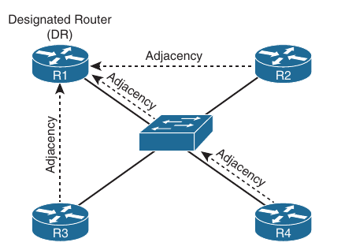

- It does not matter which router is elected as the DR on a multi-access Ethernet topology or a full-mesh Frame Relay topology because every router is able to reach the DR since the Layer 2 topology lines up with the Layer 3 addressing

- However, over a hub-and-spoke non-broadcast multi-access (NBMA network) such as Frame Relay or with a Dynamic Multipoint VPN (DMVPN), it does matter who is the DR because the underlying Layer 2 topology does not line up with the Layer 3 addressing

- Below is shown a hub-and-spoke Frame Relay of DMVPN network

- The multipoint interface (single physical interface or MGRE [Multipoint Generic Routing Encapsulation] tunnel interface) provides connectivity to multiple routers in the same subnet out the single interface, as Ethernet does

- However, in this case, the Layer 2 physical topology is not the same as the Layer 3 Topology 

- The Layer 3 topology indicates that all routers are directly reachable out the interfaces (on the same subnet)

- The Layer 2 topology says otherwise

- You cannot reach R2 from R3 and vice versa

- You must go through R1

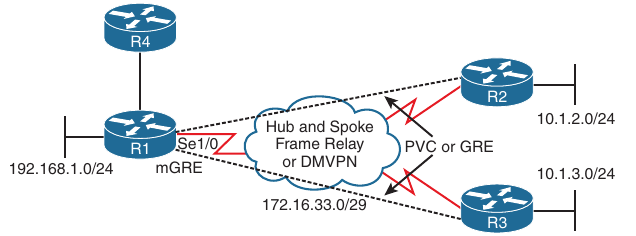

- Below is shown the wrong DR placement

- The DR router needs to be reachable through a single hop because of how OSPF neighbor relationships are formed and how routers communicate with the DR

- Hellos are established with the multicast address 224.0.0.5, and the DR is reachable at the multicast address 224.0.0.6

- Packets destined to these two multicast addresses are not relayed by other routers

- Because the DR is responsible for relaying learned routes in a multi-access network, it needs to be centrally located

- Therefore, if R2 were the DR, R3 would not be able to form an adjacency with it, because R1 does not relay the hello packet

- Therefore, R3 cannot communicate with the DR, which means it cannot tell the DR about the 10.1.3.0/24 network, and as a result, no other router learns about the 10.1.3.0/24 network

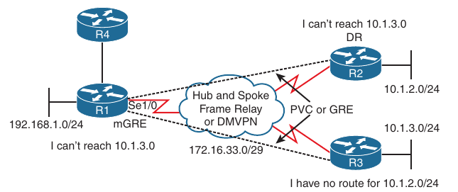

- In this case you need to control who the DR is

- It must be R1 to be sure that all routers are able to send LSAs to it and receive LSAs from it

- To verify the DR placement, issue the command `show ip ospf interface <type> <number>`

- Below is indicated that R1 considers the router with the RID 3.3.3.3 as the DR at interface 172.16.33.6

- R2 considers itself as the DR and R1 the BDR 

- R3 considers itself a DR and R1 a BDR

- Therefore, there are two DRs in this hub-and-spoke environment

- As a result, routes are not successfully learned by all routers in the topology

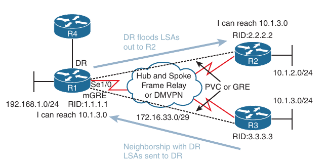

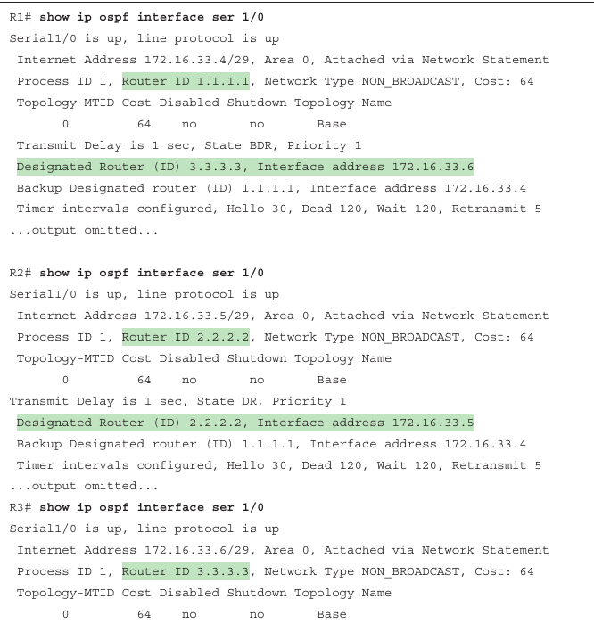

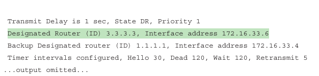

- To solve this issue, you need to force R1 to be the DR by preventing R2 and R3 for ever wanting to be a DR

- On R2 and R3 you go into interface configuration mode and set the OSPF priority to 0

- R2:

```
conf t
 int s1/0
  ip ospf priority 0
```

- R3:

```
conf t
 int s1/0
  ip ospf priority 0
```

- Now the output of `show ip ospf interface s1/0` on R1, indicates that it is the DR and there are no BDRs because you never want a spoke to back up the DR as it would cause the problem discussed earlier

#### Duplicate Router IDs

- The RID uniquely identifies the routers in the OSPF domain

- Because the RID is used during the formation of neighbor relationships and to determine which router advertises a specific LSA, it is imperative that the RIDs in the domain are unique

- If there are duplicate RIDs, the network issues can vary

- For example, in the same area, the routers are going to see a type 1 router LSA about networks they do not know about from a RID the same as theirs

- Therefore they think they generated the LSA, and a router does not use information contained in an LSA it receives with the same RID as theirs

- However, the LSA is not from itself; it just has the same RID, and as a result, you have missing routes on various routers in the domain

- Below, the Type 1 Router LSA from R1 is ignored by R3 because the LSA has the same RID as R3, and so R3 thinks it is it's own LSA

- Therefore, R3 does not learn about the 10.1.1.0/24

- Similarly, R1 does not learn about the 10.1.3.0/24 because it is ignoring the LSA that R3 sent because it has the same RID

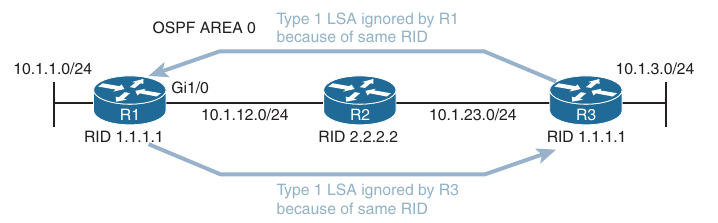

```
R3#clear ip ospf process
Reset ALL OSPF processes? [no]: y
R3#
*Oct 15 18:42:16.295: %OSPF-5-ADJCHG: Process 1, Nbr 4.4.4.4 on GigabitEthernet2 from FULL to DOWN, Neighbor Down: Interface down or detached
*Oct 15 18:42:16.365: OSPF-1 SPF  : Do not schedule partial SPF type 5, LSID 0.0.0.0, adv_rtr 4.4.4.4, area dummy area: INTRA/INTER spf scheduled 
*Oct 15 18:42:16.365: %OSPF-5-ADJCHG: Process 1, Nbr 4.4.4.4 on GigabitEthernet2 from LOADING to FULL, Loading Done
*Oct 15 18:42:16.413: OSPF-1 MON  : Begin SPF 21 at 3549.610ms, process time 108ms 
*Oct 15 18:42:16.413: OSPF-1 INTRA: Running SPF 21 for area 0, SPF-type Full 
*Oct 15 18:42:16.413: OSPF-1 INTRA: Initializing to run spf 
*Oct 15 18:42:16.413: OSPF-1 INTRA: spf_intra() - rebuilding the tree 
*Oct 15 18:42:16.413: OSPF-1 INTRA:  It is a router LSA 2.2.2.2. Link Count 2 
*Oct 15 18:42:16.413: OSPF-1 INTRA:   Processing link 0, id 10.130.1.0, link data 255.255.255.0, type 3 
*Oct 15 18:42:16.413: OSPF-1 SPF  :    Add better path to LSA ID 10.130.1.255, gateway 10.130.1.0, dist 1
*Oct 15 18:42:16.413: OSPF-1 SPF  :    Add path: next-hop 10.130.1.1, interface Loopback0 
*Oct 15 18:42:16.413: OSPF-1 INTRA:   Processing link 1, id 10.1.34.4, link data 10.1.34.3, type 2 
*Oct 15 18:42:16.413: OSPF-1 SPF  :    Add better path to LSA ID 10.1.34.4, gateway 10.1.34.3, dist 100
*Oct 15 18:42:16.413: OSPF-1 INTRA:    Putting LSA on the clist LSID 10.1.34.4, Type 2, Adv Rtr. 4.4.4.4 
*Oct 15 18:42:16.413: OSPF-1 SPF  :    Add path: next-hop 10.1.34.3, interface GigabitEthernet2 
*Oct 15 18:42:16.413: OSPF-1 INTRA:      Downheap LSA ID 10.1.34.4, Type 2, Adv 4.4.4.4 on clist from index 1 to 1 
*Oct 15 18:42:16.413: OSPF-1 INTRA: Route update succeeded for 10.1.34.0/255.255.255.0, spt metric 100, path metric 100, Next Hop: GigabitEthernet2/10.1.34.3 area 0 
*Oct 15 18:42:16.413: OSPF-1 INTRA:  It is a network LSA 10.1.34.4. Router Count 2 
*Oct 15 18:42:16.413: OSPF-1 INTRA:   Processing router id 4.4.4.4 
*Oct 15 18:42:16.413: OSPF-1 SPF  :    Add better path to LSA ID 4.4.4.4, gateway 10.1.34.4, dist 100
*Oct 15 18:42:16.413: OSPF-1 INTRA:    Putting LSA on the clist LSID 4.4.4.4, Type 1, Adv Rtr. 4.4.4.4 
*Oct 15 18:42:16.413: OSPF-1 SPF  :    Add path: next-hop 10.1.34.4, interface GigabitEthernet2 
*Oct 15 18:42:16.413: OSPF-1 INTRA:   Processing router id 2.2.2.2 
*Oct 15 18:42:16.413: OSPF-1 INTRA:   New newdist 100 olddist 0 
*Oct 15 18:42:16.413: OSPF-1 INTRA:      Downheap LSA ID 4.4.4.4, Type 1, Adv 4.4.4.4 on clist from index 1 to 1 
*Oct 15 18:42:16.413: OSPF-1 INTRA: Update ASBR Router Route 4.4.4.4 via GigabitEthernet2/10.1.34.4, igp metric 100, path metric 100, area 0 
*Oct 15 18:42:16.414: OSPF-1 SPF  : Added ASBR path to router 4.4.4.4 via 10.1.34.4, area 0, Area SPF 14, PDB SPF 21, Type Full 
*Oct 15 18:42:16.414: OSPF-1 INTRA:  It is a router LSA 4.4.4.4. Link Count 2 
*Oct 15 18:42:16.414: OSPF-1 INTRA:   Processing link 0, id 10.1.34.4, link data 10.1.34.4, type 2 
*Oct 15 18:42:16.414: OSPF-1 INTRA:   Ignore newdist 200 olddist 100 
*Oct 15 18:42:16.414: OSPF-1 INTRA:   Processing link 1, id 10.1.24.4, link data 10.1.24.4, type 2 
*Oct 15 18:42:16.414: OSPF-1 SPF  :    Add better path to LSA ID 10.1.24.4, gateway 10.1.24.4, dist 200
*Oct 15 18:42:16.414: OSPF-1 INTRA:    Putting LSA on the clist LSID 10.1.24.4, Type 2, Adv Rtr. 4.4.4.4 
*Oct 15 18:42:16.414: OSPF-1 SPF  :    Add path: next-hop 10.1.34.4, interface GigabitEthernet2 
*Oct 15 18:42:16.414: OSPF-1 INTRA:      Downheap LSA ID 10.1.24.4, Type 2, Adv 4.4.4.4 on clist from index 1 to 1 
*Oct 15 18:42:16.414: OSPF-1 INTRA: Route update succeeded for 10.1.24.0/255.255.255.0, spt metric 200, path metric 200, Next Hop: GigabitEthernet2/10.1.34.4 area 0 
*Oct 15 18:42:16.414: OSPF-1 INTRA:  It is a network LSA 10.1.24.4. Router Count 2 
*Oct 15 18:42:16.414: OSPF-1 INTRA:   Processing router id 4.4.4.4 
*Oct 15 18:42:16.414: OSPF-1 INTRA:   New newdist 200 olddist 100 
*Oct 15 18:42:16.414: OSPF-1 INTRA:   Processing router id 2.2.2.2 
*Oct 15 18:42:16.414: OSPF-1 INTRA:   No rtr back link 
*Oct 15 18:42:16.414: OSPF-1 
R3#INTRA: Adding Stub nets 
*Oct 15 18:42:16.414: OSPF-1 INTRA: Route update succeeded for 10.130.1.0/255.255.255.0, spt metric 1, path metric 1, Next Hop: Loopback0/10.130.1.1 area 0 
*Oct 15 18:42:16.414: OSPF-1 INTRA: Entered intra-area route sync for area 0 
*Oct 15 18:42:16.414: OSPF-1 INTRA: Entered intra-area route sync for area 0 
*Oct 15 18:42:16.414: OSPF-1 INTER: Check and generate summary LSA into all areas 
*Oct 15 18:42:16.414: OSPF-1 INTER: Running spf for summaries area 0 
*Oct 15 18:42:16.414: OSPF-1 INTER: Entered inter-area route sync for area 0 
*Oct 15 18:42:16.414: OSPF-1 INTER: Entered inter-area route sync for area 0 
*Oct 15 18:42:16.414: OSPF-1 INTER: Running spf for summaries area 1 
*Oct 15 18:42:16.414: OSPF-1 INTER: Entered inter-area route sync for area 1 
*Oct 15 18:42:16.414: OSPF-1 INTER: Entered inter-area route sync for area 1 
*Oct 15 18:42:16.414: OSPF-1 EXTER: Started Building Type 5 External Routes 
*Oct 15 18:42:16.414: OSPF-1 EXTER: Start processing AS External LSA 5/0.0.0.0/4.4.4.4, mask 0.0.0.0
*Oct 15 18:42:16.414: OSPF-1 EXTER:  age 1528, seq 0x80000002, lsa_metric 1, metric-type 2, fw-addr 0.0.0.0 
*Oct 15 18:42:16.414: OSPF-1 EXTER:  border table path: ASBR via 10.1.34.4 on GigabitEthernet2, area 0, cost 100, path cost 100, flags (none) 
*Oct 15 18:42:16.414: OSPF-1 EXTER: Started Building Type 7 External Routes 
*Oct 15 18:42:16.414: OSPF-1 EXTER: Started Building Type 7 External Routes 
*Oct 15 18:42:16.414: OSPF-1 EXTER: Entered External route sync for area dummy area 
*Oct 15 18:42:16.414: OSPF-1 EXTER: Entered External route sync for area dummy area 
*Oct 15 18:42:16.414: OSPF-1 EXTER: Entered NSSA route sync for area 0 
*Oct 15 18:42:16.414: OSPF-1 EXTER: Entered NSSA route sync for area 0 
*Oct 15 18:42:16.414: OSPF-1 EXTER: Entered NSSA route sync for area 1 
*Oct 15 18:42:16.414: OSPF-1 EXTER: Entered NSSA route sync for area 1 
*Oct 15 18:42:16.414: OSPF-1 MON  : End SPF 21 at 3549.611ms, Total elapsed time 1ms 
*Oct 15 18:42:16.863: OSPF-1 SPF  : Detect change in LSA type 1, LSID 4.4.4.4 from 4.4.4.4 area 0 
*Oct 15 18:42:16.863: OSPF-1 SPF  : Detect MAXAGE in LSA type 2, LS ID 10.1.34.4, from 4.4.4.4
*Oct 15 18:42:16.863: OSPF-1 SPF  : Detect generic change in LSA type 2, LSID 10.1.34.4, from 4.4.4.4 area 0
*Oct 15 18:42:16.863: OSPF-1 MON  : Begin SPF 22 at 3550.060ms, process time 109ms 
*Oct 15 18:42:16.863: OSPF-1 INTRA: Running SPF 22 for area 0, SPF-type Full 
*Oct 15 18:42:16.863: OSPF-1 INTRA: Initializing to run spf 
*Oct 15 18:42:16.863: OSPF-1 INTRA: spf_intra() - rebuilding the tree 
*Oct 15 18:42:16.863: OSPF-1 INTRA:  It is a router LSA 2.2.2.2. Link Count 2 
*Oct 15 18:42:16.863: OSPF-1 INTRA:   Processing link 0, id 10.130.1.0, link data 255.255.255.0, type 3 
*Oct 15 18:42:16.863: OSPF-1 SPF  :    Add better path to LSA ID 10.130.1.255, gateway 10.130.1.0, dist 1
*Oct 15 18:42:16.863: OSPF-1 SPF  :    Add path: next-hop 10.130.1.1, interface Loopback0 
*Oct 15 18:42:16.863: OSPF-1 INTRA:   Processing link 1, id 10.1.34.4, link data 10.1.34.3, type 2 
*Oct 15 18:42:16.863: OSPF-1 INTRA:   Ignoring Link state 10.1.34.4 type 2 MAXAGE 
*Oct 15 18:42:16.863: OSPF-1 INTRA: Adding Stub nets 
*Oct 15 18:42:16.863: OSPF-1 INTRA: Route update succeeded for 10.130.1.0/255.255.255.0, spt metric 1, path metric 1, Next Hop: Loopback0/10.130.1.1 area 0 
*Oct 15 18:42:16.863: OSPF-1 INTRA: Entered intra-area route sync for area 0 
*Oct 15 18:42:16.863: OSPF-1 SPF  : Delete  path to router 4.4.4.4 via 10.1.34.4, Area 0, Area SPF 14, PDB SPF 21, SPF Type Full  
*Oct 15 18:42:16.863: OSPF-1 INTRA: Entered intra-area route sync for area 0 
*Oct 15 18:42:16.863: OSPF-1 INTER: Check and generate summary LSA into all areas 
*Oct 15 18:42:16.863: OSPF-1 INTER: Running spf for summaries area 0 
*Oct 15 18:42:16.863: OSPF-1 INTER: Entered inter-area route sync for area 0 
*Oct 15 18:42:16.863: OSPF-1 INTER: Entered inter-area route sync for area 0 
*Oct 15 18:42:16.863: OSPF-1 INTER: Running spf for summaries area 1 
*Oct 15 1
R3#
R3#
R3#
R3#
R3#8:42:16.863: OSPF-1 INTER: Entered inter-area route sync for area 1 
*Oct 15 18:42:16.863: OSPF-1 INTER: Entered inter-area route sync for area 1 
*Oct 15 18:42:16.863: OSPF-1 EXTER: Started Building Type 5 External Routes 
*Oct 15 18:42:16.863: OSPF-1 EXTER: Start processing AS External LSA 5/0.0.0.0/4.4.4.4, mask 0.0.0.0
*Oct 15 18:42:16.864: OSPF-1 EXTER:  age 1528, seq 0x80000002, lsa_metric 1, metric-type 2, fw-addr 0.0.0.0 
*Oct 15 18:42:16.864: OSPF-1 EXTER:    Did not find route to ASBR 4.4.4.4 
*Oct 15 18:42:16.864: OSPF-1 EXTER: Started Building Type 7 External Routes 
*Oct 15 18:42:16.864: OSPF-1 EXTER: Started Building Type 7 External Routes 
*Oct 15 18:42:16.864: OSPF-1 EXTER: Entered External route sync for area dummy area 
*Oct 15 18:42:16.864: OSPF-1 EXTER: Entered External route sync for area dummy area 
*Oct 15 18:42:16.864: OSPF-1 EXTER: Entered NSSA route sync for area 0 
*Oct 15 18:42:16.864: OSPF-1 EXTER: Entered NSSA route sync for area 0 
*Oct 15 18:42:16.864: OSPF-1 EXTER: Entered NSSA route sync for area 1 
*Oct 15 18:42:16.864: OSPF-1 EXTER: Entered NSSA route sync for area 1 
*Oct 15 18:42:16.864: OSPF-1 MON  : End SPF 22 at 3550.060ms, Total elapsed time 0ms 
R3#
R3#
R3#
R3#
R3#
*Oct 15 18:42:21.262: OSPF-1 SPF  : Detect change in LSA type 1, LSID 4.4.4.4 from 4.4.4.4 area 0 
*Oct 15 18:42:21.312: OSPF-1 MON  : Begin SPF 23 at 3554.509ms, process time 109ms 
*Oct 15 18:42:21.312: OSPF-1 INTRA: Running SPF 23 for area 0, SPF-type Full 
*Oct 15 18:42:21.312: OSPF-1 INTRA: Initializing to run spf 
*Oct 15 18:42:21.312: OSPF-1 INTRA: spf_intra() - rebuilding the tree 
*Oct 15 18:42:21.312: OSPF-1 INTRA:  It is a router LSA 2.2.2.2. Link Count 2 
*Oct 15 18:42:21.312: OSPF-1 INTRA:   Processing link 0, id 10.130.1.0, link data 255.255.255.0, type 3 
*Oct 15 18:42:21.312: OSPF-1 SPF  :    Add better path to LSA ID 10.130.1.255, gateway 10.130.1.0, dist 1
*Oct 15 18:42:21.312: OSPF-1 SPF  :    Add path: next-hop 10.130.1.1, interface Loopback0 
*Oct 15 18:42:21.312: OSPF-1 INTRA:   Processing link 1, id 10.1.34.4, link data 10.1.34.3, type 2 
*Oct 15 18:42:21.312: OSPF-1 INTRA:   Ignoring Link state 10.1.34.4 type 2 MAXAGE 
*Oct 15 18:42:21.313: OSPF-1 INTRA: Adding Stub nets 
*Oct 15 18:42:21.313: OSPF-1 INTRA: Route update succeeded for 10.130.1.0/255.255.255.0, spt metric 1, path metric 1, Next Hop: Loopback0/10.130.1.1 area 0 
*Oct 15 18:42:21.313: OSPF-1 INTRA: Entered intra-area route sync for area 0 
*Oct 15 18:42:21.313: OSPF-1 INTRA: Entered intra-area route sync for area 0 
*Oct 15 18:42:21.313: OSPF-1 INTER: Check and generate summary LSA into all areas 
*Oct 15 18:42:21.313: OSPF-1 INTER: Running spf for summaries area 0 
*Oct 15 18:42:21.313: OSPF-1 INTER: Entered inter-area route sync for area 0 
*Oct 15 18:42:21.313: OSPF-1 INTER: Entered inter-area route sync for area 0 
*Oct 15 18:42:21.313: OSPF-1 INTER: Running spf for summaries area 1 
*Oct 15 18:42:21.313: OSPF-1 INTER: Entered inter-area route sync for area 1 
*Oct 15 18:42:21.313: OSPF-1 INTER: Entered inter-area route sync for area 1 
*Oct 15 18:42:21.313: OSPF-1 EXTER: Started Building Type 5 External Routes 
*Oct 15 18:42:21.313: OSPF-1 EXTER: Start processing AS External LSA 5/0.0.0.0/4.4.4.4, mask 0.0.0.0
*Oct 15 18:42:21.313: OSPF-1 EXTER:  age 1532, seq 0x80000002, lsa_metric 1, metric-type 2, fw-addr 0.0.0.0 
*Oct 15 18:42:21.313: OSPF-1 EXTER:    Did not find route to ASBR 4.4.4.4 
*Oct 15 18:42:21.313: OSPF-1 EXTER: Started Building Type 7 External Routes 
*Oct 15 18:42:21.313: OSPF-1 EXTER: Started Building Type 7 External Routes 
*Oct 15 18:42:21.313: OSPF-1 EXTER: Entered External route sync for area dummy area 
*Oct 15 18:42:21.313: OSPF-1 EXTER: Entered External route sync for area dummy area 
*Oct 15 18:42:21.313: OSPF-1 EXTER: Entered NSSA route sync for area 0 
*Oct 15 18:42:21.313: OSPF-1 EXTER: Entered NSSA route sync for area 0 
*Oct 15 18:42:21.313: OSPF-1 EXTER: Entered NSSA route sync for area 1 
*Oct 15 18:42:21.313: OSPF-1 EXTER: Entered NSSA route sync for area 1 
*Oct 15 18:42:21.313: OSPF-1 MON  : End SPF 23 at 3554.510ms, Total elapsed time 1ms 
*Oct 15 18:42:21.862: OSPF-1 SPF  : SPF due to Non-MAXAGE in lsa 2, LS ID 10.1.34.4, from 4.4.4.4
*Oct 15 18:42:21.862: OSPF-1 SPF  : Detect generic change in LSA type 2, LSID 10.1.34.4, from 4.4.4.4 area 0
*Oct 15 18:42:21.913: OSPF-1 MON  : Begin SPF 24 at 3555.109ms, process time 110ms 
*Oct 15 18:42:21.913: OSPF-1 INTRA: Running SPF 24 for area 0, SPF-type Full 
*Oct 15 18:42:21.913: OSPF-1 INTRA: Initializing to run spf 
*Oct 15 18:42:21.913: OSPF-1 INTRA: spf_intra() - rebuilding the tree 
*Oct 15 18:42:21.913: OSPF-1 INTRA:  It is a router LSA 2.2.2.2. Link Count 2 
*Oct 15 18:42:21.913: OSPF-1 INTRA:   Processing link 0, id 10.130.1.0, link data 255.255.255.0, type 3 
*Oct 15 18:42:21.913: OSPF-1 SPF  :    Add better path to LSA ID 10.130.1.255, gateway 10.130.1.0, dist 1
*Oct 15 18:42:21.913: OSPF-1 SPF  :    Add path: next-hop 10.130.1.1, interface Loopback0 
*Oct 15 18:42:21.913: OSPF-1 INTRA:   Processing link 1, id 10.1.34.4, link data 10.1.34.3, type 2 
*Oct 15 18:42:21.913: OSPF-1 SPF  :    Add better path to LSA ID 10.1.34.4, gateway 10.1.34.3, dist 100
*Oct 15 18:42:21.913: OSPF-1 INTRA:    Pu
R3#tting LSA on the clist LSID 10.1.34.4, Type 2, Adv Rtr. 4.4.4.4 
*Oct 15 18:42:21.913: OSPF-1 SPF  :    Add path: next-hop 10.1.34.3, interface GigabitEthernet2 
*Oct 15 18:42:21.913: OSPF-1 INTRA:      Downheap LSA ID 10.1.34.4, Type 2, Adv 4.4.4.4 on clist from index 1 to 1 
*Oct 15 18:42:21.913: OSPF-1 INTRA: Route update succeeded for 10.1.34.0/255.255.255.0, spt metric 100, path metric 100, Next Hop: GigabitEthernet2/10.1.34.3 area 0 
*Oct 15 18:42:21.913: OSPF-1 INTRA:  It is a network LSA 10.1.34.4. Router Count 2 
*Oct 15 18:42:21.913: OSPF-1 INTRA:   Processing router id 4.4.4.4 
*Oct 15 18:42:21.913: OSPF-1 SPF  :    Add better path to LSA ID 4.4.4.4, gateway 10.1.34.4, dist 100
*Oct 15 18:42:21.913: OSPF-1 INTRA:    Putting LSA on the clist LSID 4.4.4.4, Type 1, Adv Rtr. 4.4.4.4 
*Oct 15 18:42:21.913: OSPF-1 SPF  :    Add path: next-hop 10.1.34.4, interface GigabitEthernet2 
*Oct 15 18:42:21.913: OSPF-1 INTRA:   Processing router id 2.2.2.2 
*Oct 15 18:42:21.913: OSPF-1 INTRA:   New newdist 100 olddist 0 
*Oct 15 18:42:21.913: OSPF-1 INTRA:      Downheap LSA ID 4.4.4.4, Type 1, Adv 4.4.4.4 on clist from index 1 to 1 
*Oct 15 18:42:21.913: OSPF-1 INTRA: Update ASBR Router Route 4.4.4.4 via GigabitEthernet2/10.1.34.4, igp metric 100, path metric 100, area 0 
*Oct 15 18:42:21.913: OSPF-1 SPF  : Added ASBR path to router 4.4.4.4 via 10.1.34.4, area 0, Area SPF 17, PDB SPF 24, Type Full 
*Oct 15 18:42:21.913: OSPF-1 INTRA:  It is a router LSA 4.4.4.4. Link Count 2 
*Oct 15 18:42:21.913: OSPF-1 INTRA:   Processing link 0, id 10.1.34.4, link data 10.1.34.4, type 2 
*Oct 15 18:42:21.913: OSPF-1 INTRA:   Ignore newdist 200 olddist 100 
*Oct 15 18:42:21.913: OSPF-1 INTRA:   Processing link 1, id 10.1.24.4, link data 10.1.24.4, type 2 
*Oct 15 18:42:21.913: OSPF-1 SPF  :    Add better path to LSA ID 10.1.24.4, gateway 10.1.24.4, dist 200
*Oct 15 18:42:21.913: OSPF-1 INTRA:    Putting LSA on the clist LSID 10.1.24.4, Type 2, Adv Rtr. 4.4.4.4 
*Oct 15 18:42:21.913: OSPF-1 SPF  :    Add path: next-hop 10.1.34.4, interface GigabitEthernet2 
*Oct 15 18:42:21.913: OSPF-1 INTRA:      Downheap LSA ID 10.1.24.4, Type 2, Adv 4.4.4.4 on clist from index 1 to 1 
*Oct 15 18:42:21.913: OSPF-1 INTRA: Route update succeeded for 10.1.24.0/255.255.255.0, spt metric 200, path metric 200, Next Hop: GigabitEthernet2/10.1.34.4 area 0 
*Oct 15 18:42:21.913: OSPF-1 INTRA:  It is a network LSA 10.1.24.4. Router Count 2 
*Oct 15 18:42:21.913: OSPF-1 INTRA:   Processing router id 4.4.4.4 
*Oct 15 18:42:21.913: OSPF-1 INTRA:   New newdist 200 olddist 100 
*Oct 15 18:42:21.913: OSPF-1 INTRA:   Processing router id 2.2.2.2 
*Oct 15 18:42:21.913: OSPF-1 INTRA:   No rtr back link 
*Oct 15 18:42:21.913: OSPF-1 INTRA: Adding Stub nets 
*Oct 15 18:42:21.913: OSPF-1 INTRA: Route update succeeded for 10.130.1.0/255.255.255.0, spt metric 1, path metric 1, Next Hop: Loopback0/10.130.1.1 area 0 
*Oct 15 18:42:21.913: OSPF-1 INTRA: Entered intra-area route sync for area 0 
*Oct 15 18:42:21.913: OSPF-1 INTRA: Entered intra-area route sync for area 0 
*Oct 15 18:42:21.914: OSPF-1 INTER: Check and generate summary LSA into all areas 
*Oct 15 18:42:21.914: OSPF-1 INTER: Running spf for summaries area 0 
*Oct 15 18:42:21.914: OSPF-1 INTER: Entered inter-area route sync for area 0 
*Oct 15 18:42:21.914: OSPF-1 INTER: Entered inter-area route sync for area 0 
*Oct 15 18:42:21.914: OSPF-1 INTER: Running spf for summaries area 1 
*Oct 15 18:42:21.914: OSPF-1 INTER: Entered inter-area route sync for area 1 
*Oct 15 18:42:21.914: OSPF-1 INTER: Entered inter-area route sync for area 1 
*Oct 15 18:42:21.914: OSPF-1 EXTER: Started Building Type 5 External Routes 
*Oct 15 18:42:21.914: OSPF-1 EXTER: Start processing AS External LSA 5/0.0.0.0/4.4.4.4, mask 0.0.0.0
*Oct 15 18:42:21.914: OSPF-1 EXTER:  age 1533, seq 0x80000002, lsa_metric 1, metric-type 2, fw-addr 0.0.0.0 
*Oct 15 18:42:21.914: OSPF-1 EXTER:  border table path: ASBR via 10.1.34.4 on GigabitEthernet2, area 0, cost 100, path cost 100, flags (none) 
*Oct 15 18:42:21.914: 
R3#OSPF-1 EXTER: Started Building Type 7 External Routes 
*Oct 15 18:42:21.914: OSPF-1 EXTER: Started Building Type 7 External Routes 
*Oct 15 18:42:21.914: OSPF-1 EXTER: Entered External route sync for area dummy area 
*Oct 15 18:42:21.914: OSPF-1 EXTER: Entered External route sync for area dummy area 
*Oct 15 18:42:21.914: OSPF-1 EXTER: Entered NSSA route sync for area 0 
*Oct 15 18:42:21.914: OSPF-1 EXTER: Entered NSSA route sync for area 0 
*Oct 15 18:42:21.914: OSPF-1 EXTER: Entered NSSA route sync for area 1 
*Oct 15 18:42:21.914: OSPF-1 EXTER: Entered NSSA route sync for area 1 
*Oct 15 18:42:21.914: OSPF-1 MON  : End SPF 24 at 3555.111ms, Total elapsed time 0ms 
     
R3#show ip route 
Gateway of last resort is 10.1.34.4 to network 0.0.0.0

O*E2  0.0.0.0/0 [110/1] via 10.1.34.4, 00:00:13, GigabitEthernet2
      10.0.0.0/8 is variably subnetted, 5 subnets, 2 masks
O        10.1.24.0/24 [110/200] via 10.1.34.4, 00:00:13, GigabitEthernet2
C        10.1.34.0/24 is directly connected, GigabitEthernet2
L        10.1.34.3/32 is directly connected, GigabitEthernet2
C        10.130.1.0/24 is directly connected, Loopback0
L        10.130.1.1/32 is directly connected, Loopback0

R2#show ip route | b Gate
Gateway of last resort is 10.1.24.4 to network 0.0.0.0

O*E2  0.0.0.0/0 [110/1] via 10.1.24.4, 00:23:36, GigabitEthernet2
      10.0.0.0/8 is variably subnetted, 4 subnets, 2 masks
C        10.1.24.0/24 is directly connected, GigabitEthernet2
L        10.1.24.2/32 is directly connected, GigabitEthernet2
O        10.1.34.0/24 [110/200] via 10.1.24.4, 00:01:52, GigabitEthernet2
C        10.2.2.2/32 is directly connected, Loopback1
      203.0.113.0/24 is variably subnetted, 2 subnets, 2 masks
C        203.0.113.0/24 is directly connected, Loopback0
L        203.0.113.1/32 is directly connected, Loopback0
```

- Having duplicate router IDs in different areas would cause the physical OSPF topology to be different from the way the SPF algorithm sees it

- Below is shown an OSPF domain with duplicate RIDs in different areas

- R1 and R4 have RID 1.1.1.1

- As you can see R2 sees the router with the RID in both Area 0 and Area 1 (which to R2 is technically the same router)

- This can cause routing issues because some routes may not be passed between areas, causing the LSDB and the routing table to be incomplete

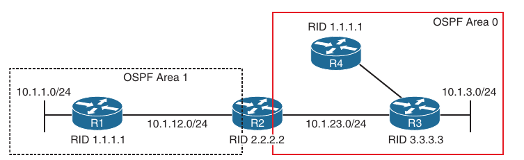

- In both the above examples, you may experience an OSPF flood war 

- A flood war occurs because routers receive LSAs associated with their RID but they don't 'own' these networks, the other router with duplicate RID does

- Therefore the router wants to correct this problem, and it sends out an LSA with it's RID and it's 'owned' networks

- When the other router with the duplicate RID gets the LSA, it does not agree with the information, and it sends out an LSA with it's 'owned' networks

- This happens over and over again until you make the RIDs unique

- If you have exhausted all possible reasons routes might not be appearing in the LSDB or the routing table, look at the RIDs of the routers by using the `show ip protocols` command

```
R2#sh ip protocols
*** IP Routing is NSF aware ***

Routing Protocol is "application"
  Sending updates every 0 seconds
  Invalid after 0 seconds, hold down 0, flushed after 0
  Outgoing update filter list for all interfaces is not set
  Incoming update filter list for all interfaces is not set
  Maximum path: 32
  Routing for Networks:
  Routing Information Sources:
    Gateway         Distance      Last Update
  Distance: (default is 4)

Routing Protocol is "ospf 1"
  Outgoing update filter list for all interfaces is not set
  Incoming update filter list for all interfaces is not set
  Router ID 2.2.2.2
  It is an area border router
  Number of areas in this router is 2. 1 normal 1 stub 0 nssa
  Maximum path: 4
  Routing for Networks:
  Routing on Interfaces Configured Explicitly (Area 0):
    Loopback0
    GigabitEthernet2
  Routing on Interfaces Configured Explicitly (Area 1):
    GigabitEthernet1
  Routing Information Sources:
    Gateway         Distance      Last Update
    3.3.3.3              110      00:02:10
    4.4.4.4              110      00:02:10
    1.1.1.1              110      00:02:15
  Distance: (default is 110)
```

### Troubleshooting Miscellaneous OSPFv2 issues

- So far the focus until now has been on troubleshooting issues related to OSPFv2 neighbor relationships and routes

- Now we will look at tracking LSAs through the network, route summarization, discontiguous areas, load balancing, and default routes

#### Tracking OSPF Advertisements Through a Network

- When troubleshooting an OSPF issue and trying to determine why certain entries are in a router's LSDB, tracking the path of the OSPF advertisements can be valuable

- For example, notice network 192.168.1.0/24 in the topology below and consider how this network is entered into the LSDB of the other OSPF routers

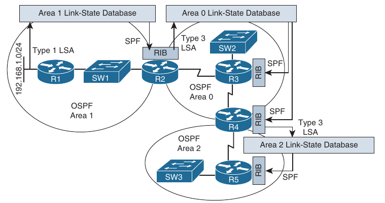

- The following steps describe how network 192.168.1.0/24, which is directly connected to router R1, is learned by the LSDBs of routers R2, R3, R4 and R5:

    1. Router R1 creates a Type 1 Router LSA for the 192.168.1.0/24 network in the Area 1 LSDB and floods it into Area 1

    2. Router R2 receives the router LSA for 192.168.1.0/24 network and places it in Area 1. R2 runs the shortest path first (SPF) algorithm to determine the best path through Area 1 to reach the 192.168.1.0/24 network. The best result is placed in R2's routing table (RIB)

    3. Router R2 informs Area 0 routers about network 192.168.1.0/24 by injecting a Type 3 LSA about the network into the LSDB of Area 0 and flooding it into Area 0. This LSA includes the cost to reach the 192.168.1.0/24 network, from the perspective of router R2

    4. Each of the other Area 0 routers (that is, routers R3 and R4) receives the Type 3 LSA and adds it to it's Area 0 LSDB. These routers run the SPF algorithm to determine the cost to reach router R2. This cost is then added to the cost router R2 advertises in it's Type 3 LSA, and the result is stored in the RIBs for routers R3 and R4

    5. Router R4 informs Area 2 routers about network 192.168.1.0/24 by injecting a Type 3 LSA into the LSDB of Area 2 and flooding it into Area 2. This LSA includes the cost to reach the 192.168.1.0/24 network, from the perspective of router R4

    6. Each of the routers in Area 2 receives the Type 3 LSA and adds it to it's Area 2 LSDB. These routers run the SPF algorithm to determine the cost to reach router R4. This cost is then added to the cost router R4 advertised in it's Type 3 LSA, and the result is stored in the RIBs of the routers

- To sucessfully troubleshoot OSPF-related issues, you should have a solid understanding of this process and the different types of OSPF LSAs

- Below are listed the LSA types you commonly encounter when troubleshooting a Cisco-based OSPF network

```
LSA Type                            Description

1                                   All OSPF routers source Type 1 LSAs. These advertisements list information about directly connected subnets, the OSPF
                                    connection types of a router and the known OSPF adjacencies of a router. A Type 1 LSA is not sent out it's local area

2                                   The designated router on a multi-access network sends a Type 2 LSA for that network if the network contains at least 2
                                    routers. A Type 2 LSA contains a list of routers connected to the multi-access network and, like the Type 1 LSA, is constrained to it's local area

3                                   A Type 3 LSA is sourced by an ABR. Each Type 3 LSA sent into an area contains information about a network that is reachable
                                    in a different area. Note that the network information is exchanged only between backbone area and a nonbackbone area,
                                    as opposed to being exchanged between two nonbackbone areas

4                                   Much like a Type 3 LSA, a Type 4 LSA is sourced by an ABR. However, instead of containing information about OSPF networks,
                                    a Type 4 LSA contains information stating how to reach an autonomous system boundary router (ASBR)

5                                   A Type 5 LSA is sourced by an ASBR and contains information about networks reachable outside the OSPF domain. A Type 5
                                    LSA is sent to all OSPF areas except for stub areas. Note that a ABR for a stub area sends default route information
                                    into the stub area rather than sending the network specific Type 5 LSAs

7                                   A Type 7 LSA is sourced from an ASBR within an NSSA. Whereas a stub area cannot connect to an external autonomous system,
                                    an NSSA can. The Type 7 LSA exists only in the NSSA; therefore, the external routes are announced by the ABR(s) of the NSSA into Area 0 using Type 5 LSAs. In addition, as with a stub area, external routes known to another OSPF area are not
                                    forwarded into an NSSA, since Type 5 LSAs are not permitted in an NSSA
```

#### Route Summarization

- OSPF is strict about where route summarization can occur

- With OSPF, manual route summarization is enabled on an area-by-area basis on an ABR to summarize routes as they enter or leave an area or on an ASBR to summarize external routes being injected into an area

- Therefore, when troubleshooting route summarization, you need to consider the following:

    - Did you enable route summarization on the correct router?

    - Did you enable route summarization for the correct area?

    - Did you create the appropriate summary route?

- You can find answers to all these questions by using the `show ip ospf` command, as shown below

- In this example, R2 is an area border router, and summary address 192.168.0.0/16 for Area 1 is currently active and being advertised into Area 0

```
R2(config-router)#do sh ip ospf
 Routing Process "ospf 1" with ID 2.2.2.2
 Start time: 00:01:13.992, Time elapsed: 01:51:36.095
 Supports only single TOS(TOS0) routes
 Supports opaque LSA
 Supports Link-local Signaling (LLS)
 Supports area transit capability
 Supports NSSA (compatible with RFC 3101)
 Supports Database Exchange Summary List Optimization (RFC 5243)
 Event-log enabled, Maximum number of events: 1000, Mode: cyclic
 It is an area border router
 Router is not originating router-LSAs with maximum metric
 Initial SPF schedule delay 50 msecs
 Minimum hold time between two consecutive SPFs 200 msecs
 Maximum wait time between two consecutive SPFs 5000 msecs
 Incremental-SPF disabled
 Initial LSA throttle delay 50 msecs
 Minimum hold time for LSA throttle 200 msecs
 Maximum wait time for LSA throttle 5000 msecs
 Minimum LSA arrival 100 msecs
 LSA group pacing timer 240 secs
 Interface flood pacing timer 33 msecs
 Retransmission pacing timer 66 msecs
 EXCHANGE/LOADING adjacency limit: initial 300, process maximum 300
 Number of external LSA 1. Checksum Sum 0x00BCE2
 Number of opaque AS LSA 0. Checksum Sum 0x000000
 Number of DCbitless external and opaque AS LSA 0
 Number of DoNotAge external and opaque AS LSA 0
 Number of areas in this router is 2. 2 normal 0 stub 0 nssa
 Number of areas transit capable is 0
 External flood list length 0
 IETF NSF helper support enabled
 Cisco NSF helper support enabled
 Reference bandwidth unit is 100000 mbps
    Area BACKBONE(0)
        Number of interfaces in this area is 2
        Area has no authentication
        SPF algorithm last executed 00:00:05.351 ago
        SPF algorithm executed 11 times
        Area ranges are
        Number of LSA 13. Checksum Sum 0x05939A
        Number of opaque link LSA 0. Checksum Sum 0x000000
        Number of DCbitless LSA 0
        Number of indication LSA 0
        Number of DoNotAge LSA 0
        Flood list length 0
    Area 1
        Number of interfaces in this area is 1
        Area has no authentication
        SPF algorithm last executed 00:00:05.351 ago
        SPF algorithm executed 15 times
        Area ranges are
           192.168.0.0/16 Active(101) Advertise 
        Number of LSA 19. Checksum Sum 0x0760A3
        Number of opaque link LSA 0. Checksum Sum 0x000000
        Number of DCbitless LSA 0
        Number of indication LSA 0
        Number of DoNotAge LSA 0
        Flood list length 0
```

- Remember that inter-area summaries are created on ABRs with the `area range` command and that external summaries are created on ASBRs with the `summary-address` command

- When a summary route is created on a router, so it is a summary route to Null0 as shown below

```
R2(config-router)#do sh ip ro | i Null
O     192.168.0.0/16 is a summary, 00:09:56, Null0
```

- The route to Null0 is created and installed into the routing table to prevent routing loops

- It is imperative that this route be in the table to ensure that if a packet is received by this router and is destined to a network that falls within the summary that the router does not really know how to reach (longer match), it is dropped

- If the route to Null0 does not exist, and if there is a default route on the router, the router forwards the packet using the default route, and the next-hop router ends up forwarding it back to this router, and the local router then forwards it based on the default route, and it comes back

- This is a routing loop

- 