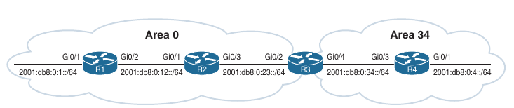
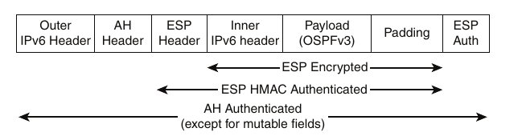
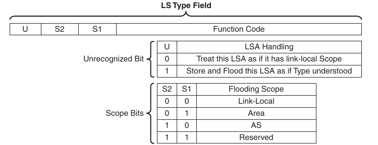

## OSPFv3

1. OSPFv3 Fundamentals

2. OSPFv3 Configuration

3. OSPFv3 LSA Flooding scope

- The Open Shortest Path First version 3 (OSPFv3) is the latest version of the OSPF protocol and includes support for both the IPv4 and IPv6 address families

- The OSPFv3 protocol is not backward compatible with OSPFv2, but the protocol mechanisms are essentially the same

### OSPFv3 Fundamentals

- OSPFv3 differs from OSPFv2 in several ways:

    - **Support for multiple address families**: OSPFv3 supports IPv4 and IPv6 address families

    - **New LSA types**: New LSA types have been created to carry IPv6 prefixes

    - **Removal of addressing semantics**: IP prefix information is no longer present in the OSPF packet headers. Instead it is carried as LSA payload information, making the protocol essentially address family independent, similar to Intermediate-System to Intermediate-System (IS-IS). OSPFv3 uses the term *link* instead of *network* because the shortest path first tree (SPF) calculations are per link instead of per subnet

    - **LSA Flooding**: OSPFv3 includes a new link-state type field that is used to determine the flooding scope of an LSA, as well as the handling of unknown LSA types

    - **Packet format**: OSPFv3 runs directly over IPv6, and the number of fields in the packet header has been reduced

    - **Router ID**: The router ID is used to identify the neighbors, regardless of the network type in OSPFv3

    - **Authentication**: Neighbor authentication has been removed from the OSPF protocol and is now performed through IPsec extension headers in the IPv6 packet

    - **Neighbor Adjacencies**: OSPFv3 inter-router communication is handled by IPv6 link-local addressing. Neighbors are not automatically detected over nonbroadcast multi-access (NBMA) interfaces. The neighbor must be manually specified using the link-local address. IPv6 allows multiple subnets to be assigned to a single interface, and OSPFv3 allows for neighbor adjacency to form even if the two routers do not share a common subnet

    - **Multiple instances**: An OSPFv3 packet includes an instance ID field that may be used to manipulate which routers on a network segment are allowed to form adjacencies

- RFC 5340 provides in-depth coverage of all the differences between OSPFv2 and OSPFv3

#### OSPFv3 Link-State Advertisement

- The OSPF Link State Database (LSDB) information is organized and advertised differently in version 3 than in version 2

- OSPFv3 modifies the structure of the router LSA (Type 1), uses the term inter-area prefix LSA instead of network summary LSA, and uses the term inter-area router LSA instead of Autonomous System Boundary Router (ASBR) summary LSA

- The principal difference is that the router LSA is only responsible for announcing interface parameters such as the interface type (point-to-point, broadcast, NBMA, point-to-multipoint and virtual links) and metric (cost)

- IP address information is advertised independently by two new LSA types:

    - Intra-area prefix LSA

    - Link-local LSA

- The OSPF Dijkstra's shortest path first (SPF) algorithm, used to to determine the SPT, only examines the router and network LSAs

- Advertising the IP prefix information using new LSA types eliminates the need for OSPF to perform full shortest path first (SPF) tree calculations every time a new IP address (prefix) is added or changed on an interface

- The OSPFv3 LSDB creates a shortest path topology tree based on links instead of networks

- Brief description of each OSPFv3 LSA type

```
LSA Type            Name                        Description

0x2001              Device                      Every router generates router LSAs that describe the the state and cost of the router's interfaces to the area

0x2002              Network                     A designated router generates network LSAs to announce all the routers attached to the link, including itself

0x2003              Inter-area prefix           Area border routers generate inter-area prefix LSAs to describe routes to IPv6 address prefixes that belong to
                                                other areas

0x2004              Inter-area router           Area border routers generate inter-area router LSAs to announce the addresses of autonomous system boundary
                                                routers in other areas

0x2005              AS-external                 Autonomous system boundary routers advertise AS-external LSAs to announce default routes or routes learned
                                                through redistribution from other routing protocols

0x2007              NSSA                        Autonomous system boundary routers that are located in a not-so-stubby area (NSSA) advertise NSSA LSAs for
                                                routes redistributed into the area

0x0008              Link                        The link LSA maps all the global unicast address prefixes associated with an interface to it's link-local
                                                interface address on the router. The link LSA is shared only between between neighbors on the same link

0x0009              Intra-area prefix           The intra-area prefix LSA is used to advertise one or more IPv6 prefixes that are associated with a router,
                                                stub, or transit network segment
```

#### OSPFv3 Communication

- OSPFv3 packets use protocol ID 89, and routers communicate with each other using the local interface's IPv6 link-local address as the source

- Depending on the packet type, the destination address is either a unicast link-local address or the multicast link-local scoped address

- **FF02::05**: OSPFv3 AllSPFRouters

- **FF02::06**: OSPFv3 AllDRouters

- Every router uses the AllSPFRouters multicast address FF02::5 to send OSPF hello messages to routers on the same link

- The hello messages are used for neighbor discovery and for detecing whether a neighbor relationship is down

- The designated router (DR) and backup designated router (BDR) also use this address to sent link-state update and flooding acknowledgement messages to all routers

- Non-DR/BDR routers send an update or link-state acknowledgement message to the DR and BDR using the AllDRouters address FF02::6

- OSPFv3 utilizes the same five packet types and logic as OSPFv2

- Below is displayed the name, address and purpose of each packet

- OSPFv3 packet types

```
Packet  Packet name             Source                  Destination                         Purpose

1       Hello                   Link-local address      FF02::5 (all routers)               Discover and maintain neighbors

                                Link-local address      Link-local address                  Initial adjacency forming, immediate hello

2       Database description    Link-local address      Link-local address                  Summarize database contents

3       Link-state request      Link-local address      Link-local address                  Database information request

4       Link-state update       Link-local address      Link-local address                  Initial adjacency forming, in response to link-state request

                                Link-local address      FF02::5 (all routers)               Database update
                                (from DR)

                                Link-local address      FF02::6 (DR/BDR)                    Database update
                                (from non-DR)

5       Link-state              Link-local address      Link-local address                  Initial adjacency forming, in response to link-state update
        acknowledgement

                                Link-local address      FF02::5 (all routers)               Flooding acknowledgement
                                (from DR)

                                Link-local address      FF02::6 (DR/BDR)                    Flooding acknowledgement
                                (from non-DR)
```

### OSPFv3 Configuration

- The process of configuring OSPFv3 involves the following steps:

    1. Initialize the OSPF process by enabling `ipv6 unicast-routing` on the router and then configuring OSPFv3 with the command `router ospfv3 <process-id>`

    2. Define the router ID (RID) by using the command `router-id <router-id>`. The router ID is a 32-bit value that does not need to match an IPv4 address. It may be any number, as long as the value is unique within the OSPF domain. OSPFv3 uses the same algorithm as OSPFv2 for dynamically locating the RID. If there are not any IPv4 interfaces available, the RID is set to 0.0.0.0 and does not allow adjacencies to form

    3. Initialize the address family within the routing process by using the command `address-family <ipv4/ipv6> unicast`. The appropriate address family is enabled automatically when OSPFv3 is enabled on an interface

    4. Use the interface command `ospfv3 <process-id> <ipv4/ipv6> area <area-id>` to enable the protocol and assign the interface to an area

- Below is a simple four router topology to demonstrate OSPFv3 configuration

- Area 0 consists of R1, R2 and R3, and Area 34 contains R3 and R4. R3 is the area border router (ABR)



- Below is provided the OSPFv3 and IPv6 address configurations for R1, R2, R3 and R4

- IPv6 link-local addressing is configured here so that each router's interface reflects it's local number (for example, R1's interfaces are set to fe80::1) in addition to traditional IPv6 addressing

- The link-local addressing is statically configured to assist with any diagnostics output

- R1:

```
router ospfv3 110
 router-id 192.168.1.1
 !
 address-family ipv6 unicast
  passive-interface GigabitEthernet0/0
 exit-address-family

interface Loopback0
 no ip address
 ipv6 address 2001:DB8::1/128
 ospfv3 110 ipv6 area 0

interface GigabitEthernet0/0
 no ip address
 duplex auto
 speed auto
 media-type rj45
 ipv6 address 2001:DB8:0:1::1/64
 ospfv3 110 ipv6 area 0

interface GigabitEthernet0/1
 no ip address
 duplex auto
 speed auto
 media-type rj45
 ipv6 address FE80::1 link-local
 ipv6 address 2001:DB8:0:12::1/64
 ospfv3 110 ipv6 area 0
```

- R2:

```
router ospfv3 110
 router-id 192.168.2.2
 !
 address-family ipv6 unicast
 exit-address-family

interface Loopback0
 no ip address
 ipv6 address 2001:DB8::2/128
 ospfv3 110 ipv6 area 0

interface GigabitEthernet0/0
 no ip address
 duplex auto
 speed auto
 media-type rj45
 ipv6 address FE80::2 link-local
 ipv6 address 2001:DB8:0:12::2/64
 ospfv3 110 ipv6 area 0

interface GigabitEthernet0/1
 no ip address
 duplex auto
 speed auto
 media-type rj45
 ipv6 address FE80::2 link-local
 ipv6 address 2001:DB8:0:23::2/64
 ospfv3 110 ipv6 area 0

```

- R3:

```
router ospfv3 110
 router-id 192.168.3.3
 !
 address-family ipv6 unicast
 exit-address-family

interface Loopback0
 no ip address
 ipv6 address 2001:DB8::3/128
 ospfv3 110 ipv6 area 0

interface GigabitEthernet0/0
 no ip address
 duplex auto
 speed auto
 media-type rj45
 ipv6 address FE80::3 link-local
 ipv6 address 2001:DB8:0:23::3/64
 ospfv3 110 ipv6 area 0

interface GigabitEthernet0/1
 no ip address
 duplex auto
 speed auto
 media-type rj45
 ipv6 address FE80::3 link-local
 ipv6 address 2001:DB8:0:34::3/64
 ospfv3 110 ipv6 area 34
```

- R4:

```
router ospfv3 110
 router-id 192.168.4.4
 !
 address-family ipv6 unicast
  passive-interface GigabitEthernet0/1
 exit-address-family

interface Loopback0
 no ip address
 ipv6 address 2001:DB8::4/128
 ospfv3 110 ipv6 area 34

interface GigabitEthernet0/0
 no ip address
 duplex auto
 speed auto
 media-type rj45
 ipv6 address FE80::4 link-local
 ipv6 address 2001:DB8:0:34::4/64
 ospfv3 110 ipv6 area 34

interface GigabitEthernet0/1
 no ip address
 duplex auto
 speed auto
 media-type rj45
 ipv6 address 2001:DB8:0:4::4/64
 ospfv3 110 ipv6 area 34
```

- Earlier versions of IOS used the commands `ipv6 router ospf` for initialization of the OSPF process and `ipv6 ospf <process-id> area <area-id>` for identification of the interface

- These commands are considered legacy

#### OSPFv3 Verification

- The commands for viewing OSPFv3 settings and statuses are very similar to those used with OSPFv2

- Verifying the OSPFv3 interfaces, neighborship, and the routing table are essential to supporting OSPFv3

- In essence, you replace `ip ospf` with `ospfv3` 

- For example, to view the neighbor adjacency for OSPFv2, you use the command `show ip ospf neighbor`, whereas you use the command `show ospfv3 ipv6 neighbor` for OSPFv3

- Below we can see the command executed on R3:

```
R3#sh ospfv3 ipv6 neighbor 

          OSPFv3 110 address-family ipv6 (router-id 192.168.3.3)

Neighbor ID     Pri   State           Dead Time   Interface ID    Interface
192.168.2.2       1   FULL/DR         00:00:35    3               GigabitEthernet0/0
192.168.4.4       1   FULL/BDR        00:00:31    2               GigabitEthernet0/1
```

- Below we can see the R1's G0/1 OSPFv3-enabled interface status with the command `show ospfv3 interface <interface-id>`

- Notice how address semantics are removed compared to OSPFv2

```
R1#show ospfv3 interface g0/1
GigabitEthernet0/1 is up, line protocol is up 
  Link Local Address FE80::1, Interface ID 3
  Area 0, Process ID 110, Instance ID 0, Router ID 192.168.1.1
  Network Type BROADCAST, Cost: 1
  Transmit Delay is 1 sec, State DR, Priority 1
  Designated Router (ID) 192.168.1.1, local address FE80::1
  Backup Designated router (ID) 192.168.2.2, local address FE80::2
  Timer intervals configured, Hello 10, Dead 40, Wait 40, Retransmit 5
    Hello due in 00:00:00
  Graceful restart helper support enabled
  Index 1/3/3, flood queue length 0
  Next 0x0(0)/0x0(0)/0x0(0)
  Last flood scan length is 0, maximum is 4
  Last flood scan time is 0 msec, maximum is 0 msec
  Neighbor Count is 1, Adjacent neighbor count is 1 
    Adjacent with neighbor 192.168.2.2  (Backup Designated Router)
  Suppress hello for 0 neighbor(s)
```

- The interface maps to the interface ID value 3 and not an IP address as in OSPFv2

- In addition, there are some helpful topology information describing the link

- The local router is the DR (192.168.1.1), and the adjacent neighbor router is the BDR (192.168.2.2)

- To see a brief version of the OSPFv3 interface settings, you use the command `show ospfv3 interface brief`

- The output of this command includes the associated process ID, area, address family (IPv4 or IPv6), interface state and the neighbor count

- Below is the command being executed on the ABR, R3

- Notice that some interfaces reside in Area 0, and others reside in Area 34

```
R3#show ospfv3 interface brief 
Interface    PID   Area            AF         Cost  State Nbrs F/C
Lo0          110   0               ipv6       1     LOOP  0/0
Gi0/0        110   0               ipv6       1     BDR   1/1
Gi0/1        110   34              ipv6       1     DR    1/1
```

- You can view the OSPFv3 IPv6 routing table by using the command `show ipv6 route ospf`

- Intra-area routes are indicated with O, and inter-area routes are indicated using OI

- In the example below, there is the command executed on R1

- The forwarding address for the routes is the link-local address of the neighboring router

```
R1#show ipv6 route ospf 
IPv6 Routing Table - default - 12 entries
Codes: C - Connected, L - Local, S - Static, U - Per-user Static route
       B - BGP, HA - Home Agent, MR - Mobile Router, R - RIP
       H - NHRP, I1 - ISIS L1, I2 - ISIS L2, IA - ISIS interarea
       IS - ISIS summary, D - EIGRP, EX - EIGRP external, NM - NEMO
       ND - ND Default, NDp - ND Prefix, DCE - Destination, NDr - Redirect
       RL - RPL, O - OSPF Intra, OI - OSPF Inter, OE1 - OSPF ext 1
       OE2 - OSPF ext 2, ON1 - OSPF NSSA ext 1, ON2 - OSPF NSSA ext 2
       la - LISP alt, lr - LISP site-registrations, ld - LISP dyn-eid
       lA - LISP away, a - Application
O   2001:DB8::2/128 [110/1]
     via FE80::2, GigabitEthernet0/1
O   2001:DB8::3/128 [110/2]
     via FE80::2, GigabitEthernet0/1
OI  2001:DB8::4/128 [110/3]
     via FE80::2, GigabitEthernet0/1
OI  2001:DB8:0:4::/64 [110/4]
     via FE80::2, GigabitEthernet0/1
O   2001:DB8:0:23::/64 [110/2]
     via FE80::2, GigabitEthernet0/1
OI  2001:DB8:0:34::/64 [110/3]
     via FE80::2, GigabitEthernet0/1
```

- Viewing the RIB:

```
R1#show ospfv3 ipv6 rib 

          OSPFv3 110 address-family ipv6 (router-id 192.168.1.1)

OSPF local RIB
Codes: * - Best, > - Installed in global RIB

*   2001:DB8::1/128, Intra, cost 0, area 0, Connected
      via Loopback0
*>  2001:DB8::2/128, Intra, cost 1, area 0
      via FE80::2, GigabitEthernet0/1
*>  2001:DB8::3/128, Intra, cost 2, area 0
      via FE80::2, GigabitEthernet0/1
*>  2001:DB8::4/128, Inter, cost 3, area 0
      via FE80::2, GigabitEthernet0/1
*   2001:DB8:0:1::/64, Intra, cost 1, area 0, Connected
      via GigabitEthernet0/0
*>  2001:DB8:0:4::/64, Inter, cost 4, area 0
      via FE80::2, GigabitEthernet0/1
*   2001:DB8:0:12::/64, Intra, cost 1, area 0, Connected
      via GigabitEthernet0/1
*>  2001:DB8:0:23::/64, Intra, cost 2, area 0
      via FE80::2, GigabitEthernet0/1
*>  2001:DB8:0:34::/64, Inter, cost 3, area 0
      via FE80::2, GigabitEthernet0/1
```

#### The Passive Interface

- OSPFv3 supports the ability to configure an interface as passive

- You configure an interface as being passive with the command `passive-interface <interface-id>` or globally with the `passive-interface default`;

- You make an interface as active with the command `no passive-interface <interface-id>`

- The command is placed under the OSPFv3 process or under the specific address family

- Placing the command under the global process cascades the setting to both address families

- Below is an example making the LAN interface on R1 explicitly passive and making all interfaces passive on R4 while making G0/0 the active interface

- R1:

```
conf t
 router opspfv3 110
  passive-interface g0/0
```

- R3:

```
conf t
 router ospfv3 110
  passive-interface default
  no passive-interface g0/0
```

- The active/passive state of an interface is verified by examining the OSPFv3 interface status using the command `show ospfv3 interface <interface-id>` and searching for the 'Passive' keyword

- Below we can see on R1 that G0/0 is a passive interface

```
R1#sh ospfv3 int g0/0 | i Passive
    No Hellos (Passive interface) 
```

#### IPv6 route summarization

- The ability to summarize IPv6 networks is as important as summarizing routes in IPv4; it may even be more important, due to hardware scalling limitations

- Below is the routing table on R4 before summarization is applied on R3

```
 exit-address-family
R4#sh ipv6 route ospf | b App
       lA - LISP away, a - Application
OI  2001:DB8::1/128 [110/3]
     via FE80::3, GigabitEthernet0/0
OI  2001:DB8::2/128 [110/2]
     via FE80::3, GigabitEthernet0/0
OI  2001:DB8::3/128 [110/1]
     via FE80::3, GigabitEthernet0/0
OI  2001:DB8:0:1::/64 [110/4]
     via FE80::3, GigabitEthernet0/0
OI  2001:DB8:0:12::/64 [110/3]
     via FE80::3, GigabitEthernet0/0
OI  2001:DB8:0:23::/64 [110/2]
     via FE80::3, GigabitEthernet0/0
```

- Summarizing the Area 0's loopback interfaces (2001:db8::1/128, 2001:db8::2/128, 2001:db8::3/128) removes three routes from the routing table

- Summarization of internal OSPFv3 routes follows the same rules as for OSPFv2 and must occur on the ABRs

- R3 summaarizes the three loopback addresses into 2001:db8:0:0/65

- Summarization commands reside under the address family in the OSPFv3 process\

- Summarization involves the command `area <id> range <prefix/prefix-length>`

- Below are shown R3's configuration for summarizing those prefixes:

```
conf t
 router ospfv3 110
  address-family ipv6
   area 0 range 2001:db8:0:0::/65
```

- Below is shown the IPv6 routing table on R4 after R3 is configured to summarize the Area 0 loopback interfaces

```
R4#sh ipv6 route ospf | b App
       lA - LISP away, a - Application
OI  2001:DB8::/65 [110/3]
     via FE80::3, GigabitEthernet0/0
OI  2001:DB8:0:1::/64 [110/4]
     via FE80::3, GigabitEthernet0/0
OI  2001:DB8:0:12::/64 [110/3]
     via FE80::3, GigabitEthernet0/0
OI  2001:DB8:0:23::/64 [110/2]
     via FE80::3, GigabitEthernet0/0
```

#### Network Type

- OSPFv3 supports the same OSPF network types as OSPFv2

- Below is shown that R2's G0/0 interface is set as a broadcast OSPF network type and is confirmed as being in the DR state

```
R2#show ospfv3 interface g0/0 | i Network
  Network Type BROADCAST, Cost: 1

R2#show ospfv3 interface b
Interface    PID   Area            AF         Cost  State Nbrs F/C
Lo0          110   0               ipv6       1     LOOP  0/0
Gi0/1        110   0               ipv6       1     BDR   1/1
Gi0/0        110   0               ipv6       1     DR    1/1
```

- You change OSPFv3 network type by using the interface parameter command `ospfv3 network <point-to-point | point-to-multipoint| broadcast | nonbroadcast>`

- Below we can see how the interfaces associated with 2001:db8:0:23::/64 being changed to point-to-point

- R2:

```
conf t
 interface g0/1
  ospfv3 network point-to-point
```

- R3:

```
conf t
 interface g0/0
  ospfv3 network point-to-point
```

- Below is shown how to verify the new settings

- The network is now point-to-point and the interface state is indicated as P2P for confirmation

```
R2(config-if)#do sh ospfv3 int g0/1 | i Net
  Network Type POINT_TO_POINT, Cost: 1

R2(config-if)#do sh ospfv3 int br
Interface    PID   Area            AF         Cost  State Nbrs F/C
Lo0          110   0               ipv6       1     LOOP  0/0
Gi0/1        110   0               ipv6       1     P2P   1/1
Gi0/0        110   0               ipv6       1     DR    1/1
```

#### OSPFv3 authentication

- OSPFv3 does not support neighbor authentication within the protocol itself

- Instead, the routing protocol utilizes IP security (IPsec) to provide authentication

- IPv6 Authentication Header (AH) or Encapsulating Security Payload (ESP) extension headers may be added to the OSPF packets to provide authentication, integrity, and confidentiality:

    - **Authentication Header (AH)**: Provide authentication

    - **Encapsulating Security Payload (ESP)**: Provides authentication and encryption

- Below is shown the IPv6 packet format



- OSPFv3 authentication supports IPsec AH authentication using the command `ospfv3 authentication` or ESP authentication and encryption with the command `ospfv3 encryption`

- The configuration may be applied to an interface, a virtual link, or an entire area

- Area authentication requires that every router in the area perform IPsec authentication in order to form neighbor adjacencies

- Interface-level authentication settings preempt area-level settings

- Unlike an IPSec VPN tunnel, OSPFv3 neighbor authentication does not perform Internet Key Exchange (IKE) to negotiate the IPsec security association (SA) values

- Therefore, the IPSec Security Parameter Index (SPI) hash algorithm and key must be manually defined when configuring OSPFv3 authentication

- IPsec peers cannot reuse the same SPI values

- The command `show crypto ipsec sa | in spi` may be used to determine the active IPsec sessions and curently used SPI values

- The full interface command `ospfv3 encryption {ipsec spi <spi> esp <encryption-algor> <key-encryption-type> <key> authentication-algorithm <key-encryption-type> <key> | null}` encrypts and authenticates the OSPFv3 in IOS using ESP

- The keyword `null` disables OSPFv3 packet payload encryption and only enables ESP header authentication

- Below is demonstrated how to configure encryption and authentication for OSPFv3 packets using ESP

- The following fabricated values are included in the configuration to establish the IPsec session:

    - **Security Policy Index**: 500

    - **Encryption Algorithm**: 3des

    - **Encryption Key**: 012345678901234567890123456789012345678901234567

    - **Authentication algorithm**: sha1

    - **Authentication Key**: 0123456789012345678901234567890123456789

- The fabricated authentication and encryption key values are used for demonstration purposes 

- A real deployment should not use such predictable values

- R1:

```
conf t
 interface g0/1
  ospfv3 encryption ipsec spi 500 esp 3des 012345678901234567890123456789012345678901234567 sha1 0123456789012345678901234567890123456789
```

- R2:

```
conf t
 interface g0/0
  ospfv3 encryption ipsec spi 500 esp 3des 012345678901234567890123456789012345678901234567 sha1 0123456789012345678901234567890123456789
```

- Configuring IPsec with AH between R2 and R3 interfaces:

- R2:

```
conf t
 interface g0/1
  ospfv3 authentication ipsec spi 512 sha1 0123456789012345678901234567890123456789
```

- R3:

```
conf t
 interface g0/0
  ospfv3 authentication ipsec spi 512 sha1 0123456789012345678901234567890123456789
```

- After enabling authentication and/or encryption on routers, a syslog message pops up, confirming that ISAKMP is ON

```
R3(config-if)#d
*Oct 24 19:31:48.689: %CRYPTO-6-ISAKMP_ON_OFF: ISAKMP is ON
R3(config-if)#do wr
*Oct 24 19:31:49.688: %LINEPROTO-5-UPDOWN: Line protocol on Interface NVI0, changed state to up
R3(config-if)#do wr
Building configuration...
[OK]
R3(config-if)#
*Oct 24 19:31:51.215: %OSPFv3-5-ADJCHG: Process 110, IPv6, Nbr 192.168.2.2 on GigabitEthernet0/0 from LOADING to FULL, Loading Done
```

- Below is demonstrated how to configure area authentication and encryption using the same IPsec settings

- R3:

```
conf t
 router ospf 110
  area 34 encryption ipsec spi 500 esp 3des 012345678901234567890123456789012345678901234567 sha1 0123456789012345678901234567890123456789
```

- R4:

```
conf t
 router ospf 110
  area 34 encryption ipsec spi 500 esp 3des 012345678901234567890123456789012345678901234567 sha1 0123456789012345678901234567890123456789
```

- R4 after enabling IPsec authentication:

```
R4(config)#router ospfv3 110
R4(config-router)#$901234567 sha1 0123456789012345678901234567890123456789   
R4(config-router)#
R4(config-router)#
R4(config-router)#do wr
*Oct 24 19:39:59.894: %CRYPTO-6-ISAKMP_ON_OFF: ISAKMP is ON
R4(config-router)#do wr
Building configuration...
[OK]
*Oct 24 19:40:00.893: %LINEPROTO-5-UPDOWN: Line protocol on Interface NVI0, changed state to up
R4(config-router)#
*Oct 24 19:40:02.509: %GRUB-5-CONFIG_WRITING: GRUB configuration is being updated on disk. Please wait...
*Oct 24 19:40:03.187: %GRUB-5-CONFIG_WRITTEN: GRUB configuration was written to disk successfully.
R4(config-router)#
*Oct 24 19:40:05.482: %OSPFv3-5-ADJCHG: Process 110, IPv6, Nbr 192.168.3.3 on GigabitEthernet0/0 from LOADING to FULL, Loading Done
R4(config-router)#do sh run | s router ospfv3
router ospfv3 110
 router-id 192.168.4.4
 area 34 encryption ipsec spi 500 esp 3des 012345678901234567890123456789012345678901234567 sha1 0123456789012345678901234567890123456789
 !
 address-family ipv6 unicast
  passive-interface GigabitEthernet0/1
 exit-address-family
R4(config-router)#
R4(config-router)#
```

- Below is shown the output of the command `show ospfv3 interface <interface-id>` 

- This `show` command can be used to verify that authentication and encryption are anabled on the interface and that a secure connection has formed with the neighbor

```
R1#show ospfv3 interface g0/1
GigabitEthernet0/1 is up, line protocol is up 
  Link Local Address FE80::1, Interface ID 3
  Area 0, Process ID 110, Instance ID 0, Router ID 192.168.1.1
  Network Type BROADCAST, Cost: 1
  3DES encryption SHA-1 auth SPI 500, secure socket UP (errors: 0)
  Transmit Delay is 1 sec, State BDR, Priority 1
  Designated Router (ID) 192.168.2.2, local address FE80::2
  Backup Designated router (ID) 192.168.1.1, local address FE80::1
  Timer intervals configured, Hello 10, Dead 40, Wait 40, Retransmit 5
    Hello due in 00:00:07
  Graceful restart helper support enabled
  Index 1/3/3, flood queue length 0
  Next 0x0(0)/0x0(0)/0x0(0)
  Last flood scan length is 2, maximum is 3
  Last flood scan time is 0 msec, maximum is 0 msec
  Neighbor Count is 1, Adjacent neighbor count is 1 
    Adjacent with neighbor 192.168.2.2  (Designated Router)
  Suppress hello for 0 neighbor(s)
```

- The output when only authentication is used

```
R2#show ospfv3 int g0/1
GigabitEthernet0/1 is up, line protocol is up 
  Link Local Address FE80::2, Interface ID 3
  Area 0, Process ID 110, Instance ID 0, Router ID 192.168.2.2
  Network Type POINT_TO_POINT, Cost: 1
  SHA-1 authentication SPI 512, secure socket UP (errors: 0)
  Transmit Delay is 1 sec, State POINT_TO_POINT
  Timer intervals configured, Hello 10, Dead 40, Wait 40, Retransmit 5
    Hello due in 00:00:06
  Graceful restart helper support enabled
  Index 1/3/3, flood queue length 0
  Next 0x0(0)/0x0(0)/0x0(0)
  Last flood scan length is 1, maximum is 5
  Last flood scan time is 0 msec, maximum is 0 msec
  Neighbor Count is 1, Adjacent neighbor count is 1 
    Adjacent with neighbor 192.168.3.3
  Suppress hello for 0 neighbor(s)
```

- The output when the authentication and encryption is enabled for the area

```
R3#show ospfv3 int g0/1
GigabitEthernet0/1 is up, line protocol is up 
  Link Local Address FE80::3, Interface ID 3
  Area 34, Process ID 110, Instance ID 0, Router ID 192.168.3.3
  Network Type BROADCAST, Cost: 1
  3DES encryption SHA-1 auth (Area) SPI 500, secure socket UP (errors: 0)
  Transmit Delay is 1 sec, State BDR, Priority 1
  Designated Router (ID) 192.168.4.4, local address FE80::4
  Backup Designated router (ID) 192.168.3.3, local address FE80::3
  Timer intervals configured, Hello 10, Dead 40, Wait 40, Retransmit 5
    Hello due in 00:00:00
  Graceful restart helper support enabled
  Index 1/1/3, flood queue length 0
  Next 0x0(0)/0x0(0)/0x0(0)
  Last flood scan length is 4, maximum is 8
  Last flood scan time is 0 msec, maximum is 0 msec
  Neighbor Count is 1, Adjacent neighbor count is 1 
    Adjacent with neighbor 192.168.4.4  (Designated Router)
  Suppress hello for 0 neighbor(s)
```

#### OSPFv3 Link-local Forwarding

- Significant changes have occured in how OSPF builds the area topology between OSPFv2 and OSPFv3

- With OSPFv2, the interface's network addresses are used to build the adjacency and link devices

- The OSPFv3 LSDB creates a shortest path topology tree based on links instead of networks

- This means that transit links only require IPv6 link-local addresses for forwarding traffic

- Therefore, the global IPv6 unicast addresses can be removed from the transit links between R1 and R4 from the sample topology, and R4 can still communicate R1's 2001:db8:0:1::/64 network

- Below, the global unicast addresses from the transit links on R1, R2 and R3

- R1:

```
R1(config)#int g0/1
R1(config-if)#no ipv6 address 2001:DB8:0:12::1/64
```

- R2:

```
R2(config)#int g0/0 
R2(config-if)#no ipv6 address 2001:DB8:0:12::2/64

R2(config-if)#int g0/1
R2(config-if)#no ipv6 address 2001:DB8:0:23::2/64
```

- R3:

```
R3(config)#
R3(config)#int g0/0
R3(config-if)#no ipv6 address 2001:DB8:0:23::3/64
R3(config-if)#int g0/1
R3(config-if)#no ipv6 address 2001:DB8:0:34::3/64
```

- Below are shown the OSPFv3 learned routes from R4's perspective

- Notice that the transit networks no longer appear

- The loopback interfaces of R1, R2 and R3 still exists, along with R1's LAN interface 2001:db8:0:1::/64

```
R4#show ipv6 route ospf | b App
       lA - LISP away, a - Application
OI  2001:DB8::1/128 [110/3]
     via FE80::3, GigabitEthernet0/0
OI  2001:DB8::2/128 [110/2]
     via FE80::3, GigabitEthernet0/0
OI  2001:DB8::3/128 [110/1]
     via FE80::3, GigabitEthernet0/0
OI  2001:DB8:0:1::/64 [110/4]
     via FE80::3, GigabitEthernet0/0
```

- R4 still maintains full connectivity to those networks because the topology is build using the IPv6 link-local addresses

- As long as the source and destination devices have routes to each other, communication can still exist

- Below we can see that R4 still maintains connectivity to R1's LAN interface (The scenario is shown to demonstrate the underlying mechanisms and is not a design suggestion)

```
R4#ping 2001:DB8:0:1::1            
Type escape sequence to abort.
Sending 5, 100-byte ICMP Echos to 2001:DB8:0:1::1, timeout is 2 seconds:
!!!!!
Success rate is 100 percent (5/5), round-trip min/avg/max = 1/1/1 ms

R4#ping 2001:DB8:0:1::1 source g0/1
Type escape sequence to abort.
Sending 5, 100-byte ICMP Echos to 2001:DB8:0:1::1, timeout is 2 seconds:
Packet sent with a source address of 2001:DB8:0:4::4
!!!!!
Success rate is 100 percent (5/5), round-trip min/avg/max = 1/1/1 ms
```

### OSPFv3 LSA Flooding Scope

- There are two LSA flooding scopes in OSPFv2: area and autonomous system

- OSPFv3 allows for three flooding scopes:

    - **Link-local scope**: Limited to the local link

    - **Area scope**: Contains LSA flooding to the local area

    - **Autonomous system scope**: Floods LSAs throughout the entire OSPF routing domain

- The LS type field in OSPFv3 has been modified from 8 bits to 16 bits

- Below is shown the new LS Type Field format

- The 3 high-order bits of the new LS type field allows for the encoding of flood information

- The first bit, U (unrecognized), indicates how a router should handle an LSA if it is unrecognized

- The second and third bits, both S (scope) bits, indicate how LSA should be flooded

- The remaining bits of the link-state field indicate the function code of the LSA

- For example, a function code of 1 maps to the router LSA, which matches the original OSPFv2 LS Type value 1



- Below are all eight OSPFv3 LSA types and flooding scopes

```
Function code           LS Type             LSA Name                    Flooding scope

1                       0x2001              Device-LSA                  Area

2                       0x2002              Network-LSA                 Area

3                       0x2003              Inter-Area-Prefix-LSA       Area

4                       0x2004              Inter-Area-Router-LSA       Area

5                       0x2005              AS-External-LSA             Autonomous System

7                       0x2007              NSSA-LSA                    Area

8                       0x2008              Link-LSA                    Link-local

9                       0x2009              Intra-Area-Prefix-LSA       Area
```

- The router LSA describes the router's interface state and cost

- Below is shown the output of the command `show ospfv3 database router <self-originate| adv-router RID>`

- The option `self-originate` keyword filters the LSAs to those created by the router on which the command is executed

- The `adv-router <RID>` keyword allows for selection of the LSAs for a specific router's LSAs that exist in the local router's LSDB

- R1 is advertising a router LSA for the local G0/1 interface (interface ID 3) with a cost of 1

- R1 is the designated router for the segment so it populates it's own RID in the LSA

```
R1#show ospfv3 database router self-originate      

          OSPFv3 110 address-family ipv4 (router-id 192.168.1.1)

                Router Link States (Area 0)

  LS age: 1155
  Options: (E-Bit, R-Bit, DC-Bit, AF-Bit)
  LS Type: Router Links
  Link State ID: 0
  Advertising Router: 192.168.1.1
  LS Seq Number: 80000003
  Checksum: 0x29F5
  Length: 40
  Number of Links: 1

    Link connected to: a Transit Network
      Link Metric: 1
      Local Interface ID: 3
      Neighbor (DR) Interface ID: 2
      Neighbor (DR) Router ID: 192.168.2.2


          OSPFv3 110 address-family ipv6 (router-id 192.168.1.1)

                Router Link States (Area 0)

  LS age: 1155
  Options: (V6-Bit, E-Bit, R-Bit, DC-Bit)
  LS Type: Router Links
  Link State ID: 0
  Advertising Router: 192.168.1.1
  LS Seq Number: 80000004
  Checksum: 0x28F5
  Length: 40
  Number of Links: 1

    Link connected to: a Transit Network
      Link Metric: 1
      Local Interface ID: 3
      Neighbor (DR) Interface ID: 2
      Neighbor (DR) Router ID: 192.168.2.2
```

- As this interface has both IPv4 and IPv6 for OSPF on the interface, the output shows both address families

- To limit the output to a specific address family:

```
R1#show ospfv3 ipv6 database router self-originate 

          OSPFv3 110 address-family ipv6 (router-id 192.168.1.1)

                Router Link States (Area 0)

  LS age: 1238
  Options: (V6-Bit, E-Bit, R-Bit, DC-Bit)
  LS Type: Router Links
  Link State ID: 0
  Advertising Router: 192.168.1.1
  LS Seq Number: 80000004
  Checksum: 0x28F5
  Length: 40
  Number of Links: 1

    Link connected to: a Transit Network
      Link Metric: 1
      Local Interface ID: 3
      Neighbor (DR) Interface ID: 2
      Neighbor (DR) Router ID: 192.168.2.2
```

- The OSPFv3 LSAs include an Options field that describes the router's capabilities

- Below are described the various service options

```
Option                  Description

V6                      The V6 bit indicates that the router participates in IPv6 routing

E                       The E bit indicates that the router is capable of processing external LSAs. A router in a stubby area sets the E bit to clear (0)
                        Neighboring routers do not form adjacencies if they have mismatched E bit settings

R                       The R bit indicates that the router actively participates in forwarding traffic. The R bit is set to clear(0) indicates that
                        the router is not used as a transit router for forwarding traffic but is still capable of exchanging route information

DC                      The DC bit is set to indicate that the router is capable of supressing future hellos from being sent over an interface
                        The interface must be configured as a demand circuit for hello suppression to occur (demand circuits are typically used on costly low-bandwidth legacy ISDN BRI circuits or virtual links (probably))

MC                      The MC bit indicates that the router is capable of multicast extensions for OSPF (MOSPF). This bit is not used and listed only for
                        reference. In 2008, RFC5340 deprecated MOSPF along with the Group-Membership-LSA

N                       The N bit indicates that the router supports Type 7 LSAs (NSSA area). Neighboring routers do not form an adjacency if they have
                        mismatched N bit settings
```

- Below is shown of R3's router LSAs in the LSDB of R1

- The bits indicate the functionality the router can perform in each area

```
R1#show ipv6 ospf database router adv-router 3.3.3.3

            OSPFv3 Router with ID (1.1.1.1) (Process ID 110)

                Router Link States (Area 0)

  Routing Bit Set on this LSA
  LS age: 1627
  Options: (V6-Bit, E-Bit, R-Bit, DC-Bit)
  LS Type: Router Links
  Link State ID: 0
  Advertising Router: 3.3.3.3
  LS Seq Number: 80000006
  Checksum: 0xC8DD
  Length: 56
  Area Border Router
  Number of Links: 2

    Link connected to: a Virtual Link
      Link Metric: 1
      Local Interface ID: 10
      Neighbor Interface ID: 7
      Neighbor Router ID: 4.4.4.4

    Link connected to: a Transit Network
      Link Metric: 1
      Local Interface ID: 2
      Neighbor (DR) Interface ID: 2
      Neighbor (DR) Router ID: 3.3.3.3

```

- The network LSA describes the known routers on the broadcast interface G0/0, interface ID 2 on R2

- Below is shown the output of `show ospfv3 database network self-originate`, which indicates that there are two routers present for the network: R1 (192.168.1.1) and R2 (192.168.2.2)

```
R2#show ospfv3 ipv6 database network self-originate 

          OSPFv3 110 address-family ipv6 (router-id 192.168.2.2)

                Net Link States (Area 0)

  LS age: 436
  Options: (V6-Bit, E-Bit, R-Bit, DC-Bit)
  LS Type: Network Links
  Link State ID: 2 (Interface ID of Designated Router)
  Advertising Router: 192.168.2.2
  LS Seq Number: 80000001
  Checksum: 0xB20E
  Length: 32
        Attached Router: 192.168.2.2
        Attached Router: 192.168.1.1
```

- The link LSA is responsible for providing details about IPv6 prefixes associated with an interface

- Below is shown the output of `show ospfv3 database link [self-originate]` 

- Notice that the prefix 2001:db8:0:12::/64 is associated with interface G0/1 (interface ID 3) and can be reached using the link-local address fe80::1, and that the prefix 2001:db8:0:1::/64 is associated with G0/0 (interface ID 2)


```
R1#show ospfv3 ipv6 database link self-originate 

          OSPFv3 110 address-family ipv6 (router-id 192.168.1.1)

                Link (Type-8) Link States (Area 0)

  LS age: 964
  Options: (V6-Bit, E-Bit, R-Bit, DC-Bit)
  LS Type: Link-LSA (Interface: GigabitEthernet0/1)
  Link State ID: 3 (Interface ID)
  Advertising Router: 192.168.1.1
  LS Seq Number: 80000002
  Checksum: 0x5689
  Length: 56
  Router Priority: 1
  Link Local Address: FE80::1
  Number of Prefixes: 1
  Prefix Address: 2001:DB8:0:12::
  Prefix Length: 64, Options: None

  LS age: 964
  Options: (V6-Bit, E-Bit, R-Bit, DC-Bit)
  LS Type: Link-LSA (Interface: GigabitEthernet0/0)
  Link State ID: 2 (Interface ID)
  Advertising Router: 192.168.1.1
  LS Seq Number: 80000002
  Checksum: 0x7782
  Length: 56
  Router Priority: 1
  Link Local Address: FE80::5054:FF:FE1B:50E9
  Number of Prefixes: 1
  Prefix Address: 2001:DB8:0:1::
  Prefix Length: 64, Options: None
```

- R3 has backbone connectivity and is the local ABR for Area 34 in the network topology in our example

- As an ABR, it is responsible for advertising inter-area prefix LSAs that describe routes that belong to other areas in the OSPF domain

- The command `show ospfv3 database` display the router's summary view of OSPFv3 database

- Below is shown R3's database

- Notice that R3's router LSA is set to B, indicating that this is an ABR router

- The advertising RID for all the inter-area prefix LSAs originates from 192.168.3.3 (R3)

```
R3#show ospfv3 database 

          OSPFv3 110 address-family ipv6 (router-id 192.168.3.3)

                Router Link States (Area 0)

ADV Router       Age         Seq#        Fragment ID  Link count  Bits
 192.168.1.1     1690        0x80000004  0            1           None
 192.168.2.2     1686        0x80000006  0            2           None
 192.168.3.3     1735        0x80000002  0            1           B

                Net Link States (Area 0)

ADV Router       Age         Seq#        Link ID    Rtr count
 192.168.2.2     1691        0x80000001  2          2

                Inter Area Prefix Link States (Area 0)

ADV Router       Age         Seq#        Prefix
 192.168.3.3     1729        0x80000001  2001:DB8:0:34::/64
 192.168.3.3     1684        0x80000001  2001:DB8::4/128
 192.168.3.3     1684        0x80000001  2001:DB8:0:4::/64

                Link (Type-8) Link States (Area 0)
          
ADV Router       Age         Seq#        Link ID    Interface
 192.168.2.2     1740        0x80000002  3          Gi0/0
 192.168.3.3     1734        0x80000002  2          Gi0/0

                Intra Area Prefix Link States (Area 0)

ADV Router       Age         Seq#        Link ID    Ref-lstype  Ref-LSID
 192.168.1.1     1691        0x80000003  0          0x2001      0
 192.168.2.2     1691        0x80000003  0          0x2001      0
 192.168.2.2     1691        0x80000001  2048       0x2002      2
 192.168.3.3     1735        0x80000002  0          0x2001      0

                Router Link States (Area 34)

ADV Router       Age         Seq#        Fragment ID  Link count  Bits
 192.168.3.3     1678        0x80000004  0            1           B
 192.168.4.4     1674        0x80000004  0            1           None

                Net Link States (Area 34)

ADV Router       Age         Seq#        Link ID    Rtr count
 192.168.4.4     1687        0x80000001  2          2
          
                Inter Area Prefix Link States (Area 34)

ADV Router       Age         Seq#        Prefix
 192.168.3.3     1739        0x80000001  2001:DB8::3/128
 192.168.3.3     1729        0x80000001  2001:DB8::2/128
 192.168.3.3     1729        0x80000001  2001:DB8:0:23::/64
 192.168.3.3     1729        0x80000001  2001:DB8:0:12::/64
 192.168.3.3     1684        0x80000001  2001:DB8::1/128
 192.168.3.3     1684        0x80000001  2001:DB8:0:1::/64

                Link (Type-8) Link States (Area 34)

ADV Router       Age         Seq#        Link ID    Interface
 192.168.3.3     1734        0x80000002  3          Gi0/1
 192.168.4.4     1722        0x80000002  2          Gi0/1

                Intra Area Prefix Link States (Area 34)

ADV Router       Age         Seq#        Link ID    Ref-lstype  Ref-LSID
 192.168.4.4     1687        0x80000003  0          0x2001      0
 192.168.4.4     1687        0x80000001  2048       0x2002      2
```
