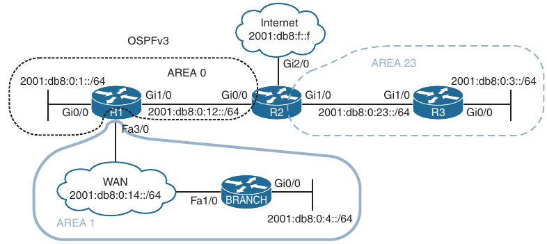
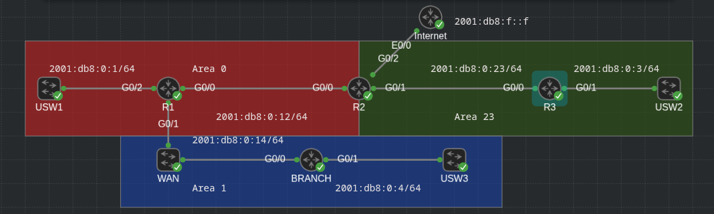
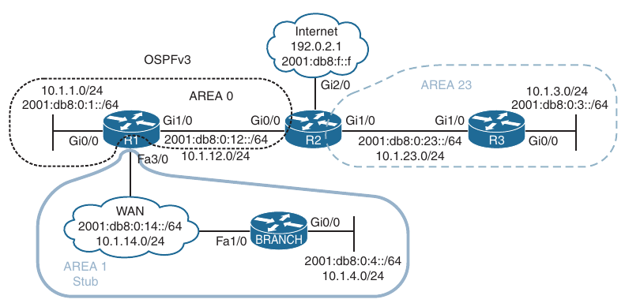
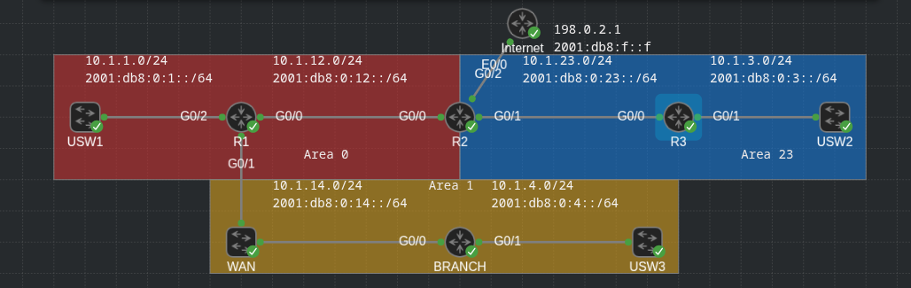
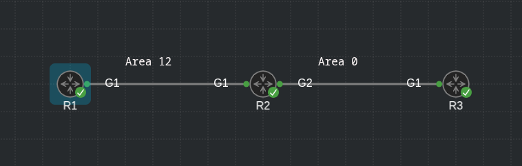
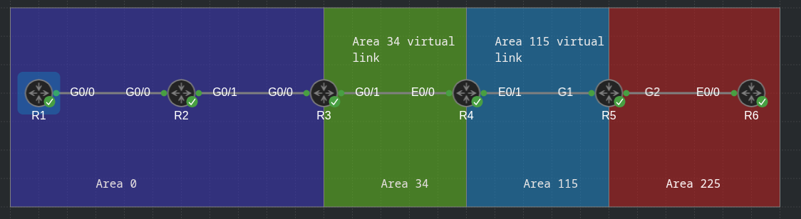
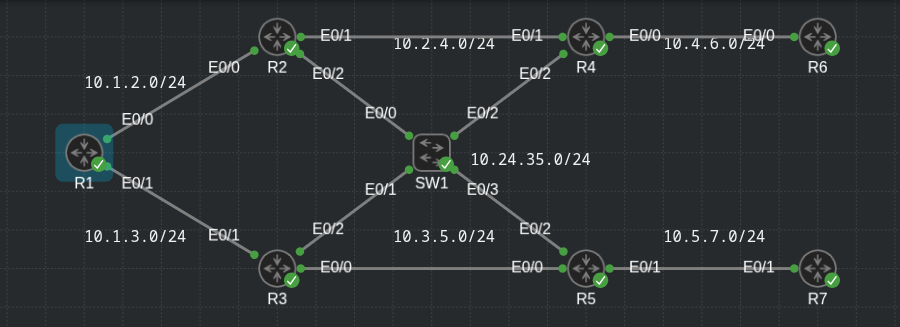

## Troubleshooting OSPFv3

1. Troubleshooting OSPFv3 for IPv6

2. OSPFv3 trouble tickets

3. Troubleshooting OSPFv3 Address Families

4. OSPFv3 AF trouble tickets

- The Open Shortest Path First version 3 (OSPFv3) dynamic routing protocol is a link-state routing protocol that uses *Dijkstra's shortest path first (SPF) algorithm*. It is an extremely scalable routing protocol because of it's hierarchical design. OSPFv3 is designed for routing IPv6 neighbors

- Troubleshooting OSPFv3 using classic configurations and also using the OSPF address family configurations

- Before any routes can be exchanged between OSPFv3 routers on the same LAN or across a WAN, an OSPFv3 neighbor relationship must be formed

- Neighbor relationships may fail to form for many reasons, and as a troubleshooter you need to be aware of them

- Focus on the OSPFv3 show commands that can be used for troubleshooting, and examples of them in various trouble tickets

- After neighbor relationships are formed, neighboring routers exchange OSPF link-state advertisements (LSAs), which contain information about routes

- In some cases, routes may end up missing, and you need to be able to determine why the routes are missing

- Focus on the OSPFv3 commands that that can be used to troubleshoot missing OSPFv3 routes in certain scenarios

### Troubleshooting OSPFv3 for IPv6

- Because OSPFv3 is based on OSPFv2, it presents similar issues when it comes to troubleshooting, with a few minor differences based on IPv6

- This should come as a relief, as it means you do not have to learn a huge amount of new information for OSPFv3

- However, you do need to know the `show` commands that display the information you need to troubleshoot any given OSPFv3 related issue

- We will see the `show` commands that you can use to troubleshoot OSPFv3 neighbor adjacency issues and route issues

#### OSPFv3 troubleshooting Commands

- You use the `show ipv6 protocols` command, to verify which IPv6 routing protocols are running on a device

- Specifically with OSPFv3, you can verify the Process ID (PID), the Router ID (RID), the type of router - area border router (ABR) or autonomous system boundary router (ASBR) - the number of areas the router is a member of, whether any of the areas are stub areas or NSSAs (not-so-stubby areas), the interfaces participating in the routing process and the area they belong to, and whether redistribution is occuring

```
R3#show ipv6 protocols 
IPv6 Routing Protocol is "connected"
IPv6 Routing Protocol is "application"
IPv6 Routing Protocol is "ND"
IPv6 Routing Protocol is "ospf 110"
  Router ID 192.168.3.3
  Area border router
  Number of areas: 2 normal, 0 stub, 0 nssa
  Interfaces (Area 0):
    Loopback0
    GigabitEthernet0/0
  Interfaces (Area 34):
    GigabitEthernet0/1
  Redistribution:
    None
```

- You can use the `show ipv6 ospf` command to display global OSPFv3 settings 

- For example, you can verify the OSPFv3 PID, the RID, the type of router (ABR or ASBR), various timers and statistics, the number of areas on the routers and the type of area (normal, stub or NSSA), the reference bandwidth, and the parameters related to the different areas configured on the router (for example, whether area authentication is enabled, whether the area is a stub area, a totally stubby area, an NSSA, or a totally NSSA)

```
R3#show ipv6 ospf
 Routing Process "ospfv3 110" with ID 192.168.3.3
 Supports NSSA (compatible with RFC 3101)
 Supports Database Exchange Summary List Optimization (RFC 5243)
 Event-log enabled, Maximum number of events: 1000, Mode: cyclic
 It is an area border router
 Router is not originating router-LSAs with maximum metric
 Initial SPF schedule delay 5000 msecs
 Minimum hold time between two consecutive SPFs 10000 msecs
 Maximum wait time between two consecutive SPFs 10000 msecs
 Minimum LSA interval 5 secs
 Minimum LSA arrival 1000 msecs
 LSA group pacing timer 240 secs
 Interface flood pacing timer 33 msecs
 Retransmission pacing timer 66 msecs
 Retransmission limit dc 24 non-dc 24
 EXCHANGE/LOADING adjacency limit: initial 300, process maximum 300
 Number of external LSA 0. Checksum Sum 0x000000
 Number of areas in this router is 2. 2 normal 0 stub 0 nssa
 Graceful restart helper support enabled
 Reference bandwidth unit is 100 mbps
 RFC1583 compatibility enabled
    Area BACKBONE(0)
        Number of interfaces in this area is 2
        SPF algorithm executed 5 times
        Number of LSA 13. Checksum Sum 0x066210
        Number of DCbitless LSA 0
        Number of indication LSA 0
        Number of DoNotAge LSA 0
        Flood list length 0
    Area 34
        Number of interfaces in this area is 1
        It is a stub area, no summary LSA in this area
        Generates stub default route with cost 1
        3DES Encryption SHA-1 Auth, SPI 500
        SPF algorithm executed 10 times
        Number of LSA 9. Checksum Sum 0x04DF9C
        Number of DCbitless LSA 0
        Number of indication LSA 0
        Number of DoNotAge LSA 0
        Flood list length 0

```

- The command `show ipv6 interface brief`, enables you to verify which interfaces are participating in the OSPFv3 process 

- You can also identify the PID they are attached to, the area they are participating in, the IPv6 interface ID used to represent the interface, the cost of the interface (which by default is based on the reference bandwidth divided by the interface bandwidth), the DR and BDR (designated router/backup designated router) state, and whether there are any neighbor adjacencies established out the interface

- Notice that R3 has interfaces in Area 0 and Area 34; therefore, it is an ABR

```
R3#show ipv6 ospf int br
Interface    PID   Area            Intf ID    Cost  State Nbrs F/C
Lo0          110   0               9          1     LOOP  0/0
Gi0/0        110   0               2          1     P2P   1/1
Gi0/1        110   34              3          1     BDR   1/1
```

- With the `show ipv6 ospf interface <type/number>` command, you can obtain detailed information about the interfaces participating in the OSPF process 

- The unique information that will draw you to this command for troubleshooting includes the network type, the cost, whether authentication is enabled on the interface, the current DR/BDR state, the interface priority, the DR and BDR IDs, and the timers (hello and dead)

```
R3#show ipv6 ospf interface g0/1
GigabitEthernet0/1 is up, line protocol is up 
  Link Local Address FE80::3, Interface ID 3
  Area 34, Process ID 110, Instance ID 0, Router ID 192.168.3.3
  Network Type BROADCAST, Cost: 1
  3DES encryption SHA-1 auth (Area) SPI 500, secure socket UP (errors: 0)
  Transmit Delay is 1 sec, State BDR, Priority 1
  Designated Router (ID) 192.168.4.4, local address FE80::4
  Backup Designated router (ID) 192.168.3.3, local address FE80::3
  Timer intervals configured, Hello 10, Dead 40, Wait 40, Retransmit 5
    Hello due in 00:00:02
  Graceful restart helper support enabled
  Index 1/1/3, flood queue length 0
  Next 0x0(0)/0x0(0)/0x0(0)
  Last flood scan length is 1, maximum is 2
  Last flood scan time is 0 msec, maximum is 0 msec
  Neighbor Count is 1, Adjacent neighbor count is 1 
    Adjacent with neighbor 192.168.4.4  (Designated Router)
  Suppress hello for 0 neighbor(s)
```

- The `show ipv6 ospf neighbor` command enables you to verify what routers successfully formed neighbor adjacencies with the local router

- You can verify a neighbor by it's RID, which is displayed in the Neighbor ID column, the priority of the neighbor's interface used to form the neighbor adjacency, the state of the neighbor's interface, the dead timer, the IPv6 interface ID, of the neighboring device, and the local interface used to form the adjacency

```
R3#show ipv6 ospf neighbor 

            OSPFv3 Router with ID (192.168.3.3) (Process ID 110)

Neighbor ID     Pri   State           Dead Time   Interface ID    Interface
192.168.2.2       0   FULL/  -        00:00:38    3               GigabitEthernet0/0
192.168.4.4       1   FULL/DR         00:00:36    2               GigabitEthernet0/1
```

- To verify the LSAs that were collected and placed in the link-state database (LSDB), you use the `show ipv6 ospf database` command as shown below

- In this example, R3 has information for Area 0 and Area 34 because it is an ABR

```
R3#show ipv6 ospf database 

            OSPFv3 Router with ID (192.168.3.3) (Process ID 110)

                Router Link States (Area 0)

ADV Router       Age         Seq#        Fragment ID  Link count  Bits
 192.168.1.1     318         0x80000005  0            1           None
 192.168.2.2     342         0x80000007  0            2           None
 192.168.3.3     331         0x80000003  0            1           B

                Net Link States (Area 0)

ADV Router       Age         Seq#        Link ID    Rtr count
 192.168.2.2     342         0x80000002  2          2

                Inter Area Prefix Link States (Area 0)

ADV Router       Age         Seq#        Prefix
 192.168.3.3     331         0x80000002  2001:DB8:0:34::/64
 192.168.3.3     331         0x80000002  2001:DB8::4/128
 192.168.3.3     331         0x80000002  2001:DB8:0:4::/64

                Link (Type-8) Link States (Area 0)
          
ADV Router       Age         Seq#        Link ID    Interface
 192.168.2.2     342         0x80000003  3          Gi0/0
 192.168.3.3     331         0x80000003  2          Gi0/0

                Intra Area Prefix Link States (Area 0)

ADV Router       Age         Seq#        Link ID    Ref-lstype  Ref-LSID
 192.168.1.1     318         0x80000004  0          0x2001      0
 192.168.2.2     342         0x80000004  0          0x2001      0
 192.168.2.2     342         0x80000002  2048       0x2002      2
 192.168.3.3     331         0x80000003  0          0x2001      0

                Router Link States (Area 34)

ADV Router       Age         Seq#        Fragment ID  Link count  Bits
 192.168.3.3     331         0x80000005  0            1           B
 192.168.4.4     335         0x80000005  0            1           None

                Net Link States (Area 34)

ADV Router       Age         Seq#        Link ID    Rtr count
 192.168.4.4     335         0x80000002  2          2
          
                Inter Area Prefix Link States (Area 34)

ADV Router       Age         Seq#        Prefix
 192.168.3.3     331         0x80000002  ::/0

                Link (Type-8) Link States (Area 34)

ADV Router       Age         Seq#        Link ID    Interface
 192.168.3.3     331         0x80000003  3          Gi0/1
 192.168.4.4     335         0x80000003  2          Gi0/1

                Intra Area Prefix Link States (Area 34)

ADV Router       Age         Seq#        Link ID    Ref-lstype  Ref-LSID
 192.168.4.4     335         0x80000004  0          0x2001      0
 192.168.4.4     335         0x80000002  2048       0x2002      2
```

- Notice that there are two new LSA types beyond the types used for OSPFv2, the link (Type 8 LSA) and the intra-area prefix (Type 9) LSA

- Below are defined the two new LSAs for OSPFv3

- Also notice that in OSPFv2 Type 3 LSA (summary LSA) is now called the inter-area prefix LSA

```
LSA Type                            Description

8                                   The link LSA provides information to neighbors about link-local addresses and the IPv6 addresses associated with the link.
                                    Therefore, it is only flooded on the local link and not reflooded by other OSPF routers

9                                   The intra-area prefix LSA provides information for two different scenarios. First it provides information about IPv6
                                    address prefixes associated with a transit network by referencing a network LSA. Second, it provides information about
                                    IPv6 address prefixes associated with a router by referencing a router LSA. Type 9 LSAs are flooded only within an area
```

- To verify the OSPFv3 routes that have been installed into the routing table, you use the `show ipv6 route ospf` command

- In this case R2 knows only about a Type 5 OSPF route, which is a default route (routes from outside the area but still within the OSPFv3 domain), and some Inter-area OSPF routes

```
R2#show ipv6 route ospf | b App
       lA - LISP away, a - Application
OE2 ::/0 [110/1], tag 1
     via FE80::3, GigabitEthernet0/1
O   2001:DB8::1/128 [110/1]
     via FE80::1, GigabitEthernet0/0
O   2001:DB8::3/128 [110/1]
     via FE80::3, GigabitEthernet0/1
OI  2001:DB8::4/128 [110/2]
     via FE80::3, GigabitEthernet0/1
O   2001:DB8:0:1::/64 [110/2]
     via FE80::1, GigabitEthernet0/0
OI  2001:DB8:0:4::/64 [110/3]
     via FE80::3, GigabitEthernet0/1
OI  2001:DB8:0:34::/64 [110/2]
     via FE80::3, GigabitEthernet0/1
```

- Use the `show ipv6 interface <type/number>` command when troubleshooting OSPFv3 issues to verify whether the interface is listening to the multicast address FF02::5 (All OSPFv3 routers) and FF02::6 (OSPFv3 DR/BDR). You can also verify the MTU and whether there are any IPv6 ACLs applied to the interface that might be blocking OSPFv3 packets or packets sourced from/ destined to link-local addresses

```
R2#show ipv6 interface g0/1
GigabitEthernet0/1 is up, line protocol is up
  IPv6 is enabled, link-local address is FE80::2 
  No Virtual link-local address(es):
  Global unicast address(es):
    2001:DB8:0:23::2, subnet is 2001:DB8:0:23::/64 
  Joined group address(es):
    FF02::1
    FF02::2
    FF02::5
    FF02::1:FF00:2
  MTU is 1500 bytes
  ICMP error messages limited to one every 100 milliseconds
  ICMP redirects are enabled
  ICMP unreachables are sent
  Input features: IPsec
  Output features: IPSec
  ND DAD is enabled, number of DAD attempts: 1
  ND reachable time is 30000 milliseconds (using 30000)
  ND advertised reachable time is 0 (unspecified)
  ND advertised retransmit interval is 0 (unspecified)
  ND router advertisements are sent every 200 seconds
  ND router advertisements live for 1800 seconds
  ND advertised default router preference is Medium
  Hosts use stateless autoconfig for addresses.
```

### OSPFv3 Trouble Tickets

- Two trouble tickets

- The purpose of these trouble tickets is to show a process that you can use when troubleshooting in the real world or on a exam environment

- Both of the trouble tickets are based on the following topology





#### Trouble Ticket 10.1

- **Problem**: The network has recently updated to reduce the number of LSAs to reduce the number of LSAs that cross the WAN link from R1 to the BRANCH site

- The only LSA that is supposed to be permited is a Type 3 LSA about a default route

- However, reports indicate that more Type 3 LSAs are being sent from R1 to BRANCH

- You begin by reviewing the configuration change documents that were created when the change was implemented. You notice that the information is very vague. It only states that Area 1 was created as a totally stubby area. It does not indicate what changes were made, to which devices and the commands that were used

- Your troubleshooting begins by verifying the problem with the `show ipv6 route ospf` command on BRANCH. You confirm that there are more inter-area routes than just the default inter-area route

```
RANCH(config-rtr)#do sh ipv6 route ospf | b App
       lA - LISP away, a - Application
OI  ::/0 [110/2]
     via FE80::5054:FF:FEAF:C5A7, GigabitEthernet0/0
OI  2001:DB8:0:1::/64 [110/2]
     via FE80::5054:FF:FEAF:C5A7, GigabitEthernet0/0
OI  2001:DB8:0:3::/64 [110/4]
     via FE80::5054:FF:FEAF:C5A7, GigabitEthernet0/0
OI  2001:DB8:0:12::/64 [110/2]
     via FE80::5054:FF:FEAF:C5A7, GigabitEthernet0/0
OI  2001:DB8:0:23::/64 [110/3]
     via FE80::5054:FF:FEAF:C5A7, GigabitEthernet0/0
OI  2001:DB8:1::1/128 [110/1]
     via FE80::5054:FF:FEAF:C5A7, GigabitEthernet0/0
OI  2001:DB8:2::2/128 [110/2]
     via FE80::5054:FF:FEAF:C5A7, GigabitEthernet0/0
OI  2001:DB8:3::3/128 [110/3]
     via FE80::5054:FF:FEAF:C5A7, GigabitEthernet0/0
```

- Next, you want to confirm that BRANCH is configured as a stub area for Area 1

- You issue the command `show ipv6 ospf | include Area|stub`, and confirm that it is

```
BRANCH#show ipv6 ospf | i Area|stub
 Number of areas in this router is 1. 0 normal 1 stub 0 nssa
    Area 1
        It is a stub area
```

- When you issue the same command on R1, the output indicates that Area 1 is a stub area and that a default route with a cost of 1 is being injected into the area

```
R1#sh ipv6 ospf | i Area|stub
 Number of areas in this router is 2. 1 normal 1 stub 0 nssa
    Area BACKBONE(0)
    Area 1
        It is a stub area
        Generates stub default route with cost 1
```

- However, you realize that this output indicates that a stub area, not a totally stubby area exists

- If it were a totally stubby area, it would also state *no summary LSA in this area* 

- To confirm this, you issue the command `sh run | section ipv6 router ospf` on both R1 and BRANCH

- Reviewing the output, you notice that R1 is configured with `area 1 stub` and BRANCH is configured with `area 1 stub no-summary`

- It appears that the commands were executed on the wrong routers

```
R1#sh run | s ipv6 router ospf
ipv6 router ospf 110
 router-id 1.1.1.1
 area 1 stub
 passive-interface GigabitEthernet0/2
 passive-interface Loopback0

BRANCH#sh run | s ipv6 router ospf
ipv6 router ospf 110
 router-id 4.4.4.4
 area 1 stub no-summary
 passive-interface GigabitEthernet0/1
 passive-interface Loopback0
```

- To fix the issue, you issue the command `area 1 stub no-summary` on R1 and the commands `no area 1 stub no-summary` and `area 1 stub` on BRANCH. After this change has been made, you issue the command `sh run | s ipv6 router ospf` on both R1 and BRANCH to confirm the changes were made:

- R1:

```
conf t
 ipv6 router ospf 110
  area 1 stub no-summary

R1(config-rtr)#do sh run | s ipv6 router ospf
ipv6 router ospf 110
 router-id 1.1.1.1
 area 1 stub no-summary
 passive-interface GigabitEthernet0/2
 passive-interface Loopback0
```

- BRANCH:

```
conf t
 ipv6 router ospf 110
  no area 1 stub no-summary
  area 1 stub

BRANCH(config-rtr)#do sh run | s ipv6 router ospf    
ipv6 router ospf 110
 router-id 4.4.4.4
 area 1 stub
 passive-interface GigabitEthernet0/1
 passive-interface Loopback0
```

- Next, you issue the command `show ipv6 ospf | i Area|stub` on R1 to verify that it states `no summary LSA in this area`, which means no Type 3. It does!

```
R1(config-rtr)#do sh ipv6 ospf | i Area|stub
 Number of areas in this router is 2. 1 normal 1 stub 0 nssa
    Area BACKBONE(0)
    Area 1
        It is a stub area, no summary LSA in this area
        Generates stub default route with cost 1
```

- The output of `show ipv6 route ospf` on BRANCH contains only the default route. The issue is solved as shown below

```
BRANCH(config-rtr)#do sh ipv6 route ospf | b App
       lA - LISP away, a - Application
OI  ::/0 [110/2]
     via FE80::5054:FF:FEAF:C5A7, GigabitEthernet0/0
```

#### Trouble Ticket 10.2

- **Problem**: Branch users are complaining that they are unable to access any resource outside the Branch office

- You access BRANCH and issue the extended ping command as shown below

- As you can see, the connectivity fails

```
BRANCH#ping           
Protocol [ip]: ipv6
Target IPv6 address: 2001:db8:0:1::1
Repeat count [5]: 
Datagram size [100]: 
Timeout in seconds [2]: 
Extended commands? [no]: yes
Source address or interface: 2001:db8:0:4::4
UDP protocol? [no]: 
Verbose? [no]: 
Precedence [0]: 
DSCP [0]: 
Include hop by hop option? [no]: 
Include destination option? [no]: 
Sweep range of sizes? [no]: 
Type escape sequence to abort.
Sending 5, 100-byte ICMP Echos to 2001:DB8:0:1::1, timeout is 2 seconds:
Packet sent with a source address of 2001:DB8:0:4::4
.....
Success rate is 0 percent (0/5)
```

- You issue the `show ipv6 route` command on BRANCH and notice that there are only local and connected routes

```
BRANCH#show ipv6 route
IPv6 Routing Table - default - 6 entries
Codes: C - Connected, L - Local, S - Static, U - Per-user Static route
       B - BGP, HA - Home Agent, MR - Mobile Router, R - RIP
       H - NHRP, I1 - ISIS L1, I2 - ISIS L2, IA - ISIS interarea
       IS - ISIS summary, D - EIGRP, EX - EIGRP external, NM - NEMO
       ND - ND Default, NDp - ND Prefix, DCE - Destination, NDr - Redirect
       RL - RPL, O - OSPF Intra, OI - OSPF Inter, OE1 - OSPF ext 1
       OE2 - OSPF ext 2, ON1 - OSPF NSSA ext 1, ON2 - OSPF NSSA ext 2
       la - LISP alt, lr - LISP site-registrations, ld - LISP dyn-eid
       lA - LISP away, a - Application
C   2001:DB8:0:4::/64 [0/0]
     via GigabitEthernet0/1, directly connected
L   2001:DB8:0:4::4/128 [0/0]
     via GigabitEthernet0/1, receive
C   2001:DB8:0:14::/64 [0/0]
     via GigabitEthernet0/0, directly connected
L   2001:DB8:0:14::4/128 [0/0]
     via GigabitEthernet0/0, receive
LC  2001:DB8:4::4/128 [0/0]
     via Loopback0, receive
L   FF00::/8 [0/0]
     via Null0, receive
```

- You conclude that no routes are learned from R1

- Therefore, it must be a neighbor issue

- To confirm, you use the command `show ipv6 ospf neighbor` on BRANCH, and as you suspected, the output confirms that BRANCH is not a neighbor with R1

```
BRANCH#show ipv6 ospf neighbor 
BRANCH#
BRANCH#
```

- You suspect that the BRANCH interface to R1 is not enabled for the OSPFv3 process

- You issue the `show ipv6 ospf interface brief` command to verify that the interface is participating in the process

- The output indicates that G0/0 is participating in the OSPFv3 process

```
BRANCH#show ipv6 ospf interface brief 
Interface    PID   Area            Intf ID    Cost  State Nbrs F/C
Lo0          110   1               9          1     LOOP  0/0
Gi0/1        110   1               3          1     DR    0/0
Gi0/0        110   1               2          1     DR    0/0
```

- You decide to shift your attention on R1 and check whether the interface connected to BRANCH is participating in the OSPFv3 process

- R1 is using G0/1 interface to connect to the BRANCH

- When you issue the `show ipv6 ospf interface brief` on R1, the output reveals that G0/1 is participating in the OSPFv3 process as well

```
R1#show ipv6 ospf interface brief 
Interface    PID   Area            Intf ID    Cost  State Nbrs F/C
Lo0          110   0               9          1     LOOP  0/0
Gi0/2        110   0               4          1     DR    0/0
Gi0/0        110   0               2          1     BDR   1/1
Gi0/1        110   1               3          1     DR    0/0
```

- You revisit BRANCH and decide to issue the `debug ipv6 ospf hello` command to gather further information

- The output reveals that timers are mismatched from FE80::5054:FF:FEAF:C5A7

- You issue the `show cdp neighbors detail` command on BRANCH, as shown below, to confirm that R1 is using that link-local address. It is! Therefore you conclude that the neighbor relationship is not formed because of mismatched timers

```
BRANCH#show cdp neighbors detail 
-------------------------
Device ID: R1
Entry address(es): 
  IPv6 address: 2001:DB8:0:14::1  (global unicast)
  IPv6 address: FE80::5054:FF:FEAF:C5A7  (link-local)
Platform: Cisco ,  Capabilities: Router Source-Route-Bridge 
Interface: GigabitEthernet0/0,  Port ID (outgoing port): GigabitEthernet0/1
Holdtime : 148 sec

Version :
Cisco IOS Software, IOSv Software (VIOS-ADVENTERPRISEK9-M), Version 15.9(3)M12, RELEASE SOFTWARE (fc1)
Technical Support: http://www.cisco.com/techsupport
Copyright (c) 1986-2025 by Cisco Systems, Inc.
Compiled Fri 19-Sep-25 07:49 by mcpre

advertisement version: 2


Total cdp entries displayed : 1
```

- On R1 you use the `show ipv6 ospf interface g0/1` command, and on BRANCH you issue the `show ipv6 ospf interface g0/0` command and use the spot-the-difference method

```
R1#show ipv6 ospf int g0/1
GigabitEthernet0/1 is up, line protocol is up 
  Link Local Address FE80::5054:FF:FEAF:C5A7, Interface ID 3
  Area 1, Process ID 110, Instance ID 0, Router ID 1.1.1.1
  Network Type BROADCAST, Cost: 1
  Transmit Delay is 1 sec, State DR, Priority 1
  Designated Router (ID) 1.1.1.1, local address FE80::5054:FF:FEAF:C5A7
  No backup designated router on this network
  Timer intervals configured, Hello 10, Dead 40, Wait 40, Retransmit 5
    Hello due in 00:00:08
  Graceful restart helper support enabled
  Index 1/1/3, flood queue length 0
  Next 0x0(0)/0x0(0)/0x0(0)
  Last flood scan length is 0, maximum is 0
  Last flood scan time is 0 msec, maximum is 0 msec
  Neighbor Count is 0, Adjacent neighbor count is 0 
  Suppress hello for 0 neighbor(s)

BRANCH#show ipv6 ospf int g0/0
GigabitEthernet0/0 is up, line protocol is up 
  Link Local Address FE80::5054:FF:FED3:95B, Interface ID 2
  Area 1, Process ID 110, Instance ID 0, Router ID 4.4.4.4
  Network Type NON_BROADCAST, Cost: 1
  Transmit Delay is 1 sec, State WAITING, Priority 1
  No designated router on this network
  No backup designated router on this network
  Timer intervals configured, Hello 30, Dead 120, Wait 120, Retransmit 5
    Hello due in 00:00:05
    Wait time before Designated router selection 00:00:05
  Graceful restart helper support enabled
  Index 1/2/2, flood queue length 0
  Next 0x0(0)/0x0(0)/0x0(0)
  Last flood scan length is 1, maximum is 4
  Last flood scan time is 0 msec, maximum is 0 msec
  Neighbor Count is 0, Adjacent neighbor count is 0 
  Suppress hello for 0 neighbor(s)
```

- You imediately notice that the hello and dead timers do not match

- However, you remember that you can configure them manually or manipulate them by changing the OSPF interface network type

- Therefore, you check the network type and find that R1 is using BROADCAST (the default for OSPF interfaces), and BRANCH is using NON_BROADCAST (not the default on ethernet interfaces)

- Therefore, someone must have manually changed the network type on BRANCH

- You issue the command `show run interface g0/0` on BRANCH and confirm that the network type was manually changed with the `ipv6 ospf network non-broadcast`

```
BRANCH#sh run int g0/0
Building configuration...

Current configuration : 182 bytes
!
interface GigabitEthernet0/0
 no ip address
 duplex auto
 speed auto
 media-type rj45
 ipv6 address 2001:DB8:0:14::4/64
 ipv6 ospf 110 area 1
 ipv6 ospf network non-broadcast
end
```

- You remove this command with the `no ipv6 ospf network non-broadcast` command, which changes the network type back to the default, BROADCAST

- A syslog message then indicates that a neighbor relationship has been formed between R1 and BRANCH

```
conf t
 interface g0/0
  no ipv6 ospf network non-broadcast


*Oct 30 17:33:44.983: %OSPFv3-5-ADJCHG: Process 110, Nbr 1.1.1.1 on GigabitEthernet0/0 from LOADING to FULL, Loading Done
```

- You reissue the extended ping on BRANCH and it is successful

```
BRANCH#ping 
Protocol [ip]: ipv6
Target IPv6 address: 2001:db8:0:1::1
Repeat count [5]: 
Datagram size [100]: 
Timeout in seconds [2]: 
Extended commands? [no]: yes
Source address or interface: 2001:db8:0:4::4
UDP protocol? [no]: 
Verbose? [no]: 
Precedence [0]: 
DSCP [0]: 
Include hop by hop option? [no]: 
Include destination option? [no]: 
Sweep range of sizes? [no]: 
Type escape sequence to abort.
Sending 5, 100-byte ICMP Echos to 2001:DB8:0:1::1, timeout is 2 seconds:
Packet sent with a source address of 2001:DB8:0:4::4
!!!!!
Success rate is 100 percent (5/5), round-trip min/avg/max = 1/1/1 ms
```

#### Troubleshooting OSPFv3 Address Families

- OSPFv3 address families (AFs) enable you to configure a single process to support both IPv4 and IPv6. In addition, a single database is maintained for IPv4 and IPv6

- However, adjacencies are established individually for each AF, and settings can be configured on an AF-by-AF basis

- Here will be shown the commands that can be used to troubleshoot an OSPFv3 implementation that uses address families

- Below is shown a sample OSPFv3 configuration with AFs

- The OSPFv3 PID is 110 and is locally significant

- Therefore, it does not have to match between neighbors

- Any parameter configured under the main router OSPFv3 configuration mode applies to all address families

- In this example, `area 23 stub` command is configured under the main router OSPFv3 configuration mode; therefore Area 23 is a stub area for both IPv4 and IPv6 address families

- Note that if there are conflicts between configurations in router OSPFv3 configuration mode and AF configuration mode, AF configuration mode wins

- You still enable the OSPFv3 process on an interface-by-interface basis in interface configuration mode with the `ospfv3 <process-id> <ipv4/ipv6> area <area-id>` command

- In addition, OSPFv3 interface parameters are still configured in interface configuration mode

- However, remember that if you do not specify the AF, (IPv4 or IPv6), the configured parameter applies to all address families

- If you apply the configuration to the AF, it applies only to that AF. If a conflict exists, the AF configuration wins

- In the G0/0 configuration notice that the hello interval is configured without an AF specified. Therefore it applies to both IPv4 and IPv6

- However, the hello interval is also configured for IPv6 AF. Therefore, this configuration prevails for IPv6, and a hello interval of 10 is used; IPv4 uses the hello interval 11

```
R2(config-if)#do sh run int g0/1
Building configuration...

Current configuration : 198 bytes
!
interface GigabitEthernet0/1
 ip address 10.1.23.2 255.255.255.0
 duplex auto
 speed auto
 media-type rj45
 ipv6 address 2001:DB8:0:23::2/64
 ospfv3 110 ipv6 area 23
 ospfv3 110 ipv4 area 23
end

```

- With OSPFv3 AFs you can use the `show ip protocols` and `show ipv6 protocols` commands as shown below

```
R2#show ip protocols 
*** IP Routing is NSF aware ***

Routing Protocol is "application"
  Sending updates every 0 seconds
  Invalid after 0 seconds, hold down 0, flushed after 0
  Outgoing update filter list for all interfaces is not set
  Incoming update filter list for all interfaces is not set
  Maximum path: 32
  Routing for Networks:
  Routing Information Sources:
    Gateway         Distance      Last Update
  Distance: (default is 4)

Routing Protocol is "ospfv3 110"
  Outgoing update filter list for all interfaces is not set
  Incoming update filter list for all interfaces is not set
  Router ID 2.2.2.2
  Area border and autonomous system boundary router
  Number of areas: 1 normal, 1 stub, 0 nssa
  Interfaces (Area 0):
    GigabitEthernet0/0
  Interfaces (Area 23):
    GigabitEthernet0/1
  Maximum path: 4
  Routing Information Sources:
    Gateway         Distance      Last Update
    3.3.3.3              110      00:03:08
  Distance: (default is 110)

R2#sh
R2#show ipv6 pro
R2#show ipv6 protocols 
IPv6 Routing Protocol is "connected"
IPv6 Routing Protocol is "application"
IPv6 Routing Protocol is "ND"
IPv6 Routing Protocol is "static"
IPv6 Routing Protocol is "ospf 110"
  Router ID 22.22.22.22
  Area border and autonomous system boundary router
  Number of areas: 1 normal, 1 stub, 0 nssa
  Interfaces (Area 0):
    GigabitEthernet0/0
  Interfaces (Area 23):
    GigabitEthernet0/1
  Redistribution:
    None
```

- The output of `show ospfv3` displays the same information you would find with the `show ip ospf` and `show ipv6 ospf` commands

- Notice that the IPv4 AF is listed first, followed by the IPv6 AF

```
R2#show ospfv3
 OSPFv3 110 address-family ipv4
 Router ID 2.2.2.2
 Supports NSSA (compatible with RFC 3101)
 Supports Database Exchange Summary List Optimization (RFC 5243)
 Event-log enabled, Maximum number of events: 1000, Mode: cyclic
 It is an area border and autonomous system boundary router
 Redistributing External Routes from,
 Originate Default Route
 Router is not originating router-LSAs with maximum metric
 Initial SPF schedule delay 5000 msecs
 Minimum hold time between two consecutive SPFs 10000 msecs
 Maximum wait time between two consecutive SPFs 10000 msecs
 Minimum LSA interval 5 secs
 Minimum LSA arrival 1000 msecs
 LSA group pacing timer 240 secs
 Interface flood pacing timer 33 msecs
 Retransmission pacing timer 66 msecs
 Retransmission limit dc 24 non-dc 24
 EXCHANGE/LOADING adjacency limit: initial 300, process maximum 300
 Number of external LSA 1. Checksum Sum 0x009209
 Number of areas in this router is 2. 1 normal 1 stub 0 nssa
 Graceful restart helper support enabled
 Reference bandwidth unit is 100 mbps
 RFC1583 compatibility enabled
    Area BACKBONE(0)
        Number of interfaces in this area is 1
        SPF algorithm executed 9 times
        Number of LSA 11. Checksum Sum 0x07292C
        Number of DCbitless LSA 0
        Number of indication LSA 0
        Number of DoNotAge LSA 0
        Flood list length 0
    Area 23
        Number of interfaces in this area is 1
        It is a stub area
        Generates stub default route with cost 1
        SPF algorithm executed 6 times
        Number of LSA 9. Checksum Sum 0x0476FA
        Number of DCbitless LSA 0
        Number of indication LSA 0
        Number of DoNotAge LSA 0
        Flood list length 0

 OSPFv3 110 address-family ipv6
 Router ID 22.22.22.22
 Supports NSSA (compatible with RFC 3101)
 Supports Database Exchange Summary List Optimization (RFC 5243)
 Event-log enabled, Maximum number of events: 1000, Mode: cyclic
 It is an area border and autonomous system boundary router
 Originate Default Route
 Router is not originating router-LSAs with maximum metric
 Initial SPF schedule delay 5000 msecs
 Minimum hold time between two consecutive SPFs 10000 msecs
 Maximum wait time between two consecutive SPFs 10000 msecs
 Minimum LSA interval 5 secs
 Minimum LSA arrival 1000 msecs
 LSA group pacing timer 240 secs
 Interface flood pacing timer 33 msecs
 Retransmission pacing timer 66 msecs
 Retransmission limit dc 24 non-dc 24
 EXCHANGE/LOADING adjacency limit: initial 300, process maximum 300
 Number of external LSA 2. Checksum Sum 0x00CC1B
 Number of areas in this router is 2. 1 normal 1 stub 0 nssa
 Graceful restart helper support enabled
 Reference bandwidth unit is 100 mbps
 RFC1583 compatibility enabled
    Area BACKBONE(0)
        Number of interfaces in this area is 1
        SPF algorithm executed 8 times
        Number of LSA 21. Checksum Sum 0x0B95EE
        Number of DCbitless LSA 0
        Number of indication LSA 0
        Number of DoNotAge LSA 0
        Flood list length 0
    Area 23
        Number of interfaces in this area is 1
        It is a stub area
        Generates stub default route with cost 1
        SPF algorithm executed 8 times
        Number of LSA 23. Checksum Sum 0x0BBADC
        Number of DCbitless LSA 0
        Number of indication LSA 0
        Number of DoNotAge LSA 0
        Flood list length 0

```

- The output of the command `show ospfv3 interface brief` shoes the interfaces participating in the OSPFv3 process for each AF

- Below we can see that there is added a column that indicates which AF the interface is participating on

```
R2#show ospfv3 interface br
Interface    PID   Area            AF         Cost  State Nbrs F/C
Gi0/0        110   0               ipv4       1     DR    1/1
Gi0/1        110   23              ipv4       1     DR    1/1
Gi0/0        110   0               ipv6       1     DR    1/1
Gi0/1        110   23              ipv6       1     DR    1/1
```

- The `show ospfv3 interface <type/number>` command enables you to review detailed information about the interface configurations

- Below is displayed the IPv4 AF information at the top and the IPv6 AF information at the bottom

```
R2#show ospfv3 interface g0/1
GigabitEthernet0/1 is up, line protocol is up 
  Link Local Address FE80::5054:FF:FE07:38C1, Interface ID 3
  Internet Address 10.1.23.2/24
  Area 23, Process ID 110, Instance ID 64, Router ID 2.2.2.2
  Network Type BROADCAST, Cost: 1
  Transmit Delay is 1 sec, State DR, Priority 1
  Designated Router (ID) 2.2.2.2, local address FE80::5054:FF:FE07:38C1
  Backup Designated router (ID) 3.3.3.3, local address FE80::5054:FF:FE8F:DF92
  Timer intervals configured, Hello 10, Dead 40, Wait 40, Retransmit 5
    Hello due in 00:00:05
  Graceful restart helper support enabled
  Index 1/1/1, flood queue length 0
  Next 0x0(0)/0x0(0)/0x0(0)
  Last flood scan length is 0, maximum is 4
  Last flood scan time is 0 msec, maximum is 0 msec
  Neighbor Count is 1, Adjacent neighbor count is 1 
    Adjacent with neighbor 3.3.3.3  (Backup Designated Router)
  Suppress hello for 0 neighbor(s)
GigabitEthernet0/1 is up, line protocol is up 
  Link Local Address FE80::5054:FF:FE07:38C1, Interface ID 3
  Area 23, Process ID 110, Instance ID 0, Router ID 22.22.22.22
  Network Type BROADCAST, Cost: 1
  Transmit Delay is 1 sec, State DR, Priority 1
  Designated Router (ID) 22.22.22.22, local address FE80::5054:FF:FE07:38C1
  Backup Designated router (ID) 3.3.3.3, local address FE80::5054:FF:FE8F:DF92
  Timer intervals configured, Hello 10, Dead 40, Wait 40, Retransmit 5
    Hello due in 00:00:02
  Graceful restart helper support enabled
  Index 1/1/1, flood queue length 0
  Next 0x0(0)/0x0(0)/0x0(0)
  Last flood scan length is 3, maximum is 5
  Last flood scan time is 0 msec, maximum is 0 msec
  Neighbor Count is 1, Adjacent neighbor count is 1 
    Adjacent with neighbor 3.3.3.3  (Backup Designated Router)
  Suppress hello for 0 neighbor(s)
```

- To verify the neighbor relationships that have been formed for each AF, you issue the command `show ospfv3 neighbor`

- Again, the output is presenting the same information as before, but this time there are different sections for each AF

```
R2#show ospfv3 neighbor 

          OSPFv3 110 address-family ipv4 (router-id 2.2.2.2)

Neighbor ID     Pri   State           Dead Time   Interface ID    Interface
1.1.1.1           1   FULL/BDR        00:00:34    2               GigabitEthernet0/0
3.3.3.3           1   FULL/BDR        00:00:37    2               GigabitEthernet0/1

          OSPFv3 110 address-family ipv6 (router-id 22.22.22.22)

Neighbor ID     Pri   State           Dead Time   Interface ID    Interface
1.1.1.1           1   FULL/BDR        00:00:32    2               GigabitEthernet0/0
3.3.3.3           1   FULL/BDR        00:00:39    2               GigabitEthernet0/1
```

- To verify the information in the LSDB, you issue the command `show ospfv3 database`

- When using AFs, the OSPFv3 database contains LSAs for both IPv4 and IPv6, as shown below

```
R2#show ospfv3 database 

          OSPFv3 110 address-family ipv4 (router-id 2.2.2.2)

                Router Link States (Area 0)

ADV Router       Age         Seq#        Fragment ID  Link count  Bits
 1.1.1.1         1299        0x80000004  0            1           None
 2.2.2.2         1303        0x80000008  0            1           B E
 11.11.11.11     2160        0x80000002  0            1           None

                Net Link States (Area 0)

ADV Router       Age         Seq#        Link ID    Rtr count
 2.2.2.2         1308        0x80000001  2          2

                Inter Area Prefix Link States (Area 0)

ADV Router       Age         Seq#        Prefix
 2.2.2.2         1404        0x80000002  10.1.23.0/24
 2.2.2.2         888         0x80000002  10.1.3.0/24
 2.2.2.2         888         0x80000002  3.3.3.3/32

                Link (Type-8) Link States (Area 0)
          
ADV Router       Age         Seq#        Link ID    Interface
 1.1.1.1         1391        0x80000001  2          Gi0/0
 2.2.2.2         1404        0x80000002  2          Gi0/0
 11.11.11.11     2201        0x80000001  2          Gi0/0

                Intra Area Prefix Link States (Area 0)

ADV Router       Age         Seq#        Link ID    Ref-lstype  Ref-LSID
 2.2.2.2         1308        0x80000001  2048       0x2002      2

                Router Link States (Area 23)

ADV Router       Age         Seq#        Fragment ID  Link count  Bits
 2.2.2.2         888         0x80000006  0            1           B
 3.3.3.3         809         0x80000007  0            1           None

                Net Link States (Area 23)

ADV Router       Age         Seq#        Link ID    Rtr count
 2.2.2.2         888         0x80000002  3          2

                Inter Area Prefix Link States (Area 23)
          
ADV Router       Age         Seq#        Prefix
 2.2.2.2         1404        0x80000002  0.0.0.0/0
 2.2.2.2         1404        0x80000002  10.1.12.0/24

                Link (Type-8) Link States (Area 23)

ADV Router       Age         Seq#        Link ID    Interface
 2.2.2.2         1917        0x80000002  3          Gi0/1
 3.3.3.3         809         0x80000002  2          Gi0/1

                Intra Area Prefix Link States (Area 23)

ADV Router       Age         Seq#        Link ID    Ref-lstype  Ref-LSID
 2.2.2.2         888         0x80000002  3072       0x2002      3
 3.3.3.3         809         0x80000003  0          0x2001      0

                Type-5 AS External Link States

ADV Router       Age         Seq#        Prefix
 2.2.2.2         1404        0x80000002  0.0.0.0/0

          OSPFv3 110 address-family ipv6 (router-id 22.22.22.22)
          
                Router Link States (Area 0)

ADV Router       Age         Seq#        Fragment ID  Link count  Bits
 1.1.1.1         1351        0x8000000F  0            1           B
 22.22.22.22     1390        0x80000006  0            1           B E

                Net Link States (Area 0)

ADV Router       Age         Seq#        Link ID    Rtr count
 22.22.22.22     51          0x80000002  2          2

                Inter Area Prefix Link States (Area 0)

ADV Router       Age         Seq#        Prefix
 1.1.1.1         1382        0x80000004  2001:DB8:0:14::/64
 1.1.1.1         1382        0x80000004  2001:DB8:4::4/128
 1.1.1.1         1382        0x80000004  2001:DB8:0:4::/64
 22.22.22.22     1343        0x80000002  2001:DB8:0:23::/64
 22.22.22.22     825         0x80000002  2001:DB8:0:3::/64
 22.22.22.22     825         0x80000002  2001:DB8:3::3/128

                Link (Type-8) Link States (Area 0)
          
ADV Router       Age         Seq#        Link ID    Interface
 1.1.1.1         1387        0x80000004  2          Gi0/0
 22.22.22.22     1343        0x80000002  2          Gi0/0

                Intra Area Prefix Link States (Area 0)

ADV Router       Age         Seq#        Link ID    Ref-lstype  Ref-LSID
 1.1.1.1         1387        0x80000009  0          0x2001      0
 22.22.22.22     51          0x80000002  2048       0x2002      2

                Router Link States (Area 23)

ADV Router       Age         Seq#        Fragment ID  Link count  Bits
 3.3.3.3         839         0x8000000E  0            1           None
 22.22.22.22     825         0x80000008  0            1           B

                Net Link States (Area 23)

ADV Router       Age         Seq#        Link ID    Rtr count
 22.22.22.22     825         0x80000004  3          2

                Inter Area Prefix Link States (Area 23)
          
ADV Router       Age         Seq#        Prefix
 22.22.22.22     1343        0x80000002  ::/0
 22.22.22.22     1343        0x80000002  2001:DB8:0:12::/64
 22.22.22.22     1376        0x80000001  2001:DB8:1::1/128
 22.22.22.22     1376        0x80000001  2001:DB8:0:1::/64
 22.22.22.22     1376        0x80000001  2001:DB8:4::4/128
 22.22.22.22     1376        0x80000001  2001:DB8:0:4::/64
 22.22.22.22     1376        0x80000001  2001:DB8:0:14::/64

                Link (Type-8) Link States (Area 23)

ADV Router       Age         Seq#        Link ID    Interface
 3.3.3.3         839         0x80000005  2          Gi0/1
 22.22.22.22     1836        0x80000002  3          Gi0/1

                Intra Area Prefix Link States (Area 23)

ADV Router       Age         Seq#        Link ID    Ref-lstype  Ref-LSID
 3.3.3.3         839         0x80000009  0          0x2001      0
 22.22.22.22     825         0x80000004  3072       0x2002      3

                Type-5 AS External Link States
          
ADV Router       Age         Seq#        Prefix
 22.22.22.22     1343        0x80000002  ::/0
```

- Keep in mind that when troubleshooting OSPFv3 AFs that both OSPF for IPv4 and OSPF for IPv6 use IPv6 to exchange routing information

- Therefore, IPv6 unicast routing must be enabled on the router. Also, classic OSPFv2 and OSPFv3 AFs are not compatible

- Therefore, a router using OSPFv3 AFs for IPv4 does not peer with a router using classic OSPFv2 configuration for IPv4 because they are not compatible

- To verify the IPv4 OSPFv3 entries in the routing table, you can use the `show ip route ospfv3` command 

- To verify the IPv6 OSPFv3 entries in the routing table, you can use the `show ipv6 route ospf` command

```
R2#show ip route ospfv3 | b Gate
Gateway of last resort is 203.0.113.2 to network 0.0.0.0

      3.0.0.0/32 is subnetted, 1 subnets
O        3.3.3.3 [110/1] via 10.1.23.3, 00:53:41, GigabitEthernet0/1
      10.0.0.0/8 is variably subnetted, 5 subnets, 2 masks
O        10.1.3.0/24 [110/2] via 10.1.23.3, 00:54:38, GigabitEthernet0/1

R2#show ipv6 route ospf | b App
       lA - LISP away, a - Application
O   2001:DB8:0:1::/64 [110/2]
     via FE80::5054:FF:FEFD:F88E, GigabitEthernet0/0
O   2001:DB8:0:3::/64 [110/2]
     via FE80::5054:FF:FE8F:DF92, GigabitEthernet0/1
OI  2001:DB8:0:4::/64 [110/3]
     via FE80::5054:FF:FEFD:F88E, GigabitEthernet0/0
OI  2001:DB8:0:14::/64 [110/2]
     via FE80::5054:FF:FEFD:F88E, GigabitEthernet0/0
O   2001:DB8:1::1/128 [110/1]
     via FE80::5054:FF:FEFD:F88E, GigabitEthernet0/0
O   2001:DB8:3::3/128 [110/1]
     via FE80::5054:FF:FE8F:DF92, GigabitEthernet0/1
OI  2001:DB8:4::4/128 [110/2]
     via FE80::5054:FF:FEFD:F88E, GigabitEthernet0/0
```

- If you need to turn on debugging for OSPFv3, you can issue the `debug ospfv3` command followed by what you want to debug, such as events, packets, hellos, or adj. This turns on debugging for all AFs

- If you want to turn it on only for a specific AF, you need to include the AF in the command. For example, in the command `debug ospfv3 ipv6 hello`, `ipv6` refers to the AF

```
R2#debug ospfv3 hello 
OSPFv3 hello debugging is on for process 110, IPv4, Default vrf
OSPFv3 hello debugging is on for process 110, IPv6, Default vrf
R2#
*Oct 30 21:25:39.056: OSPFv3-110-IPv4 HELLO Gi0/0: Rcv hello from 1.1.1.1 area 0 from FE80::5054:FF:FEFD:F88E interface ID 2
R2#
*Oct 30 21:25:41.939: OSPFv3-110-IPv4 HELLO Gi0/1: Send hello to FF02::5 area 23 from FE80::5054:FF:FE07:38C1 interface ID 3
*Oct 30 21:25:42.305: OSPFv3-110-IPv4 HELLO Gi0/1: Rcv hello from 3.3.3.3 area 23 from FE80::5054:FF:FE8F:DF92 interface ID 2
*Oct 30 21:25:42.835: OSPFv3-110-IPv6 HELLO Gi0/1: Send hello to FF02::5 area 23 from FE80::5054:FF:FE07:38C1 interface ID 3
R2#
*Oct 30 21:25:43.485: OSPFv3-110-IPv4 HELLO Gi0/0: Send hello to FF02::5 area 0 from FE80::5054:FF:FE2C:83CE interface ID 2
*Oct 30 21:25:43.638: OSPFv3-110-IPv6 HELLO Gi0/0: Rcv hello from 1.1.1.1 area 0 from FE80::5054:FF:FEFD:F88E interface ID 2
*Oct 30 21:25:44.148: OSPFv3-110-IPv6 HELLO Gi0/0: Send hello to FF02::5 area 0 from FE80::5054:FF:FE2C:83CE interface ID 2
R2#
*Oct 30 21:25:45.093: OSPFv3-110-IPv6 HELLO Gi0/1: Rcv hello from 3.3.3.3 area 23 from FE80::5054:FF:FE8F:DF92 interface ID 2
R2#
*Oct 30 21:25:49.689: OSPFv3-110-IPv4 HELLO Gi0/0: Rcv hello from 1.1.1.1 area 0 from FE80::5054:FF:FEFD:F88E interface ID 2
R2#
*Oct 30 21:25:51.335: OSPFv3-110-IPv4 HELLO Gi0/1: Send hello to FF02::5 area 23 from FE80::5054:FF:FE07:38C1 interface ID 3
*Oct 30 21:25:51.913: OSPFv3-110-IPv6 HELLO Gi0/1: Send hello to FF02::5 area 23 from FE80::5054:FF:FE07:38C1 interface ID 3
*Oct 30 21:25:51.934: OSPFv3-110-IPv4 HELLO Gi0/1: Rcv hello from 3.3.3.3 area 23 from FE80::5054:FF:FE8F:DF92 interface ID 2
R2#un all
All possible debugging has been turned off
R2#
*Oct 30 21:25:52.896: OSPFv3-110-IPv6 HELLO Gi0/0: Rcv hello from 1.1.1.1 area 0 from FE80::5054:FF:FEFD:F88E interface ID 2
*Oct 30 21:25:53.364: OSPFv3-110-IPv6 HELLO Gi0/0: Send hello to FF02::5 area 0 from FE80::5054:FF:FE2C:83CE interface ID 2
R2#
*Oct 30 21:25:54.061: OSPFv3-110-IPv4 HELLO Gi0/0: Send hello to FF02::5 area 0 from FE80::5054:FF:FE2C:83CE interface ID 2
*Oct 30 21:25:54.281: OSPFv3-110-IPv6 HELLO Gi0/1: Rcv hello from 3.3.3.3 area 23 from FE80::5054:FF:FE8F:DF92 interface ID 2
!!!!!!!!!
R2#debug ospfv3 ipv4 hello 
OSPFv3 hello debugging is on for process 110, IPv4, Default vrf
R2#
*Oct 30 21:26:36.531: OSPFv3-110-IPv4 HELLO Gi0/0: Send hello to FF02::5 area 0 from FE80::5054:FF:FE2C:83CE interface ID 2
R2#
*Oct 30 21:26:38.926: OSPFv3-110-IPv4 HELLO Gi0/1: Send hello to FF02::5 area 23 from FE80::5054:FF:FE07:38C1 interface ID 3
R2#
*Oct 30 21:26:41.155: OSPFv3-110-IPv4 HELLO Gi0/1: Rcv hello from 3.3.3.3 area 23 from FE80::5054:FF:FE8F:DF92 interface ID 2
*Oct 30 21:26:41.584: OSPFv3-110-IPv4 HELLO Gi0/0: Rcv hello from 1.1.1.1 area 0 from FE80::5054:FF:FEFD:F88E interface ID 2
R2#
*Oct 30 21:26:46.758: OSPFv3-110-IPv4 HELLO Gi0/0: Send hello to FF02::5 area 0 from FE80::5054:FF:FE2C:83CE interface ID 2
R2#un 
*Oct 30 21:26:48.921: OSPFv3-110-IPv4 HELLO Gi0/1: Send hello to FF02::5 area 23 from FE80::5054:FF:FE07:38C1 interface ID 3
R2#un all
All possible debugging has been turned off
R2#
*Oct 30 21:26:50.544: OSPFv3-110-IPv4 HELLO Gi0/1: Rcv hello from 3.3.3.3 area 23 from FE80::5054:FF:FE8F:DF92 interface ID 2
```

### OSPFv3 AF Trouble Ticket

- A ticket related to OSPFv3 address families

- The purpose is to show a process that you can use when troubleshooting in the real world or in an exam environment

- This ticket is based on the topology shown below





#### Trouble Ticket 10.3

- **Problem**: Users in BRANCH indicated that they are not able to access any IPv6-enabled resources on the Internet, but they can access IPv4-enabled resources

- An extended ping issued on BRANCH to destination 2001:db8:f::f confirms the issue as shown below

- In addition, you ping 192.0.2.1, and it is successful in confirming connectivity to IPv4-enabled resources

```
BRANCH#ping 
Protocol [ip]: ipv6
Target IPv6 address: 2001:db8:f::f
Repeat count [5]: 
Datagram size [100]: 
Timeout in seconds [2]: 
Extended commands? [no]: yes
Source address or interface: 2001:db8:0:4::4
UDP protocol? [no]: 
Verbose? [no]: 
Precedence [0]: 
DSCP [0]: 
Include hop by hop option? [no]: 
Include destination option? [no]: 
Sweep range of sizes? [no]: 
Type escape sequence to abort.
Sending 5, 100-byte ICMP Echos to 2001:DB8:F::F, timeout is 2 seconds:
Packet sent with a source address of 2001:DB8:0:4::4
UUUUU
Success rate is 0 percent (0/5)

BRANCH#ping 192.0.2.1
Type escape sequence to abort.
Sending 5, 100-byte ICMP Echos to 192.0.2.1, timeout is 2 seconds:
!!!!!
Success rate is 100 percent (5/5), round-trip min/avg/max = 1/1/1 ms
```

- On the BRANCH router, you issue the command `show ipv6 route 2001:db8:f::f`, and it indicates that the BRANCH router has a default route that can be used to reach the IPv6 address

- This explains why the ping returned UUUUU. It indicates that the destination is not reachable by some other router. But which router is returning this message?

```
BRANCH#show ipv6 route 2001:db8:f::f
Routing entry for ::/0
  Known via "ospf 110", distance 110, metric 11, type inter area
  Route count is 1/1, share count 0
  Routing paths:
    FE80::5054:FF:FEE6:D4F6, GigabitEthernet0/0
      From FE80::5054:FF:FEE6:D4F6
      Last updated 00:14:17 ago

```

- To determine which router returned the message, you issue a trace to see where it fails

- Below we see the results of the command `traceroute 2001:db8:f::f`. The trace indicates that R1 is returning the destination unreachable message

```
BRANCH#traceroute 2001:db8:f::f
Type escape sequence to abort.
Tracing the route to 2001:DB8:F::F

  1 2001:DB8:0:14::1 !U  !U  !U 
```

- You visit R1 and issue the `show ipv6 route 2001:db8:f::f` command. As shown below, there is no route to reach that IPv6 address

```
R1#show ipv6 route 2001:db8:f::f
% Route not found
```

- Why would BRANCH but not R1 have a default route? When you review the network diagram, you see that Area 1 is a stub area

- Therefore, R1 is generating a default route and injecting it into the area

- This is why the default route on BRANCH is of type inter-area and not external

- It seems that R2 might not be generating a default route when it should be

- You access R2 and issue the command `show ospfv3 ipv6` command, and confirm that it is not an ASBR - although it should be if it is generating a default route

```
R2#show ospfv3 ipv6
 OSPFv3 110 address-family ipv6
 Router ID 22.22.22.22
 Supports NSSA (compatible with RFC 3101)
 Supports Database Exchange Summary List Optimization (RFC 5243)
 Event-log enabled, Maximum number of events: 1000, Mode: cyclic
 It is an area border router
 Router is not originating router-LSAs with maximum metric
 Initial SPF schedule delay 5000 msecs
 Minimum hold time between two consecutive SPFs 10000 msecs
 Maximum wait time between two consecutive SPFs 10000 msecs
 Minimum LSA interval 5 secs
 Minimum LSA arrival 1000 msecs
 LSA group pacing timer 240 secs
 Interface flood pacing timer 33 msecs
 Retransmission pacing timer 66 msecs
 Retransmission limit dc 24 non-dc 24
 EXCHANGE/LOADING adjacency limit: initial 300, process maximum 300
 Number of external LSA 0. Checksum Sum 0x000000
 Number of areas in this router is 2. 1 normal 1 stub 0 nssa
 Graceful restart helper support enabled
 Reference bandwidth unit is 10000 mbps
 RFC1583 compatibility enabled
    Area BACKBONE(0)
        Number of interfaces in this area is 1
        SPF algorithm executed 6 times
        Number of LSA 11. Checksum Sum 0x050275
        Number of DCbitless LSA 0
        Number of indication LSA 0
        Number of DoNotAge LSA 0
        Flood list length 0
    Area 23
        Number of interfaces in this area is 1
        It is a stub area
        Generates stub default route with cost 1
        SPF algorithm executed 6 times
        Number of LSA 12. Checksum Sum 0x059FFF
        Number of DCbitless LSA 0
        Number of indication LSA 0
        Number of DoNotAge LSA 0
        Flood list length 0
```

- Next, you issue the command `show run | section router ospfv3`. The output confirms that the `default-information originate` command is missing from IPv6 AF configuration mode. It is configured only under IPv4 AF configuration mode

```
R2#sh run | s router ospfv3
router ospfv3 110
 router-id 2.2.2.2
 area 23 stub
 !
 address-family ipv4 unicast
  passive-interface default
  no passive-interface GigabitEthernet0/0
  no passive-interface GigabitEthernet0/1
  default-information originate
  auto-cost reference-bandwidth 100000
 exit-address-family
 !
 address-family ipv6 unicast
  passive-interface default
  no passive-interface GigabitEthernet0/0
  no passive-interface GigabitEthernet0/1
  router-id 22.22.22.22
  auto-cost reference-bandwidth 10000
 exit-address-family
```

- You add the `default-information originate` command to IPv6 AF configuration mode and issue the extended IPv6 ping on BRANCH

- The ping is successful

- R2:

```
conf t
 router ospfv3 110
  address-family ipv6
   default-information originate

R2#sh run | s router ospfv3
router ospfv3 110
 router-id 2.2.2.2
 area 23 stub
 !
 address-family ipv4 unicast
  passive-interface default
  no passive-interface GigabitEthernet0/0
  no passive-interface GigabitEthernet0/1
  default-information originate
  auto-cost reference-bandwidth 100000
 exit-address-family
 !
 address-family ipv6 unicast
  passive-interface default
  no passive-interface GigabitEthernet0/0
  no passive-interface GigabitEthernet0/1
  default-information originate
  router-id 22.22.22.22
  auto-cost reference-bandwidth 10000
 exit-address-family
```

- BRANCH

```
BRANCH#ping 
Protocol [ip]: ipv6
Target IPv6 address: 2001:db8:f::f
Repeat count [5]: 
Datagram size [100]: 
Timeout in seconds [2]: 
Extended commands? [no]: yes
Source address or interface: 2001:db8:0:4::4
UDP protocol? [no]: 
Verbose? [no]: 
Precedence [0]: 
DSCP [0]: 
Include hop by hop option? [no]: 
Include destination option? [no]: 
Sweep range of sizes? [no]: 
Type escape sequence to abort.
Sending 5, 100-byte ICMP Echos to 2001:DB8:F::F, timeout is 2 seconds:
Packet sent with a source address of 2001:DB8:0:4::4
!!!!!
Success rate is 100 percent (5/5), round-trip min/avg/max = 1/1/1 ms
```

### OSPFv3 in VRFs

- The same things apply in regards to OSPFv3 in VRFs as for OSPFv2. The process assumes each router to be connected to the MPLS VPN superbackbone

- Due to this, the routers in areas other than area 0, will not get their routing table populated with routes from other areas

- To get around this, you need to enable `capability vrf-lite` for all the routers (recommanded). This is done per address family

- Topology:



- R1:

```
R1#sh run | s vrf def
vrf definition TEST
 !
 address-family ipv4
 exit-address-family
 !
 address-family ipv6
 exit-address-family

R1#sh run | s router ospfv3
router ospfv3 110
 router-id 1.1.1.1
 !
 address-family ipv4 unicast vrf TEST
  capability vrf-lite
 exit-address-family
 !
 address-family ipv6 unicast vrf TEST
  capability vrf-lite
 exit-address-family

R1#sh run int g1
Building configuration...

Current configuration : 258 bytes
!
interface GigabitEthernet1
 vrf forwarding TEST
 ip address 10.1.12.1 255.255.255.0
 negotiation auto
 ipv6 address 2001:DB8:0:12::1/64
 ospfv3 110 network point-to-point
 ospfv3 110 ipv4 area 12
 ospfv3 110 ipv6 area 12
 no mop enabled
 no mop sysid
end

R1#sh run int l0           
Building configuration...

Current configuration : 203 bytes
!
interface Loopback0
 vrf forwarding TEST
 ip address 10.1.1.1 255.255.255.255
 ipv6 address 2001:DB8:1:1::1/64
 ospfv3 110 network point-to-point
 ospfv3 110 ipv4 area 12
 ospfv3 110 ipv6 area 12
end
```

- R2:

```
R2#show run | s vrf def
vrf definition TEST
 !
 address-family ipv4
 exit-address-family
 !
 address-family ipv6
 exit-address-family

R2#show run | s router ospfv3
router ospfv3 110
 router-id 2.2.2.2
 !
 address-family ipv4 unicast vrf TEST
  capability vrf-lite
 exit-address-family
 !
 address-family ipv6 unicast vrf TEST
  capability vrf-lite
 exit-address-family

R2#sh run int g1
Building configuration...

Current configuration : 258 bytes
!
interface GigabitEthernet1
 vrf forwarding TEST
 ip address 10.1.12.2 255.255.255.0
 negotiation auto
 ipv6 address 2001:DB8:0:12::2/64
 ospfv3 110 network point-to-point
 ospfv3 110 ipv4 area 12
 ospfv3 110 ipv6 area 12
 no mop enabled
 no mop sysid
end

R2#sh run int l0
Building configuration...

Current configuration : 197 bytes
!
interface Loopback0
 vrf forwarding TEST
 ip address 10.2.2.2 255.255.255.255
 ipv6 address 2001:DB8:2:2::2/128
 ospfv3 110 ipv6 area 0
 ospfv3 110 ipv6 priority 100
 ospfv3 110 ipv4 area 0
end

R2#sh run int g2
Building configuration...

Current configuration : 251 bytes
!
interface GigabitEthernet2
 vrf forwarding TEST
 ip address 10.1.23.2 255.255.255.0
 negotiation auto
 ipv6 address 2001:DB8:0:23::2/64
 ospfv3 110 ipv6 area 0
 ospfv3 110 ipv6 priority 100
 ospfv3 110 ipv4 area 0
 no mop enabled
 no mop sysid
end

```

- R3:

```
R3#sh run | s vrf def
vrf definition TEST
 !
 address-family ipv4
 exit-address-family
 !
 address-family ipv6
 exit-address-family

R3#sh run | s router ospfv3
router ospfv3 110
 router-id 3.3.3.3
 !
 address-family ipv4 unicast vrf TEST
  capability vrf-lite
 exit-address-family
 !
 address-family ipv6 unicast vrf TEST
  capability vrf-lite
 exit-address-family

R3#sh run int g1 
Building configuration...

Current configuration : 251 bytes
!
interface GigabitEthernet1
 vrf forwarding TEST
 ip address 10.1.23.3 255.255.255.0
 negotiation auto
 ipv6 address 2001:DB8:0:23::3/64
 ospfv3 110 ipv6 area 0
 ospfv3 110 ipv4 area 0
 ospfv3 110 ipv4 priority 100
 no mop enabled
 no mop sysid
end

R3#sh run int l0
Building configuration...

Current configuration : 197 bytes
!
interface Loopback0
 vrf forwarding TEST
 ip address 10.3.3.3 255.255.255.255
 ipv6 address 2001:DB8:3:3::3/128
 ospfv3 110 ipv6 area 0
 ospfv3 110 ipv4 area 0
 ospfv3 110 ipv4 priority 100
end

```

- Show commands - R1:

```
R3#show ospfv3 vrf TEST
 OSPFv3 110 address-family ipv4 vrf TEST
 Router ID 3.3.3.3
 Supports NSSA (compatible with RFC 3101)
 Supports Database Exchange Summary List Optimization (RFC 5243)
 Event-log enabled, Maximum number of events: 1000, Mode: cyclic
 Router is not originating router-LSAs with maximum metric
 Initial SPF schedule delay 50 msecs
 Minimum hold time between two consecutive SPFs 200 msecs
 Maximum wait time between two consecutive SPFs 5000 msecs
 Initial LSA throttle delay 50 msecs
 Minimum hold time for LSA throttle 200 msecs
 Maximum wait time for LSA throttle 5000 msecs
 Minimum LSA arrival 100 msecs
 LSA group pacing timer 240 secs
 Interface flood pacing timer 33 msecs
 Retransmission pacing timer 66 msecs
 Retransmission limit dc 24 non-dc 24
 EXCHANGE/LOADING adjacency limit: initial 300, process maximum 300
 Number of external LSA 0. Checksum Sum 0x000000
 Number of areas in this router is 1. 1 normal 0 stub 0 nssa
 Graceful restart helper support enabled
 Reference bandwidth unit is 100 mbps
 RFC1583 compatibility enabled
    Area BACKBONE(0)
        Number of interfaces in this area is 2
        SPF algorithm executed 4 times
        Number of LSA 10. Checksum Sum 0x045320
        Number of DCbitless LSA 0
        Number of indication LSA 0
        Number of DoNotAge LSA 0
        Flood list length 0

 OSPFv3 110 address-family ipv6 vrf TEST
 Router ID 3.3.3.3
 Supports NSSA (compatible with RFC 3101)
 Supports Database Exchange Summary List Optimization (RFC 5243)
 Event-log enabled, Maximum number of events: 1000, Mode: cyclic
 Router is not originating router-LSAs with maximum metric
 Initial SPF schedule delay 50 msecs
 Minimum hold time between two consecutive SPFs 200 msecs
 Maximum wait time between two consecutive SPFs 5000 msecs
 Initial LSA throttle delay 50 msecs
 Minimum hold time for LSA throttle 200 msecs
 Maximum wait time for LSA throttle 5000 msecs
 Minimum LSA arrival 100 msecs
 LSA group pacing timer 240 secs
 Interface flood pacing timer 33 msecs
 Retransmission pacing timer 66 msecs
 Retransmission limit dc 24 non-dc 24
 EXCHANGE/LOADING adjacency limit: initial 300, process maximum 300
 Number of external LSA 0. Checksum Sum 0x000000
 Number of areas in this router is 1. 1 normal 0 stub 0 nssa
 Graceful restart helper support enabled
 Reference bandwidth unit is 100 mbps
 RFC1583 compatibility enabled
    Area BACKBONE(0)
        Number of interfaces in this area is 2
        SPF algorithm executed 4 times
        Number of LSA 10. Checksum Sum 0x0500A5
        Number of DCbitless LSA 0
        Number of indication LSA 0
        Number of DoNotAge LSA 0
        Flood list length 0


R3#show ip route vrf TEST ospfv3 | b Gate 
Gateway of last resort is not set

      10.0.0.0/8 is variably subnetted, 6 subnets, 2 masks
O IA     10.1.1.1/32 [110/2] via 10.1.23.2, 00:17:54, GigabitEthernet1
O IA     10.1.12.0/24 [110/2] via 10.1.23.2, 00:17:54, GigabitEthernet1
O        10.2.2.2/32 [110/1] via 10.1.23.2, 00:17:54, GigabitEthernet1

R3#show ipv6 route vrf TEST ospf | b App
       lp - LISP publications, a - Application, m - OMP
OI  2001:DB8:0:12::/64 [110/2]
     via FE80::5054:FF:FE74:153F, GigabitEthernet1
OI  2001:DB8:1:1::/64 [110/3]
     via FE80::5054:FF:FE74:153F, GigabitEthernet1
O   2001:DB8:2:2::2/128 [110/1]
     via FE80::5054:FF:FE74:153F, GigabitEthernet1
```

### OSPFv3 IPv6 with virtual links

- The commands for IPv6 OSPFv3 virtual links are the same as for OSPFv2

- I even managed to "stack" multiple virtual links depending of one-another and the router in the far-end was reachable

Example topology:



- Configuration on R3:

```
R3#show run | s router ospf
ipv6 router ospf 110
 router-id 3.3.3.3
 area 34 virtual-link 4.4.4.4
 passive-interface Loopback0

R3#sh run int g0/1
Building configuration...

Current configuration : 150 bytes
!
interface GigabitEthernet0/1
 no ip address
 duplex auto
 speed auto
 media-type rj45
 ipv6 address 2001:DB8:0:34::3/64
 ipv6 ospf 110 area 34
end
```

- Configuration on R4:

```
R4#show run | s router ospf
ipv6 router ospf 110
 router-id 4.4.4.4
 area 34 virtual-link 3.3.3.3
 area 115 virtual-link 5.5.5.5
 passive-interface Loopback0

R4#sh run int e0/0
Building configuration...

Current configuration : 120 bytes
!
interface Ethernet0/0
 bandwidth 1000000
 no ip address
 ipv6 address 2001:DB8:0:34::4/64
 ipv6 ospf 110 area 34
end

R4#sh run int e0/1
Building configuration...

Current configuration : 121 bytes
!
interface Ethernet0/1
 bandwidth 1000000
 no ip address
 ipv6 address 2001:DB8:0:45::4/64
 ipv6 ospf 110 area 115
end
```

- Configuration on R5:

```
R5#show run | s router ospf
ipv6 router ospf 110
 router-id 5.5.5.5
 area 115 virtual-link 4.4.4.4
 passive-interface Loopback0

R5#sh run int g1
Building configuration...

Current configuration : 155 bytes
!
interface GigabitEthernet1
 no ip address
 negotiation auto
 ipv6 address 2001:DB8:0:45::5/64
 ipv6 ospf 110 area 115
 no mop enabled
 no mop sysid
end
```

- Routing table on R6 after the virtual link is up between R4 and R5

```
R6#show ipv6 route ospf | b App
       lp - LISP publications, ls - LISP destinations-summary, a - Application
       m - OMP
OI  2001:DB8::1/128 [110/14]
     via FE80::5054:FF:FEA3:633D, Ethernet0/0
OI  2001:DB8::2/128 [110/13]
     via FE80::5054:FF:FEA3:633D, Ethernet0/0
OI  2001:DB8::3/128 [110/12]
     via FE80::5054:FF:FEA3:633D, Ethernet0/0
OI  2001:DB8::4/128 [110/11]
     via FE80::5054:FF:FEA3:633D, Ethernet0/0
OI  2001:DB8::5/128 [110/10]
     via FE80::5054:FF:FEA3:633D, Ethernet0/0
OI  2001:DB8:0:12::/64 [110/14]
     via FE80::5054:FF:FEA3:633D, Ethernet0/0
OI  2001:DB8:0:23::/64 [110/13]
     via FE80::5054:FF:FEA3:633D, Ethernet0/0
OI  2001:DB8:0:34::/64 [110/12]
     via FE80::5054:FF:FEA3:633D, Ethernet0/0
OI  2001:DB8:0:34::3/128 [110/12]
     via FE80::5054:FF:FEA3:633D, Ethernet0/0
OI  2001:DB8:0:45::/64 [110/11]
     via FE80::5054:FF:FEA3:633D, Ethernet0/0
OI  2001:DB8:0:45::4/128 [110/11]
     via FE80::5054:FF:FEA3:633D, Ethernet0/0
```

- R4 OSPF neighbor table

```
R4#sh ipv6 ospf neighbor 

            OSPFv3 Router with ID (4.4.4.4) (Process ID 110)

Neighbor ID     Pri   State           Dead Time   Interface ID    Interface
5.5.5.5           0   FULL/  -           -        14              OSPFv3_VL2
3.3.3.3           0   FULL/  -           -        10              OSPFv3_VL0
3.3.3.3           1   FULL/BDR        00:00:33    3               Ethernet0/0
5.5.5.5           1   FULL/BDR        00:00:37    7               Ethernet0/1
```

- R5 OSPF neighbor table:

```
5#show ipv6 ospf neighbor 

            OSPFv3 Router with ID (5.5.5.5) (Process ID 110)

Neighbor ID     Pri   State           Dead Time   Interface ID    Interface
4.4.4.4           0   FULL/  -           -        9               OSPFv3_VL1
4.4.4.4           1   FULL/DR         00:00:33    2               GigabitEthernet1
6.6.6.6           1   FULL/DR         00:00:38    1               GigabitEthernet2
```

- Ping from R1 to R6's loopback

```
R1#ping 2001:db8:6:6::6 source l0
Type escape sequence to abort.
Sending 5, 100-byte ICMP Echos to 2001:DB8:6:6::6, timeout is 2 seconds:
Packet sent with a source address of 2001:DB8::1
!!!!!
Success rate is 100 percent (5/5), round-trip min/avg/max = 1/1/1 ms
```

### EIGRP-OSPFv3 redistribution for both IPv4 and IPv6

- CML topology:



- In this lab we are using only R1, R2 and R3

- R1 and R3 - run EIGRP AS 13, for both IPv4 and IPv6

- R1 and R2 - run OSPFv3 process 12, for both IPv4 and IPv6

- R1 redistribute routes for between the both protocols for both IPv4 and IPv6

- R3 configuration:

```
R3(config-if)#do sh run int e0/1
Building configuration...

Current configuration : 89 bytes
!
interface Ethernet0/1
 ip address 10.1.3.3 255.255.255.0
 ipv6 address 2017::3/64
end

R3(config-if)#do sh run int l0  
Building configuration...

Current configuration : 93 bytes
!
interface Loopback0
 ip address 192.168.3.1 255.255.255.255
 ipv6 address 2033::3/128
end

R3(config-if)#do sh ip int br | e ass
Interface              IP-Address      OK? Method Status                Protocol
Ethernet0/0            10.3.5.3        YES NVRAM  up                    up      
Ethernet0/1            10.1.3.3        YES NVRAM  up                    up      
Ethernet0/2            10.24.35.3      YES NVRAM  up                    up      
Loopback0              192.168.3.1     YES NVRAM  up                    up      
Loopback1              192.168.3.2     YES NVRAM  up                    up      
Loopback2              192.168.3.3     YES NVRAM  up                    up      
Loopback3              3.3.3.3         YES NVRAM  up                    up      

R3(config-if)#do sh ipv6 int br | e ass|adm
Ethernet0/0            [up/up]
Ethernet0/1            [up/up]
    FE80::A8BB:CCFF:FE00:4D10
    2017::3
Ethernet0/2            [up/up]
Loopback0              [up/up]
    FE80::A8BB:CCFF:FE00:4D00
    2033::3
Loopback1              [up/up]
Loopback2              [up/up]
Loopback3              [up/up]

R3(config-if)#do sh run | s router eigrp
router eigrp OSPFv3
 !
 address-family ipv4 unicast autonomous-system 13
  !
  topology base
   redistribute connected
  exit-af-topology
  network 10.1.3.3 0.0.0.0
 exit-address-family
 !
 address-family ipv6 unicast autonomous-system 13
  !
  topology base
  exit-af-topology
 exit-address-family
```

- R1 - configuration:

```
R1(config-if)#do sh run int e0/1       
Building configuration...

Current configuration : 89 bytes
!
interface Ethernet0/1
 ip address 10.1.3.1 255.255.255.0
 ipv6 address 2017::1/64
end

R1(config-if)#do sh run int e0/0 
Building configuration...

Current configuration : 226 bytes
!
interface Ethernet0/0
 ip address 10.1.2.1 255.255.255.0
 ipv6 address 2012::1/64
 ipv6 enable
 ospfv3 12 ipv4 area 0
 ospfv3 12 ipv4 network point-to-point
 ospfv3 12 ipv6 area 0
 ospfv3 12 ipv6 network point-to-point
end

R1(config-if)#do sh ip int br | e ass
Interface              IP-Address      OK? Method Status                Protocol
Ethernet0/0            10.1.2.1        YES NVRAM  up                    up      
Ethernet0/1            10.1.3.1        YES NVRAM  up                    up      
Loopback0              192.168.1.1     YES NVRAM  up                    up      
Loopback1              192.168.1.2     YES NVRAM  up                    up      
Loopback2              192.168.1.3     YES NVRAM  up                    up      
Loopback3              1.1.1.1         YES NVRAM  up                    up      

R1(config-if)#do sh ipv6 int br | e ass|adm
Ethernet0/0            [up/up]
    FE80::A8BB:CCFF:FE00:4E00
    2012::1
Ethernet0/1            [up/up]
    FE80::A8BB:CCFF:FE00:4E10
    2017::1
Loopback0              [up/up]
    FE80::A8BB:CCFF:FE00:4E00
    2011::1
Loopback1              [up/up]
Loopback2              [up/up]
Loopback3              [up/up]


R1(config-if)#do sh run | s router ospfv3
router ospfv3 12
 router-id 1.1.1.1
 !
 address-family ipv4 unicast
  redistribute connected metric-type 1
  redistribute eigrp 13 metric 10 metric-type 1
 exit-address-family
 !
 address-family ipv6 unicast
  redistribute eigrp 13 metric 10 metric-type 1
 exit-address-family

R1(config-if)#do sh run | s router eigrp
router eigrp OSPFv3
 !
 address-family ipv4 unicast autonomous-system 13
  !
  topology base
   redistribute connected
   redistribute ospfv3 12 metric 10000 10 255 1 1500
  exit-af-topology
  network 10.1.3.1 0.0.0.0
 exit-address-family
 !
 address-family ipv6 unicast autonomous-system 13
  !
  topology base
   redistribute ospf 12 match internal external 1 external 2 metric 10000 10 255 1 1500
  exit-af-topology
 exit-address-family

```

- R2 configuration:

```
R2#sh run int e0/0   
Building configuration...

Current configuration : 258 bytes
!
interface Ethernet0/0
 ip address 10.1.2.2 255.255.255.0
 ip ospf network point-to-point
 ipv6 address 2012::2/64
 ipv6 enable
 ospfv3 12 ipv4 area 0
 ospfv3 12 ipv4 network point-to-point
 ospfv3 12 ipv6 area 0
 ospfv3 12 ipv6 network point-to-point
end

R2#sh run int l3
Building configuration...

Current configuration : 89 bytes
!
interface Loopback3
 ip address 2.2.2.2 255.255.255.255
 ipv6 address 2022::2/128
end

R2#sh ip int br | e ass
Interface              IP-Address      OK? Method Status                Protocol
Ethernet0/0            10.1.2.2        YES NVRAM  up                    up      
Ethernet0/1            10.2.4.2        YES NVRAM  up                    up      
Ethernet0/2            10.24.35.2      YES NVRAM  up                    up      
Loopback0              192.168.2.1     YES NVRAM  up                    up      
Loopback1              192.168.2.2     YES NVRAM  up                    up      
Loopback2              192.168.2.3     YES NVRAM  up                    up      
Loopback3              2.2.2.2         YES NVRAM  up                    up      

R2#sh ipv6 int br | e ass|adm
Ethernet0/0            [up/up]
    FE80::A8BB:CCFF:FE00:4C00
    2012::2
Ethernet0/1            [up/up]
Ethernet0/2            [up/up]
Loopback0              [up/up]
Loopback1              [up/up]
Loopback2              [up/up]
Loopback3              [up/up]
    FE80::A8BB:CCFF:FE00:4C00
    2022::2

R2#sh run | s router ospf
router ospfv3 12
 router-id 2.2.2.2
 !
 address-family ipv4 unicast
  redistribute connected metric-type 1
 exit-address-family
 !
 address-family ipv6 unicast
  redistribute connected metric-type 1
 exit-address-family
```

- R3:

```
R3#sh ipv6 ro eigrp | b App
       lp - LISP publications, ls - LISP destinations-summary, a - Application
       m - OMP
D   2011::1/128 [90/1024640]
     via FE80::A8BB:CCFF:FE00:4E10, Ethernet0/1
D   2012::/64 [90/1536000]
     via FE80::A8BB:CCFF:FE00:4E10, Ethernet0/1
EX  2022::2/128 [170/1075200]
     via FE80::A8BB:CCFF:FE00:4E10, Ethernet0/1
```

- R2:

```
R2#sh ipv6 ro ospf | b App
       lp - LISP publications, ls - LISP destinations-summary, a - Application
       m - OMP
OE1 2033::3/128 [110/20]
     via FE80::A8BB:CCFF:FE00:4E00, Ethernet0/0
```

- Ping:

```
R2#ping 2033::3 source l3
Type escape sequence to abort.
Sending 5, 100-byte ICMP Echos to 2033::3, timeout is 2 seconds:
Packet sent with a source address of 2022::2
!!!!!
Success rate is 100 percent (5/5), round-trip min/avg/max = 1/1/1 ms
```

